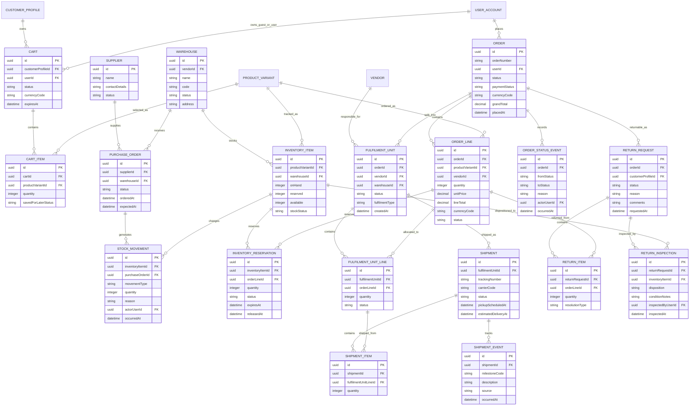

# Database ERD

**Project:** Task 2 — E-Commerce Marketplace  
**Source of truth:** `docs/requirements/Task_2_Complete_Ecommerce_Marketplace_Specification.pdf`  
**Canonical requirements:** [SRS.md](../requirements/SRS.md)  
**Related:** [SYSTEM-ARCHITECTURE.md](SYSTEM-ARCHITECTURE.md), [BUSINESS-RULES.md](../requirements/BUSINESS-RULES.md), [SECURITY-ARCHITECTURE.md](SECURITY-ARCHITECTURE.md)

## Scope and status

This is a **conceptual/logical ERD**. It defines entities, relationships, ownership, and integrity intent. It is not physical DDL, column sizing, partitioning, or a final normalized implementation schema.

| Status | Meaning |
|---|---|
| **Mandatory** | Required by the PDF or necessary for a required marketplace capability. |
| **Conditional** | Applies only if the relevant optional feature is selected. |
| **Decision required** | Exact values, rules, or scope remain unresolved in [SRS §12](../requirements/SRS.md#12-unresolved-decisions-and-items-to-confirm). |

---

## 1. Data design requirements

| ID | Requirement | Status | Cross-reference |
|---|---|---|---|
| DB-001 | PostgreSQL is the system of record. | Mandatory | [SRS DB-001](../requirements/SRS.md#8-data-api-and-integration-summary) |
| DB-002 | Model entities with primary keys, foreign keys, indexes, timestamps, status history, and appropriate uniqueness constraints. | Mandatory | [SRS DB-002](../requirements/SRS.md#8-data-api-and-integration-summary) |
| DB-003 | Minimise and protect sensitive data; never store raw card numbers or CVV. | Mandatory | [SEC-DATA-001](SECURITY-ARCHITECTURE.md), [SEC-PAY-001](SECURITY-ARCHITECTURE.md) |
| DB-004 | Use database transactions for checkout, stock reservation, payment-state transitions, and financial ledger operations. | Mandatory | [BR-INV-005](../requirements/BUSINESS-RULES.md), [AC-005](../requirements/ACCEPTANCE-CRITERIA.md) |
| DB-005 | Use idempotency keys for order creation, payment requests, refunds, webhook processing, and payout operations. | Mandatory | [API-IDEMP](API-DESIGN.md) |
| DB-006 | Store monetary values using fixed-precision decimals and explicit currency code; never use floating-point arithmetic for money. | Mandatory | [BR-FIN-001](../requirements/BUSINESS-RULES.md) |
| DB-007 | Preserve immutable financial ledger entries; correct errors with compensating entries. | Mandatory | [BR-FIN-002](../requirements/BUSINESS-RULES.md) |
| DB-008 | Maintain status/event histories for orders, payments, shipments, returns, vendor approvals, and products. | Mandatory | [BR-ORD-005](../requirements/BUSINESS-RULES.md) |
| DB-009 | Index common filters/joins, review query plans, and avoid unbounded list endpoints. | Mandatory | [API-003](API-DESIGN.md), [PERF-006](PERFORMANCE-STRATEGY.md) |
| DB-010 | Use soft deletion only where appropriate; retain financial and audit records according to policy and law. | Mandatory | [SEC-PRIV-004](SECURITY-ARCHITECTURE.md) |

---

## 2. Entity group index

| ID | Entity group | Covers |
|---|---|---|
| DB-ID | Identity, access and privacy | Users, roles, permissions, addresses, consents, data-subject requests, audit records, idempotency records. |
| DB-VEN | Vendor and seller | Vendor applications, verification state, staff, documents, bank references, store profile, status history. |
| DB-CAT | Catalogue | Categories, brands, collections, tags, attributes, products, variants, media, product groupings. |
| DB-CUST | Customer and engagement | Customer profiles, wishlist, recently viewed, reviews, segments, campaigns, notifications. |
| DB-PRICE | Pricing and promotions | Prices, promotions, coupons, promotion eligibility, price calculation audit records. |
| DB-CART | Cart | Carts and cart lines, including saved-for-later state. |
| DB-INV | Inventory and procurement | Warehouses, inventory items, reservations, stock movements, suppliers, purchase orders. |
| DB-ORD | Orders and fulfilment | Parent orders, order lines, fulfilment units, order events, invoices. |
| DB-SHIP | Shipping and logistics | Shipments, shipment items, carrier references, milestones and exceptions. |
| DB-RET | Returns and exchanges | Return requests, return items, inspection and disposition records. |
| DB-FIN | Finance and settlement | Payments, attempts, webhooks, refunds, ledger, commissions, settlements, payouts, credit notes. |
| DB-SUP | Support and disputes | Tickets, messages, disputes, SLA events. |
| DB-CONTENT | Content and SEO | Pages, banners, navigation, redirects, SEO metadata. |
| DB-OPS | Operational records | Feature flags, report exports, object references, notification events. |

---

## 3. Identity, vendor, catalogue and customer ERD

```mermaid
erDiagram
    USER_ACCOUNT ||--o{ USER_ROLE : has
    ROLE ||--o{ USER_ROLE : assigned_to
    ROLE ||--o{ ROLE_PERMISSION : includes
    PERMISSION ||--o{ ROLE_PERMISSION : granted_by
    USER_ACCOUNT ||--o{ ADDRESS : saves
    USER_ACCOUNT ||--o{ CONSENT_RECORD : records
    USER_ACCOUNT ||--o{ DATA_SUBJECT_REQUEST : submits
    USER_ACCOUNT ||--o| CUSTOMER_PROFILE : has
    USER_ACCOUNT ||--o| VENDOR : operates
    VENDOR ||--o{ VENDOR_STAFF : employs
    VENDOR ||--o{ VENDOR_DOCUMENT : submits
    VENDOR ||--o| BANK_ACCOUNT_REFERENCE : references
    VENDOR ||--o{ VENDOR_STATUS_EVENT : records
    VENDOR ||--o| STORE_PROFILE : configures
    CATEGORY ||--o{ CATEGORY : parent_of
    VENDOR ||--o{ PRODUCT : lists
    CATEGORY ||--o{ PRODUCT : categorizes
    BRAND ||--o{ PRODUCT : brands
    COLLECTION ||--o{ PRODUCT : groups
    TAG ||--o{ PRODUCT : tags
    PRODUCT ||--o{ PRODUCT_VARIANT : has
    PRODUCT ||--o{ PRODUCT_MEDIA : displays
    PRODUCT_VARIANT ||--o{ PRICE : priced_by
    CUSTOMER_PROFILE ||--o{ WISHLIST_ITEM : saves
    PRODUCT_VARIANT ||--o{ WISHLIST_ITEM : wishlisted_as
    CUSTOMER_PROFILE ||--o{ RECENTLY_VIEWED : tracks
    PRODUCT ||--o{ RECENTLY_VIEWED : viewed_as
    CUSTOMER_PROFILE ||--o{ REVIEW : writes
    PRODUCT ||--o{ REVIEW : reviewed_as
    VENDOR ||--o{ REVIEW : vendor_reviewed
    REVIEW ||--o{ REVIEW_MODERATION_EVENT : moderated_by
    SEGMENT ||--o{ CUSTOMER_SEGMENT_MEMBER : contains
    CUSTOMER_PROFILE ||--o{ CUSTOMER_SEGMENT_MEMBER : member_of

    USER_ACCOUNT {
        uuid id PK
        string email
        string phone
        string passwordHash
        string status
        datetime createdAt
        datetime updatedAt
    }
    ROLE {
        uuid id PK
        string code
        string scope
        string status
    }
    PERMISSION {
        uuid id PK
        string code
        string resource
        string action
    }
    USER_ROLE {
        uuid id PK
        uuid userId FK
        uuid roleId FK
        uuid vendorId FK
        datetime grantedAt
    }
    ROLE_PERMISSION {
        uuid id PK
        uuid roleId FK
        uuid permissionId FK
    }
    ADDRESS {
        uuid id PK
        uuid userId FK
        string addressType
        string line1
        string line2
        string city
        string region
        string postalCode
        string countryCode
        boolean isDefault
    }
    CONSENT_RECORD {
        uuid id PK
        uuid userId FK
        string purpose
        string channel
        string status
        datetime recordedAt
    }
    DATA_SUBJECT_REQUEST {
        uuid id PK
        uuid userId FK
        string requestType
        string status
        datetime requestedAt
    }
    CUSTOMER_PROFILE {
        uuid id PK
        uuid userId FK
        string displayName
        string status
        string loyaltyTier
        datetime createdAt
    }
    VENDOR {
        uuid id PK
        uuid ownerUserId FK
        string legalName
        string tradeName
        string applicationStatus
        string verificationStatus
        string accountStatus
        datetime createdAt
    }
    VENDOR_STAFF {
        uuid id PK
        uuid vendorId FK
        uuid userId FK
        string status
        datetime invitedAt
    }
    VENDOR_DOCUMENT {
        uuid id PK
        uuid vendorId FK
        string documentType
        string objectReference
        datetime expiresAt
        string verificationStatus
    }
    BANK_ACCOUNT_REFERENCE {
        uuid id PK
        uuid vendorId FK
        string providerToken
        string maskedAccount
        string verificationStatus
    }
    VENDOR_STATUS_EVENT {
        uuid id PK
        uuid vendorId FK
        string fromStatus
        string toStatus
        string reason
        uuid actorUserId FK
        datetime occurredAt
    }
    STORE_PROFILE {
        uuid id PK
        uuid vendorId FK
        string slug
        string description
        string policies
        string operatingHours
        string contactDetails
    }
    CATEGORY {
        uuid id PK
        uuid parentId FK
        string name
        string slug
        string status
    }
    BRAND {
        uuid id PK
        string name
        string slug
        string status
    }
    COLLECTION {
        uuid id PK
        string name
        string slug
        string status
    }
    TAG {
        uuid id PK
        string name
        string slug
    }
    PRODUCT {
        uuid id PK
        uuid vendorId FK
        uuid categoryId FK
        uuid brandId FK
        string title
        string slug
        string description
        string productType
        string status
        datetime createdAt
    }
    PRODUCT_VARIANT {
        uuid id PK
        uuid productId FK
        string sku
        string barcode
        string variantAttributes
        string status
    }
    PRODUCT_MEDIA {
        uuid id PK
        uuid productId FK
        string mediaType
        string objectReference
        string altText
        integer sortOrder
    }
    PRICE {
        uuid id PK
        uuid productVariantId FK
        decimal amount
        string currencyCode
        string priceType
        datetime effectiveFrom
        datetime effectiveTo
    }
    WISHLIST_ITEM {
        uuid id PK
        uuid customerProfileId FK
        uuid productVariantId FK
        datetime addedAt
    }
    RECENTLY_VIEWED {
        uuid id PK
        uuid customerProfileId FK
        uuid productId FK
        datetime viewedAt
    }
    REVIEW {
        uuid id PK
        uuid customerProfileId FK
        uuid productId FK
        uuid vendorId FK
        integer rating
        string title
        string body
        boolean verifiedPurchase
        string status
    }
    REVIEW_MODERATION_EVENT {
        uuid id PK
        uuid reviewId FK
        string action
        string reason
        uuid actorUserId FK
        datetime occurredAt
    }
    SEGMENT {
        uuid id PK
        string name
        string ruleDefinition
        string status
    }
    CUSTOMER_SEGMENT_MEMBER {
        uuid id PK
        uuid segmentId FK
        uuid customerProfileId FK
    }
```

**Entity notes**

- `BANK_ACCOUNT_REFERENCE` stores only protected/tokenized references and masked display data; raw account secrets are not stored in the marketplace database.
- `PRODUCT.productType` is constrained by [DEC-003](../requirements/SRS.md#12-unresolved-decisions-and-items-to-confirm).
- Product and vendor status histories are mandatory; exact transition values are pending [DEC-021](../requirements/SRS.md#12-unresolved-decisions-and-items-to-confirm).
- `CUSTOMER_PROFILE`, `SEGMENT`, and loyalty attributes depend on customer/marketing scope decisions in [DEC-016](../requirements/SRS.md#12-unresolved-decisions-and-items-to-confirm).

---

## 4. Cart, inventory, order, shipping and returns ERD

**Entity notes**

- `ORDER` is the customer-facing parent order. `FULFILMENT_UNIT` represents vendor/warehouse/shipment split units in [BR-ORD-002](../requirements/BUSINESS-RULES.md).
- Multiple warehouses, suppliers, purchase orders, and batch/lot/serial/expiry fields are conditional on [DEC-016](../requirements/SRS.md#12-unresolved-decisions-and-items-to-confirm) and [DEC-003](../requirements/SRS.md#12-unresolved-decisions-and-items-to-confirm).
- Exact status names and transitions for orders, fulfilment units, reservations, shipments, and returns require [DEC-021](../requirements/SRS.md#12-unresolved-decisions-and-items-to-confirm).
- Reservation uniqueness and expiry behaviour support [AC-005](../requirements/ACCEPTANCE-CRITERIA.md).

---

## 5. Pricing, finance, support, content and operations ERD

```mermaid
erDiagram
    PRODUCT_VARIANT ||--o{ PRICE_RULE : priced_by
    PROMOTION ||--o{ COUPON : issues
    PROMOTION ||--o{ PRICE_RULE : applies
    ORDER ||--o{ PRICE_CALCULATION_AUDIT : calculated_for
    ORDER ||--o{ PAYMENT : paid_by
    PAYMENT ||--o{ PAYMENT_ATTEMPT : attempted_with
    PAYMENT ||--o{ WEBHOOK_EVENT : updated_by
    PAYMENT ||--o{ REFUND : refunded_by
    PAYMENT ||--o{ LEDGER_ENTRY : records
    REFUND ||--o{ LEDGER_ENTRY : records
    ORDER ||--o{ INVOICE : invoiced_as
    INVOICE ||--o{ CREDIT_NOTE : adjusted_by
    VENDOR ||--o{ COMMISSION_CALCULATION : charged_for
    COMMISSION_CALCULATION ||--o{ LEDGER_ENTRY : records
    VENDOR ||--o{ SETTLEMENT : settled_for
    SETTLEMENT ||--o{ PAYOUT : paid_by
    LEDGER_ENTRY ||--o{ SETTLEMENT : included_in
    ORDER ||--o{ SUPPORT_TICKET : discussed_in
    VENDOR ||--o{ SUPPORT_TICKET : discussed_for
    SUPPORT_TICKET ||--o{ SUPPORT_MESSAGE : contains
    SUPPORT_TICKET ||--o{ DISPUTE : escalated_to
    SUPPORT_TICKET ||--o{ SLA_EVENT : tracks
    CONTENT_PAGE ||--o{ SEO_METADATA : described_by
    BANNER ||--o{ SEO_METADATA : described_by
    CONTENT_PAGE ||--o{ NAVIGATION_ITEM : linked_from
    REDIRECT ||--o{ CONTENT_PAGE : points_to
    NOTIFICATION_EVENT ||--o{ OBJECT_REFERENCE : renders
    REPORT_EXPORT ||--o| OBJECT_REFERENCE : downloadable_as

    PRICE_RULE {
        uuid id PK
        uuid productVariantId FK
        uuid promotionId FK
        string ruleType
        decimal amount
        string currencyCode
        datetime effectiveFrom
        datetime effectiveTo
    }
    PROMOTION {
        uuid id PK
        string name
        string status
        string eligibilityDefinition
        datetime startsAt
        datetime endsAt
    }
    COUPON {
        uuid id PK
        uuid promotionId FK
        string code
        string status
        integer usageLimit
        integer usageCount
    }
    PRICE_CALCULATION_AUDIT {
        uuid id PK
        uuid orderId FK
        string calculationContext
        decimal subtotal
        decimal discountTotal
        decimal taxTotal
        decimal shippingTotal
        decimal grandTotal
        string currencyCode
        datetime calculatedAt
    }
    PAYMENT {
        uuid id PK
        uuid orderId FK
        string provider
        string providerReference
        string status
        decimal amount
        string currencyCode
        datetime createdAt
    }
    PAYMENT_ATTEMPT {
        uuid id PK
        uuid paymentId FK
        string providerReference
        string status
        string failureCode
        datetime attemptedAt
    }
    WEBHOOK_EVENT {
        uuid id PK
        uuid paymentId FK
        string provider
        string providerEventId
        string eventType
        string signatureStatus
        string processingStatus
        datetime receivedAt
    }
    REFUND {
        uuid id PK
        uuid paymentId FK
        decimal amount
        string currencyCode
        string reason
        string status
        string providerReference
        datetime initiatedAt
    }
    LEDGER_ENTRY {
        uuid id PK
        uuid orderId FK
        uuid paymentId FK
        uuid refundId FK
        uuid vendorId FK
        string entryType
        decimal amount
        string currencyCode
        string direction
        datetime postedAt
    }
    INVOICE {
        uuid id PK
        uuid orderId FK
        string invoiceNumber
        string status
        decimal total
        string currencyCode
        datetime issuedAt
    }
    CREDIT_NOTE {
        uuid id PK
        uuid invoiceId FK
        string creditNoteNumber
        decimal amount
        string currencyCode
        string reason
        datetime issuedAt
    }
    COMMISSION_CALCULATION {
        uuid id PK
        uuid vendorId FK
        uuid orderLineId FK
        string planReference
        decimal amount
        string currencyCode
        string calculationBasis
        datetime calculatedAt
    }
    SETTLEMENT {
        uuid id PK
        uuid vendorId FK
        string periodReference
        string status
        decimal grossAmount
        decimal deductionAmount
        decimal netPayable
        string currencyCode
        datetime preparedAt
    }
    PAYOUT {
        uuid id PK
        uuid settlementId FK
        string status
        decimal amount
        string currencyCode
        string providerReference
        datetime approvedAt
    }
    SUPPORT_TICKET {
        uuid id PK
        uuid orderId FK
        uuid vendorId FK
        uuid requesterUserId FK
        string category
        string priority
        string status
        string escalationStatus
    }
    SUPPORT_MESSAGE {
        uuid id PK
        uuid ticketId FK
        uuid authorUserId FK
        string visibility
        string body
        datetime sentAt
    }
    DISPUTE {
        uuid id PK
        uuid ticketId FK
        string disputeType
        string status
        string resolutionCode
        datetime openedAt
    }
    SLA_EVENT {
        uuid id PK
        uuid ticketId FK
        string milestone
        string status
        datetime dueAt
        datetime occurredAt
    }
    CONTENT_PAGE {
        uuid id PK
        string slug
        string title
        string body
        string status
    }
    BANNER {
        uuid id PK
        string name
        string placement
        string status
        string objectReference
    }
    NAVIGATION_ITEM {
        uuid id PK
        uuid contentPageId FK
        string label
        string target
        integer sortOrder
    }
    REDIRECT {
        uuid id PK
        string fromPath
        string toPath
        string status
    }
    SEO_METADATA {
        uuid id PK
        string entityType
        uuid entityId
        string title
        string description
        string canonicalUrl
        string structuredData
    }
    IDEMPOTENCY_RECORD {
        string scope PK
        string idempotencyKey PK
        string requestFingerprint
        string status
        string responseReference
        datetime createdAt
    }
    FEATURE_FLAG {
        uuid id PK
        string code
        string scope
        boolean enabled
        string configuration
    }
    NOTIFICATION_EVENT {
        uuid id PK
        string channel
        string templateCode
        string recipientReference
        string status
        datetime queuedAt
    }
    REPORT_EXPORT {
        uuid id PK
        uuid requestedByUserId FK
        string reportType
        string filterDefinition
        string status
        datetime requestedAt
    }
    OBJECT_REFERENCE {
        uuid id PK
        string provider
        string objectKey
        string mimeType
        string accessLevel
        datetime createdAt
    }
```

**Entity notes**

- `LEDGER_ENTRY` is append-only. Corrections are compensating entries per [BR-FIN-002](../requirements/BUSINESS-RULES.md).
- Money fields require `currencyCode` and fixed-precision decimal storage per DB-006.
- `WEBHOOK_EVENT.providerEventId` and `IDEMPOTENCY_RECORD` support duplicate/replay protection per DB-005 and [API-WH-001](API-DESIGN.md).
- Commission, payout, credit-note, and reconciliation values are not assumed; see [DEC-006](../requirements/SRS.md#12-unresolved-decisions-and-items-to-confirm) and [DEC-022](../requirements/SRS.md#12-unresolved-decisions-and-items-to-confirm).
- `FEATURE_FLAG` and conditional entity usage must follow [DEC-016](../requirements/SRS.md#12-unresolved-decisions-and-items-to-confirm).

---

## 6. Logical integrity rules

| ID | Rule | Status |
|---|---|---|
| DB-CON-001 | Every entity has a primary key; every cross-entity reference uses a foreign key unless the referenced system is external and represented by a provider reference. | Mandatory |
| DB-CON-002 | SKU uniqueness is scoped by vendor and product variant rules to be confirmed. | Mandatory intent; exact uniqueness scope decision required |
| DB-CON-003 | A user may have multiple addresses, with at most one default address per address type. | Mandatory |
| DB-CON-004 | Vendor status changes are appended to `VENDOR_STATUS_EVENT`; current status is mirrored on `VENDOR` for reads. | Mandatory |
| DB-CON-005 | A product becomes publicly visible only when its status and moderation state are approved/published according to the defined state machine. | Mandatory; exact transitions decision required |
| DB-CON-006 | A cart line quantity must satisfy catalogue and inventory quantity rules. | Mandatory |
| DB-CON-007 | Inventory reservation quantity must not exceed available stock when committed. | Mandatory |
| DB-CON-008 | A parent order may have one or more fulfilment units; every fulfilment unit belongs to one parent order. | Mandatory |
| DB-CON-009 | Shipment items must reference lines from the same fulfilment unit. | Mandatory |
| DB-CON-010 | Return items must reference eligible lines from the related order. | Mandatory |
| DB-CON-011 | Payment, refund, commission, settlement, payout, invoice, and credit-note amounts use explicit currency codes. | Mandatory |
| DB-CON-012 | Financial ledger rows cannot be updated or deleted; compensating rows are inserted. | Mandatory |
| DB-CON-013 | Webhook events are unique by provider and provider event ID. | Mandatory |
| DB-CON-014 | Idempotency scope plus key is unique; request fingerprint mismatches are rejected. | Mandatory |
| DB-CON-015 | Sensitive fields are minimised, encrypted/tokenized as appropriate, and excluded from general list endpoints. | Mandatory |
| DB-CON-016 | Audit records are append-only and linked to actor, action, target, time, and outcome. | Mandatory |
| DB-CON-017 | Soft deletion is used for user-facing catalogue/content records where appropriate, but not for financial or audit records. | Mandatory |
| DB-CON-018 | Optional entities such as warehouses, purchase orders, loyalty data, and batch/serial attributes are activated only when confirmed in scope. | Conditional |

---

## 7. Transaction boundaries

| ID | Transaction | Atomic work | Cross-reference |
|---|---|---|---|
| DB-TX-001 | Order creation | Validate cart, recalculate server totals, create parent order/lines, reserve inventory, persist idempotency record, queue post-commit side effects. | [AC-001](../requirements/ACCEPTANCE-CRITERIA.md), [AC-005](../requirements/ACCEPTANCE-CRITERIA.md) |
| DB-TX-002 | Reservation release/expiry | Mark reservation released and restore availability exactly once. | [BR-CHK-006](../requirements/BUSINESS-RULES.md) |
| DB-TX-003 | Payment status update | Persist webhook event, deduplicate, update payment status and order payment state consistently. | [AC-006](../requirements/ACCEPTANCE-CRITERIA.md) |
| DB-TX-004 | Refund | Update refund status and append ledger entries only once per provider event/idempotency key. | [AC-007](../requirements/ACCEPTANCE-CRITERIA.md) |
| DB-TX-005 | Commission and settlement preparation | Calculate commission results, append ledger entries, create settlement snapshot. | [AC-008](../requirements/ACCEPTANCE-CRITERIA.md) |
| DB-TX-006 | Return disposition | Update return status, inspection, inventory disposition, and linked refund/replacement intent. | [AC-007](../requirements/ACCEPTANCE-CRITERIA.md) |
| DB-TX-007 | Vendor status change | Update vendor status and append status event with reason and actor. | [AC-002](../requirements/ACCEPTANCE-CRITERIA.md) |
| DB-TX-008 | Product moderation | Update product status and append moderation/status event. | [AC-003](../requirements/ACCEPTANCE-CRITERIA.md) |

---

## 8. Index and query intent

| ID | Query pattern | Index intent | Cross-reference |
|---|---|---|---|
| DB-IDX-001 | Product discovery by category, brand, vendor, status, price, rating, and availability. | Composite indexes on catalogue filters; search index when needed. | [FR-DISC-003](../requirements/SRS.md#34-storefront-search--product-discovery), [PERF-004](PERFORMANCE-STRATEGY.md) |
| DB-IDX-002 | SKU/barcode lookup. | Unique or near-unique indexes scoped by vendor/product rules. | [FR-CAT-005](../requirements/SRS.md#31-product-catalogue--product-listing) |
| DB-IDX-003 | Inventory availability by variant and location. | Indexes on variant, warehouse, status, and available quantity. | [FR-INV-001](../requirements/SRS.md#38-inventory-procurement--warehouse) |
| DB-IDX-004 | Order lookup by user, order number, status, vendor, and placed date. | Composite indexes for customer and operational views. | [FR-ORD-001](../requirements/SRS.md#39-order-management--fulfilment) |
| DB-IDX-005 | Fulfilment and shipment queues by status and vendor/warehouse. | Indexes on status, vendor, warehouse, and due/estimated dates. | [FR-ORD-008](../requirements/SRS.md#39-order-management--fulfilment) |
| DB-IDX-006 | Payment and webhook reconciliation by provider reference/event ID/status. | Unique and lookup indexes. | [FR-PAY-003](../requirements/SRS.md#37-payments-refunds--finance) |
| DB-IDX-007 | Ledger and settlement queries by vendor, period, entry type, and currency. | Indexes on vendor, posted date, entry type, and settlement reference. | [FR-PAY-005](../requirements/SRS.md#37-payments-refunds--finance) |
| DB-IDX-008 | Support ticket queues by status, priority, assignee, and SLA due time. | Indexes on queue fields. | [FR-SUP-006](../requirements/SRS.md#315-customer-support--disputes) |
| DB-IDX-009 | Audit queries by actor, action, target, and time range. | Indexes on actor, target, and timestamp. | [SEC-AUDIT-001](SECURITY-ARCHITECTURE.md) |
| DB-IDX-010 | Idempotency and webhook deduplication. | Unique indexes on scope/key and provider/event ID. | [API-IDEMP](API-DESIGN.md) |

---

## 9. Retention, privacy and lifecycle

| ID | Data category | Lifecycle intent | Status |
|---|---|---|---|
| DB-RET-001 | User-facing catalogue/content records | Soft delete/deactivate where appropriate; preserve public URL/redirect behaviour where SEO is relevant. | Mandatory |
| DB-RET-002 | Orders, invoices, payments, refunds, ledger, settlements, payouts, tax records | Retain according to policy and law; never hard-delete for convenience. | Mandatory; retention periods decision required |
| DB-RET-003 | Audit and security records | Retain auth audit events for `1 year` under G4; retain other security records according to policy and protect from modification. | Mandatory; non-auth retention periods decision required |
| DB-RET-004 | Consent records | Retain evidence of consent and withdrawal timestamps according to privacy obligations. | Mandatory |
| DB-RET-008 | Login history records | Retain login history for `90 days` under G4; never store passwords, OTPs, or raw tokens. | Mandatory |
| DB-RET-009 | Revoked session metadata | Retain revoked session metadata for `90 days` under G4; active session state remains authoritative in Redis. | Mandatory |
| DB-RET-005 | Data-subject export/deletion requests | Track request, decision, execution evidence, and actor. | Mandatory |
| DB-RET-006 | Sensitive vendor documents and bank references | Restrict access, track expiry, tokenize/protect, and remove or archive according to policy. | Mandatory |
| DB-RET-007 | Carts, recently viewed, temporary reservations, webhook payloads | Short-lived lifecycle with cleanup after purpose is satisfied, except where reconciliation evidence is required. | Mandatory intent; exact periods decision required |

---

## 10. Unresolved data-model decisions

| ID | Decision needed | Impact on ERD |
|---|---|---|
| DEC-003 | Product types and subscription/service/digital scope. | Product attributes, fulfilment, inventory, tax, and recurring fields. |
| DEC-004 | Payment provider and settlement capability. | Payment/refund/payout fields and provider references. |
| DEC-005 | Shipping model. | Shipment/carrier references, webhook milestones, and rate objects. |
| DEC-006 | Commission, settlement, reserve/holdback, dispute policy. | Commission calculation, ledger, settlement, payout, and credit-note rules. |
| DEC-011 | Dedicated operational portals or admin subareas. | Role/permission scoping and staff-user relationships. |
| DEC-012 | Guest checkout policy. | Resolved by G5: guest checkout allowed; eligible guest orders associate after verified registration; exact eligibility rules remain to be documented. |
| DEC-016 | Conditional feature launch scope. | Warehouse, procurement, loyalty, gifting, wallet, subscription, B2B, and multi-warehouse entities. |
| DEC-018 | PCI DSS responsibility boundary. | Which payment data/reference fields are permissible. |
| DEC-020 | Retention and recovery numeric targets. | Auth retention values resolved by G4; other retention/recovery targets remain decision-required. |
| DEC-021 | Exact state machines. | Status value domains and event transition rules. |
| DEC-022 | Duplicate-listing and reconciliation rules. | Duplicate detection fields and ledger matching evidence. |

## 11. Approved G1–G8 data-model addendum

The auth baseline is detailed in `docs/audits/AUTHENTICATION-IMPLEMENTATION-PLAN.md`. Existing ERD IDs remain unchanged.

| Gate | Data-model effect |
|---|---|
| G1 | Persist role-level MFA policy and encrypted TOTP/recovery-code data; Delivery/Logistics policy is configurable and audited. |
| G2 | Add opaque session, device, CSRF, and Redis-backed active-session metadata with PostgreSQL history/revocation records. |
| G3 | Store email verification state so backend guards can enforce the restricted-session allowlist. |
| G4 | Apply approved TTLs, lockout counters, resend limits, recovery-code count `10`, and retention periods for login history `90 days`, audit events `1 year`, and revoked session metadata `90 days`. |
| G5 | Add secure `GuestIdentity` and verified guest-order association records; never use unverified email as a merge key. |
| G6 | Add `ExternalIdentityLink` keyed by provider and verified provider subject with explicit linking metadata. |
| G7 | The separate admin portal shares the same PostgreSQL user, role, permission, session, and audit tables. |
| G8 | Prisma migrations and pnpm workspace layout implement the baseline; no destructive production migration. |
