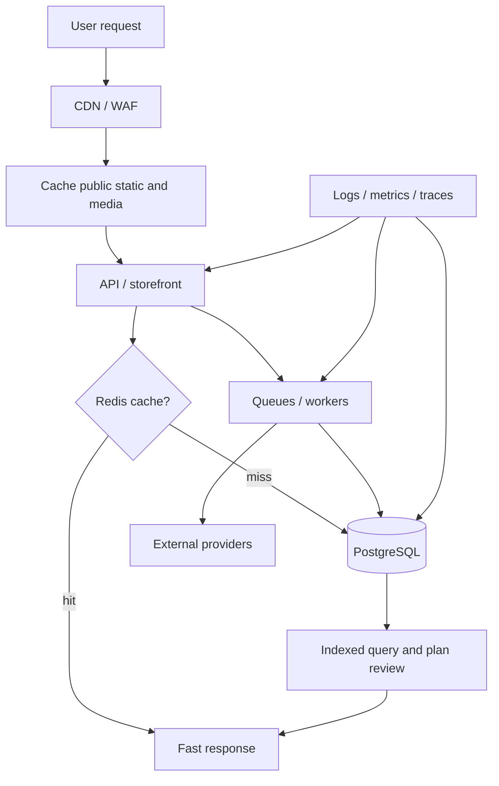

# Performance Strategy

**Project:** Task 2 — E-Commerce Marketplace  
**Source of truth:** `docs/requirements/Task_2_Complete_Ecommerce_Marketplace_Specification.pdf`  
**Canonical requirements:** [SRS.md](../requirements/SRS.md)  
**Related:** [SYSTEM-ARCHITECTURE.md](SYSTEM-ARCHITECTURE.md), [DATABASE-ERD.md](DATABASE-ERD.md), [API-DESIGN.md](API-DESIGN.md), [ACCEPTANCE-CRITERIA.md](../requirements/ACCEPTANCE-CRITERIA.md)

## Status vocabulary

| Status | Meaning |
|---|---|
| **Mandatory** | Required by the PDF or necessary for a reliable marketplace launch. |
| **Recommendation** | Recommended engineering approach, not a confirmed numeric target. |
| **Decision required** | Numeric target, topology, capacity input, or SLO is unresolved. See [SRS §12](../requirements/SRS.md#12-unresolved-decisions-and-items-to-confirm). |

> The PDF labels performance, availability, RPO/RTO, and related numbers as targets to agree. This document defines the strategy and decision gates but does not invent numeric pass/fail values.

---

## 1. Performance and reliability requirements

| ID | Area | Requirement | Status | Cross-reference |
|---|---|---|---|---|
| PERF-001 | Performance targets | Define measurable page and API latency targets for key journeys. | Decision required | [NFR-PERF-001](../requirements/SRS.md#5-non-functional-requirements), [DEC-020](../requirements/SRS.md#12-unresolved-decisions-and-items-to-confirm) |
| PERF-002 | Frontend and query optimization | Optimize Core Web Vitals, caching, image delivery, and database queries. | Mandatory | [NFR-PERF-002](../requirements/SRS.md#5-non-functional-requirements) |
| PERF-003 | Capacity model | Define expected vendors, SKUs, monthly orders, peak concurrent users, and growth forecast before load testing. | Decision required | [DEC-008](../requirements/SRS.md#12-unresolved-decisions-and-items-to-confirm) |
| PERF-004 | Search performance | Keep catalogue discovery and search responsive as catalogue size grows; define search quality/latency targets. | Mandatory intent; targets decision required | [FR-DISC-002](../requirements/SRS.md#34-storefront-search--product-discovery), [DEC-023](../requirements/SRS.md#12-unresolved-decisions-and-items-to-confirm) |
| PERF-005 | Scalability | Support growth in users, products, vendors, and concurrent orders through scalable architecture and tested capacity plans. | Mandatory | [NFR-SCAL-001](../requirements/SRS.md#5-non-functional-requirements) |
| PERF-006 | Database efficiency | Index common filters/joins, review query plans, avoid unbounded endpoints, and keep checkout/stock transactions short. | Mandatory | [DB-009](../requirements/SRS.md#8-data-api-and-integration-summary), [DB-IDX-*](DATABASE-ERD.md) |
| PERF-007 | Availability and recovery | Define uptime objective, maintenance windows, failover design, backups, RPO/RTO, and service dependency strategy. | Decision required | [NFR-AVAIL-001](../requirements/SRS.md#5-non-functional-requirements), [DEC-009](../requirements/SRS.md#12-unresolved-decisions-and-items-to-confirm), [DEC-019](../requirements/SRS.md#12-unresolved-decisions-and-items-to-confirm), [DEC-020](../requirements/SRS.md#12-unresolved-decisions-and-items-to-confirm) |
| PERF-008 | Observability | Centralize structured logs, metrics, traces, dashboards, and actionable alerts for performance and reliability. | Mandatory | [NFR-OBS-001](../requirements/SRS.md#5-non-functional-requirements), [DEP-007](../requirements/SRS.md#11-devops-environments-and-deployment) |
| PERF-009 | Reliability mechanisms | Use transactions, retries with backoff, idempotency, queue monitoring, graceful degradation, and dead-letter handling. | Mandatory | [NFR-REL-001](../requirements/SRS.md#5-non-functional-requirements), [ARC-ASYNC](SYSTEM-ARCHITECTURE.md) |
| PERF-010 | Performance testing | Load test expected peak traffic for search, browse, checkout, flash sales, and concurrent inventory updates. | Mandatory | [QA-007](../requirements/SRS.md#10-testing-and-quality-assurance), [AC-QA-005](../requirements/ACCEPTANCE-CRITERIA.md) |

**QA ID note:** [SRS §10](../requirements/SRS.md#10-testing-and-quality-assurance) defines `QA-007` as performance testing. Performance test acceptance is covered by [AC-QA-005](../requirements/ACCEPTANCE-CRITERIA.md).

---

## 2. Strategy overview

| Layer | Performance treatment | Status |
|---|---|---|
| Client/storefront | SSR/SSG where appropriate, code splitting, image optimization, Core Web Vitals review, accessible responsive components. | Recommendation |
| CDN/edge | Public media/static assets and cacheable public pages where safe. | Recommendation |
| API | Connection pooling, bounded request sizes, pagination, validation, correlation IDs, and cache controls. | Mandatory |
| Cache | Redis for safe read-through caching, rate limiting, and short-lived operational state. | Recommendation |
| Database | Indexes, query-plan review, transaction discipline, fixed-precision money columns, no unbounded queries. | Mandatory |
| Search | PostgreSQL full-text initially; dedicated search index when threshold is reached. | Conditional; threshold pending DEC-015 |
| Async | Queues for notifications, indexing, invoices, exports, webhooks, and scheduled cleanup. | Mandatory |
| Integrations | Timeouts, bounded retries, circuit/fallback behaviour, reconciliation, and provider-status monitoring. | Mandatory |
| Observability | SLO dashboards, error rates, latency histograms, queue depth, DB health, provider failures. | Mandatory; SLOs pending DEC-009/DEC-020 |

---

## 3. Performance targets framework

| ID | Metric area | Target-setting requirement | Status |
|---|---|---|---|
| PERF-TGT-001 | Storefront page responsiveness | Define targets for homepage, category, search, product detail, cart, and checkout pages. | Decision required |
| PERF-TGT-002 | API latency | Define percentiles for product listing, search, cart, quote, order creation, payment status, and order history endpoints. | Decision required |
| PERF-TGT-003 | Search quality and speed | Define typo tolerance, synonym, relevance, and latency acceptance thresholds. | Decision required |
| PERF-TGT-004 | Checkout throughput | Define expected order creation/payment peak and acceptable degradation behaviour. | Decision required |
| PERF-TGT-005 | Inventory contention | Define acceptable behaviour when many users reserve the same SKU; no oversell beyond configured rules. | Mandatory behaviour; thresholds decision required |
| PERF-TGT-006 | Background processing | Define acceptable queue backlog and staleness limits for notifications, indexing, exports, and invoice generation. | Decision required |
| PERF-TGT-007 | Availability | Define uptime, maintenance windows, failover, and dependency-degradation objectives. | Decision required |
| PERF-TGT-008 | Recovery | Define RPO/RTO, backup frequency, retention, and restore drill cadence. | Decision required |
| PERF-TGT-009 | Browser/mobile | Define supported browsers, breakpoints, and device performance expectations. | Decision required |

All targets above require [DEC-008](../requirements/SRS.md#12-unresolved-decisions-and-items-to-confirm), [DEC-009](../requirements/SRS.md#12-unresolved-decisions-and-items-to-confirm), [DEC-020](../requirements/SRS.md#12-unresolved-decisions-and-items-to-confirm), or [DEC-023](../requirements/SRS.md#12-unresolved-decisions-and-items-to-confirm).

---

## 4. Capacity planning

| ID | Input | Needed from | Used for |
|---|---|---|---|
| PERF-CAP-001 | Expected vendors, SKUs, and catalogue growth. | [DEC-008](../requirements/SRS.md#12-unresolved-decisions-and-items-to-confirm) | Database sizing, search strategy, cache sizing. |
| PERF-CAP-002 | Monthly orders and peak order rate. | [DEC-008](../requirements/SRS.md#12-unresolved-decisions-and-items-to-confirm) | Checkout throughput, queue sizing, database write capacity. |
| PERF-CAP-003 | Peak concurrent users. | [DEC-008](../requirements/SRS.md#12-unresolved-decisions-and-items-to-confirm) | Load-test scenarios, web/API scaling. |
| PERF-CAP-004 | Growth forecast. | [DEC-008](../requirements/SRS.md#12-unresolved-decisions-and-items-to-confirm) | Scaling plan and service-extraction triggers. |
| PERF-CAP-005 | Hosting preference, budget, team, timeline, support model. | [DEC-009](../requirements/SRS.md#12-unresolved-decisions-and-items-to-confirm) | Topology and operational model. |
| PERF-CAP-006 | Load balancer, autoscaling, failover topology. | [DEC-019](../requirements/SRS.md#12-unresolved-decisions-and-items-to-confirm) | Availability and scalability design. |

**Capacity outputs to produce after decisions**

- Load-test scenarios and target concurrency.
- Cache and queue sizing assumptions.
- Database connection and storage plan.
- Search index migration trigger.
- Auto-scaling and failover plan.
- Alert thresholds and escalation paths.
- Service extraction triggers documented in ADRs.

---

## 5. Frontend and storefront performance

| ID | Technique | Requirement | Status |
|---|---|---|---|
| PERF-FE-001 | Core Web Vitals tracking | Instrument LCP, INP/responsiveness, CLS, and related agreed metrics for key pages. | Mandatory |
| PERF-FE-002 | Image delivery | Use optimized formats, responsive sizes, lazy loading, CDN delivery, and alt text. | Mandatory |
| PERF-FE-003 | Rendering strategy | Use server rendering/static generation where it improves SEO and perceived performance. | Recommendation |
| PERF-FE-004 | Bundle control | Split code by route/feature and avoid shipping admin/vendor code to public storefront users. | Recommendation |
| PERF-FE-005 | Public cache headers | Define cacheability for public content, product media, and private/account responses. | Mandatory |
| PERF-FE-006 | Checkout responsiveness | Show immediate client feedback while relying on server-calculated totals and idempotent submission. | Mandatory |
| PERF-FE-007 | Accessibility interaction | Maintain accessible loading, error, focus, and validation states under slow conditions. | Mandatory |

---

## 6. API and caching strategy

| ID | Cache/API concern | Approach | Status |
|---|---|---|---|
| PERF-CACHE-001 | Catalogue reads | Cache safe public catalogue/category/content reads with explicit invalidation on publish/status changes. | Recommendation |
| PERF-CACHE-002 | Search results | Cache common query/facet result shapes only where correctness and personalization rules permit. | Recommendation; personalization pending DEC-016 |
| PERF-CACHE-003 | Session/auth | Use secure, short-lived session/token state according to final auth design. | Mandatory |
| PERF-CACHE-004 | Rate limiting | Use Redis-backed rate limiting once numeric limits are agreed. | Mandatory intent; limits pending DEC-020 |
| PERF-CACHE-005 | Idempotency records | Store idempotency records durably, not only in transient cache. | Mandatory |
| PERF-CACHE-006 | Inventory | Do not cache authoritative availability without a controlled freshness/invalidation strategy. | Mandatory |
| PERF-CACHE-007 | Cart/checkout | Cache only non-authoritative UI state; totals and stock commitments remain server-side. | Mandatory |
| PERF-CACHE-008 | Object storage/CDN | Serve public media through CDN; use signed URLs for private documents. | Mandatory |

**Invalidation triggers**

| Trigger | Affected cache |
|---|---|
| Product moderation/publish status change | Product detail, category listing, search documents, homepage groupings. |
| Price/promotion change | Product listing, quote context, cart display. |
| Inventory reservation/release/sale | Availability display, stock status, search facets where present. |
| Content/campaign change | Homepage, banners, navigation, static pages, sitemap inputs. |
| Vendor suspension/termination | Vendor storefront, product visibility, search results. |
| Feature flag/configuration change | Client capability flags and affected module configuration caches. |

---

## 7. Database performance

| ID | Practice | Requirement | Status |
|---|---|---|---|
| PERF-DB-001 | Index common filters/joins using [DB-IDX-*](DATABASE-ERD.md). | Mandatory |
| PERF-DB-002 | Review query plans for product search, order queues, inventory lookup, ledger reports, and audit search. | Mandatory |
| PERF-DB-003 | Avoid unbounded list endpoints; require pagination and allow-listed filters. | Mandatory |
| PERF-DB-004 | Keep checkout, reservation, payment-state, refund, and ledger transactions short and deterministic. | Mandatory |
| PERF-DB-005 | Use fixed-precision decimal money columns and explicit currency codes. | Mandatory |
| PERF-DB-006 | Keep immutable ledger appends efficient and protect them from updates. | Mandatory |
| PERF-DB-007 | Separate or index reporting reads if dashboards impact transactional work. | Recommendation |
| PERF-DB-008 | Monitor connections, slow queries, locks, replication lag where applicable, and database health. | Mandatory |
| PERF-DB-009 | Test backup/restore performance once RPO/RTO are agreed. | Mandatory; targets pending DEC-020 |

---

## 8. Search performance and scaling

| ID | Approach | Requirement | Status |
|---|---|---|---|
| PERF-SEARCH-001 | Start with PostgreSQL full-text where sufficient. | Recommendation | [TEC-010](../requirements/SRS.md#6-recommended-technology-stack) |
| PERF-SEARCH-002 | Move to OpenSearch/Elasticsearch when the agreed threshold is reached. | Conditional; threshold pending DEC-015 |
| PERF-SEARCH-003 | Update search documents on approved product visibility changes. | Mandatory |
| PERF-SEARCH-004 | Keep facets/filters aligned with API contracts and indexed fields. | Mandatory |
| PERF-SEARCH-005 | Define typo tolerance, synonym, and relevance targets. | Decision required | [DEC-023](../requirements/SRS.md#12-unresolved-decisions-and-items-to-confirm) |
| PERF-SEARCH-006 | Avoid exposing stale product visibility after moderation or vendor suspension. | Mandatory |

---

## 9. Checkout, inventory and flash-sale resilience

| ID | Concern | Strategy | Status |
|---|---|---|---|
| PERF-CHK-001 | Duplicate submits | Require idempotency keys and duplicate-click protection. | Mandatory |
| PERF-CHK-002 | Stock contention | Atomic reservation, expiry/release, and controlled oversell rules. | Mandatory; rules pending DEC-021 |
| PERF-CHK-003 | Provider latency | Timeouts, bounded retries, status polling, and verified webhooks. | Mandatory |
| PERF-CHK-004 | Queue spikes | Queue non-critical checkout side effects after commit; monitor backlog. | Mandatory |
| PERF-CHK-005 | Graceful failure | Show accurate pending/failed states; do not claim success before verified payment. | Mandatory |
| PERF-CHK-006 | Flash sales | Define load scenarios and degradation strategy once capacity inputs are known. | Decision required |
| PERF-CHK-007 | Cart expiry | Clean stale carts/reservations on a schedule. | Mandatory intent; durations pending DEC-020 |

---

## 10. Asynchronous throughput and reliability

| ID | Concern | Strategy | Status |
|---|---|---|---|
| PERF-ASYNC-001 | Queue backlog | Monitor depth, age, processing rate, and oldest job age. | Mandatory |
| PERF-ASYNC-002 | Retry policy | Bounded retries with exponential backoff and jitter. | Mandatory |
| PERF-ASYNC-003 | Dead-letter queue | Route unprocessable jobs to an inspectable DLQ with replay where safe. | Mandatory |
| PERF-ASYNC-004 | Webhook volume | Persist event first, process idempotently, deduplicate by provider event ID. | Mandatory |
| PERF-ASYNC-005 | Notifications | Queue by channel/provider; respect consent and provider limits. | Mandatory |
| PERF-ASYNC-006 | Exports/invoices/status jobs | Run asynchronously and expose progress/download references. | Mandatory |
| PERF-ASYNC-007 | Scheduling | Coordinate scheduled tasks to avoid duplicate execution. | Mandatory |

---

## 11. Availability, failover and recovery

| ID | Area | Strategy | Status |
|---|---|---|---|
| PERF-AVAIL-001 | Uptime objective | Define SLO after hosting, budget, support model, and dependency review. | Decision required |
| PERF-AVAIL-002 | Maintenance windows | Agree windows and communication approach. | Decision required |
| PERF-AVAIL-003 | Failover topology | Decide load balancer, autoscaling, and failover design. | Decision required | [DEC-019](../requirements/SRS.md#12-unresolved-decisions-and-items-to-confirm) |
| PERF-AVAIL-004 | Dependency degradation | Continue safe browsing where possible; queue notifications; expose provider outages accurately. | Mandatory |
| PERF-AVAIL-005 | Backups | Automated database backups, encrypted storage, controlled retention. | Mandatory |
| PERF-AVAIL-006 | PITR | Point-in-time recovery where supported by provider and decision. | Conditional |
| PERF-AVAIL-007 | Restore drills | Test restoration in a non-production environment before launch and on agreed cadence. | Mandatory |
| PERF-AVAIL-008 | RPO/RTO | Define and verify recovery objectives. | Decision required |

---

## 12. Observability and alerting

| ID | Signal | Requirement | Status |
|---|---|---|---|
| PERF-OBS-001 | Latency | Track page/API latency by key endpoint and journey. | Mandatory |
| PERF-OBS-002 | Errors | Track HTTP error rates, validation failures, business-rule failures, and unhandled exceptions. | Mandatory |
| PERF-OBS-003 | Saturation | Track CPU/memory, DB connections, queue depth, cache health, and provider rate limits. | Mandatory |
| PERF-OBS-004 | Traffic | Track requests/search/checkout rates by surface and endpoint family. | Mandatory |
| PERF-OBS-005 | Provider health | Track payment, shipping, tax, email, and SMS success/failure and latency. | Mandatory |
| PERF-OBS-006 | Business critical events | Alert on payment failures, webhook failures, stuck orders, oversell conflicts, queue backlog, and reconciliation exceptions. | Mandatory |
| PERF-OBS-007 | Correlation | Propagate request/correlation IDs through APIs, logs, traces, queues, and provider adapters. | Mandatory |
| PERF-OBS-008 | Dashboards | Provide operational dashboards for storefront, vendor/admin portal, API, database, queues, and integrations. | Mandatory |
| PERF-OBS-009 | SLO alerts | Alert against agreed SLOs once DEC-009/DEC-020 are resolved. | Decision required |

---

## 13. Testing strategy

| ID | Test type | Scope | Acceptance | Status |
|---|---|---|---|---|
| PERF-TEST-001 | Baseline | Key page and API timings under nominal conditions. | AC-QA-005 | Mandatory once targets exist |
| PERF-TEST-002 | Load | Expected concurrent users, browsing, search, cart, and checkout. | AC-QA-005 | Mandatory |
| PERF-TEST-003 | Stress | Push beyond expected load to identify breaking points and degradation. | AC-QA-005 | Recommendation |
| PERF-TEST-004 | Spike/flash sale | Sudden traffic to product detail, checkout, and reservation paths. | AC-QA-005 | Mandatory where flash sales are in scope |
| PERF-TEST-005 | Concurrency | Concurrent inventory reservation, idempotent order submit, webhook duplicates. | AC-005, AC-006 | Mandatory |
| PERF-TEST-006 | Endurance | Sustained load for memory leaks, queue growth, and connection leaks. | AC-QA-005 | Recommendation |
| PERF-TEST-007 | Failover/restore | Restore drill and dependency failure behaviour. | LAUNCH-010, PERF-AVAIL-008 | Mandatory |
| PERF-TEST-008 | Frontend | Core Web Vitals, responsive breakpoints, browser compatibility. | AC-QA-005, AC-ACC-001 | Mandatory |

**Test exit rule:** performance tests cannot receive a final pass/fail result until numeric targets from [DEC-008](../requirements/SRS.md#12-unresolved-decisions-and-items-to-confirm), [DEC-009](../requirements/SRS.md#12-unresolved-decisions-and-items-to-confirm), [DEC-020](../requirements/SRS.md#12-unresolved-decisions-and-items-to-confirm), and [DEC-023](../requirements/SRS.md#12-unresolved-decisions-and-items-to-confirm) are agreed and recorded.

---

## 14. Scaling and extraction triggers

| ID | Trigger candidate | Possible response | Status |
|---|---|---|---|
| PERF-SCALE-001 | Search traffic/catalogue size exceeds agreed threshold. | Introduce dedicated search index and async indexing. | Conditional; threshold pending DEC-015 |
| PERF-SCALE-002 | Reporting queries affect transactions. | Introduce read models/reporting store. | Conditional |
| PERF-SCALE-003 | Notification volume affects core API. | Scale workers independently or extract notification service. | Conditional |
| PERF-SCALE-004 | Webhook/payment load requires isolation. | Separate webhook processing deployment unit. | Conditional; compliance boundary pending DEC-018 |
| PERF-SCALE-005 | Checkout peak requires independent scaling. | Extract checkout/order processing behind stable APIs while preserving transactional rules. | Conditional |
| PERF-SCALE-006 | Multi-region demand confirmed. | Evaluate regional deployment, data residency, and localization. | Conditional; scope pending DEC-016/DEC-024 |

Extraction triggers are recorded in ADRs per [ARC-ADR](SYSTEM-ARCHITECTURE.md). No extraction is assumed for the initial modular monolith baseline.

---

## 15. Performance decision gates

| ID | Decision needed | Blocks |
|---|---|---|
| DEC-008 | Capacity inputs. | Load scenarios, sizing, thresholds. |
| DEC-009 | Hosting, budget, team, timeline, support model, SLOs. | Infrastructure plan, support and availability model. |
| DEC-015 | Search migration threshold. | Search architecture and index plan. |
| DEC-016 | Conditional launch scope. | Mobile, loyalty, multi-warehouse, B2B, and advanced feature load. |
| DEC-019 | Load balancer, autoscaling, failover topology. | Availability design. |
| DEC-020 | Numeric performance, availability, RPO/RTO, retention, breakpoints. | Auth retention/TTL values resolved by G4; other thresholds remain final acceptance gates. |
| DEC-021 | Exact state machines and oversell policy details. | Concurrency and reservation rules. |
| DEC-023 | Search quality targets. | Search acceptance criteria. |
| DEC-024 | Whether advanced/mobile/multi-region features are mandatory day one. | Capacity model and MVP performance scope. |

---

## 16. Traceability

| Source area | Performance IDs |
|---|---|
| §5 architecture/application design | PERF-002, PERF-006, PERF-009 |
| §6 database/data model | PERF-006, [DATABASE-ERD.md](DATABASE-ERD.md) |
| §8 non-functional requirements | PERF-001–PERF-010 |
| §10 testing and QA | PERF-010, [AC-QA-005](../requirements/ACCEPTANCE-CRITERIA.md) |
| §11 DevOps/environments | PERF-008, PERF-AVAIL-*, [DEP-007](../requirements/SRS.md#11-devops-environments-and-deployment) |
| §16 assumptions/decisions | PERF decision gates above |

## 17. Approved G1–G8 performance addendum

| Gate | Performance/reliability effect |
|---|---|
| G1 | MFA policy evaluation and step-up checks must be backend-enforced without bypassing endpoint permission checks. |
| G2 | Budget one Redis session lookup per protected request; test session-store latency, revocation, and fail-closed behavior. |
| G3 | Restricted-session checks are applied on every protected route before expensive business work. |
| G4 | Benchmark Argon2id `19 MiB`, `2` iterations, parallelism `1`; test approved TTLs, rate limits, recovery codes, and retention jobs. |
| G5 | Guest identity lookup and guest-order association are bounded, idempotent, and tested for duplicate/takeover cases. |
| G6 | Google callback/link endpoints are rate-limited and tested for provider failures and replayed state. |
| G7 | Separate admin portal shares backend capacity, database, session store, and audit pipeline; no second auth authority. |
| G8 | pnpm workspace scripts standardize lint, typecheck, build, migration checks, and performance test execution. |
