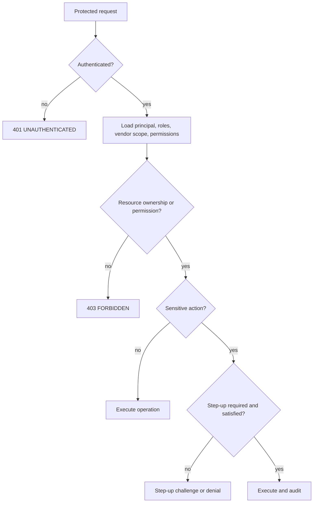

# Security Architecture

**Project:** Task 2 — E-Commerce Marketplace  
**Source of truth:** `docs/requirements/Task_2_Complete_Ecommerce_Marketplace_Specification.pdf`  
**Canonical requirements:** [SRS.md](../requirements/SRS.md)  
**Related:** [SYSTEM-ARCHITECTURE.md](SYSTEM-ARCHITECTURE.md), [API-DESIGN.md](API-DESIGN.md), [DATABASE-ERD.md](DATABASE-ERD.md), [ACCEPTANCE-CRITERIA.md](../requirements/ACCEPTANCE-CRITERIA.md)

## Status vocabulary

| Status | Meaning |
|---|---|
| **Mandatory** | Explicitly required by the PDF or necessary for a secure in-scope capability. |
| **Conditional** | Applies when the relevant feature, provider, channel, or jurisdiction is in scope. |
| **Decision required** | The PDF leaves the control value or boundary unresolved. See [SRS §12](../requirements/SRS.md#12-unresolved-decisions-and-items-to-confirm). |

> This document does not resolve MFA policy, PCI DSS responsibility, target-jurisdiction obligations, SLA/SLO values, or retention periods. Those remain [DEC-001](../requirements/SRS.md#12-unresolved-decisions-and-items-to-confirm), [DEC-010](../requirements/SRS.md#12-unresolved-decisions-and-items-to-confirm), [DEC-018](../requirements/SRS.md#12-unresolved-decisions-and-items-to-confirm), and [DEC-020](../requirements/SRS.md#12-unresolved-decisions-and-items-to-confirm).

---

## 1. Security principles

| ID | Principle | Architecture treatment | Status |
|---|---|---|---|
| SEC-PRIN-001 | Never trust the client for authorization, totals, stock, payment state, or audit records. | Server-side enforcement in API/domain modules. | Mandatory |
| SEC-PRIN-002 | Use least privilege for customers, vendors, staff, admins, support, finance, warehouse, and delivery roles. | Role and permission model with resource ownership checks. | Mandatory |
| SEC-PRIN-003 | Protect sensitive data by minimising collection, encrypting storage/transport, tokenizing payment data, and restricting access. | Data classification and protection controls. | Mandatory |
| SEC-PRIN-004 | Make financial and privileged actions traceable. | Append-only audit records and immutable ledger entries. | Mandatory |
| SEC-PRIN-005 | Verify all external callbacks. | Signed, replay-protected, idempotent webhook handling. | Mandatory |
| SEC-PRIN-006 | Fail safely. | Avoid leaking sensitive data; queue non-critical work; expose operational exceptions. | Mandatory |
| SEC-PRIN-007 | Separate duties for sensitive finance and admin actions where permissions allow. | Finance-specific permissions and approval records. | Mandatory |
| SEC-PRIN-008 | Treat compliance obligations as jurisdiction-dependent. | Decision gates and specialist review before launch. | Decision required |

---

## 2. Authentication

### SEC-AUTH — Authentication controls

| ID | Control | Requirement | Status | Cross-reference |
|---|---|---|---|---|
| SEC-AUTH-001 | Customer, vendor, staff, admin, and operator authentication | Registration, login, logout, email/phone verification, password reset, and optional social sign-in. | Mandatory; social sign-in conditional | [FR-CUS-001](../requirements/SRS.md#33-customer-accounts--crm) |
| SEC-AUTH-002 | Password storage | Store passwords using a modern salted password-hashing algorithm; never store plaintext passwords. | Mandatory | [SEC-002](../requirements/SRS.md#9-security-and-privacy-checklist) |
| SEC-AUTH-003 | MFA support | Support MFA for privileged users; whether it is mandatory is unresolved. | Decision required | [DEC-010](../requirements/SRS.md#12-unresolved-decisions-and-items-to-confirm) |
| SEC-AUTH-004 | Session management | Use secure session/token handling, expiry, revocation, and secure cookie/header settings according to the final auth design. | Mandatory | [FR-COMP-001](../requirements/SRS.md#318-security-privacy--compliance) |
| SEC-AUTH-005 | Step-up authentication | Require re-authentication for sensitive admin/finance actions if confirmed by MFA policy. | Decision required | [DEC-010](../requirements/SRS.md#12-unresolved-decisions-and-items-to-confirm) |
| SEC-AUTH-006 | Account status enforcement | Suspended, rejected, or terminated users/vendors cannot access protected functions. | Mandatory | [FR-VEN-003](../requirements/SRS.md#32-vendor--seller-management) |

**Authentication notes**

- The PDF conflicts on MFA: §3.18 says optional MFA; §9 requires MFA for privileged users. The architecture supports both; enforcement awaits [DEC-010](../requirements/SRS.md#12-unresolved-decisions-and-items-to-confirm).
- Social sign-in is optional and must not bypass verification, consent, privacy, or account-linking controls.
- Vendor staff permissions are assigned by the vendor owner and must remain subordinate to vendor owner rights.

---

## 3. Authorization

### SEC-AUTHZ — Authorization model

| ID | Control | Requirement | Status | Cross-reference |
|---|---|---|---|---|
| SEC-AUTHZ-001 | Server-side authorization | Enforce authorization on every protected API/domain operation, not only in client UI. | Mandatory | [FR-COMP-002](../requirements/SRS.md#318-security-privacy--compliance), [API-004](API-DESIGN.md) |
| SEC-AUTHZ-002 | Admin RBAC | Admin/sub-admin accounts have fine-grained permissions; reporting and exports are role-protected. | Mandatory | [FR-ADM-002](../requirements/SRS.md#312-admin-console--platform-configuration), [FR-BI-007](../requirements/SRS.md#317-reports--business-intelligence) |
| SEC-AUTHZ-003 | Vendor staff RBAC | Vendor staff act only under vendor-owner-assigned permissions and have recorded activity history. | Mandatory | [FR-VEN-012](../requirements/SRS.md#32-vendor--seller-management) |
| SEC-AUTHZ-004 | Client group separation | Keep public, customer, vendor, operations, admin, and super-admin capabilities separate. | Mandatory | [API-007](API-DESIGN.md) |
| SEC-AUTHZ-005 | Resource ownership | Customers can access only their carts, orders, returns, tickets, reviews, and profile data. | Mandatory | [API-PERM-002](API-DESIGN.md) |
| SEC-AUTHZ-006 | Vendor data scoping | Vendors can access only their storefront, products, stock, orders, settlements, and staff. | Mandatory | [API-PERM-003](API-DESIGN.md) |
| SEC-AUTHZ-007 | Finance-sensitive permissions | Refunds, commissions, payouts, settlement approval, and bank-reference changes require explicit permissions. | Mandatory | [API-PERM-007](API-DESIGN.md) |
| SEC-AUTHZ-008 | Sensitive admin actions | Privileged changes require audit records and, where decided, step-up authentication. | Mandatory; step-up decision required | [BR-SEC-002](../requirements/BUSINESS-RULES.md) |

**Role permission summary**

| Role | Allowed scope | Explicitly restricted |
|---|---|---|
| Guest visitor | Public catalogue, search, product detail, cart where policy permits. | Accounts, orders, admin/vendor functions, private documents. |
| Customer | Own profile, addresses, cart, orders, returns, reviews, wishlist, tickets, consents. | Other customers’ data, vendor/admin/finance operations. |
| Vendor owner | Own vendor application, store profile, products, stock, assigned orders, shipments, returns, settlements, staff. | Other vendors’ data, marketplace-wide configuration, customer PII beyond fulfilment need. |
| Vendor staff | Vendor tasks granted by the vendor owner. | Permission self-grant, unassigned vendor data, admin functions. |
| Marketplace administrator | Assigned user/vendor/catalogue/order/payment/return/moderation/configuration operations. | Actions outside granted permissions; unaudited sensitive actions. |
| Support agent | Tickets, conversations, disputes, knowledge base, escalations. | Unrelated financial/payout actions unless separately permitted. |
| Warehouse/fulfilment operator | Stock movements, picking, packing, dispatch, return inspection. | Marketplace configuration, settlement approval, unrelated customer data. |
| Delivery/logistics operator | Assigned shipments, milestones, exceptions, proof of delivery where supported. | Order financial details, unrelated customer/vendor data. |
| Finance operator | Payment/refund reconciliation, tax/finance reports, settlements, payouts. | Catalogue merchandising, support conversations unrelated to disputes. |
| Super administrator | Global configuration, admin roles, permissions, audit/security settings. | Using global rights without audit; changing financial values without documented approval. |

---

## 4. Application security

### SEC-APP — Application-layer controls

| ID | Control | Requirement | Status | Cross-reference |
|---|---|---|---|---|
| SEC-APP-001 | Validation, encoding and query safety | Input validation, output encoding, parameterized queries, safe deserialization, and file-upload validation. | Mandatory | [FR-COMP-004](../requirements/SRS.md#318-security-privacy--compliance) |
| SEC-APP-002 | Common web attack controls | CSRF where applicable, XSS, SQL injection, SSRF, broken access control, and rate-limit protections. | Mandatory; CSRF conditional | [SEC-005](../requirements/SRS.md#9-security-and-privacy-checklist) |
| SEC-APP-003 | Security headers | Apply appropriate security headers and secure cookie attributes. | Mandatory | [SEC-001](../requirements/SRS.md#9-security-and-privacy-checklist) |
| SEC-APP-004 | Error handling | Return stable sanitized errors; log details internally with correlation IDs. | Mandatory | [API-ERR](API-DESIGN.md) |
| SEC-APP-005 | Secure uploads | Validate type/size, scan where supported, use object storage, and serve private files by signed URLs. | Mandatory | [API-FILE-001](API-DESIGN.md) |
| SEC-APP-006 | Dependency and container security | Dependency scanning, container scanning, static analysis, and vulnerability remediation before production. | Mandatory | [QA-006](../requirements/ACCEPTANCE-CRITERIA.md) |
| SEC-APP-007 | Secrets in code | Prohibit secrets in source control and build artifacts. | Mandatory | [SEC-SECRETS-001](#7-secrets-management) |

---

## 5. Transport and data protection

### SEC-TLS — Transport security

| ID | Control | Requirement | Status |
|---|---|---|---|
| SEC-TLS-001 | HTTPS/TLS everywhere for web, API, webhook, and admin traffic. | Mandatory |
| SEC-TLS-002 | HSTS and secure redirect behaviour according to the deployment platform. | Recommendation |
| SEC-TLS-003 | Certificate renewal, monitoring, and TLS configuration review before launch. | Mandatory |
| SEC-TLS-004 | Provider webhook endpoints accept only configured secure callbacks. | Mandatory |

### SEC-DATA — Data-at-rest protection

| ID | Control | Requirement | Status | Cross-reference |
|---|---|---|---|---|
| SEC-DATA-001 | Minimise sensitive data collection and exposure; never store raw card numbers or CVV. | Mandatory | [DB-003](DATABASE-ERD.md), [BR-SEC-003](../requirements/BUSINESS-RULES.md) |
| SEC-DATA-002 | Encrypt sensitive fields, backups, and object storage where supported; restrict and test restoration. | Mandatory | [SEC-010](../requirements/SRS.md#9-security-and-privacy-checklist) |
| SEC-DATA-003 | Use protected/tokenized references for bank and payment data. | Mandatory | [DB-VEN](DATABASE-ERD.md) |
| SEC-DATA-004 | Apply field-level access controls for KYC documents, banking references, and personal data. | Mandatory | [SEC-PII-004](#6-privacy-and-personal-data) |
| SEC-DATA-005 | Avoid copying sensitive data into logs, analytics payloads, error reports, and support notes. | Mandatory | [NFR-OBS-001](../requirements/SRS.md#5-non-functional-requirements) |

**Data classification**

| Class | Examples | Required handling | Status |
|---|---|---|---|
| Public | Published products, public content, approved storefront profiles. | CDN/cache allowed; SEO metadata controlled. | Mandatory |
| Internal | Operational status, feature flags, non-sensitive configuration, aggregate reports. | Authenticated role-based access. | Mandatory |
| Confidential | Customer addresses/contact details, order history, support tickets, vendor business details. | Encryption, access control, audit for sensitive access where applicable. | Mandatory |
| Restricted | Passwords/hashes, payment tokens, bank references, KYC documents, secrets, audit records. | Strongest access control, tokenization/encryption, no general list endpoints, audit access. | Mandatory |

---

## 6. Privacy and personal data

### SEC-PRIV — Privacy controls

| ID | Control | Requirement | Status | Cross-reference |
|---|---|---|---|---|
| SEC-PRIV-001 | Privacy notices and consent records | Publish privacy notices, record consent and withdrawal, and link consent to purpose/channel. | Mandatory | [FR-COMP-006](../requirements/SRS.md#318-security-privacy--compliance), [FR-CUS-002](../requirements/SRS.md#33-customer-accounts--crm) |
| SEC-PRIV-002 | Data minimization | Collect only data needed for the stated commerce, verification, fulfilment, tax, and support purpose. | Mandatory | [NFR-DATA-001](../requirements/SRS.md#5-non-functional-requirements) |
| SEC-PRIV-003 | Consent-aware messaging | Email/SMS/push/promotional and abandoned-cart messaging require allowed purpose and channel consent. | Mandatory where messaging used | [FR-MKT-004](../requirements/SRS.md#313-marketing-loyalty--engagement) |
| SEC-PRIV-004 | Retention and deletion | Define retention policies, archive/delete schedules, and preserve required financial/audit records. | Mandatory; periods decision required | [DB-010](DATABASE-ERD.md), [DEC-020](../requirements/SRS.md#12-unresolved-decisions-and-items-to-confirm) |
| SEC-PRIV-005 | Data-subject workflows | Support account export/deletion requests and track outcomes according to applicable obligations. | Mandatory | [FR-CUS-008](../requirements/SRS.md#33-customer-accounts--crm) |
| SEC-PRIV-006 | Jurisdiction review | Assess privacy, consumer, tax, payment, and e-commerce requirements for each target market with specialists. | Mandatory | [SEC-011](../requirements/SRS.md#9-security-and-privacy-checklist), [DEC-001](../requirements/SRS.md#12-unresolved-decisions-and-items-to-confirm) |

### SEC-PII-004 — Sensitive seller and personal information

| ID | Requirement | Status | Cross-reference |
|---|---|---|---|
| SEC-PII-004-001 | KYC documents, tax identifiers, bank references, and contact details are confidential/restricted data. | Mandatory | [FR-VEN-002](../requirements/SRS.md#32-vendor--seller-management) |
| SEC-PII-004-002 | Sensitive seller data is accessible only to permitted vendor users and authorized admin/finance reviewers. | Mandatory | [SEC-AUTHZ-006](#3-authorization) |
| SEC-PII-004-003 | Document expiry tracking and verification state are maintained. | Mandatory | [FR-VEN-002](../requirements/SRS.md#32-vendor--seller-management) |
| SEC-PII-004-004 | Raw financial account secrets are not stored; protected references and masked display values are used. | Mandatory | [DB-CON-015](DATABASE-ERD.md) |
| SEC-PII-004-005 | Access to sensitive seller data is audited where it supports privileged actions and dispute review. | Mandatory | [SEC-AUDIT-001](#10-audit-and-accountability) |

---

## 7. Secrets management

### SEC-SECRETS — Secrets controls

| ID | Requirement | Status |
|---|---|---|
| SEC-SECRETS-001 | Store secrets in a secrets manager or protected environment configuration; never commit them to source control. | Mandatory |
| SEC-SECRETS-002 | Separate local, test, staging, and production credentials and data. | Mandatory |
| SEC-SECRETS-003 | Rotate provider, database, and signing secrets according to an agreed policy. | Mandatory intent; interval to agree |
| SEC-SECRETS-004 | Grant secrets only to services that need them and audit access where the platform supports it. | Mandatory |
| SEC-SECRETS-005 | Exclude secrets from logs, error reports, client bundles, and CI output. | Mandatory |

---

## 8. Payment security and fraud

### SEC-PAY — Payment controls

| ID | Requirement | Status | Cross-reference |
|---|---|---|---|
| SEC-PAY-001 | Use hosted or tokenized payment flows; never store raw card numbers or CVV. | Mandatory | [FR-PAY-001](../requirements/SRS.md#37-payments-refunds--finance) |
| SEC-PAY-002 | Define PCI DSS responsibility boundary with the selected provider. | Decision required | [DEC-018](../requirements/SRS.md#12-unresolved-decisions-and-items-to-confirm) |
| SEC-PAY-003 | Verify payment webhooks and process them idempotently. | Mandatory | [API-WH-001](API-DESIGN.md) |
| SEC-PAY-004 | Restrict refunds, payouts, settlement approval, and bank-reference changes by permission and audit them. | Mandatory | [SEC-AUTHZ-007](#3-authorization) |
| SEC-PAY-005 | Reconcile provider transactions and maintain immutable financial ledger records. | Mandatory | [DB-007](DATABASE-ERD.md) |
| SEC-PAY-006 | Do not trust client-returned payment status as proof of payment. | Mandatory | [AC-006](../requirements/ACCEPTANCE-CRITERIA.md) |

### SEC-FRAUD — Fraud and abuse controls

| ID | Requirement | Status | Cross-reference |
|---|---|---|---|
| SEC-FRAUD-001 | Monitor fraud signals for suspicious logins, payments, returns, and reviews; provide manual review queues. | Mandatory | [FR-COMP-007](../requirements/SRS.md#318-security-privacy--compliance) |
| SEC-FRAUD-002 | Detect duplicate-listing and suspicious content patterns once rules are defined. | Decision required | [DEC-022](../requirements/SRS.md#12-unresolved-decisions-and-items-to-confirm) |
| SEC-FRAUD-003 | Track return reason codes and abuse patterns for review. | Mandatory | [FR-RET-008](../requirements/SRS.md#311-returns-exchanges--refunds) |
| SEC-FRAUD-004 | Apply spam/abuse detection to reviews and support content. | Mandatory | [FR-REV-005](../requirements/SRS.md#314-reviews-ratings--moderation) |
| SEC-FRAUD-005 | Use rate limits and anomaly alerts where agreed. | Mandatory intent; numeric limits decision required | [DEC-020](../requirements/SRS.md#12-unresolved-decisions-and-items-to-confirm) |

---

## 9. Threat model

| Threat category | Marketplace example | Primary controls | Status |
|---|---|---|---|
| Spoofing | Stolen customer/vendor/admin credentials; fake webhook caller. | SEC-AUTH-*, SEC-TLS, signed webhooks, optional MFA pending DEC-010. | Mandatory; MFA decision required |
| Tampering | Client changes totals; provider event replay; product status manipulation. | Server-calculated totals, idempotency, webhook dedupe, state machines, audit records. | Mandatory |
| Repudiation | Admin changes commission without evidence; seller denies KYC submission. | SEC-AUDIT-001, immutable ledger, status/event histories. | Mandatory |
| Information disclosure | Customer PII exposed via API; KYC documents leaked; secrets in logs. | SEC-AUTHZ-*, SEC-DATA-*, SEC-PRIV-*, secrets management, sanitized errors. | Mandatory |
| Denial of service | Checkout/search abuse, queue backlog, provider outage. | Rate limits, bounded retries, queue monitoring, graceful degradation, performance strategy. | Mandatory intent; limits/SLOs pending DEC-020 |
| Elevation of privilege | Vendor staff grants self-permissions; sub-admin accesses super-admin settings. | Fine-grained RBAC, permission separation, negative authorization tests. | Mandatory |
| Fraud | Return abuse, fake reviews, suspicious payments. | SEC-FRAUD-*, moderation queues, manual review. | Mandatory |
| Supply chain | Vulnerable dependency/container or compromised CI secret. | SEC-APP-006, SEC-SECRETS-*, CI security scans. | Mandatory |

---

## 10. Audit and accountability

### SEC-AUDIT — Audit controls

| ID | Requirement | Status | Cross-reference |
|---|---|---|---|
| SEC-AUDIT-001 | Record privileged actions, seller bank-detail changes, refunds, commissions, payouts, admin permission changes, and sensitive configuration changes. | Mandatory | [SEC-009](../requirements/SRS.md#9-security-and-privacy-checklist), [BR-SEC-002](../requirements/BUSINESS-RULES.md) |
| SEC-AUDIT-002 | Audit records include actor, action, target, time, outcome, and correlation/request ID where available. | Mandatory | [DB-CON-016](DATABASE-ERD.md) |
| SEC-AUDIT-003 | Audit records are append-only and protected from ordinary deletion or update. | Mandatory | [DB-RET-003](DATABASE-ERD.md) |
| SEC-AUDIT-004 | Order, payment, shipment, return, vendor, and product status changes have event histories. | Mandatory | [DB-008](DATABASE-ERD.md) |
| SEC-AUDIT-005 | Audit and security logs are centrally collected and alertable. | Mandatory | [NFR-OBS-001](../requirements/SRS.md#5-non-functional-requirements) |
| SEC-AUDIT-006 | Sensitive logs are access-controlled and retained according to policy. | Mandatory; retention pending DEC-020 | [SEC-PRIV-004](#6-privacy-and-personal-data) |

---

## 11. Security control traceability

| SRS checklist ID | Architecture control IDs | Acceptance |
|---|---|---|
| SEC-001 HTTPS/TLS, secure cookies, headers | SEC-TLS-*, SEC-APP-003 | AC-QA-006 |
| SEC-002 Password hashing and MFA | SEC-AUTH-002, SEC-AUTH-003 | AC-QA-006; MFA policy pending DEC-010 |
| SEC-003 RBAC and server-side authorization | SEC-AUTHZ-001–SEC-AUTHZ-008 | AC-009, AC-QA-006 |
| SEC-004 Validation, encoding, parameterized queries, upload scanning | SEC-APP-001, SEC-APP-005 | AC-QA-006 |
| SEC-005 CSRF/XSS/injection/access control/rate limits | SEC-APP-002 | AC-QA-006 |
| SEC-006 Secrets management | SEC-SECRETS-001–SEC-SECRETS-005 | AC-QA-006 |
| SEC-007 Payment tokenization/hosted checkout | SEC-PAY-001, SEC-PAY-002 | AC-006, AC-QA-006 |
| SEC-008 Webhook verification/replay protection | API-WH-001–API-WH-003, SEC-PAY-003 | AC-006 |
| SEC-009 Privileged action auditing | SEC-AUDIT-001–SEC-AUDIT-003 | AC-009 |
| SEC-010 Encrypted backups and sensitive fields | SEC-DATA-002, SEC-DATA-003 | LAUNCH-010 |
| SEC-011 Jurisdiction-specific compliance review | SEC-PRIV-006 | DEL-SEC-001, DEC-001 |
| SEC-012 Dependency/container/static/penetration testing | SEC-APP-006 | AC-QA-006 |

---

## 12. Security verification and launch readiness

| ID | Verification activity | Acceptance reference | Status |
|---|---|---|---|
| SEC-VER-001 | Authorization matrix testing across all roles and sensitive endpoints. | [AC-009](../requirements/ACCEPTANCE-CRITERIA.md), [AC-QA-006](../requirements/ACCEPTANCE-CRITERIA.md) | Mandatory |
| SEC-VER-002 | Payment and shipping webhook signature, replay, and idempotency testing. | [AC-006](../requirements/ACCEPTANCE-CRITERIA.md) | Mandatory |
| SEC-VER-003 | Injection, XSS, CSRF where applicable, SSRF, upload, and session-handling tests. | [AC-QA-006](../requirements/ACCEPTANCE-CRITERIA.md) | Mandatory |
| SEC-VER-004 | Dependency, container, static analysis, and penetration test evidence. | [SEC-012](../requirements/SRS.md#9-security-and-privacy-checklist), [DEL-SEC-001](../requirements/ACCEPTANCE-CRITERIA.md) | Mandatory |
| SEC-VER-005 | Privacy review, consent mapping, retention mapping, and data-subject workflow verification. | [SEC-PRIV-*](#6-privacy-and-personal-data) | Mandatory; jurisdiction pending DEC-001 |
| SEC-VER-006 | Backup restoration and encrypted backup verification. | [LAUNCH-010](../requirements/SRS.md#11-development-phases-and-mvp-baseline) | Mandatory |
| SEC-VER-007 | Security incident contacts, runbooks, and escalation paths ready. | [LAUNCH-011](../requirements/SRS.md#11-development-phases-and-mvp-baseline) | Mandatory |

---

## 13. Incident response outline

| Phase | Requirement | Status |
|---|---|---|
| Prepare | Define roles, contacts, severity levels, secure communication channels, and runbooks before production. | Mandatory |
| Detect | Alert on authentication anomalies, payment failures, webhook failures, queue backlog, privilege changes, and critical vulnerability findings. | Mandatory |
| Contain | Revoke sessions/credentials, disable affected integrations or feature flags, preserve evidence. | Mandatory |
| Eradicate | Patch, rotate secrets, remove malicious content, correct access rules. | Mandatory |
| Recover | Restore service/data where needed, verify integrity, monitor for recurrence. | Mandatory |
| Learn | Record root cause, impact, corrective actions, and control improvements. | Mandatory |
| Notify | Follow jurisdiction- and contract-specific breach notification obligations once target markets and provider boundaries are confirmed. | Decision required |

---

## 14. Unresolved security decisions

| ID | Decision needed | Impact |
|---|---|---|
| DEC-001 | Target countries and applicable legal/compliance requirements. | Privacy notices, consumer law, tax, payment, and e-commerce rules. |
| DEC-004 | Payment provider, methods, COD, and settlement capability. | PCI scope, token flow, payout controls, refund handling. |
| DEC-010 | Whether MFA is optional or mandatory for privileged users. | Authentication and step-up enforcement. |
| DEC-011 | Dedicated operational portals or admin-console subareas. | Permission scoping and audit presentation. |
| DEC-012 | Guest checkout policy. | Authentication requirements for checkout and order access. |
| DEC-016 | Which conditional features launch. | Social sign-in, loyalty, wallet/gift card, mobile, B2B, multi-warehouse controls. |
| DEC-018 | PCI DSS responsibility boundary. | Compliance documentation and control allocation. |
| DEC-020 | Numeric security, availability, retention, and rate-limit targets. | Test thresholds and operational alerts. |
| DEC-022 | Duplicate-listing, tax source, commission examples, and reconciliation matching rules. | Fraud/abuse detection and finance controls. |
