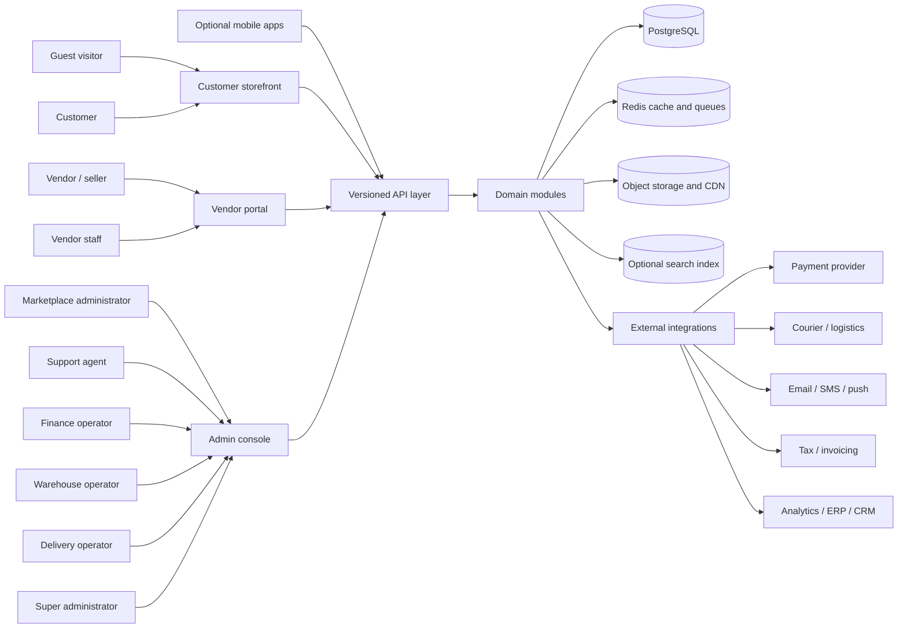
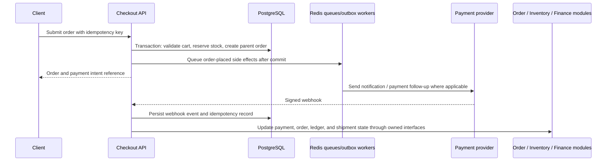
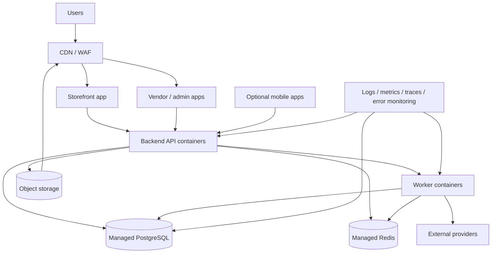

# System Architecture

**Project:** Task 2 — E-Commerce Marketplace  
**Source of truth:** `docs/requirements/Task_2_Complete_Ecommerce_Marketplace_Specification.pdf`  
**Canonical requirements:** [SRS.md](../requirements/SRS.md)  
**Related:** [DATABASE-ERD.md](DATABASE-ERD.md), [API-DESIGN.md](API-DESIGN.md), [SECURITY-ARCHITECTURE.md](SECURITY-ARCHITECTURE.md), [PERFORMANCE-STRATEGY.md](PERFORMANCE-STRATEGY.md)

## Status vocabulary

| Status | Meaning |
|---|---|
| **Mandatory** | Directly stated or implied by an in-scope requirement in the PDF. |
| **Recommendation** | Recommended baseline from the PDF, not a confirmed final technical choice. |
| **Conditional** | Applies only if the corresponding optional feature is in scope. |
| **Decision required** | The PDF leaves provider, topology, transport, threshold, or scope unresolved. See [SRS §12](../requirements/SRS.md#12-unresolved-decisions-and-items-to-confirm). |

---

## 1. Architecture intent

| ID | Architecture statement | Status | Cross-reference |
|---|---|---|---|
| ARC-001 | Begin with a modular monolith: one deployable backend organised into strict domain modules with explicit interfaces, independent tests, and clear data ownership. | Recommendation | [SRS ARC-001](../requirements/SRS.md#7-architecture-summary) |
| ARC-002 | Avoid premature microservice complexity while preserving extraction of high-load or independently operated modules later. | Recommendation | [PHASE-008](../requirements/SRS.md#11-development-phases-and-mvp-baseline) |
| ARC-003 | Separate presentation clients from the backend through versioned APIs so web, optional mobile, and internal workspaces share one contract surface. | Mandatory | [API-001](API-DESIGN.md) |
| ARC-004 | Use PostgreSQL as the transactional system of record; Redis for cache, rate limiting, and queues; object storage for files; and an optional search index when full-text search is insufficient. | Recommendation | [DB-001](DATABASE-ERD.md), [TEC-009](../requirements/SRS.md#6-recommended-technology-stack), [TEC-010](../requirements/SRS.md#6-recommended-technology-stack) |
| ARC-005 | All protected operations enforce authentication and server-side authorization at the API/application boundary. | Mandatory | [SEC-AUTHZ-001](SECURITY-ARCHITECTURE.md) |
| ARC-006 | Use synchronous calls for immediate transactional reads/writes and asynchronous processing for side effects, notifications, indexing, exports, and webhooks. | Recommendation | [ARC-ASYNC](#5-asynchronous-architecture) |
| ARC-007 | Maintain audit, status, and immutable financial histories as first-class architecture concerns. | Mandatory | [DB-008](DATABASE-ERD.md), [SEC-AUDIT-001](SECURITY-ARCHITECTURE.md) |
| ARC-008 | Treat all unresolved values, providers, topologies, and optional scope as decision gates; do not encode assumptions as delivered behaviour. | Mandatory | [SRS §12](../requirements/SRS.md#12-unresolved-decisions-and-items-to-confirm) |

---

## 2. System context

**Context notes**

- Dedicated workspaces for support, warehouse, delivery, and finance are not named in the PDF; they are modelled as admin-console subareas until [DEC-011](../requirements/SRS.md#12-unresolved-decisions-and-items-to-confirm) is resolved.
- Native mobile apps and additional channels are conditional and must not be treated as launch scope without [DEC-016](../requirements/SRS.md#12-unresolved-decisions-and-items-to-confirm) and [DEC-024](../requirements/SRS.md#12-unresolved-decisions-and-items-to-confirm).

---

## 3. Presentation architecture

### ARC-PRES — Presentation layer

| ID | Client surface | Responsibilities | Status | Cross-reference |
|---|---|---|---|---|
| ARC-PRES-001 | Customer storefront | Public catalogue, search, product detail, cart, checkout, account, orders, returns, reviews, support entry points, SEO pages. | Mandatory | [FR-DISC-*](../requirements/SRS.md#34-storefront-search--product-discovery), [FR-CUS-*](../requirements/SRS.md#33-customer-accounts--crm), [UX-PRES-001](../requirements/ACCEPTANCE-CRITERIA.md) |
| ARC-PRES-002 | Vendor portal | Onboarding, KYC submission, store profile, products, inventory, prices, orders, shipments, returns, commissions, payouts, staff management. | Mandatory | [FR-VEN-*](../requirements/SRS.md#32-vendor--seller-management) |
| ARC-PRES-003 | Admin console | Platform dashboards, user/vendor/catalogue/order/payment/return administration, moderation, configuration, audit, and role-aware operational subareas. | Mandatory | [FR-ADM-*](../requirements/SRS.md#312-admin-console--platform-configuration), [SRS-ROLE-011–SRS-ROLE-015](../requirements/SRS.md#2-user-roles-and-portals) |
| ARC-PRES-004 | Optional mobile apps | Customer, vendor, and delivery app surfaces using shared API contracts. | Conditional | [FR-MOB-002](../requirements/SRS.md#319-mobile--multi-channel), [DEC-016](../requirements/SRS.md#12-unresolved-decisions-and-items-to-confirm) |
| ARC-PRES-005 | Design system | Shared components, responsive patterns, accessible forms, error states, and status indicators across clients. | Mandatory | [UX-PRES-001](../requirements/ACCEPTANCE-CRITERIA.md), [NFR-ACC-001](../requirements/SRS.md#5-non-functional-requirements) |

**Presentation rules**

| ID | Rule | Status |
|---|---|---|
| ARC-PRES-RULE-001 | Clients must not calculate final payable amounts, tax, commission, or stock commitments as authoritative values. | Mandatory |
| ARC-PRES-RULE-002 | Sensitive admin actions require explicit permission checks and, where decided, step-up authentication. | Mandatory; step-up details depend on DEC-010 |
| ARC-PRES-RULE-003 | Web and optional mobile clients consume the same versioned API contracts; mobile-specific endpoints must be justified. | Mandatory |
| ARC-PRES-RULE-004 | Portal decomposition must follow [DEC-011](../requirements/SRS.md#12-unresolved-decisions-and-items-to-confirm). | Decision required |

---

## 4. Application and domain architecture

### ARC-DOMAIN — Modular monolith boundaries

| ID | Domain module | Owns | Provides | Consumes / publishes | Status |
|---|---|---|---|---|---|
| ARC-DOMAIN-IDENTITY | Identity and access | Users, credentials, sessions, roles, permissions, consents linkage | Authentication, session management, authorization policy evaluation | Publishes user/role events | Mandatory |
| ARC-DOMAIN-VENDOR | Vendor and seller management | Vendor applications, KYC state, store profiles, staff invitations, status history | Vendor onboarding, approval state, storefront configuration | Publishes vendor status events | Mandatory |
| ARC-DOMAIN-CATALOGUE | Catalogue | Products, variants, media, categories, brands, attributes, groups, moderation state | Listing, moderation, catalogue-group queries | Publishes product visibility/index events | Mandatory |
| ARC-DOMAIN-PRICING | Pricing, tax and promotions | Prices, coupons, campaigns, rules, calculation audit records | Server-side quote calculation and promotion evaluation | Uses catalogue/customer context | Mandatory |
| ARC-DOMAIN-CART | Cart | Cart lines, saved-for-later state, cart persistence | Cart operations and pre-checkout quote context | Uses catalogue/pricing/inventory | Mandatory |
| ARC-DOMAIN-CHECKOUT | Checkout and order placement | Checkout sessions, idempotency, reservation intent | Server-calculated totals, validation, order creation orchestration | Uses inventory/payment/order; publishes order-placed events | Mandatory |
| ARC-DOMAIN-INVENTORY | Inventory and warehouse | Stock balances, reservations, movements, locations, low-stock state | Availability, reservation, release, movement recording | Publishes stock-changed/reservation-expired events | Mandatory; locations conditional |
| ARC-DOMAIN-ORDER | Orders and fulfilment | Parent orders, fulfilment units, status history, invoices, internal notes | Customer order views, vendor order assignment, fulfilment transitions | Publishes order-status events | Mandatory |
| ARC-DOMAIN-SHIPPING | Shipping and logistics | Shipments, labels, tracking, milestones, exceptions | Rate/serviceability lookup, shipment booking, tracking | Uses provider adapter; publishes shipment-status events | Mandatory |
| ARC-DOMAIN-PAYMENT | Payments and refunds | Payment attempts, provider references, refund state, webhook records | Payment authorization/capture/refund orchestration | Publishes payment-status/refund-status events | Mandatory |
| ARC-DOMAIN-FINANCE | Finance and settlements | Immutable ledger, commission results, settlements, payouts, statements | Reconciliation, settlement statements, finance reports | Uses payment/order/refund data | Mandatory |
| ARC-DOMAIN-RETURNS | Returns and exchanges | Return requests, approvals, pickup, inspection, disposition, replacements | Return workflow and eligibility checks | Uses order/inventory/payment/finance | Mandatory |
| ARC-DOMAIN-SUPPORT | Support and disputes | Tickets, messages, internal notes, disputes, SLA state | Support workflow and dispute linkage | Uses order/payment/return/vendor context | Mandatory; chat conditional |
| ARC-DOMAIN-MARKETING | Marketing and notifications | Campaigns, segments, notification events, consent-aware templates | Email/SMS/push orchestration and campaign attribution | Uses customer/order/product events | Mandatory; loyalty/affiliate conditional |
| ARC-DOMAIN-CONTENT | Content and SEO | Pages, banners, navigation, redirects, SEO metadata, sitemap inputs | Public content and merchandising configuration | Publishes content-change events | Mandatory |
| ARC-DOMAIN-REPORTING | Reporting and BI | Reporting models, export jobs, dashboard queries | Role-protected reports and exports | Consumes read models/events from other modules | Mandatory |
| ARC-DOMAIN-ADMIN | Platform configuration | Feature flags, configuration, admin permissions linkage, operational controls | Configuration lookups and admin operations | Publishes configuration-change events | Mandatory |
| ARC-DOMAIN-AUDIT | Audit and compliance | Audit records, sensitive-action history, event history views | Append-only audit trail and evidence queries | Consumes protected action events | Mandatory |
| ARC-DOMAIN-INTEGRATION | Integration adapters | Provider-specific mapping, signing, retries, normalization | Stable internal interfaces for external providers | Used by payment/shipping/tax/messaging modules | Mandatory |

**Boundary rules**

| ID | Rule | Status |
|---|---|---|
| ARC-DOMAIN-RULE-001 | A module owns its data; other modules access it through application interfaces or published events, not direct cross-module writes. | Recommendation |
| ARC-DOMAIN-RULE-002 | Checkout, stock reservation, payment-state transition, refund, and ledger operations are transactional and idempotent. | Mandatory |
| ARC-DOMAIN-RULE-003 | Provider-specific formats remain inside integration adapters; domain modules consume normalized models. | Recommendation |
| ARC-DOMAIN-RULE-004 | Reporting reads from controlled read models or audited queries and never bypasses authorization rules. | Mandatory |
| ARC-DOMAIN-RULE-005 | Status machines are centralized in the owning domain and documented before implementation. | Mandatory; exact states depend on DEC-021 |

---

## 5. Asynchronous architecture

### ARC-ASYNC — Background processing and events

| ID | Concern | Architecture approach | Status | Cross-reference |
|---|---|---|---|---|
| ARC-ASYNC-001 | Transactional side effects | Use an outbox-style record in the owning transaction, then publish to workers after commit. | Recommendation | [DB-004](DATABASE-ERD.md) |
| ARC-ASYNC-002 | Notifications | Queue email/SMS/push work after order, shipment, return, vendor, and payment events. | Mandatory capability | [FR-MKT-001](../requirements/SRS.md#313-marketing-loyalty--engagement) |
| ARC-ASYNC-003 | Webhooks | Verify signatures, persist raw event references, deduplicate by provider event ID/signature metadata, and process idempotently. | Mandatory | [API-WH-001](API-DESIGN.md) |
| ARC-ASYNC-004 | Search indexing | Update search documents after catalogue visibility changes; initial search may use PostgreSQL full-text. | Recommendation | [DEC-015](../requirements/SRS.md#12-unresolved-decisions-and-items-to-confirm) |
| ARC-ASYNC-005 | Invoices, statements, exports | Generate documents asynchronously and expose status/download links. | Mandatory | [FR-PAY-007](../requirements/SRS.md#37-payments-refunds--finance), [FR-BI-007](../requirements/SRS.md#317-reports--business-intelligence) |
| ARC-ASYNC-006 | Scheduled tasks | Process reservation expiry, document expiry reminders, retries, settlement preparation, and alert scans. | Mandatory | [BR-CHK-006](../requirements/BUSINESS-RULES.md), [FR-VEN-002](../requirements/SRS.md#32-vendor--seller-management) |
| ARC-ASYNC-007 | Retry and failure handling | Use bounded retries with backoff, dead-letter handling, monitoring, and manual replay where safe. | Mandatory | [NFR-REL-001](../requirements/SRS.md#5-non-functional-requirements) |

---

## 6. Data architecture

| ID | Data store / concern | Use | Status | Cross-reference |
|---|---|---|---|---|
| ARC-DATA-001 | PostgreSQL | System of record for transactional marketplace data, status histories, and financial ledger entries. | Mandatory | [DB-001](DATABASE-ERD.md) |
| ARC-DATA-002 | Redis | Cache, rate limiting, short-lived checkout/session helpers, queues, and scheduled job coordination where appropriate. | Recommendation | [TEC-009](../requirements/SRS.md#6-recommended-technology-stack) |
| ARC-DATA-003 | Object storage | Product media, seller documents, invoices, statements, exports, and private files via signed URLs. | Mandatory | [DEP-006](../requirements/SRS.md#11-devops-environments-and-deployment) |
| ARC-DATA-004 | CDN | Public media/static delivery and edge protection. | Recommendation | [TEC-012](../requirements/SRS.md#6-recommended-technology-stack) |
| ARC-DATA-005 | Search index | Product search and facets when PostgreSQL full-text is insufficient. | Conditional; threshold to agree | [DEC-015](../requirements/SRS.md#12-unresolved-decisions-and-items-to-confirm) |
| ARC-DATA-006 | Read models / reporting store | Denormalized views for dashboards and reports if query load requires isolation. | Recommendation | [FR-BI-*](../requirements/SRS.md#317-reports--business-intelligence) |
| ARC-DATA-007 | Backup and recovery | Managed backups, encrypted storage, restore drills, and documented recovery procedures. | Mandatory; RPO/RTO pending | [NFR-REC-001](../requirements/SRS.md#5-non-functional-requirements), [DEC-020](../requirements/SRS.md#12-unresolved-decisions-and-items-to-confirm) |

Data ownership and integrity rules are defined in [DATABASE-ERD.md](DATABASE-ERD.md). Sensitive-data handling is defined in [SECURITY-ARCHITECTURE.md](SECURITY-ARCHITECTURE.md).

---

## 7. External integrations

| ID | Integration | Purpose | Architecture treatment | Status |
|---|---|---|---|---|
| INT-PAY | Payment gateway | Authorization/capture, refunds, settlement capability where available, status webhooks | Adapter with hosted/tokenized flow, signed webhooks, idempotent processing, reconciliation export. | Mandatory capability; provider pending DEC-004 |
| INT-SHIP | Courier/logistics | Rates, serviceability, shipment creation, labels, manifests, tracking, reverse pickup | Adapter with normalized shipment model, milestone webhooks, and exception handling. | Mandatory capability; model pending DEC-005 |
| INT-EMAIL | Email provider | Verification, order/shipment/return notifications, invoices, alerts | Queue-backed notification adapter with templates and consent checks. | Mandatory |
| INT-SMS | SMS/WhatsApp | OTP and permitted transactional/promotional messages | Queue-backed adapter with consent and provider-specific fallback. | Mandatory capability; provider/consent rules apply |
| INT-TAX | Tax/invoicing | Tax calculation, invoice numbering, tax reports | Rules adapter; calculation source of truth must be decided. | Mandatory capability; tax rules pending DEC-001/DEC-022 |
| INT-MAPS | Maps/address | Address autocomplete, geocoding, delivery coverage | Optional client/provider adapter feeding address and serviceability checks. | Conditional |
| INT-ANALYTICS | Analytics | Traffic, funnel, product, and campaign analysis | Consent-aware event pipeline with agreed taxonomy and retention. | Mandatory capability; taxonomy/retention to define |
| INT-ERP | Accounting/ERP/CRM | Financial reconciliation, stock sync, customer/business workflows | Integrate after core data ownership and reconciliation rules are established. | Mandatory capability; sequencing in PHASE-005 |

**Integration rules**

| ID | Rule | Status |
|---|---|---|
| INT-RULE-001 | No provider SDK type becomes a domain entity; adapters translate to internal normalized models. | Recommendation |
| INT-RULE-002 | Outbound calls require timeouts, bounded retries, correlation IDs, and audit records for financial/operational actions. | Mandatory |
| INT-RULE-003 | Inbound webhooks require signature verification, replay protection, and idempotent processing. | Mandatory |
| INT-RULE-004 | Provider outages degrade gracefully: queue non-critical work, show accurate status, and expose exception queues. | Mandatory |

---

## 8. Deployment architecture

| ID | Deployment concern | Architecture treatment | Status |
|---|---|---|---|
| ARC-DEP-001 | Environments | local, automated test, staging/UAT, and production with isolated credentials and data. | Mandatory |
| ARC-DEP-002 | Packaging | Docker images for API, workers, and web clients; repeatable local/CI environments. | Mandatory |
| ARC-DEP-003 | Runtime | Containerized application platform or managed Kubernetes once topology is decided. | Decision required; provider/topology pending DEC-009/DEC-019 |
| ARC-DEP-004 | Workers | Separate worker deployment for queues, scheduled jobs, webhook processing, exports, and notification delivery. | Recommendation |
| ARC-DEP-005 | Database | Managed PostgreSQL with controlled migrations, monitoring, automated backups, and restore procedures. | Mandatory |
| ARC-DEP-006 | Media | Object storage plus CDN; signed URLs for private documents. | Mandatory |
| ARC-DEP-007 | Delivery | CI pipeline then staging deployment, smoke tests, approval, production deployment, rollback capability. | Mandatory |
| ARC-DEP-008 | Observability | Structured logs, metrics, traces, error monitoring, and alerts for payment failures, queue backlog, API errors, and database health. | Mandatory |

---

## 9. Cross-cutting architecture views

| Concern | Architecture decision | Cross-reference |
|---|---|---|
| Authentication and authorization | Central identity module; RBAC and fine-grained permissions enforced at API and module boundaries. | [SECURITY-ARCHITECTURE.md](SECURITY-ARCHITECTURE.md) |
| Privacy and compliance | Data classification, consent linkage, retention, export/deletion workflows, and auditability. | [SECURITY-ARCHITECTURE.md](SECURITY-ARCHITECTURE.md) |
| Money correctness | Fixed-precision decimal amounts, explicit currency, immutable ledger, server-side calculations. | [DATABASE-ERD.md](DATABASE-ERD.md), [BUSINESS-RULES.md](../requirements/BUSINESS-RULES.md) |
| Idempotency | Keys for order creation, payment requests, refunds, webhook processing, and payout operations. | [API-IDEMP](API-DESIGN.md) |
| Performance | Caching, query/index discipline, async side effects, CDN delivery, load testing, and monitoring. | [PERFORMANCE-STRATEGY.md](PERFORMANCE-STRATEGY.md) |
| Reliability | Transactions, retries with backoff, dead-letter queues, graceful degradation, backups, restore drills. | [PERFORMANCE-STRATEGY.md](PERFORMANCE-STRATEGY.md) |
| Testing | Unit, integration, API, E2E, workflow, security, performance, accessibility, and regression coverage. | [AC-QA-*](../requirements/ACCEPTANCE-CRITERIA.md) |

---

## 10. Architecture decision records

### ARC-ADR — ADR process

| ID | Requirement | Status |
|---|---|---|
| ARC-ADR-001 | Record significant architecture and technology choices as ADRs with context, decision, consequences, alternatives, and decision date. | Mandatory |
| ARC-ADR-002 | Record PDF recommendations separately from final decisions so recommendations are not misrepresented as settled choices. | Mandatory |
| ARC-ADR-003 | Link each ADR to affected SRS IDs and unresolved decisions. | Mandatory |
| ARC-ADR-004 | Require review before changing module boundaries, data ownership, provider topology, auth model, or deployment topology. | Mandatory |

**Initial ADR candidates**

| ADR candidate | Related decision |
|---|---|
| Modular monolith vs microservices | [DEC-002](../requirements/SRS.md#12-unresolved-decisions-and-items-to-confirm), [SRS-OV-005](../requirements/SRS.md#1-project-overview) |
| Technology stack baseline acceptance | [TEC-001–TEC-022](../requirements/SRS.md#6-recommended-technology-stack) |
| ORM selection | [DEC-013](../requirements/SRS.md#12-unresolved-decisions-and-items-to-confirm) |
| Real-time transport | [DEC-014](../requirements/SRS.md#12-unresolved-decisions-and-items-to-confirm) |
| Search engine and migration trigger | [DEC-015](../requirements/SRS.md#12-unresolved-decisions-and-items-to-confirm) |
| Portal decomposition | [DEC-011](../requirements/SRS.md#12-unresolved-decisions-and-items-to-confirm) |
| Payment and settlement provider model | [DEC-004](../requirements/SRS.md#12-unresolved-decisions-and-items-to-confirm) |
| Shipping provider model | [DEC-005](../requirements/SRS.md#12-unresolved-decisions-and-items-to-confirm) |
| Hosting, load balancing, autoscaling, failover | [DEC-009](../requirements/SRS.md#12-unresolved-decisions-and-items-to-confirm), [DEC-019](../requirements/SRS.md#12-unresolved-decisions-and-items-to-confirm) |

---

## 11. Future extraction boundaries

| ID | Candidate | Extraction trigger | Status |
|---|---|---|---|
| ARC-EXT-001 | Search and catalogue read side | Search traffic or catalogue size exceeds agreed threshold. | Conditional; threshold pending DEC-008/DEC-015 |
| ARC-EXT-002 | Notifications | Message volume or provider isolation requires independent scaling. | Conditional |
| ARC-EXT-003 | Reporting/BI | Analytical queries impact transactional database performance. | Conditional |
| ARC-EXT-004 | Payment/webhook processing | Compliance, isolation, or availability requirements justify a separate deployment unit. | Conditional; compliance boundary pending DEC-018 |
| ARC-EXT-005 | Fulfilment/shipping | Logistics integrations require independent deployment cadence. | Conditional; shipping model pending DEC-005 |
| ARC-EXT-006 | Mobile BFF | Native apps require client-specific aggregation. | Conditional; mobile scope pending DEC-016 |

Extraction is an evolution option, not current scope. Any extraction must preserve the same data ownership, idempotency, authorization, and audit rules documented in this document set.

---

## 12. Traceability

| Source area | Architecture IDs |
|---|---|
| §1 product definition | ARC-001–ARC-008 |
| §2 roles and portals | ARC-PRES-001–ARC-PRES-005 |
| §3 functional scope | ARC-DOMAIN-* |
| §4 recommended stack | ARC-DATA-*, ARC-DEP-* |
| §5 architecture and application design | ARC-001–ARC-008, ARC-DOMAIN-*, ARC-ASYNC-* |
| §6 data model | ARC-DATA-*, [DATABASE-ERD.md](DATABASE-ERD.md) |
| §7 API and integrations | [API-DESIGN.md](API-DESIGN.md), INT-* |
| §8 NFRs | [PERFORMANCE-STRATEGY.md](PERFORMANCE-STRATEGY.md), [SECURITY-ARCHITECTURE.md](SECURITY-ARCHITECTURE.md) |
| §9 security checklist | [SECURITY-ARCHITECTURE.md](SECURITY-ARCHITECTURE.md) |
| §10 QA | [ACCEPTANCE-CRITERIA.md](../requirements/ACCEPTANCE-CRITERIA.md) |
| §11 DevOps | ARC-DEP-* |
| §16 decisions to confirm | ARC-ADR candidates, decision gates in this document |
