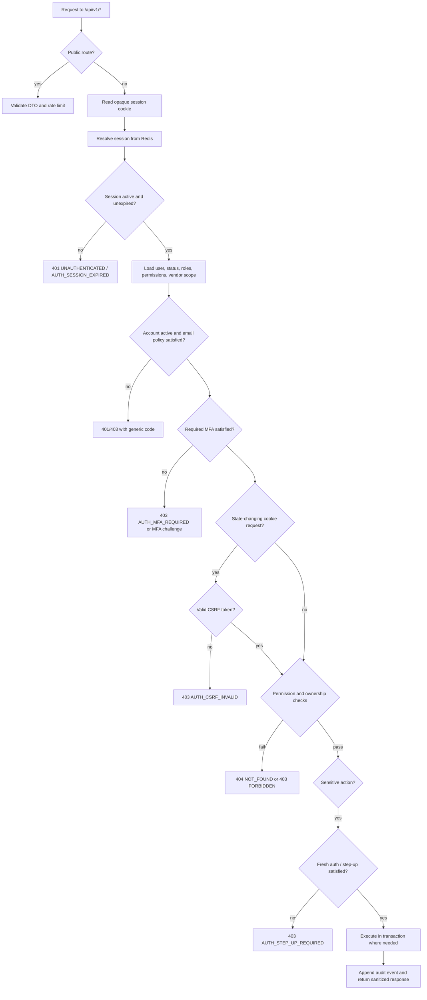

# Authentication Implementation Plan

**Project:** TradeOrbit 
**Document type:** Implementation plan — no application code modified 
**Status:** Approved implementation plan; G1–G8 recorded below; application implementation not started 
**Prepared:** 2026-11-22 
**Related source of truth:** `docs/requirements/Task_2_Complete_Ecommerce_Marketplace_Specification.pdf` 
**Canonical requirements:** `docs/requirements/SRS.md` 
**Existing verification baseline:** `docs/audits/TASK-2-VERIFICATION-REPORT.md`

## Approved G1–G8 decisions

The following decisions were human-approved on 2026-11-22 and are recorded here before implementation.

| Gate | Approved decision | Implementation consequence | Related IDs |
|---|---|---|---|
| G1 | MFA is mandatory for Vendor Owner, Vendor Staff, Admin, Super Admin, Support, and Finance; optional for Customer; mandatory for Warehouse/Fulfilment; configurable for Delivery/Logistics pending further approval | Enforce centrally after authentication and before module permission guards; do not allow mandatory roles to disable MFA | `FR-COMP-001`, `SEC-002`, `SEC-AUTH-003`, `SEC-AUTH-005`, `DEC-010` |
| G2 | Use NestJS authentication with Redis-backed server-side sessions, secure HttpOnly cookies, and CSRF protection | Use opaque session IDs, backend validation/revocation, cookie `SameSite` policy, and `X-CSRF-Token`; do not store tokens in browser storage | `SEC-AUTH-004`, `API-009`, `TEC-009`, `ADR-AUTH-001` |
| G3 | An authenticated user whose email is unverified receives a restricted session limited to email verification and resend-verification; all other protected features are blocked | Apply a server-side allowlist guard; return a generic authorization error for non-allowlisted routes | `FR-CUS-001`, `BR-VEN-001`, `AC-CUST-001`, `AC-002-01` |
| G4 | Argon2id `19 MiB`, `2` iterations, parallelism `1` subject to benchmarking; customer idle `12 hours` and absolute `30 days`; privileged idle `30 minutes` and absolute `8 hours`; verification link `24 hours`; password reset `1 hour`; `5` failed logins causes a `15-minute` lockout; `5` failed MFA attempts with rate limiting; `10` single-use hashed recovery codes; TOTP `6 digits`, `30-second` interval, `±1` interval, replay prevention; resend `1/hour` and `3/day` plus IP rate limiting; login history `90 days`; audit events `1 year`; revoked session metadata `90 days`; never log passwords, OTPs, or raw tokens | Store as validated configuration, add retention jobs, test every threshold, and redact secrets in logs | `DEC-020`, `API-ENV-005`, `SEC-FRAUD-005` |
| G5 | Guest checkout is allowed; use secure guest identity; associate eligible guest orders after verified registration; never merge using unverified email alone | Add guest identity/order claim flow with verified-email and eligibility checks | `SRS-ROLE-001`, `FR-CHK-002`, `BR-CHK-002`, `DEC-012` |
| G6 | Optional Google sign-in is in scope for customers; require secure account linking; do not auto-link by email; existing roles and MFA policies remain unchanged | Add provider adapter, state/PKCE, verified subject binding, explicit linking, and Google-specific tests | `FR-CUS-001`, `SEC-AUTH-001`, `DEC-016` |
| G7 | Use a separate admin portal with a centralized auth backend and shared PostgreSQL database | Admin portal consumes backend auth, RBAC, sessions, CSRF, and audit events; no separate user store or role authority | `SRS-PORTAL-003`, `SRS-ROLE-015`, `DEC-011` |
| G8 | Use a pnpm workspaces monorepo with the approved TradeOrbit stack | Use `pnpm-workspace.yaml`, `pnpm-lock.yaml`, shared TypeScript/lint config, and approved NestJS/Next.js/Prisma/Redis tooling | `AGENTS.md`, `TEC-001`–`TEC-022` |

Remaining implementation prerequisites are external details, not unresolved G1–G8 policy decisions: Google OAuth credentials/configuration, MFA encryption key management, guest-order eligibility details, and legal/security review of retention implementation. Do not silently invent values for those prerequisites. No code, migrations, infrastructure, or dependencies were created while producing this plan.

---

## 1. Existing authentication functionality

### 1.1 Repository inspection result

The repository currently contains documentation, git metadata, and root workspace foundation configuration; application source code has not been implemented yet.

Historical note: the original repository-state descriptions in this section were written before the root foundation files were created. The statements below reflect the current repository while preserving the original application-implementation baseline.

- Root entries include `.git/`, `AGENTS.md`, `README.md`, `docs/`, `package.json`, `pnpm-workspace.yaml`, `tsconfig.base.json`, `.gitignore`, and `.env.example`.
- No `src/`, `apps/`, `backend/`, or `frontend/` application directories exist. `pnpm-lock.yaml` is pending because dependency installation has not been performed.
- No NestJS modules, controllers, services, guards, DTOs, decorators, or middleware.
- No Next.js pages, components, auth forms, hooks, or client API layer.
- No `schema.prisma`, Prisma migrations, SQL DDL, or database models.
- No Redis client, session store, queue setup, or BullMQ workers.
- No OpenAPI/Swagger document.
- No Jest, Supertest, or Playwright tests.
- `.env.example` exists as a documentation-only template; real secrets configuration and encryption-key management are not implemented.
- No Docker or CI configuration.

This partially matches `docs/audits/TASK-2-VERIFICATION-REPORT.md`, which records no implemented requirements and no application source code; the root workspace foundation configuration now exists.

### 1.2 Existing documented functionality to reuse

There is no code to reuse, but the following documented designs should be preserved rather than replaced:

| Area | Existing design to reuse | IDs / location |
|---|---|---|
| Versioned REST prefix | `/api/v1/...` | `API-001` |
| OpenAPI requirement | Document schemas, examples, errors, authentication, and endpoint permissions | `API-002`, `DEL-API-001` |
| Error envelope | Stable codes such as `UNAUTHENTICATED`, `FORBIDDEN`, `VALIDATION_FAILED`, `RATE_LIMITED` | `API-ERR`, `API-ENV-001`–`API-ENV-004` |
| Correlation IDs | Correlation/request ID on every response and structured log | `API-ENV-002` |
| Existing auth endpoints | `POST /api/v1/auth/register`, `POST /api/v1/auth/login`, `POST /api/v1/auth/password-reset`, `GET /api/v1/me`, `PATCH /api/v1/me` | `API-CUST` |
| Vendor registration | `POST /api/v1/vendor/applications` and vendor approval lifecycle | `API-VEN`, `FR-VEN-001`–`003`, `AC-002-01`–`AC-002-05` |
| Roles | Guest, customer, vendor, vendor staff, admin, support, warehouse/fulfilment, delivery/logistics, finance, super-admin | `SRS-ROLE-001`–`SRS-ROLE-010` |
| Permission separation | Public, customer, vendor, operations, admin, super-admin | `API-007`, `API-PERM-001`–`API-PERM-008` |
| Ownership rules | Customers own their carts/orders/returns/tickets/profile; vendors scoped to owning vendor | `SEC-AUTHZ-005`, `SEC-AUTHZ-006` |
| Central identity module | Identity owns users, credentials, sessions, roles, permissions, and authorization policy evaluation | `ARC-DOMAIN-IDENTITY` |
| Audit module | Append-only security and privileged-action audit records | `ARC-DOMAIN-AUDIT`, `SEC-AUDIT-001`–`006` |
| Redis | Cache, rate limiting, queues, and sessions where appropriate | `TEC-009`, `ARC-DATA-002` |
| Email integration | Transactional verification and alert emails | `INT-EMAIL` |

### 1.3 Confirmed gaps from documentation

The documented auth surface is partial. The API catalogue does not define logout, verification completion, reset confirmation, MFA, recovery codes, session/device management, CSRF token issuance, or step-up verification endpoints.

---

## 2. Missing functionality

| # | Missing capability | Required by / rationale |
|---|---|---|
| M01 | Complete NestJS application skeleton with validation, configuration, error filtering, and correlation IDs | `AGENTS.md`, `API-002`–`API-009` |
| M02 | PostgreSQL/Prisma schema and migration for identity, tokens, MFA, sessions, devices, login history, and audit events | `DB-001`–`DB-010`, `DB-ENT-001`, `DB-ENT-012` |
| M03 | Argon2id password hashing and secure password policy | Phase 4 request, `SEC-AUTH-002`, `SEC-002` |
| M04 | Customer registration with strict DTO whitelisting and no privileged role assignment | Phase 3 request, `FR-CUS-001` |
| M05 | Vendor registration/application that does not grant approval or vendor-only access | Phase 3 request, `AC-002-04` |
| M06 | Email verification token issuance, hashing, expiry, single-use consumption, and resend with rate limiting | Phase 3 request, `BR-VEN-001` |
| M07 | Duplicate-email prevention with non-enumerating responses | Phase 3/4 request, `SEC-APP-004` |
| M08 | Login with generic failure message, account status checks, and brute-force protection | Phase 4 request, `SEC-AUTH-006`, `SEC-FRAUD-005` |
| M09 | Secure password reset request/confirmation with hashed, expiring, single-use tokens | Phase 4 request, `FR-CUS-001` |
| M10 | Logout and logout from all devices with session revocation | `SEC-AUTH-004`, Phase 7 request |
| M11 | Redis-backed opaque server-side sessions, HttpOnly cookies, rotation, expiry, and device metadata | `SEC-AUTH-004`, `TEC-009` |
| M12 | CSRF protection for cookie-authenticated state-changing requests | `FR-COMP-004`, `SEC-APP-002`, `SEC-VER-003` |
| M13 | TOTP MFA enrollment, QR setup, initial OTP confirmation, and enforcement guards | Phase 5 request, `SEC-AUTH-003` |
| M14 | Encrypted TOTP secrets at rest with managed key and key versioning | Phase 5 request, `SEC-DATA-002`, `SEC-SECRETS-001` |
| M15 | Hashed single-use recovery codes and one-time atomic consumption | Phase 5 request |
| M16 | OTP replay prevention, brute-force throttling, and MFA audit/notifications | Phase 5 request, `SEC-AUDIT-001`–`006` |
| M17 | Recent-authentication/step-up guard for MFA disable/reset and sensitive admin actions | Phase 5 request, `SEC-AUTH-005`, `API-PERM-008` |
| M18 | DB-backed RBAC with roles, permissions, user-role scopes, and server-side guards on every protected endpoint | Phase 6 request, `FR-COMP-002`, `SEC-AUTHZ-001`–`008` |
| M19 | Resource ownership and vendor-scope enforcement to prevent IDOR and cross-vendor access | `SEC-AUTHZ-005`, `SEC-AUTHZ-006`, `API-PERM-002`–`004` |
| M20 | Protection against public privilege assignment and privilege escalation | Phase 2 request, `SEC-PRIN-001`, `SEC-AUTHZ-002`–`006` |
| M21 | Session/device management screens and API | Phase 7/10 request |
| M22 | Frontend auth screens with loading, validation, success, error, accessible, responsive states | Phase 10 request, `UX-STATE-001`, `NFR-ACC-001` |
| M23 | OpenAPI documentation for all auth endpoints, request/response schemas, and error codes | `API-002`, `DEL-API-001` |
| M24 | Automated security tests for all named scenarios in Phase 11 | `QA-003`, `QA-006`, `AC-QA-003`, `AC-QA-006`, `SEC-VER-001`, `SEC-VER-003` |
| M25 | Documentation updates preserving existing IDs and recording approved decisions plus unresolved details | Phase 12 request, `ARC-ADR-001`–`004` |
| M26 | Secure guest identity and verified guest-order association under G5 | `FR-CHK-002`, `BR-CHK-002`, `DEC-012` |
| M27 | Optional Google sign-in with explicit secure account linking under G6 | `FR-CUS-001`, `SEC-AUTH-001`, `DEC-016` |
| M28 | Separate admin portal consuming centralized auth, RBAC, sessions, CSRF, audit, and shared PostgreSQL under G7 | `SRS-PORTAL-003`, `SRS-ROLE-015`, `DEC-011` |
| M29 | Validated G4 security configuration and retention jobs | `DEC-020`, `API-ENV-005`, `SEC-FRAUD-005` |
| M30 | G3 restricted-session allowlist on every protected endpoint | `FR-CUS-001`, `BR-VEN-001`, `AC-CUST-001`, `AC-002-01` |

---

## 3. Recommended architecture

### 3.1 Architecture decision

Because no authentication architecture exists, there is no existing JWT/cookie design to replace. The approved design is a **modular NestJS identity module with authoritative Redis-backed opaque sessions delivered via secure HttpOnly cookies**, backend session validation and revocation, and CSRF protection.

This aligns with:

- `ARC-DOMAIN-IDENTITY`: identity owns users, credentials, sessions, roles, permissions, and authorization policy evaluation.
- `TEC-009` / `ARC-DATA-002`: Redis is appropriate for sessions, cache, and rate limiting.
- `SEC-AUTH-004`: secure session/token handling, expiry, revocation, and cookie settings.
- G2: Redis-backed NestJS sessions, HttpOnly cookies, and CSRF are approved.

Trade-offs versus JWT:

| Option | Trade-off |
|---|---|
| Opaque Redis sessions (**approved**) | Immediate revocation, simple device management, no client-side token storage, CSRF required for cookie auth, Redis availability dependency, one Redis lookup per request. |
| Stateless JWT | Not selected: no session lookup, but difficult immediate revocation, requires refresh/denylist design, and higher key/rotation complexity. |
| JWT in `localStorage` | Rejected: XSS token theft risk and explicit Phase 7 prohibition. |

`ADR-AUTH-001` must be written before code to record the approved context, consequences, and rejected alternatives.

### 3.2 Request authentication pipeline

### 3.3 Modules and responsibilities

| Module | Responsibility |
|---|---|
| `IdentityModule` | Registration, login, logout, verification, password reset, account status, user profile |
| `SessionModule` | Redis session lifecycle, cookies, CSRF tokens, device records, session rotation/revocation |
| `MfaModule` | TOTP enrollment/verification, encrypted secrets, recovery codes, MFA policy evaluation, challenges |
| `AuthorizationModule` | Roles, permissions, user-role scopes, permission guards, ownership policies |
| `AuditModule` | Append-only security audit events and correlation IDs |
| `VendorModule` | Reuse existing documented vendor application/approval flow; grant vendor role only after approval |
| `NotificationModule` | Queue-backed verification, reset, and MFA-change emails via `INT-EMAIL` |
| `AdminModule` | User/role/permission administration and sensitive action endpoints |
| `ExternalIdentityModule` | Optional Google sign-in and explicit secure account linking under G6; no email-only auto-link |
| `GuestModule` | Secure guest identity and verified guest-order association under G5 |
| `PrismaModule` / `RedisModule` | Infrastructure access only; no business logic |

G7 approves a separate admin portal that consumes the centralized auth backend and shared PostgreSQL database. Do not create a second identity provider, role store, or session authority.

### 3.4 Token and credential classification

| Data | Storage | Exposure rule |
|---|---|---|
| Password | Argon2id hash in PostgreSQL | Never returned, logged, or placed in JWT/session |
| Email verification token | SHA-256 or HMAC hash in PostgreSQL; raw token only in email | Never logged; single-use; expires |
| Password reset token | SHA-256 or HMAC hash in PostgreSQL; raw token only in email | Never logged; single-use; expires; invalidates password sessions |
| TOTP secret | AES-256-GCM envelope encryption with managed key; key ID/version stored | Returned once during enrollment only; never logged |
| Recovery code | Argon2id hash in PostgreSQL; masked hint only | Displayed once at generation/regeneration; never logged |
| Session ID | Random opaque ID; cookie value; hash stored in Redis/PostgreSQL | Never in URL, localStorage, logs, or error responses |
| CSRF token | Random token bound to session; hash stored with session | Returned to frontend only via protected response/header |
| Audit event | Append-only PostgreSQL table | Sanitized metadata only; no secrets, OTPs, codes, tokens, passwords |

---

## 4. User-role permission matrix

### 4.1 Role mapping to existing requirements

The requested role labels map to existing documented roles as follows. Do not merge them without new approval.

| Requested label | Existing canonical role | Notes |
|---|---|---|
| Customer | `SRS-ROLE-002` | Own profile, addresses, cart, orders, returns, reviews, tickets |
| Vendor | `SRS-ROLE-003` | Vendor owner; access only after approval |
| Vendor staff | `SRS-ROLE-004` | Included because documented and permission-scoped |
| Admin | `SRS-ROLE-005` | Fine-grained admin permissions |
| Super Admin | `SRS-ROLE-010` | Highest platform administration |
| Support Staff | `SRS-ROLE-006` | Support tickets and approved support information |
| Delivery / Fulfilment Staff | `SRS-ROLE-007` and `SRS-ROLE-008` | Preserve warehouse/fulfilment and delivery/logistics as separate roles unless approved otherwise |
| Finance operator | `SRS-ROLE-009` | Existing documented finance role; sensitive actions require explicit permission and audit |

### 4.2 Authentication policy by role

| Role | Login methods | Email verification | MFA policy | Additional gate |
|---|---|---|---|---|
| Guest | Secure guest identity; no account login | N/A | N/A | Guest checkout approved under G5; eligible orders associate only after verified registration |
| Customer | Email/password or optional Google sign-in with explicit linking | Required | Optional | Unverified sessions are restricted to email verification and resend under G3 |
| Vendor owner | Email/password | Required | Mandatory | Vendor application approved; no vendor access before approval |
| Vendor staff | Email/password | Required | Mandatory | Vendor-owner-assigned permissions; subordinate to vendor owner |
| Admin | Email/password | Required | Mandatory | Explicit admin permissions; step-up for sensitive actions |
| Super Admin | Email/password | Required | Mandatory | Highest permissions; all sensitive actions audited |
| Support Staff | Email/password | Required | Mandatory | Assigned tickets/responsibilities only |
| Warehouse / Fulfilment Staff | Secure login | Required | Mandatory | Assigned fulfilment units/stock locations only |
| Delivery / Logistics Staff | Secure login | Required | Configurable pending further approval | Assigned shipment/exception context only; policy changes are audited |
| Finance operator | Email/password | Required | Mandatory | Explicit finance permissions; audit and separation of duties |

MFA policy values above are approved under G1; only the Delivery/Logistics configurable setting remains pending a separate approval.

### 4.3 Permission matrix

Legend: `Own` = caller-owned resources only; `Vendor` = caller's approved vendor only; `Assigned` = explicitly assigned records only; `Permission` = named permission required; `Global` = platform-wide; `—` = no access.

| Resource / action | Guest | Customer | Vendor owner/staff | Admin | Super Admin | Support | Warehouse/fulfilment | Delivery | Finance |
|---|---|---|---|---|---|---|---|---|---|
| Register account | Yes, customer only | — | Via vendor application | Admin-created only | Admin-created only | Admin-created only | Admin-created only | Admin-created only | Admin-created only |
| Link Google sign-in | — | Explicit authenticated or verified-provider linking only | — | Permission where applicable | Permission where applicable | — | — | — | — |
| Claim eligible guest order | After verified registration only | Own claimed orders | — | — | — | — | — | — | — |
| View/edit own profile | — | Own | Own | Permission | Permission | Own | Own | Own | Own |
| Change own password | — | Yes | Yes | Yes | Yes | Yes | Yes | Yes | Yes | Yes |
| Manage own addresses/cart | — | Own | — | — | — | — | — | — | — |
| View own orders | — | Own | — | — | — | — | — | — | — |
| View vendor-assigned orders | — | — | Vendor + permission | Global permission | Global | Assigned support context | Assigned fulfilment | Assigned shipment context | Finance context only |
| Manage products/variants/media | — | — | Vendor + permission | Permission | Permission | — | — | — | — |
| Manage inventory/stock | — | — | Vendor + permission | Permission | Permission | — | Assigned | — | — |
| Store profile | — | — | Vendor + permission | Permission | Permission | Read support context | — | — | — |
| Vendor staff and permissions | — | — | Vendor owner only; staff cannot self-grant | Permission | Permission | — | — | — | — |
| Vendor approval/rejection/suspension | — | — | — | Permission | Permission | — | — | — | — |
| View vendor financial records | — | — | Vendor + permission | Permission | Permission | Dispute context only | — | — | Permission |
| Refunds/commissions/payouts | — | — | Limited vendor-visible statements/admin-initiated payout status | Permission + audit | Permission + audit | Dispute context only | — | — | Permission + audit |
| Tickets/messages/internal notes | — | Own tickets | Vendor-related tickets | Permission | Permission | Assigned + responsibility | Escalation context | Delivery exception context | Dispute context |
| Shipments and milestones | — | Own order tracking | Vendor shipments | Permission | Permission | Support context | Dispatch context | Assigned only | — |
| Admin user/role management | — | — | — | Limited permission | Global + audit | — | — | — | — |
| Role/permission definitions | — | — | — | — | Global + audit | — | — | — | — |
| Security settings and audit log | — | — | — | Read assigned permission | Global + audit | — | — | — | — |
| MFA enrollment/disable/reset for self | — | Optional enrollment/disable; reset after step-up | Mandatory enrollment/reset; disable denied | Mandatory enrollment/reset; disable denied | Mandatory enrollment/reset; disable denied | Mandatory enrollment/reset; disable denied | Mandatory enrollment/reset; disable denied | Configurable policy; changes audited | Mandatory enrollment/reset; disable denied |
| MFA reset for another user | — | — | — | Permission + strong audit | Global + audit | — | — | — | — |
| Sessions/devices for self | — | Own | Own | Own | Own | Own | Own | Own | Own |
| Revoke sessions for another user | — | — | — | Permission + audit | Permission + audit | — | — | — | — |

### 4.4 Enforcement rules

1. Public registration DTOs accept only `email`, `password`, `firstName`, `lastName`, optional phone, and consent fields. `role`, `permissions`, `vendorId`, `status`, `emailVerified`, and `mfaEnabled` are forbidden properties.
2. Roles and permissions are read only from the authenticated server-side principal, never from request bodies, query parameters, or frontend state.
3. Every protected route must declare a permission and, where applicable, a scope resolver (`OWN`, `VENDOR`, `ASSIGNED`, `GLOBAL`).
4. Vendor ownership is resolved from `UserRole.vendorId` or `Vendor.ownerUserId`, not from a client-supplied vendor ID.
5. Missing ownership returns `404 NOT_FOUND` where revealing existence would leak data; otherwise `403 FORBIDDEN`.
6. Role or permission changes rotate/terminate affected sessions and increment `User.roleVersion`; guards reject stale principals.
7. Super-admin actions require an explicit permission, fresh authentication, and an append-only audit event.
8. Vendor approval is a separate state transition in `Vendor`/`VendorApplication`; registering or verifying email must never grant it.
9. An unverified authenticated session may call only email verification and verification resend until G3 is satisfied.
10. Guest orders are associated only after verified registration and documented eligibility checks; unverified email match alone is never sufficient.
11. Google sign-in uses state/PKCE and explicit linking; provider email match alone never links to an existing account and never changes roles or MFA policy.
12. The separate admin portal uses the same backend principal, permission guards, session store, CSRF policy, audit trail, and PostgreSQL database as the customer and vendor surfaces.

---

## 5. Database changes

No Prisma schema exists, so this is an initial identity baseline. If any database is later found to exist, use additive, reviewable migrations only; never delete user data or run destructive migrations without explicit approval.

### 5.1 Proposed Prisma models

| Model | Key fields | Constraints / indexes |
|---|---|---|
| `User` | `id`, `email`, `emailNormalized`, `phone`, `passwordHash`, `status`, `emailVerifiedAt`, `phoneVerifiedAt`, `failedLoginCount`, `lockedUntil`, `mustChangePassword`, `roleVersion`, `createdAt`, `updatedAt`, `deletedAt` | Unique `emailNormalized`; unique `phone` where present; index `(status, createdAt)`; partial/hard delete policy via `deletedAt`; status enum `ACTIVE`, `PENDING_VERIFICATION`, `SUSPENDED`, `REJECTED`, `TERMINATED` |
| `Role` | `id`, `code`, `name`, `scope`, `status`, timestamps | Unique `code`; scope enum `GLOBAL`, `VENDOR`, `CUSTOMER` |
| `Permission` | `id`, `code`, `resource`, `action`, `description`, timestamps | Unique `code`; index `(resource, action)` |
| `RolePermission` | `id`, `roleId`, `permissionId`, timestamps | Unique `(roleId, permissionId)`; FKs restrict |
| `UserRole` | `id`, `userId`, `roleId`, `vendorId?`, `scopeKey`, `status`, `grantedByUserId?`, `grantedAt`, `expiresAt?` | Unique `(userId, roleId, scopeKey)`; indexes on `userId`, `vendorId`, `roleId`, `status`; FK to `Vendor` when introduced |
| `ExternalIdentityLink` | `id`, `userId`, `provider`, `providerSubject`, `providerEmailVerifiedAt?`, `linkedBy`, `linkedAt`, `revokedAt` | Unique `(provider, providerSubject)`; index `(userId, provider)`; explicit linking only; no email-only uniqueness |
| `GuestIdentity` | `id`, `guestTokenHash`, `emailHash?`, `status`, `expiresAt`, `convertedUserId?`, `convertedAt`, `createdAt` | Unique `guestTokenHash`; index `(emailHash, status)`; secure opaque token; no privileged claims |
| `EmailVerificationToken` | `id`, `userId`, `tokenHash`, `purpose`, `expiresAt`, `consumedAt`, `createdAt` | Unique `tokenHash`; index `(userId, expiresAt)`; FK cascade from user |
| `PasswordResetToken` | `id`, `userId`, `tokenHash`, `expiresAt`, `consumedAt`, `revokedAt`, `createdAt` | Unique `tokenHash`; index `(userId, expiresAt)`; issue revokes prior active tokens |
| `MfaEnrollment` | `id`, `userId`, `status`, `encryptedSecret`, `encryptionKeyId`, `encryptionKeyVersion`, `algorithm`, `digits`, `periodSeconds`, `lastUsedTotpStep`, `enabledAt`, `createdAt`, `updatedAt` | Unique `userId`; index `(status, enabledAt)`; one active TOTP enrollment per user |
| `MfaRecoveryCode` | `id`, `userId`, `enrollmentId`, `codeHash`, `maskedHint`, `usedAt`, `createdAt` | Unique `codeHash`; index `(userId, usedAt)`; FK cascade from enrollment |
| `Session` | `id`, `sessionTokenHash`, `familyId`, `userId`, `deviceId`, `status`, `expiresAt`, `lastSeenAt`, `revokedAt`, `csrfTokenHash?`, `ipHash`, `userAgentHash`, timestamps | Unique `sessionTokenHash`; indexes `(userId, status, expiresAt)`, `(familyId)`, `(expiresAt)`; Redis is authoritative for active sessions |
| `Device` | `id`, `userId`, `label`, `browser`, `os`, `firstSeenAt`, `lastSeenAt`, `revokedAt` | Unique `(userId, label)` or stable device hash; index `(userId, lastSeenAt)` |
| `LoginHistory` | `id`, `userId?`, `emailHash`, `outcome`, `reasonCode`, `ipHash`, `userAgentHash`, `sessionId?`, `occurredAt` | Indexes `(userId, occurredAt)`, `(emailHash, occurredAt)`, `(outcome, occurredAt)`; no raw password/OTP/token; retain `90 days` under G4 |
| `SecurityAuditEvent` | `id`, `actorUserId?`, `actorRoleCode?`, `action`, `targetType`, `targetId?`, `outcome`, `metadata`, `correlationId`, `ipHash`, `userAgentHash`, `occurredAt` | Append-only; indexes `(actorUserId, occurredAt)`, `(action, occurredAt)`, `(targetType, targetId)`, `(correlationId)`; retain `1 year` under G4 |
| `IdempotencyRecord` | Existing documented pattern: `scope`, `idempotencyKey`, `requestFingerprint`, `status`, `responseReference`, timestamps | Unique `(scope, idempotencyKey)`; reuse for sensitive account mutations if approved |
| `VendorApplication` / `Vendor` / `VendorStaff` | Minimal links required for role scope and approval checks | Coordinate with vendor module; do not duplicate KYC/finance logic |

### 5.2 Integrity and security rules

- Store `emailNormalized` and password/recovery hashes only; never plaintext.
- Token hashes use SHA-256 or HMAC with a server-side pepper from secrets configuration; raw tokens are never persisted.
- TOTP secrets use envelope encryption: data encryption key per environment, key ID/version stored with ciphertext, AES-256-GCM with AAD including user ID and purpose.
- Audit events are insert-only at the application layer; database role should prevent `UPDATE`/`DELETE` for the API user where supported.
- Sessions are revoked in Redis and marked revoked in PostgreSQL; PostgreSQL is durable metadata/history, Redis is active-state authority.
- Use foreign keys with restrictive deletes for audit/login history; token/session rows may cascade only if a user is fully and lawfully removed under an approved retention workflow.
- Add indexes for token lookup, session lookup, audit queries, login history, and role scope resolution.
- All multi-step critical operations use `$transaction`:
  - reset token consume + password hash update + session revocation + audit;
  - MFA activation + recovery-code insert + audit;
  - recovery-code consume + session rotation + audit;
  - role grant/revoke + role version increment + session rotation + audit;
  - vendor approval + vendor role grant + audit;
  - Google provider linking + external identity record + audit;
  - verified guest-order association + guest identity conversion + audit.
- Retention jobs use the approved G4 periods: login history `90 days`, audit events `1 year`, and revoked session metadata `90 days`; legal-hold exclusions and configurable scheduling are required.
- Structured logging must redact or omit passwords, OTPs, raw tokens, TOTP secrets, recovery codes, session IDs, and CSRF token values.
- Security limits and TTLs are validated configuration, not hard-coded constants; approved G4 defaults apply and changes require security review.

### 5.3 Migration approach

1. Create `prisma/schema.prisma` as the first baseline schema.
2. Generate migration with `prisma migrate dev --create-only`; review generated SQL before applying.
3. Apply only to local/test databases first.
4. Production migration must be additive, reviewed, backed up, and approved; no `prisma db push`, no destructive SQL, no data deletion.
5. Seed only synthetic test users, roles, and permissions; never real customer credentials.

---

## 6. API endpoint plan

All paths use `/api/v1`. Existing documented paths are retained; new paths are additive.

### 6.1 Public authentication endpoints

| Method | Path | Purpose | Key responses |
|---|---|---|---|
| POST | `/api/v1/auth/register` | Customer registration; ignores/forbids privileged fields | `202 REGISTRATION_ACCEPTED` with generic message |
| POST | `/api/v1/auth/google/start` | Start optional Google sign-in/linking with state/PKCE | `200` with provider authorization context |
| POST | `/api/v1/auth/google/callback` | Complete Google provider verification; never auto-link by email | `200` sign-in/link result or `403 AUTH_EXTERNAL_LINK_REQUIRED` |
| POST | `/api/v1/auth/guest/session` | Issue secure guest identity for checkout under G5 | `200` with opaque guest context; no account privileges |
| POST | `/api/v1/vendor/applications` | Vendor registration/application; no approval granted | `202 APPLICATION_SUBMITTED` |
| POST | `/api/v1/auth/email/verify` | Consume email verification token | `200 EMAIL_VERIFIED`, `400/410 AUTH_TOKEN_INVALID_OR_EXPIRED` |
| POST | `/api/v1/auth/email/verification/resend` | Resend verification email with rate limiting | Always `202 ACCEPTED` generic |
| POST | `/api/v1/auth/password-reset` | Start password reset (existing path retained) | Always `202 ACCEPTED` generic |
| POST | `/api/v1/auth/password-reset/confirm` | Complete reset with single-use token | `200 PASSWORD_RESET`, `400/410 AUTH_TOKEN_INVALID_OR_EXPIRED` |
| POST | `/api/v1/auth/login` | Authenticate; may return MFA challenge | `200`, `403 AUTH_MFA_REQUIRED`, `403 AUTH_MFA_ENROLLMENT_REQUIRED`, `401 AUTH_INVALID_CREDENTIALS` |
| POST | `/api/v1/auth/mfa/login/verify` | Verify TOTP during login | `200` with rotated session, `401 AUTH_MFA_INVALID_CODE` |
| POST | `/api/v1/auth/mfa/recovery` | Use recovery code during login | `200` with rotated session, `401 AUTH_MFA_RECOVERY_INVALID` |
| GET | `/api/v1/auth/csrf` | Issue session-bound CSRF token after login | `200` with token; cookie remains HttpOnly |

### 6.2 Authenticated identity and session endpoints

| Method | Path | Permission / guard | Purpose |
|---|---|---|---|
| GET | `/api/v1/me` | Authenticated | Profile and policy status, excluding secrets/tokens |
| PATCH | `/api/v1/me` | Authenticated + CSRF | Update profile/preferences/consent; email change requires re-verification |
| POST | `/api/v1/auth/google/link` | Authenticated + CSRF | Explicitly link verified Google subject to current account |
| DELETE | `/api/v1/auth/google/link` | Authenticated + CSRF + fresh auth | Unlink Google sign-in while preserving password access policy |
| POST | `/api/v1/auth/guest/claim` | Authenticated + verified email + CSRF | Associate eligible guest orders after verified registration |
| POST | `/api/v1/auth/logout` | Authenticated + CSRF | Revoke current session and clear cookie |
| GET | `/api/v1/auth/sessions` | Authenticated | List active sessions/devices |
| DELETE | `/api/v1/auth/sessions/{id}` | Authenticated + CSRF + own session | Revoke one session/device |
| DELETE | `/api/v1/auth/sessions` | Authenticated + CSRF | Logout from all devices; revoke session family/all sessions |
| GET | `/api/v1/auth/mfa/status` | Authenticated | MFA enabled status, recovery-code count, policy requirement |
| POST | `/api/v1/auth/mfa/enrollment` | Authenticated + fresh password auth | Start TOTP setup; returns secret/QR once |
| POST | `/api/v1/auth/mfa/enrollment/confirm` | Authenticated + CSRF | Verify initial OTP, activate MFA, display recovery codes once |
| POST | `/api/v1/auth/mfa/recovery-codes/regenerate` | Authenticated + CSRF + fresh MFA auth | Replace all recovery codes |
| DELETE | `/api/v1/auth/mfa` | Authenticated + CSRF + fresh MFA auth | Disable optional MFA; denied for mandatory roles |
| POST | `/api/v1/auth/mfa/reset` | Super-admin or self step-up | Reset MFA; revoke sessions; require re-enrollment |
| POST | `/api/v1/auth/step-up` | Authenticated + CSRF | Start step-up challenge for sensitive action |
| POST | `/api/v1/auth/step-up/verify` | Authenticated + CSRF | Verify password/OTP for step-up |

### 6.3 Authorization administration endpoints

| Method | Path | Permission |
|---|---|---|
| GET | `/api/v1/admin/roles` | Admin role-read permission or Super Admin |
| POST | `/api/v1/admin/roles` | Super Admin + fresh auth + audit |
| PATCH | `/api/v1/admin/roles/{id}` | Super Admin + fresh auth + audit |
| GET | `/api/v1/admin/permissions` | Admin permission-read or Super Admin |
| POST | `/api/v1/admin/users` | Admin/Super Admin user-create permission; privileged roles require Super Admin |
| PATCH | `/api/v1/admin/users/{id}/status` | Admin/Super Admin + audit |
| POST | `/api/v1/admin/users/{id}/roles` | Super Admin for privileged roles; Admin only within granted scope |
| DELETE | `/api/v1/admin/users/{id}/roles/{roleId}` | Super Admin or scoped Admin + audit |
| POST | `/api/v1/admin/users/{id}/sessions/revoke` | Admin/Super Admin + audit |
| GET | `/api/v1/admin/audit-events` | Super Admin or explicit audit-read permission |

### 6.4 Validation, response, and error rules

- DTOs use `whitelist: true`, `forbidNonWhitelisted: true`, `transform: true`, strict email normalization, password strength validation, and bounded string lengths.
- OTP body values are validated as 6-digit strings but never logged.
- Token bodies are opaque strings with length bounds; never logged.
- All auth failures use stable generic messages. Duplicate registration, resend verification, and forgot password return generic `202` responses.
- Auth-specific error codes to document in OpenAPI:

| HTTP | Code | Meaning |
|---|---|---|
| 400 | `VALIDATION_FAILED` | Field validation failed |
| 401 | `AUTH_INVALID_CREDENTIALS` | Generic login failure |
| 401 | `AUTH_SESSION_EXPIRED` | Session missing, expired, or revoked |
| 403 | `AUTH_ACCOUNT_DISABLED` | Status prevents access; no reason detail |
| 403 | `AUTH_VENDOR_APPROVAL_REQUIRED` | Vendor not approved |
| 403 | `AUTH_EMAIL_UNVERIFIED_RESTRICTED` | Session restricted to verification endpoints under G3 |
| 403 | `AUTH_EXTERNAL_LINK_REQUIRED` | Google provider identity requires explicit secure linking |
| 409 | `AUTH_GUEST_ORDER_INELIGIBLE` | Guest order is not eligible for association |
| 403 | `AUTH_MFA_REQUIRED` | Mandatory MFA not satisfied |
| 403 | `AUTH_MFA_ENROLLMENT_REQUIRED` | Mandatory role must enroll |
| 403 | `AUTH_STEP_UP_REQUIRED` | Fresh authentication required |
| 403 | `AUTH_CSRF_INVALID` | Missing/invalid CSRF token |
| 401 | `AUTH_MFA_INVALID_CODE` | Invalid/expired/replayed OTP |
| 401 | `AUTH_MFA_RECOVERY_INVALID` | Invalid/used recovery code |
| 400/410 | `AUTH_TOKEN_INVALID_OR_EXPIRED` | Verification/reset token invalid, consumed, or expired |
| 429 | `AUTH_RATE_LIMITED` | Login, resend, OTP, or reset rate limit exceeded |
| 409 | `CONFLICT` | Authorized admin operation conflicts with current state |

- OpenAPI must document cookie auth, CSRF header `X-CSRF-Token`, request schemas, response envelopes, correlation ID, every endpoint's permission/scope, the G3 restricted-session allowlist, Google linking rules, and guest-order association rules.

---

## 7. Frontend screen plan

No frontend exists. G8 approves a pnpm workspaces monorepo, and G7 approves a separate admin portal; the approved stack remains Next.js/React/TypeScript/Tailwind. All frontends must consume centralized backend auth APIs and must not implement their own authorization authority.

### 7.1 Routes

| Route | Screen | States |
|---|---|---|
| `/register` | Customer registration | Loading, validation errors, generic success with verification instructions |
| `/auth/google/callback` | Google sign-in/link callback | Provider error, explicit-link required, linked, rate-limited |
| `/verify-email` | Verification confirmation and resend | Verifying, success, expired/invalid token, resend cooldown, restricted-session notice under G3 |
| `/vendor/apply` | Vendor registration/application | Multi-step form, validation, application status, mandatory MFA notice |
| `/account/guest-orders` | Guest-order claim after verified registration | Empty, eligible order list, ineligible explanation, success |
| `/login` | Email/password and Google login | Loading, generic failure, locked/temporary delay, unverified/MFA redirects, provider errors |
| `/forgot-password` | Request reset | Generic success regardless of email existence |
| `/reset-password` | Reset password with token | Invalid/expired token, password strength, success |
| `/mfa/enroll` | QR setup | Secret/QR shown once, copy fallback, loading, error |
| `/mfa/enroll/confirm` | Initial OTP confirmation | OTP input, invalid/replay error, success |
| `/mfa/verify` | Login OTP challenge | OTP input, rate-limit state, recovery link |
| `/mfa/recover` | Recovery code login | Single code input, invalid/used code error |
| `/mfa/recovery-codes` | One-time recovery code display | Mandatory acknowledgement, copy/download, no later re-display |
| `/security` | Security settings | MFA status, password change, policy notice, recent security events |
| `/security/sessions` | Device/session management | List, revoke device, revoke all, empty/error states |
| `/admin/security/mfa-reset` | Admin MFA reset workflow | Reason, fresh auth, confirmation, audit result |

The G7-approved separate admin portal consumes the centralized auth backend and shares PostgreSQL, RBAC definitions, Redis sessions, CSRF handling, and audit events. It must not maintain a separate user store, role table, or session cookie authority.

### 7.2 Shared components and conventions

- `AuthLayout`, `FormField`, `PasswordInput`, `PasswordStrengthMeter`, `OtpInput`, `QrSetupPanel`, `RecoveryCodeList`, `ErrorSummary`, `LoadingButton`, `SessionCard`.
- Keep API calls in `lib/auth/api.ts`, not in page components.
- Form/validation library selection remains provisional; do not introduce an unapproved major dependency.
- Store nothing sensitive in `localStorage`, `sessionStorage`, URLs, or analytics payloads.
- CSRF token is fetched into memory and sent in `X-CSRF-Token`.
- Use `aria-live` for status messages, labelled inputs, keyboard-operable OTP entry, visible focus states, high-contrast errors, and mobile-responsive layouts.
- Never render TOTP secrets or recovery codes after the one-time display; clear component state on navigation.

---

## 8. MFA implementation plan

### 8.1 Policy engine

- Store role-level MFA policy as code plus auditable configuration, not in the frontend.
- Approved policy values are `REQUIRED`, `OPTIONAL`, and `CONFIGURABLE`.
- Approved role policy:
  - Customer: `OPTIONAL`
  - Vendor Owner: `REQUIRED`
  - Vendor Staff: `REQUIRED`
  - Admin: `REQUIRED`
  - Super Admin: `REQUIRED`
  - Support: `REQUIRED`
  - Finance: `REQUIRED`
  - Warehouse/Fulfilment: `REQUIRED`
  - Delivery/Logistics: `CONFIGURABLE` pending further approval; changes are audited
- Global `MfaGuard` runs after authentication and before module permission guards, so direct API calls cannot bypass mandatory MFA.
- A mandatory user without active MFA receives a short-lived partial session limited to MFA enrollment, OTP verification, recovery, CSRF retrieval, `/me` policy status, and logout. It cannot access other protected resources until MFA is satisfied.

### 8.2 Enrollment flow

1. User authenticates with password; for optional MFA, require recent password confirmation before enrollment.
2. `POST /auth/mfa/enrollment` generates a random 20-byte TOTP secret.
3. Encrypt the secret with AES-256-GCM envelope encryption and store `MfaEnrollment` with `status=PENDING`.
4. Build `otpauth://totp/TradeOrbit:<email>?secret=...&issuer=TradeOrbit&algorithm=SHA1&digits=6&period=30`.
5. Return QR image/data URL and manual secret only in this response; set a short pending-enrollment expiry.
6. `POST /auth/mfa/enrollment/confirm` verifies an OTP using ±1 step and replay prevention.
7. In one transaction: mark enrollment `ACTIVE`, generate the approved `10` recovery codes with Argon2id hashes, rotate session, append audit event, queue notification.
8. Return recovery codes exactly once.

### 8.3 Login verification flow

1. Password login succeeds but mandatory MFA is not satisfied: issue partial session with `mfaStatus=REQUIRED`.
2. Client calls `/auth/mfa/login/verify` or `/auth/mfa/recovery`.
3. Verify OTP/recovery code with per-challenge attempt limits and replay/one-time checks.
4. On success, rotate session ID and CSRF token, update login history to success, append audit event, and issue normal session cookie.
5. On failure, increment throttling counters, append generic failure audit, and never log OTP/code values.

### 8.4 OTP and recovery-code security

- Reject OTP steps less than or equal to `lastUsedTotpStep`; atomically advance `lastUsedTotpStep`.
- Accept only ±1 interval drift with 6-digit, 30-second TOTP; enforce the approved `5` failed MFA attempt limit with per-enrollment, per-session, and per-IP rate limiting.
- Recovery codes are high-entropy, hashed with Argon2id, issued as exactly `10` single-use codes, and consumed using a conditional atomic update so two parallel requests cannot both succeed.
- Recovery-code use triggers audit, email notification, session rotation, and forced re-enrollment where required by mandatory MFA policy.
- Regeneration invalidates all previous codes in one transaction.
- Disable/reset requires fresh authentication; roles with mandatory MFA cannot disable MFA through direct API calls.

### 8.5 Reset, replacement, and notification

| Event | Flow | Audit event |
|---|---|---|
| Enrollment started | Fresh password auth; pending secret created | `MFA_ENROLLMENT_STARTED` |
| Enrollment confirmed | Valid OTP; codes returned once | `MFA_ENABLED` |
| Recovery code used | Consume atomically; rotate session | `MFA_RECOVERY_CODE_USED` |
| Recovery codes regenerated | Fresh MFA auth; old codes invalidated | `MFA_RECOVERY_CODES_REGENERATED` |
| Self disable | Optional MFA only; fresh MFA auth | `MFA_DISABLED` |
| Admin reset | Super Admin/privileged permission with reason; sessions revoked; user re-enrolls | `MFA_RESET_BY_ADMIN` |
| Failed OTP/recovery | Throttle; generic error | `MFA_VERIFICATION_FAILED` |
| Secret re-encryption | Key rotation job; no plaintext in logs | `MFA_SECRET_REKEYED` |

Notifications are sent after enrollment, disable, reset, recovery use, and code regeneration. Notification content must never include OTPs, recovery codes, TOTP secrets, or tokens.

---

## 9. Security risks

| Risk | Impact | Mitigation | Residual / unresolved item |
|---|---|---|---|
| MFA policy ambiguity | Wrong enforcement, failed acceptance, or silent requirement change | Use the approved G1 policy centrally; preserve IDs and test every role | Delivery/Logistics configurable setting requires separate approval |
| Session model regression | Inconsistent auth model, unsafe token storage | Use approved G2 Redis-backed opaque sessions, HttpOnly cookies, CSRF, backend validation/revocation, and `ADR-AUTH-001` | Verify implementation against ADR; no decision gate remains |
| Security configuration drift | Unreviewed hard-coded thresholds or retention | Use validated configuration with approved G4 values; test effective config | Benchmark Argon2id parameters and obtain legal/security sign-off for retention jobs |
| Unverified session scope ambiguity | Unverified users access protected data or are blocked inconsistently | Enforce the approved G3 restricted-session allowlist on every protected route | Verify allowlist coverage in API tests |
| Guest identity forgery or order mis-association | Guest orders attached to wrong account | Use secure identity, expiry, verified email, eligibility checks, and audited association under G5 | Guest-order eligibility details must be documented before implementation |
| Google account-linking takeover | Account takeover if provider identity is mislinked | Use explicit authenticated linking, state/PKCE, verified provider subject, and no email-only auto-link under G6 | Google OAuth configuration is an external prerequisite |
| Separate admin portal auth drift | Admin portal bypasses shared controls | Use centralized auth, shared RBAC, sessions, CSRF, audit, and PostgreSQL under G7 | Verify portal tests cover auth drift |
| Email enumeration | Account discovery via registration/reset/resend errors | Generic `202` responses and generic emails; DB unique constraint; no existence detail in errors | Verify in tests |
| Token leakage via URL/referrer/logs | Account takeover | Email links land on frontend; API accepts token in POST body; `Referrer-Policy: no-referrer`; log redaction; never log raw tokens | Test log output |
| TOTP secret exposure | MFA bypass | Envelope encryption, one-time display, no logging, no responses after enrollment, strict cache/response headers | MFA key-management provider and rotation procedure remain external dependencies |
| Recovery-code theft or reuse | Account takeover | High entropy, exactly `10` single-use Argon2id-hashed codes, one-time display, atomic consumption, notifications, audit | User storage/printing is outside application control |
| OTP replay/brute force | MFA bypass | Last-step tracking, ±1 interval, approved `5` attempt limit, challenge invalidation, IP/session throttling | Verify throttling under load and test configuration changes |
| CSRF on cookie-auth endpoints | State change without consent | Synchronizer CSRF token bound to session; `SameSite`; Origin/Referer checks where practical; rotate on login | Test all POST/PATCH/DELETE |
| Privilege assignment from public registration | Privilege escalation | Strict DTO whitelisting, server defaults, admin-only role endpoints, audit, session rotation | Negative tests required |
| Vendor approval bypass | Unauthorized vendor finance/order access | Separate approval state; role granted only after approval; guard checks every vendor endpoint | Verify with `AC-002-04` |
| IDOR/cross-vendor data access | Data breach | Central scope resolvers, ownership guards, 404 for hidden resources, repository filters always include scope | Matrix tests required |
| Stale roles in sessions | Privilege persists after revocation | Role version check, session rotation/revocation on role/status change | Include revocation tests |
| Redis compromise or unavailability | Session theft or outage | Random opaque IDs, hashes, approved G4 TTLs, network ACL, TLS, Redis persistence where appropriate, fail closed for session lookup | Availability SLO and failover topology remain unresolved |
| Audit log tampering or premature deletion | Loss of evidence | Append-only table, restricted DB role, correlation IDs, central collection, approved `1-year` retention | Legal hold and archive procedure require review |
| Email change after MFA enrollment | Recovery/notification to unverified address | Require fresh auth, re-verify new email, notify old email, revoke sessions | Implement and legally review verification copy and retention |
| Test shortcuts disabling MFA/CSRF | False confidence and production bypass | Use isolated test config only; never add production bypass flags; no secrets in tests | CI policy review |

---

## 10. Testing plan

Test framework follows approved stack: Jest + Supertest for backend, Playwright for E2E. All data is synthetic; no real customer credentials.

### 10.1 Unit tests

| Area | Cases |
|---|---|
| Password service | Argon2id hash/verify, wrong password, hash never equals plaintext, parameter config |
| Password policy | Too short, common/forbidden password, max length, unicode normalization |
| Token service | Randomness, hashing, expiry, consumed/revoked token rejection |
| TOTP service | Valid code, invalid code, expired code, ±1 step, replay rejection, last-step update |
| Recovery codes | Generation count, hash storage, valid use, reuse rejection, regeneration invalidation |
| Session policy | TTL, idle expiry, rotation, family revocation, role-version invalidation |
| Permission service | Every role/permission combination in matrix, unknown permission denial |
| Ownership resolvers | Own/vendor/assigned/global scope resolution and fail-closed behaviour |
| DTO validation | Missing fields, invalid email, weak password, forbidden `role`/`permissions` fields |
| G4 configuration | Argon2id parameters, approved TTLs, lockout/MFA/resend thresholds, retention periods, and config validation |
| G5 guest identity | Opaque guest tokens, expiry, verified registration, eligible-order association, and email-only merge rejection |
| G6 Google linking | State/PKCE validation, verified subject binding, explicit link/unlink, and role/MFA policy preservation |

### 10.2 Integration tests

| Area | Cases |
|---|---|
| Prisma constraints | Unique email/token/code/session, foreign keys, append-only audit assumptions |
| Transactions | Reset consume + password change + session revoke; MFA activation + recovery codes; role change + session rotation |
| Redis sessions | Create/read/expire/delete/rotate, revocation, all-device logout |
| CSRF | Missing token, invalid token, token from different session, token after login rotation |
| Encryption | TOTP secret encrypt/decrypt, key version change, wrong key/AAD failure, no plaintext in DB |
| Email queue | Verification/reset/MFA notification events queued with sanitized payloads |
| Rate limiting | Login, resend, OTP, and reset counters across time windows |

### 10.3 API security tests

- Valid and invalid login, including generic failure and locked account response.
- Duplicate registration returns non-enumerating response and creates only one user.
- Email verification valid, expired, reused, and malformed token.
- Verification resend rate limiting.
- Password reset valid, expired, reused, revoked by newer token, and unknown email generic response.
- Logout revokes current session only; all-device logout revokes all sessions.
- Session expiry and rotation after login, MFA activation, role change, and logout-all.
- Missing/invalid CSRF token on all state-changing cookie-auth endpoints.
- MFA enrollment, invalid OTP, expired OTP, replayed OTP, brute-force lockout.
- Recovery code use, reuse, invalid code, regeneration invalidation.
- Mandatory-MFA bypass attempts: direct calls to protected endpoints with partial session, forged role fields, replayed session, stale role.
- Step-up required for MFA disable/reset and sensitive admin actions.
- Unverified sessions are denied on every non-allowlisted protected endpoint under G3.
- Google sign-in rejects email-only auto-link and preserves existing roles and MFA policy.
- Guest orders are claimed only after verified registration and eligibility checks; unverified email match is rejected.
- Separate admin portal uses the centralized session, RBAC, CSRF, and audit controls.
- Unauthenticated access to every protected endpoint returns `401`.
- Customer cross-user access to profile, addresses, cart, orders, tickets, and sessions returns denial.
- Vendor cross-vendor product/order/finance access returns denial.
- Unapproved vendor access to vendor-only endpoints returns `403 AUTH_VENDOR_APPROVAL_REQUIRED`.
- Support access outside assigned responsibilities returns denial.
- Delivery access to unassigned shipment returns denial.
- Vendor staff self-granting permissions fails.
- Non-admin assigning privileged role during registration/admin creation fails.
- Super-admin sensitive action without audit record fails the test assertion.

### 10.4 E2E tests

| Journey | Coverage |
|---|---|
| Customer | Register → verify email → login → update security settings → manage sessions → logout |
| Customer MFA | Login → enroll → scan/verify OTP → view codes once → logout → login with OTP → recover with code |
| Vendor | Register/application → unapproved denial → admin approval → mandatory MFA enrollment → vendor access |
| Admin | Login → MFA → permission-bound action → sensitive action step-up → audit event present |
| Super Admin | Role change → affected session revoked → audit event present |
| Reset | Forgot password → reset email → reset → prior sessions invalid → login with new password |
| Accessibility | Keyboard-only forms, labelled OTP inputs, error summaries, focus management, responsive layouts |
| Google sign-in | Explicit link/unlink, duplicate-provider rejection, no email-only takeover |
| Guest checkout claim | Guest order → verified registration → eligible claim → duplicate/email-only rejection |
| Restricted session | Unverified login → verification endpoints only → full access after verification |

### 10.5 Execution and acceptance

- Run unit/integration/API tests in CI on every change.
- Run Playwright critical journeys before release.
- Run pnpm lint, typecheck, build, Prisma migration check, and dependency audit before release.
- Map coverage to `AC-QA-001`–`006`, `SEC-VER-001`, `SEC-VER-003`, `AC-CUST-001`, `AC-002-01`–`05`, `AC-009-01`–`05`.
- Never claim tests passed unless executed successfully in the target environment.

---

## 11. Exact files expected to change

No application files currently exist, but the root workspace foundation files are present. The following are the exact proposed paths for implementation. G8 approves pnpm workspaces. `pnpm-lock.yaml` remains pending and must not be generated without explicit approval for dependency installation.

### 11.1 Documentation changed now

- `docs/audits/AUTHENTICATION-IMPLEMENTATION-PLAN.md`

### 11.2 Documentation changed during implementation phase

- `docs/requirements/SRS.md`
- `docs/requirements/BUSINESS-RULES.md`
- `docs/requirements/USER-STORIES.md`
- `docs/requirements/ACCEPTANCE-CRITERIA.md`
- `docs/architecture/API-DESIGN.md`
- `docs/architecture/DATABASE-ERD.md`
- `docs/architecture/SECURITY-ARCHITECTURE.md`
- `docs/architecture/SYSTEM-ARCHITECTURE.md`
- `docs/audits/AUTH-IMPLEMENTATION-VERIFICATION-REPORT.md` (new)

### 11.3 Root and infrastructure

- `package.json` (present)
- `pnpm-workspace.yaml` (present)
- `tsconfig.base.json` (present)
- `pnpm-lock.yaml` (pending; dependency installation not performed)
- `.gitignore` (present)
- `.env.example` (present)
- `docker-compose.yml` (pending)
- `docs/architecture/ADR-AUTH-001-SESSION-MODEL.md` (pending/new)

### 11.4 Backend — configuration and infrastructure

- `apps/api/package.json`
- `apps/api/tsconfig.json`
- `apps/api/nest-cli.json`
- `apps/api/.env.example`
- `apps/api/prisma/schema.prisma`
- `apps/api/prisma/migrations/<timestamp>_auth_baseline/migration.sql`
- `apps/api/prisma/seed.ts`
- `apps/api/src/main.ts`
- `apps/api/src/app.module.ts`
- `apps/api/src/config/configuration.ts`
- `apps/api/src/config/auth.config.ts`
- `apps/api/src/config/validation.schema.ts`
- `apps/api/src/prisma/prisma.module.ts`
- `apps/api/src/prisma/prisma.service.ts`
- `apps/api/src/redis/redis.module.ts`
- `apps/api/src/redis/redis.service.ts`
- `apps/api/src/common/filters/all-exceptions.filter.ts`
- `apps/api/src/common/interceptors/correlation-id.interceptor.ts`
- `apps/api/src/common/pipes/strict-validation.pipe.ts`
- `apps/api/src/common/crypto/encryption.service.ts`
- `apps/api/src/common/crypto/token-hash.service.ts`
- `apps/api/src/common/utils/ip-hash.util.ts`
- `apps/api/src/openapi/openapi.config.ts`

### 11.5 Backend — identity module

- `apps/api/src/modules/identity/identity.module.ts`
- `apps/api/src/modules/identity/controllers/auth.controller.ts`
- `apps/api/src/modules/identity/controllers/user.controller.ts`
- `apps/api/src/modules/identity/controllers/session.controller.ts`
- `apps/api/src/modules/identity/services/registration.service.ts`
- `apps/api/src/modules/identity/services/login.service.ts`
- `apps/api/src/modules/identity/services/password.service.ts`
- `apps/api/src/modules/identity/services/token.service.ts`
- `apps/api/src/modules/identity/services/verification.service.ts`
- `apps/api/src/modules/identity/services/password-reset.service.ts`
- `apps/api/src/modules/identity/services/account-status.service.ts`
- `apps/api/src/modules/identity/services/login-attempt.service.ts`
- `apps/api/src/modules/identity/dto/register.dto.ts`
- `apps/api/src/modules/identity/dto/vendor-application.dto.ts`
- `apps/api/src/modules/identity/dto/login.dto.ts`
- `apps/api/src/modules/identity/dto/email-verification.dto.ts`
- `apps/api/src/modules/identity/dto/resend-verification.dto.ts`
- `apps/api/src/modules/identity/dto/password-reset-request.dto.ts`
- `apps/api/src/modules/identity/dto/password-reset-confirm.dto.ts`
- `apps/api/src/modules/identity/dto/update-profile.dto.ts`

### 11.5a Backend — external identity module

- `apps/api/src/modules/external-identity/external-identity.module.ts`
- `apps/api/src/modules/external-identity/controllers/google-auth.controller.ts`
- `apps/api/src/modules/external-identity/services/google-oauth.service.ts`
- `apps/api/src/modules/external-identity/services/external-account-linking.service.ts`
- `apps/api/src/modules/external-identity/dto/google-callback.dto.ts`
- `apps/api/src/modules/external-identity/dto/link-external-account.dto.ts`

### 11.5b Backend — guest identity module

- `apps/api/src/modules/guest/guest.module.ts`
- `apps/api/src/modules/guest/controllers/guest.controller.ts`
- `apps/api/src/modules/guest/services/guest-identity.service.ts`
- `apps/api/src/modules/guest/services/guest-order-association.service.ts`
- `apps/api/src/modules/guest/dto/create-guest-session.dto.ts`
- `apps/api/src/modules/guest/dto/claim-guest-orders.dto.ts`

### 11.6 Backend — MFA module

- `apps/api/src/modules/mfa/mfa.module.ts`
- `apps/api/src/modules/mfa/controllers/mfa.controller.ts`
- `apps/api/src/modules/mfa/services/mfa-enrollment.service.ts`
- `apps/api/src/modules/mfa/services/totp.service.ts`
- `apps/api/src/modules/mfa/services/mfa-challenge.service.ts`
- `apps/api/src/modules/mfa/services/recovery-code.service.ts`
- `apps/api/src/modules/mfa/services/mfa-policy.service.ts`
- `apps/api/src/modules/mfa/dto/enrollment.dto.ts`
- `apps/api/src/modules/mfa/dto/verify-otp.dto.ts`
- `apps/api/src/modules/mfa/dto/recovery.dto.ts`
- `apps/api/src/modules/mfa/dto/regenerate-recovery-codes.dto.ts`

### 11.7 Backend — session and CSRF

- `apps/api/src/modules/session/session.module.ts`
- `apps/api/src/modules/session/services/session.service.ts`
- `apps/api/src/modules/session/services/csrf.service.ts`
- `apps/api/src/modules/session/services/device.service.ts`
- `apps/api/src/modules/session/guards/session-auth.guard.ts`
- `apps/api/src/modules/session/guards/csrf.guard.ts`
- `apps/api/src/modules/session/decorators/current-session.decorator.ts`

### 11.8 Backend — authorization and audit

- `apps/api/src/modules/authorization/authorization.module.ts`
- `apps/api/src/modules/authorization/services/role.service.ts`
- `apps/api/src/modules/authorization/services/permission.service.ts`
- `apps/api/src/modules/authorization/services/authorization.service.ts`
- `apps/api/src/modules/authorization/guards/permissions.guard.ts`
- `apps/api/src/modules/authorization/guards/mfa.guard.ts`
- `apps/api/src/modules/authorization/guards/fresh-auth.guard.ts`
- `apps/api/src/modules/authorization/guards/resource-ownership.guard.ts`
- `apps/api/src/modules/authorization/decorators/require-permissions.decorator.ts`
- `apps/api/src/modules/authorization/decorators/public.decorator.ts`
- `apps/api/src/modules/audit/audit.module.ts`
- `apps/api/src/modules/audit/services/audit.service.ts`
- `apps/api/src/modules/audit/controllers/audit.controller.ts`
- `apps/api/src/modules/audit/dto/audit-event.dto.ts`

### 11.9 Backend — vendor/admin integration

- `apps/api/src/modules/vendor/controllers/vendor-application.controller.ts`
- `apps/api/src/modules/vendor/services/vendor-application.service.ts`
- `apps/api/src/modules/vendor/services/vendor-approval.service.ts`
- `apps/api/src/modules/admin/controllers/admin-user.controller.ts`
- `apps/api/src/modules/admin/controllers/admin-role.controller.ts`
- `apps/api/src/modules/admin/services/admin-user.service.ts`
- `apps/api/src/modules/admin/dto/create-admin-user.dto.ts`
- `apps/api/src/modules/admin/dto/assign-role.dto.ts`

### 11.10 Backend — notifications

- `apps/api/src/modules/notification/notification.module.ts`
- `apps/api/src/modules/notification/services/email-notification.service.ts`
- `apps/api/src/modules/notification/templates/email-verification.template.ts`
- `apps/api/src/modules/notification/templates/password-reset.template.ts`
- `apps/api/src/modules/notification/templates/mfa-change.template.ts`

### 11.11 Backend tests

- `apps/api/test/auth/register.e2e-spec.ts`
- `apps/api/test/auth/login.e2e-spec.ts`
- `apps/api/test/auth/email-verification.e2e-spec.ts`
- `apps/api/test/auth/password-reset.e2e-spec.ts`
- `apps/api/test/auth/session.e2e-spec.ts`
- `apps/api/test/auth/csrf.e2e-spec.ts`
- `apps/api/test/auth/mfa.e2e-spec.ts`
- `apps/api/test/auth/recovery-code.e2e-spec.ts`
- `apps/api/test/auth/rate-limit.e2e-spec.ts`
- `apps/api/test/auth/rbac-boundaries.e2e-spec.ts`
- `apps/api/test/auth/vendor-ownership.e2e-spec.ts`
- `apps/api/test/auth/privilege-escalation.e2e-spec.ts`
- `apps/api/test/auth/audit.e2e-spec.ts`
- `apps/api/test/fixtures/users.fixture.ts`
- `apps/api/test/fixtures/roles.fixture.ts`

### 11.12 Customer frontend (`apps/customer-web/`)

- `apps/customer-web/package.json`
- `apps/customer-web/tsconfig.json`
- `apps/customer-web/next.config.ts`
- `apps/customer-web/src/app/layout.tsx`
- `apps/customer-web/src/app/(auth)/layout.tsx`
- `apps/customer-web/src/app/(auth)/login/page.tsx`
- `apps/customer-web/src/app/(auth)/register/page.tsx`
- `apps/customer-web/src/app/(auth)/verify-email/page.tsx`
- `apps/customer-web/src/app/(auth)/forgot-password/page.tsx`
- `apps/customer-web/src/app/(auth)/reset-password/page.tsx`
- `apps/customer-web/src/app/(auth)/mfa/enroll/page.tsx`
- `apps/customer-web/src/app/(auth)/mfa/enroll/confirm/page.tsx`
- `apps/customer-web/src/app/(auth)/mfa/verify/page.tsx`
- `apps/customer-web/src/app/(auth)/mfa/recover/page.tsx`
- `apps/customer-web/src/app/(auth)/mfa/recovery-codes/page.tsx`
- `apps/customer-web/src/app/(account)/security/page.tsx`
- `apps/customer-web/src/app/(account)/security/sessions/page.tsx`
- `apps/customer-web/src/components/auth/auth-layout.tsx`
- `apps/customer-web/src/components/auth/form-field.tsx`
- `apps/customer-web/src/components/auth/password-input.tsx`
- `apps/customer-web/src/components/auth/password-strength-meter.tsx`
- `apps/customer-web/src/components/auth/otp-input.tsx`
- `apps/customer-web/src/components/auth/qr-setup-panel.tsx`
- `apps/customer-web/src/components/auth/recovery-code-list.tsx`
- `apps/customer-web/src/components/auth/session-card.tsx`
- `apps/customer-web/src/components/auth/error-summary.tsx`
- `apps/customer-web/src/lib/auth/api.ts`
- `apps/customer-web/src/lib/auth/session.ts`
- `apps/customer-web/src/lib/auth/csrf.ts`
- `apps/customer-web/src/lib/validation/auth.ts`
- `apps/customer-web/src/hooks/useAuth.ts`
- `apps/customer-web/src/hooks/useCsrf.ts`
- `apps/customer-web/playwright.config.ts`
- `apps/customer-web/tests/e2e/auth/customer-registration.spec.ts`
- `apps/customer-web/tests/e2e/auth/login-mfa.spec.ts`
- `apps/customer-web/tests/e2e/auth/password-reset.spec.ts`
- `apps/customer-web/tests/e2e/auth/session-management.spec.ts`
- `apps/customer-web/tests/e2e/auth/google-sign-in.spec.ts`
- `apps/customer-web/tests/e2e/auth/guest-checkout.spec.ts`
- `apps/customer-web/tests/e2e/auth/restricted-session.spec.ts`

### 11.13 Vendor frontend (`apps/vendor-web/`)

This plan preserves G1 mandatory MFA for Vendor Owner and Vendor Staff and uses centralized backend auth APIs without a separate authorization authority.

- `apps/vendor-web/package.json`
- `apps/vendor-web/tsconfig.json`
- `apps/vendor-web/next.config.ts`
- `apps/vendor-web/src/app/layout.tsx`
- `apps/vendor-web/src/app/(auth)/login/page.tsx`
- `apps/vendor-web/src/app/(auth)/mfa/enroll/page.tsx`
- `apps/vendor-web/src/app/(auth)/mfa/enroll/confirm/page.tsx`
- `apps/vendor-web/src/app/(auth)/mfa/verify/page.tsx`
- `apps/vendor-web/src/app/(auth)/mfa/recover/page.tsx`
- `apps/vendor-web/src/app/(auth)/mfa/recovery-codes/page.tsx`
- `apps/vendor-web/src/app/(vendor)/apply/page.tsx`
- `apps/vendor-web/src/app/(account)/security/page.tsx`
- `apps/vendor-web/src/app/(account)/security/sessions/page.tsx`
- `apps/vendor-web/src/components/auth/auth-layout.tsx`
- `apps/vendor-web/src/components/auth/form-field.tsx`
- `apps/vendor-web/src/components/auth/password-input.tsx`
- `apps/vendor-web/src/components/auth/otp-input.tsx`
- `apps/vendor-web/src/components/auth/qr-setup-panel.tsx`
- `apps/vendor-web/src/components/auth/recovery-code-list.tsx`
- `apps/vendor-web/src/components/auth/session-card.tsx`
- `apps/vendor-web/src/components/auth/error-summary.tsx`
- `apps/vendor-web/src/lib/auth/api.ts`
- `apps/vendor-web/src/lib/auth/session.ts`
- `apps/vendor-web/src/lib/auth/csrf.ts`
- `apps/vendor-web/src/lib/validation/auth.ts`
- `apps/vendor-web/src/hooks/useAuth.ts`
- `apps/vendor-web/src/hooks/useCsrf.ts`
- `apps/vendor-web/playwright.config.ts`
- `apps/vendor-web/tests/e2e/auth/vendor-onboarding.spec.ts`
- `apps/vendor-web/tests/e2e/auth/vendor-login-mfa.spec.ts`
- `apps/vendor-web/tests/e2e/auth/vendor-session-management.spec.ts`

### 11.14 Separate admin portal (`apps/admin-web/`)

- `apps/admin-web/package.json`
- `apps/admin-web/tsconfig.json`
- `apps/admin-web/next.config.ts`
- `apps/admin-web/src/app/layout.tsx`
- `apps/admin-web/src/app/login/page.tsx`
- `apps/admin-web/src/app/mfa/enroll/page.tsx`
- `apps/admin-web/src/app/mfa/verify/page.tsx`
- `apps/admin-web/src/app/security/mfa-reset/page.tsx`
- `apps/admin-web/src/lib/auth/api.ts`
- `apps/admin-web/src/lib/auth/csrf.ts`
- `apps/admin-web/src/hooks/useAdminAuth.ts`
- `apps/admin-web/playwright.config.ts`
- `apps/admin-web/tests/e2e/auth/admin-portal-login.spec.ts`

---

## 12. Implementation order

Work is to proceed in small, reviewable stages. No commit or push without explicit approval.

### Stage 0 — Record approved decisions and close implementation prerequisites

1. G1–G8 are already human-approved; record them in the ADR and canonical requirement documents before code.
2. Write `ADR-AUTH-001` covering the approved session model, cookies, CSRF, MFA policy engine, separate admin portal, and rejected alternatives.
3. Resolve remaining implementation prerequisites: Google OAuth configuration, MFA encryption key management, guest order eligibility rules, and legal/security sign-off on configurable values and retention.
4. Add new requirement IDs while preserving existing IDs; mark Delivery/Logistics MFA as configurable pending further approval.

### Stage 1 — Foundation and database baseline

1. Use the existing root workspace foundation (`package.json`, `pnpm-workspace.yaml`, `tsconfig.base.json`, `.gitignore`, and `.env.example`) and verify it before scaffolding the NestJS API and the `apps/customer-web/`, `apps/vendor-web/`, and `apps/admin-web/` Next.js applications. Application scaffolding, ESLint/Prettier, Prisma, Redis/BullMQ, Docker, GitHub Actions, and dependency lockfile generation remain pending.
2. Add global validation, correlation IDs, sanitized exception filter, config validation, and OpenAPI skeleton.
3. Create initial Prisma schema and additive baseline migration from Section 5.
4. Add audit foundation and restricted DB policy guidance.
5. Run schema validation, lint, typecheck, and initial tests.

### Stage 2 — Credentials, registration, verification, and reset

1. Implement password service with Argon2id and password policy.
2. Implement registration for customers and vendor application entry point with strict field whitelisting.
3. Implement token hashing, email verification, resend rate limiting, and generic responses.
4. Implement password reset request/confirmation, token invalidation, and session revocation.
5. Implement secure guest identity, Google OAuth callback/linking, and verified guest-order association.
6. Add unit/integration/API tests for these flows, including the G3 restricted-session allowlist.

### Stage 3 — Sessions, login, logout, and CSRF

1. Implement Redis opaque session store, cookie handling, session rotation, expiry, and device records.
2. Implement login with generic errors, account-status checks, and brute-force throttling.
3. Implement CSRF token issuance and guard.
4. Implement logout and all-device logout with G4 TTLs and backend revocation.
5. Enforce the G3 restricted-session allowlist on every protected endpoint.
6. Add session/CSRF/rate-limit/restricted-session tests.

### Stage 4 — MFA

1. Implement encryption service, key versioning, and TOTP service.
2. Implement enrollment, QR generation, initial OTP verification, and one-time recovery codes.
3. Implement login MFA challenge, recovery, replay prevention, and throttling.
4. Implement the G1 MFA policy guard, mandatory enrollment partial sessions, Delivery/Logistics configurable policy, step-up routes, disable/reset rules, notifications, and audit events.
5. Add all MFA unit, integration, API, and E2E tests, including policy enforcement for every role.

### Stage 5 — RBAC and resource scoping

1. Seed canonical roles/permissions and user-role scopes.
2. Implement permission, ownership, fresh-auth, and vendor-approval guards.
3. Add admin role/user management and audited role changes with session rotation.
4. Enforce vendor and support/delivery/finance scoping on existing documented endpoints as they are added.
5. Run full role/permission matrix and negative authorization tests.

### Stage 6 — API documentation hardening

1. Complete OpenAPI schemas for all Section 6 endpoints.
2. Document cookie auth, CSRF, error codes, throttling, and permissions.
3. Add contract tests against the OpenAPI document.

### Stage 7 — Frontend screens

1. Build shared auth layout, form components, OTP input, and API/CSRF client for customer/vendor apps.
2. Build registration, verification, login, Google callback/linking, guest-order claim, password reset, and vendor application screens.
3. Build MFA enrollment, OTP, recovery, recovery-code display, security settings, and session management screens.
4. Build the separate admin portal using shared auth APIs, RBAC, and session infrastructure.
5. Add loading, empty, validation, success, error, accessible, and responsive states.
6. Add Playwright journeys for customer, vendor, admin portal, Google sign-in, guest checkout, and restricted sessions.

### Stage 8 — Verification and documentation close-out

1. Run all tests, lint, typecheck, builds, Prisma migration checks, pnpm dependency audits, and retention/configuration assertions.
2. Review changed files for secrets, logging redaction, authorization gaps, admin-portal auth drift, and regression risk.
3. Update all seven required TradeOrbit documents while preserving existing IDs and adding new IDs.
4. Produce `docs/audits/AUTH-IMPLEMENTATION-VERIFICATION-REPORT.md` with executed commands and results.
5. Present diff for human review; do not commit or push without explicit approval.

---

## Documentation ID plan for Stage 8

Preserve every existing requirement ID. Add new IDs rather than rewriting existing meaning. The table distinguishes IDs already present in canonical documents from genuinely new IDs; existing IDs are listed for traceability only and must not be added again.

| Document | Existing IDs already present — do not add again | Genuinely new IDs to add when updating canonical documentation |
|---|---|---|
| `SRS.md` | None from this plan. | `FR-AUTH-001`–`FR-AUTH-013` for auth lifecycle, MFA, sessions, RBAC, audit, Google sign-in, guest identity/order association, and separate admin portal; `DEC-025` session model (G2-approved), `DEC-026` role MFA policy (G1-approved; Delivery/Logistics pending), `DEC-027` verification gating (G3-approved), `DEC-028` auth limit and retention profile (G4-approved), `DEC-029` guest-order eligibility rules (unresolved detail) |
| `BUSINESS-RULES.md` | None from this plan. | `BR-SEC-005`–`BR-SEC-012`, `BR-VEN-013`, `BR-SUP-007`, `BR-SHIP-008`, `BR-GUEST-001` for verified guest-order association |
| `USER-STORIES.md` | `US-SEC-003`, `US-SEC-004`, `US-ADMIN-008`, `US-CUST-017` for Google linking, `US-GUEST-006` for guest-order claim, `US-CUST-018`, `US-ADMIN-009` | `US-SEC-005`, `US-SEC-006`, `US-VEND-018`, `US-SUPERADMIN-005`, `US-SUPPORT-007`, `US-DELIVERY-006` |
| `ACCEPTANCE-CRITERIA.md` | `AC-AUTH-001`–`AC-AUTH-008`, `AC-MKT-001`, `AC-MKT-002` | `AC-AUTH-009`–`AC-AUTH-016`, `AC-SEC-005`–`AC-SEC-008`, `AC-QA-007` |
| `API-DESIGN.md` | None from this plan. | `API-AUTH-001`–`API-AUTH-032`, `API-ERR-AUTH-001`–`API-ERR-AUTH-016` |
| `DATABASE-ERD.md` | None from this plan. | `DB-ENT-013`–`DB-ENT-026`, `DB-CON-019`–`DB-CON-026`, `DB-TX-009`–`DB-TX-012`, `DB-IDX-011`–`DB-IDX-014` |
| `SECURITY-ARCHITECTURE.md` | None from this plan. | `SEC-AUTH-007`–`SEC-AUTH-016`, `SEC-AUTHZ-009`–`SEC-AUTHZ-011`, `SEC-SECRETS-006`, `SEC-AUDIT-007` |
| `SYSTEM-ARCHITECTURE.md` | None from this plan. | `ARC-DOMAIN-SESSION`, `ARC-DOMAIN-MFA`, `ARC-DOMAIN-EXTERNAL-IDENTITY`, `ARC-DOMAIN-GUEST`, `ARC-ADR-005` and ADR links |

## Definition of done for the later implementation

- Approved G1–G8 decisions are recorded in canonical documentation; unresolved external dependencies are tracked, not silently decided.
- Every endpoint in Section 6 is implemented, validated, authorized, audited where required, and documented in OpenAPI.
- Redis-backed sessions, HttpOnly cookies, CSRF protection, backend validation, and revocation are verified in tests.
- No plaintext passwords, raw tokens, OTPs, recovery codes, or TOTP secrets are stored or logged.
- G1 MFA policy is enforced for every role; mandatory MFA cannot be bypassed by direct API calls; Delivery/Logistics uses the approved configurable policy and records changes.
- G3 restricted sessions can access only email verification and verification resend.
- Guest orders are associated only after registration and email verification, never by unverified email alone.
- Google sign-in uses explicit secure account linking; email match alone never links accounts and roles/MFA remain unchanged.
- The separate admin portal uses centralized backend auth, shared PostgreSQL, shared RBAC, and shared sessions.
- G4 configuration and retention jobs are validated, configurable, and subject to documented security/legal review.
- Vendor approval cannot be bypassed by registration or email verification.
- All customer/vendor/admin/support/warehouse/delivery/finance permission boundaries pass automated tests.
- All listed test suites, lint, typecheck, builds, migrations, pnpm audits, and retention assertions have been executed successfully.
- Documentation updates preserve existing IDs and record unresolved decisions.
- The final diff is reviewed and presented for human approval; nothing is committed or pushed without permission.
