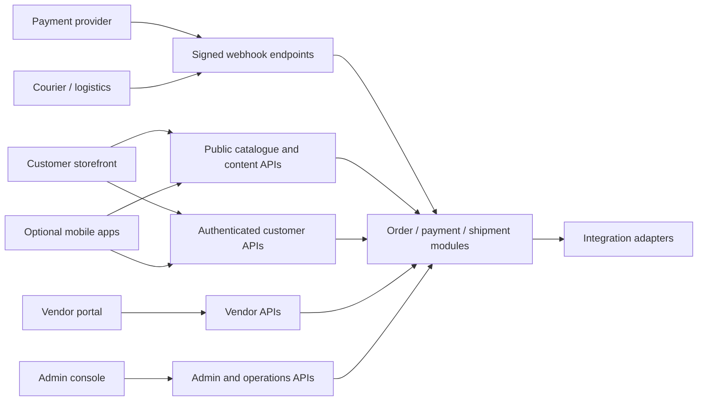
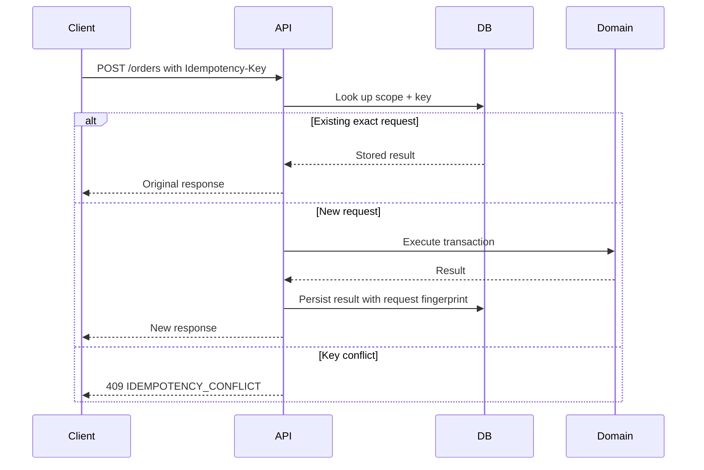
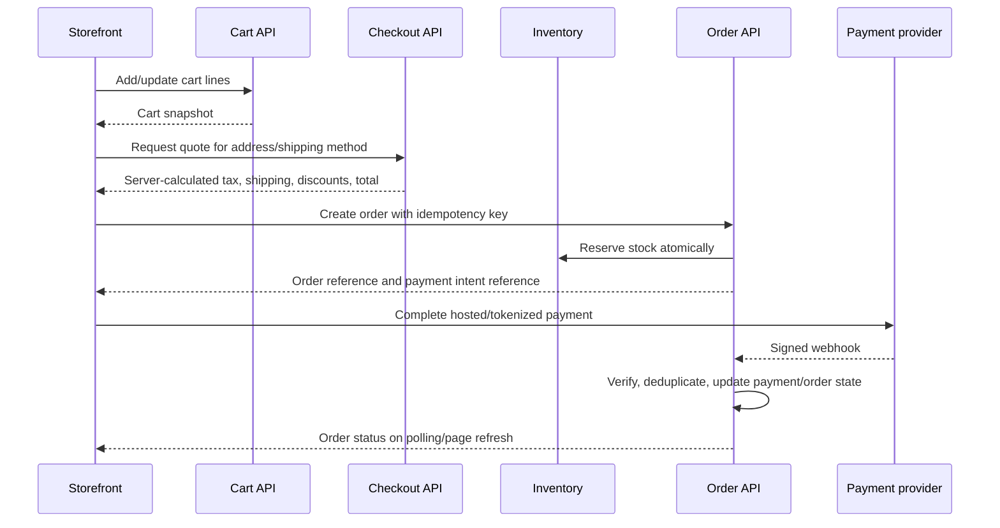

# API-DESIGN.md — Beginner-Friendly Copy

> **Learning copy notice.** This is a learning copy. No architecture decision, ID, API contract, database entity, security control, status, or requirement was changed. The original content is reproduced below.

## How to use this guide

- Read the beginner sections first, then the unchanged original below the separator.
- API methods, paths, request/response shapes, permissions, and statuses below are copied exactly.
- An ID such as `GET /api/v1/products` is a real development task: implement that exact method and path.

## How to read the IDs in this document

| ID pattern | Plain-English meaning | What it means as development work |
|---|---|---|
| `API-001`–`API-009` | API standards | Build versioning, docs, list controls, auth, idempotency, webhook security, separation, money rules, TLS. |
| `API-ERR` | Error model | Implement the listed HTTP statuses and `error.code` values. |
| `API-ENV-*` | Envelope rules | Use the same success/list/error response shapes everywhere. |
| `API-CAT`, `API-DISC`, `API-CUST`, … | Endpoint catalogue groups | Implement the exact method + path rows in that group. |
| `API-PERM-*` | Permission model | Enforce the listed permission scope on the server. |
| `API-IDEMP-*` | Idempotency | Accept keys, store fingerprints, dedupe, return conflicts. |
| `API-PAGE-*` | Pagination/filtering/sorting | Add bounded, allow-listed list controls. |
| `API-CHK-RULE-*` | Checkout rules | Enforce server totals, atomic order/reservation, verified payment. |
| `API-WH-*` | Webhooks | Verify signatures, persist events, dedupe, dead-letter, normalize. |
| `API-FILE-*` | File uploads | Validate, scan, use object references and signed URLs. |
| `API-VER-*` | Versioning | Handle breaking changes, deprecation, shared contracts. |
| `DEC-*` | Unresolved decisions | Ask before choosing provider, limits, topology, or scope. |

## Beginner explanations by topic

### 1. API standards

**What is it?**  
Nine baseline rules for TradeOrbit's API.

**Why do we need it?**  
All clients must talk to the backend in the same predictable way.

**How does it work?**  
Versioned REST paths, OpenAPI docs, validated lists, auth, idempotency, signed webhooks, TLS.

**Example.**  
`GET /api/v1/products` is public; `PATCH /api/v1/me` needs an authenticated customer.

**What do I need to build?**  
`/api/v1/...` routes, OpenAPI spec, DTO validation, guards, correlation IDs, HTTPS.

**How do I test it?**  
Check every protected route rejects anonymous calls and appears in OpenAPI.

| ID | Development work |
|---|---|
| API-001 | Group endpoints under `/api/v1/...`. |
| API-002 | Publish OpenAPI spec with schemas, examples, errors, auth, permissions. |
| API-003 | Add pagination, sorting, filtering, validation, request limits. |
| API-004 | Apply auth and server-side role/permission checks. |
| API-005 | Add idempotency keys for sensitive create/payment ops and correlation IDs. |
| API-006 | Verify webhook signatures, prevent replay, handle retries, dead-letter. |
| API-007 | Keep permission groups separate. |
| API-008 | Never accept client-authoritative totals; include currency codes. |
| API-009 | HTTPS/TLS everywhere; secure cookies or bearer-token flows. |

### 2. API surface map

**What is it?**  
Which client group uses which API group.

**Why do we need it?**  
It prevents mixing public, customer, vendor, admin, and webhook access.

**How does it work?**  
Clients call API groups; API groups call domain modules; modules call adapters.

**Example.**  
A payment provider calls signed webhook endpoints; a shopper calls public/product and customer APIs.

**What do I need to build?**  
The listed API groups with their base areas.

**How do I test it?**  
Map each route to an audience and confirm permission checks match.

### 3. Request and response conventions

**What is it?**  
Consistent success, list, and error response shapes.

**Why do we need it?**  
Clients can handle responses with one parser.

**How does it work?**  
Success has `data` + `meta`; lists add `pagination`; errors have `error.code`, `message`, `details`, `meta`.

**Example.**  
`409 IDEMPOTENCY_CONFLICT` means the same key was reused with a different fingerprint.

**What do I need to build?**  
Envelope helpers, stable error codes, correlation IDs, sanitized messages.

**How do I test it?**  
Assert response shapes and that no stack traces/secrets appear.

| ID | Development work |
|---|---|
| API-ENV-001 | Use consistent envelopes across domains. |
| API-ENV-002 | Include correlation/request ID in every response and log. |
| API-ENV-003 | Return stable machine-readable error codes. |
| API-ENV-004 | Do not expose stack traces, raw provider errors, secrets, PII. |
| API-ENV-005 | Agree page size, max request size, rate limits before implementation. |

### 4. Domain endpoint catalogue

**What is it?**  
The exact list of endpoints grouped by domain.

**Why do we need it?**  
It is the contract for storefront, vendor portal, admin console, and providers.

**How does it work?**  
Each row gives method, path, purpose, required permission, and status.

**Example.**  
`POST /api/v1/orders` creates an order idempotently and reserves stock.

**What do I need to build?**  
Every method/path row in API-CAT, API-DISC, API-CUST, API-CHK, API-VEN, API-SHIP, API-RET, API-FIN, API-SUP, API-CMS, API-ADMIN.

**How do I test it?**  
For each row: happy path, invalid input, wrong role, cross-user access.

### 5. Permission model

**What is it?**  
Rules for who can call which operation.

**Why do we need it?**  
A valid user can still be the wrong user for a resource.

**How does it work?**  
Public, customer ownership, vendor ownership, staff assignment, admin fine-grained, super-admin, finance-sensitive, step-up.

**Example.**  
Vendor staff cannot grant permissions to themselves.

**What do I need to build?**  
Guards/interceptors that enforce ownership and fine-grained permissions on the server.

**How do I test it?**  
Run negative tests for every permission scope.

| ID | Development work |
|---|---|
| API-PERM-001 | Public access only to published/approved public resources. |
| API-PERM-002 | Customer must own cart/order/return/ticket. |
| API-PERM-003 | Vendor caller must belong to owning vendor and hold permission. |
| API-PERM-004 | Vendor owner assigns staff permissions; no self-grant. |
| API-PERM-005 | Admin/sub-admin actions fine-grained and server-enforced. |
| API-PERM-006 | Super-admin global config/admin/security settings. |
| API-PERM-007 | Finance-sensitive operations need specific permission and audit. |
| API-PERM-008 | Step-up only if DEC-010 confirms it. |

### 6. Idempotency

**What is it?**  
Making repeated requests safe.

**Why do we need it?**  
Network retries and double-clicks must not create two orders or charges.

**How does it work?**  
Clients send `Idempotency-Key`; server stores scope + key + fingerprint and returns the original result.

**Example.**  
Reusing a key with a different body returns `409 IDEMPOTENCY_CONFLICT`.

**What do I need to build?**  
Header handling, durable records, fingerprint check, conflict response, dedupe by provider reference.

**How do I test it?**  
Send the same request twice, then a different body with the same key.

| ID | Development work |
|---|---|
| API-IDEMP-001 | Accept `Idempotency-Key` header on sensitive POST operations. |
| API-IDEMP-002 | Scope includes endpoint/operation, principal or guest cart, and key. |
| API-IDEMP-003 | Store fingerprint and return original result for exact retry. |
| API-IDEMP-004 | Different fingerprint with same key → `IDEMPOTENCY_CONFLICT`. |
| API-IDEMP-005 | Order/payment/refund/webhook/payout handling is idempotent. |
| API-IDEMP-006 | Retain records long enough for realistic retry windows. |

### 7. Pagination, filtering and sorting

**What is it?**  
Bounded ways to list data.

**Why do we need it?**  
Unbounded lists are slow and can expose too much data.

**How does it work?**  
Use one pagination style per endpoint family; allow-list filters and sorts.

**Example.**  
Product filters include category, brand, price, rating, availability, attributes, vendor, delivery options.

**What do I need to build?**  
`page`/`cursor`, `pageSize`/`limit`, `sort`, `q`, `filter[field]`, `fields` support where declared.

**How do I test it?**  
Send an unknown filter and confirm rejection.

| ID | Development work |
|---|---|
| API-PAGE-001 | Consistent cursor or page pagination per family. |
| API-PAGE-002 | Expose total count where cost is acceptable. |
| API-PAGE-003 | Allow-list and validate filters; reject unknown filters. |
| API-PAGE-004 | Allow-list sort fields mapped to indexed fields. |
| API-PAGE-005 | Support listed product filters. |
| API-PAGE-006 | Support listed product sorting options. |
| API-PAGE-007 | Agree request body/query/file size limits before production. |

### 8. Checkout and payment sequence

**What is it?**  
The ordered steps from cart to verified payment.

**Why do we need it?**  
It keeps totals and stock correct and avoids false success.

**How does it work?**  
Cart → quote → idempotent order → atomic reservation → hosted payment → signed webhook → status on polling.

**Example.**  
Payment success is based on verified provider state, not the browser return URL.

**What do I need to build?**  
Quote endpoint, order endpoint, inventory reservation, webhook verification, polling status.

**How do I test it?**  
Send a fake return URL success and confirm order does not mark paid.

| ID | Development work |
|---|---|
| API-CHK-RULE-001 | Reject client-submitted authoritative totals. |
| API-CHK-RULE-002 | Use same server pricing rules for quote and order. |
| API-CHK-RULE-003 | Reservation and order creation are atomic. |
| API-CHK-RULE-004 | Failed/expired checkout releases reservation once. |
| API-CHK-RULE-005 | Payment success from verified provider state. |
| API-CHK-RULE-006 | Guest checkout only if DEC-012 confirms it. |

### 9. Webhooks

**What is it?**  
Provider callbacks that report events.

**Why do we need it?**  
Payment and courier status changes arrive asynchronously.

**How does it work?**  
Verify signature and timestamp, persist event, dedupe by provider event ID, enqueue normalized event, update state idempotently.

**Example.**  
`POST /api/v1/webhooks/payments/{provider}` with signature headers.

**What do I need to build?**  
Signed endpoint, verification, persistence, dedupe, exception queue, adapter translation.

**How do I test it?**  
Replay a webhook and confirm no duplicate ledger/refund effects.

| ID | Development work |
|---|---|
| API-WH-001 | Providers deliver signed payment/shipping events. |
| API-WH-002 | Verify signature before business processing. |
| API-WH-003 | Store provider event IDs for dedupe/replay protection. |
| API-WH-004 | Retry responses preserve at-most-once business effects. |
| API-WH-005 | Unprocessable events go to dead-letter/exception queue. |
| API-WH-006 | Persist event and enqueue processing; avoid long synchronous work. |
| API-WH-007 | Translate provider payloads via adapters into normalized domain events. |
| API-WH-001 (signed payment webhook subsection) | Implement the 7 expected steps for payment callbacks. |

### 10. File upload and object references

**What is it?**  
Handling product media and private documents.

**Why do we need it?**  
Files can be malicious or sensitive.

**How does it work?**  
Validate type/size, scan where supported, store in object storage, return object references, serve private files via signed URLs.

**Example.**  
KYC document access uses a signed URL and strict access control.

**What do I need to build?**  
Upload validation, scanning hook, object reference responses, signed URL generation.

**How do I test it?**  
Upload disallowed MIME type and oversized file; confirm rejection.

| ID | Development work |
|---|---|
| API-FILE-001 | Validate file type/size, malware scanning, object storage references. |
| API-FILE-002 | Private documents use signed URLs and strict access control. |
| API-FILE-003 | Public media uses CDN-friendly references and alt text. |
| API-FILE-004 | Return object references, not filesystem paths. |
| API-FILE-005 | Agree max file sizes and MIME types before production. |

### 11. Versioning and compatibility

**What is it?**  
How the API changes safely.

**Why do we need it?**  
Web and optional mobile clients must not break silently.

**How does it work?**  
Breaking change → new version; additive fields allowed; deprecations documented.

**Example.**  
A renamed response field is a breaking change and needs a new API version.

**What do I need to build?**  
Version prefix, deprecation docs, OpenAPI review steps.

**How do I test it?**  
Confirm old contract still works until documented removal.

| ID | Development work |
|---|---|
| API-VER-001 | New API version for breaking changes. |
| API-VER-002 | Additive non-breaking fields may be added in current version. |
| API-VER-003 | Document deprecated endpoints with replacement and removal timeline. |
| API-VER-004 | Web and optional mobile use same versioned contracts. |
| API-VER-005 | Review OpenAPI changes for API/security/consumer impact. |

### 12. Traceability

**What is it?**  
A map from source areas to API IDs.

**Why do we need it?**  
It shows every functional area has an API surface.

**How does it work?**  
Read the source-area row and open the listed API IDs.

**Example.**  
§3.7 payments/refunds/finance → API-FIN, API-WH-001.

**What do I need to build?**  
Cross-links in docs and tickets.

**How do I test it?**  
Pick a source area and confirm endpoints exist.

## Simple glossary

| Term | Simple meaning |
|---|---|
| modular monolith | One deployed backend, split internally into strict business modules. |
| REST API | HTTP endpoints using methods like GET, POST, PATCH, DELETE. |
| OpenAPI | A machine-readable description of API paths, schemas, and errors. |
| DTO | Data Transfer Object: a validated object used at the API boundary. |
| RBAC | Role-Based Access Control: permissions are attached to roles. |
| idempotency | Doing the same request twice has the same effect as doing it once. |
| webhook | A callback where a provider sends an event to your API. |
| queue | A list of background jobs waiting to be processed. |
| worker | A process that takes jobs from a queue and executes them. |
| cache | A fast temporary store for data that is safe to reuse. |
| Redis | In-memory data store used here for cache, rate limits, queues. |
| BullMQ | A Node.js queue library commonly used with Redis. |
| Prisma / ORM | Prisma maps application objects to database rows; an ORM is that mapping layer. |
| migration | A versioned script that changes database structure. |
| ERD | Entity Relationship Diagram: boxes for data entities and lines for relationships. |
| foreign key | A field that points to a row in another table. |
| index | A database helper that makes common lookups faster. |
| transaction | A group of database changes that all succeed or all fail together. |
| CI/CD | Automated build/test (CI) and automated delivery (CD). |
| SLO | Service Level Objective: an agreed reliability target. |
| RPO/RTO | Recovery Point Objective (max data loss) / Recovery Time Objective (max downtime). |
| TLS | Encryption for data in transit; HTTPS uses TLS. |
| CSRF | Cross-Site Request Forgery: a trick that makes a user's browser send unwanted requests. |
| XSS | Cross-Site Scripting: injecting harmful script into a page. |
| SQL injection | Injecting SQL through input to read or change data illegally. |
| secrets manager | A secure store for API keys, passwords, and tokens. |
| tokenization | Replacing sensitive data with a safe reference/token. |
| endpoint | A specific method + path, such as `GET /api/v1/products`. |
| envelope | A consistent wrapper shape around response data or errors. |
| correlation ID | An ID that links a request across logs, traces, and queues. |
| pagination | Returning a list in pages instead of all at once. |
| cursor | An opaque position marker used instead of page numbers. |
| allow-list | A short list of permitted values; anything else is rejected. |
| fingerprint | A value representing request content, used to detect key reuse with a different request. |
| replay | Sending the same event again; must not repeat business effects. |
| dead-letter queue | A queue for events/jobs that cannot be processed. |
| object reference | A storage key/reference returned instead of a filesystem path. |
| signed URL | A short-lived URL granting access to a private file. |
| step-up authentication | Asking for fresh proof again before a very sensitive action. |
| hosted checkout | Payment page hosted by the provider so card data does not touch TradeOrbit. |
| serviceability | Whether a courier can deliver to an address. |
| KYC | Know Your Customer: checks used to verify a seller's identity/business. |
| SLA | Service Level Agreement: agreed response/resolution timing. |

## Original document content (unchanged)

# API Design

**Project:** Task 2 — E-Commerce Marketplace  
**Source of truth:** `docs/requirements/Task_2_Complete_Ecommerce_Marketplace_Specification.pdf`  
**Canonical requirements:** [SRS.md](../requirements/SRS.md)  
**Related:** [SYSTEM-ARCHITECTURE.md](SYSTEM-ARCHITECTURE.md), [DATABASE-ERD.md](DATABASE-ERD.md), [SECURITY-ARCHITECTURE.md](SECURITY-ARCHITECTURE.md)

## Status vocabulary

| Status | Meaning |
|---|---|
| **Mandatory** | Directly required by the PDF or required to implement an in-scope requirement. |
| **Recommendation** | Recommended baseline from the PDF. |
| **Conditional** | Applies only if the corresponding optional feature is selected. |
| **Decision required** | Provider, scope, numeric limit, or protocol choice remains unresolved. See [SRS §12](../requirements/SRS.md#12-unresolved-decisions-and-items-to-confirm). |

---

## 1. API standards

| ID | Standard | Requirement | Status | Cross-reference |
|---|---|---|---|---|
| API-001 | Versioned REST | Group endpoints by domain under a version prefix such as `/api/v1/...`. | Mandatory | [SRS API-001](../requirements/SRS.md#8-data-api-and-integration-summary) |
| API-002 | OpenAPI/Swagger | Publish an OpenAPI specification with schemas, examples, errors, authentication, and endpoint permissions. | Mandatory | [DEL-API-001](../requirements/ACCEPTANCE-CRITERIA.md) |
| API-003 | List controls | Support pagination, sorting, filtering, field validation, and request-size limits; numeric limits are to be agreed. | Mandatory; limits decision required | [DB-009](DATABASE-ERD.md), [DEC-020](../requirements/SRS.md#12-unresolved-decisions-and-items-to-confirm) |
| API-004 | Authentication and authorization | Apply authentication and server-side role/permission checks to every protected operation. | Mandatory | [SEC-AUTHZ-001](SECURITY-ARCHITECTURE.md) |
| API-005 | Idempotency and correlation | Use idempotency keys for sensitive create/payment operations and correlation IDs for request tracing. | Mandatory | [API-IDEMP](#6-idempotency) |
| API-006 | Webhook security | Verify signatures, prevent replay, handle retries, and dead-letter unprocessable events. | Mandatory | [API-WH](#9-webhooks) |
| API-007 | Permission separation | Keep public, authenticated customer, vendor, support/operations, admin, and super-admin permissions distinct. | Mandatory | [SEC-AUTHZ-004](SECURITY-ARCHITECTURE.md) |
| API-008 | Money handling | Clients never submit authoritative totals; server responses include explicit currency codes. | Mandatory | [DB-006](DATABASE-ERD.md), [BR-PRICE-008](../requirements/BUSINESS-RULES.md) |
| API-009 | Transport | Use HTTPS/TLS everywhere; secure cookies or bearer-token flows according to the final auth design. | Mandatory | [SEC-TLS](SECURITY-ARCHITECTURE.md) |

---

## 2. API surface map



| API group | Audience | Base area | Status |
|---|---|---|---|
| Public catalogue/content | Anonymous and authenticated clients | `/api/v1/categories`, `/api/v1/products`, `/api/v1/search`, `/api/v1/content` | Mandatory |
| Identity and customer | Customers and guest checkout flows | `/api/v1/auth`, `/api/v1/me`, `/api/v1/addresses` | Mandatory; guest policy pending DEC-012 |
| Cart/checkout/orders | Customers | `/api/v1/cart`, `/api/v1/checkout`, `/api/v1/orders` | Mandatory |
| Vendor | Approved vendors and vendor staff | `/api/v1/vendor` | Mandatory |
| Shipping/returns | Vendor, warehouse, delivery, customer where applicable | `/api/v1/shipments`, `/api/v1/returns` | Mandatory; portal access pending DEC-011 |
| Finance/settlement | Finance operators and vendors | `/api/v1/finance`, `/api/v1/vendor/settlements` | Mandatory; values pending DEC-006 |
| Support/disputes | Support agents, customers, vendors | `/api/v1/support`, `/api/v1/disputes` | Mandatory; chat pending DEC-017 |
| Admin/configuration | Admin and super-admin | `/api/v1/admin` | Mandatory |
| Webhooks | Payment and shipping providers | `/api/v1/webhooks` | Mandatory; providers pending DEC-004/DEC-005 |

---

## 3. Request and response conventions

### API-ERR — Error model

| HTTP status | `error.code` example | Meaning | Handling |
|---|---|---|---|
| 400 | `VALIDATION_FAILED` | Field or business validation failed. | Return field-level errors; no state change. |
| 401 | `UNAUTHENTICATED` | Authentication missing or invalid. | Request sign-in or valid token. |
| 403 | `FORBIDDEN` | User lacks role/permission/ownership. | Do not reveal protected resource details. |
| 404 | `NOT_FOUND` | Resource does not exist or is not visible to the caller. | Use consistent responses for authorization-sensitive resources. |
| 409 | `CONFLICT` | State conflict, duplicate resource, or stale status. | Include conflict reason and current resource state where safe. |
| 409 | `IDEMPOTENCY_CONFLICT` | Same idempotency key reused with a different request fingerprint. | Reject; do not replay different request. |
| 422 | `BUSINESS_RULE_VIOLATION` | Valid request violates policy/state rules. | Include stable rule code; no numeric assumption. |
| 429 | `RATE_LIMITED` | Rate limit exceeded. | Return retry guidance once limits are agreed. |
| 500 | `INTERNAL_ERROR` | Unexpected failure. | Log with correlation ID; do not leak internals. |
| 503 | `DEPENDENCY_UNAVAILABLE` | Required downstream provider unavailable. | Support retry/status polling where safe. |

**Success envelope**

```json
{
  "data": {},
  "meta": {
    "requestId": "correlation-id",
    "timestamp": "2026-01-01T00:00:00Z"
  }
}
```

**List envelope**

```json
{
  "data": [],
  "pagination": {
    "page": 1,
    "pageSize": 20,
    "total": 100,
    "totalPages": 5
  },
  "meta": {
    "requestId": "correlation-id",
    "timestamp": "2026-01-01T00:00:00Z"
  }
}
```

**Error envelope**

```json
{
  "error": {
    "code": "VALIDATION_FAILED",
    "message": "The request contains invalid fields.",
    "details": [
      {
        "field": "quantity",
        "code": "OUT_OF_RANGE"
      }
    ]
  },
  "meta": {
    "requestId": "correlation-id",
    "timestamp": "2026-01-01T00:00:00Z"
  }
}
```

**Envelope rules**

| ID | Rule | Status |
|---|---|---|
| API-ENV-001 | Use consistent success, list, and error envelopes across all domains. | Mandatory |
| API-ENV-002 | Include a correlation/request ID in every response and in structured logs. | Mandatory |
| API-ENV-003 | Return stable machine-readable error codes; messages may be localized later. | Mandatory |
| API-ENV-004 | Do not expose stack traces, raw provider errors, secrets, or sensitive personal data. | Mandatory |
| API-ENV-005 | Page size, maximum request size, and rate-limit values are agreed before implementation. | Decision required |

---

## 4. Domain endpoint catalogue

### API-CAT — Catalogue APIs

| Method | Path | Purpose | Permission | Status |
|---|---|---|---|---|
| GET | `/api/v1/categories` | List category tree and subcategories. | Public | Mandatory |
| GET | `/api/v1/brands` | List brands. | Public | Mandatory |
| GET | `/api/v1/products` | Browse published products with filters/sorting. | Public | Mandatory |
| GET | `/api/v1/products/{slug}` | Product detail with variants and availability. | Public | Mandatory |
| POST | `/api/v1/vendor/products` | Submit a product listing. | Vendor or vendor staff with product permission | Mandatory |
| PATCH | `/api/v1/vendor/products/{id}` | Update a product listing. | Vendor owner/staff with permission | Mandatory |
| POST | `/api/v1/vendor/products/bulk-import` | Submit CSV/Excel bulk import. | Vendor with catalogue permission | Mandatory |
| GET | `/api/v1/vendor/products/imports/{id}` | Retrieve validation/error report. | Vendor with catalogue permission | Mandatory |
| POST | `/api/v1/admin/products/{id}/moderation` | Approve or reject with reason. | Admin with moderation permission | Mandatory |

### API-DISC — Discovery APIs

| Method | Path | Purpose | Permission | Status |
|---|---|---|---|---|
| GET | `/api/v1/search` | Keyword search with facets, filters, and sorting. | Public | Mandatory |
| GET | `/api/v1/search/suggest` | Autocomplete/suggestions. | Public | Mandatory |
| GET | `/api/v1/products/{id}/related` | Related/frequently-bought-together products. | Public | Mandatory |
| GET | `/api/v1/me/wishlist` | Customer wishlist. | Authenticated customer | Mandatory |
| POST | `/api/v1/me/wishlist` | Add item to wishlist. | Authenticated customer | Mandatory |
| GET | `/api/v1/me/recently-viewed` | Recently viewed products. | Authenticated customer | Mandatory |

**Search-quality note:** typo tolerance, synonyms, and relevance-ranking targets remain [DEC-023](../requirements/SRS.md#12-unresolved-decisions-and-items-to-confirm).

### API-CUST — Customer account APIs

| Method | Path | Purpose | Permission | Status |
|---|---|---|---|---|
| POST | `/api/v1/auth/register` | Register customer. | Public | Mandatory |
| POST | `/api/v1/auth/login` | Authenticate and create session/token flow. | Public | Mandatory |
| POST | `/api/v1/auth/password-reset` | Start password reset. | Public | Mandatory |
| GET | `/api/v1/me` | Get profile and preferences. | Authenticated customer | Mandatory |
| PATCH | `/api/v1/me` | Update profile, preferences, consent. | Authenticated customer | Mandatory |
| GET | `/api/v1/addresses` | List saved addresses. | Authenticated customer | Mandatory |
| POST | `/api/v1/addresses` | Add validated address. | Authenticated customer | Mandatory |
| PATCH | `/api/v1/addresses/{id}` | Update address/default flag. | Authenticated customer | Mandatory |
| POST | `/api/v1/privacy/export` | Request data export. | Authenticated customer | Mandatory |
| POST | `/api/v1/privacy/delete` | Request account deletion. | Authenticated customer | Mandatory |

### API-CHK — Cart, checkout and order APIs

| Method | Path | Purpose | Permission | Status |
|---|---|---|---|---|
| GET | `/api/v1/cart` | Get current cart. | Public/customer; guest policy pending | Conditional guest support |
| POST | `/api/v1/cart/items` | Add item to cart. | Public/customer; guest policy pending | Conditional guest support |
| PATCH | `/api/v1/cart/items/{id}` | Update quantity or save-for-later. | Cart owner | Mandatory |
| DELETE | `/api/v1/cart/items/{id}` | Remove cart item. | Cart owner | Mandatory |
| POST | `/api/v1/checkout/quote` | Server-calculate tax, shipping, discounts, final total. | Cart owner | Mandatory |
| POST | `/api/v1/orders` | Create order idempotently and reserve stock. | Customer or permitted guest | Mandatory; guest policy pending DEC-012 |
| GET | `/api/v1/orders` | List customer orders. | Authenticated customer | Mandatory |
| GET | `/api/v1/orders/{id}` | Order detail, fulfilment units, shipment summary. | Order owner or permitted operator | Mandatory |
| POST | `/api/v1/orders/{id}/cancellation` | Request cancellation under policy. | Order owner or permitted operator | Conditional |

### API-VEN — Vendor APIs

| Method | Path | Purpose | Permission | Status |
|---|---|---|---|---|
| POST | `/api/v1/vendor/applications` | Submit seller registration and application. | Public/registered user | Mandatory |
| GET | `/api/v1/vendor/applications/{id}` | View application status and reasons. | Applicant or admin | Mandatory |
| POST | `/api/v1/vendor/kyc` | Submit KYC/business/tax/document data. | Applicant vendor | Mandatory |
| POST | `/api/v1/vendor/bank-reference` | Submit protected bank reference. | Applicant/approved vendor | Mandatory |
| GET | `/api/v1/vendor/me` | Vendor profile and status. | Vendor owner/staff | Mandatory |
| PATCH | `/api/v1/vendor/me/store-profile` | Update storefront profile. | Vendor with permission | Mandatory |
| GET | `/api/v1/vendor/dashboard` | Sales, orders, returns, inventory, ratings, commissions, payouts. | Vendor with reporting permission | Mandatory |
| POST | `/api/v1/vendor/staff` | Invite vendor staff. | Vendor owner | Mandatory |
| GET | `/api/v1/vendor/performance` | Vendor performance scorecard. | Vendor with reporting permission | Mandatory |

### API-SHIP — Shipping and fulfilment APIs

| Method | Path | Purpose | Permission | Status |
|---|---|---|---|---|
| GET | `/api/v1/checkout/shipping-options` | Serviceability, rates, and delivery estimates. | Cart owner | Mandatory |
| GET | `/api/v1/vendor/orders` | Vendor-assigned order queue. | Vendor/warehouse permission | Mandatory |
| PATCH | `/api/v1/vendor/fulfilment-units/{id}` | Accept/reject/process fulfilment unit. | Vendor/warehouse permission | Mandatory |
| POST | `/api/v1/shipments` | Create shipment and label. | Vendor/warehouse permission | Mandatory |
| DELETE | `/api/v1/shipments/{id}` | Cancel shipment where provider allows. | Vendor/warehouse permission | Mandatory |
| GET | `/api/v1/shipments/{id}/tracking` | Tracking milestones. | Order party or operator | Mandatory |
| POST | `/api/v1/shipments/{id}/exceptions` | Record failed delivery, reattempt, RTO, reverse pickup. | Delivery/warehouse permission | Mandatory |
| POST | `/api/v1/shipments/{id}/pod` | Attach proof-of-delivery reference. | Delivery permission | Conditional |

### API-RET — Returns and refund APIs

| Method | Path | Purpose | Permission | Status |
|---|---|---|---|---|
| POST | `/api/v1/returns` | Request return/exchange with reason/comments/evidence. | Order owner | Mandatory |
| GET | `/api/v1/returns/{id}` | Return status and tracking. | Request owner or operator | Mandatory |
| PATCH | `/api/v1/admin/returns/{id}/decision` | Approve/reject return. | Admin/support permission | Mandatory |
| POST | `/api/v1/warehouse/returns/{id}/inspection` | Record inspection and disposition. | Warehouse permission | Mandatory |
| POST | `/api/v1/returns/{id}/refund` | Initiate eligible refund. | Finance/admin permission | Mandatory |
| POST | `/api/v1/returns/{id}/exchange` | Create replacement order and reserve stock. | Admin/support permission | Mandatory |

### API-FIN — Payment, finance and settlement APIs

| Method | Path | Purpose | Permission | Status |
|---|---|---|---|---|
| POST | `/api/v1/payments` | Create payment/order payment request. | Order owner | Mandatory; provider pending DEC-004 |
| GET | `/api/v1/payments/{id}` | Payment status. | Order owner/finance/admin | Mandatory |
| POST | `/api/v1/refunds` | Initiate full/partial refund. | Finance/admin permission | Mandatory |
| GET | `/api/v1/vendor/settlements` | Vendor settlement statements. | Vendor/finance permission | Mandatory |
| POST | `/api/v1/finance/settlements` | Prepare settlement snapshot. | Finance permission | Mandatory |
| PATCH | `/api/v1/finance/settlements/{id}/approval` | Approve/reject settlement. | Finance permission | Mandatory |
| POST | `/api/v1/finance/payouts` | Record/request payout. | Finance permission | Mandatory |
| GET | `/api/v1/finance/reconciliation` | Exception and reconciliation report. | Finance permission | Mandatory |

### API-SUP — Support and dispute APIs

| Method | Path | Purpose | Permission | Status |
|---|---|---|---|---|
| POST | `/api/v1/support/tickets` | Create ticket. | Customer/vendor | Mandatory |
| GET | `/api/v1/support/tickets/{id}` | Ticket detail and history. | Ticket party/support | Mandatory |
| POST | `/api/v1/support/tickets/{id}/messages` | Add message or internal note. | Ticket party/support | Mandatory |
| PATCH | `/api/v1/support/tickets/{id}/assignment` | Assign/escalate ticket. | Support permission | Mandatory |
| POST | `/api/v1/disputes` | Open order/return/payment/vendor dispute. | Eligible party | Mandatory |
| GET | `/api/v1/support/sla` | SLA queue and status. | Support permission | Mandatory; SLA values pending DEC-009 |

### API-CMS — Content and SEO APIs

| Method | Path | Purpose | Permission | Status |
|---|---|---|---|---|
| GET | `/api/v1/content/pages/{slug}` | Public page content. | Public | Mandatory |
| GET | `/api/v1/content/home` | Homepage sections/banners. | Public | Mandatory |
| POST | `/api/v1/admin/content/pages` | Create/update static page. | Admin content permission | Mandatory |
| POST | `/api/v1/admin/banners` | Create/update banner or campaign section. | Admin content permission | Mandatory |
| POST | `/api/v1/admin/redirects` | Manage redirects. | Admin content permission | Mandatory |
| GET | `/api/v1/sitemap.xml` | Sitemap input feed. | Public | Mandatory |

### API-ADMIN — Admin and platform configuration APIs

| Method | Path | Purpose | Permission | Status |
|---|---|---|---|---|
| GET | `/api/v1/admin/dashboard` | Platform KPIs and exception counts. | Admin permission | Mandatory |
| POST | `/api/v1/admin/admins` | Create admin/sub-admin. | Super-admin permission | Mandatory |
| PATCH | `/api/v1/admin/admins/{id}/permissions` | Assign fine-grained permissions. | Super-admin permission | Mandatory |
| GET | `/api/v1/admin/vendors` | Vendor management queue. | Admin with vendor permission | Mandatory |
| PATCH | `/api/v1/admin/vendors/{id}/status` | Approve/reject/suspend/reactivate/terminate. | Admin with vendor permission | Mandatory |
| PATCH | `/api/v1/admin/config/commissions` | Configure commission rules. | Admin with finance configuration permission | Mandatory; values pending DEC-006 |
| PATCH | `/api/v1/admin/config/tax` | Configure tax rules. | Admin with tax permission | Mandatory; source pending DEC-022 |
| PATCH | `/api/v1/admin/config/shipping` | Configure zones/serviceability. | Admin with shipping permission | Mandatory; model pending DEC-005 |
| PATCH | `/api/v1/admin/features/{code}` | Toggle feature flag/scope. | Super-admin permission | Mandatory |
| GET | `/api/v1/admin/audit-logs` | Search audit records. | Admin with audit permission | Mandatory |

---

## 5. Permission model

| ID | Permission scope | Rule | Status |
|---|---|---|---|
| API-PERM-001 | Public | No authentication; limited to published/approved public resources. | Mandatory |
| API-PERM-002 | Customer | Caller must own the resource or be the authenticated owner of the cart/order/return/ticket. | Mandatory |
| API-PERM-003 | Vendor | Caller must belong to the owning vendor and hold the required vendor permission. | Mandatory |
| API-PERM-004 | Vendor staff | Permissions are assigned by the vendor owner; staff cannot grant permissions to themselves. | Mandatory |
| API-PERM-005 | Admin/sub-admin | Endpoint and action permissions are fine-grained and server-enforced. | Mandatory |
| API-PERM-006 | Super-admin | Global configuration, administrator management, and security settings. | Mandatory |
| API-PERM-007 | Finance-sensitive | Refunds, commissions, payouts, settlement approval, and bank-reference changes require specific permissions and audit records. | Mandatory |
| API-PERM-008 | Step-up | Sensitive admin actions may require step-up authentication if [DEC-010](../requirements/SRS.md#12-unresolved-decisions-and-items-to-confirm) confirms it. | Decision required |

---

## 6. Idempotency

### API-IDEMP — Idempotency requirements

| ID | Requirement | Status | Cross-reference |
|---|---|---|---|
| API-IDEMP-001 | Sensitive POST operations accept an `Idempotency-Key` header. | Mandatory | [SRS DB-005](../requirements/SRS.md#8-data-api-and-integration-summary) |
| API-IDEMP-002 | Idempotency scope includes endpoint/operation, authenticated principal or guest cart, and key. | Mandatory | [DB-CON-014](DATABASE-ERD.md) |
| API-IDEMP-003 | The server stores a request fingerprint and returns the original result for an exact retry. | Mandatory | [API-005](#1-api-standards) |
| API-IDEMP-004 | Reusing a key with a different fingerprint returns `IDEMPOTENCY_CONFLICT`. | Mandatory | [API-ERR](#3-request-and-response-conventions) |
| API-IDEMP-005 | Order creation, payment requests, refunds, webhook processing, and payout operations require idempotent handling. | Mandatory | [AC-006](../requirements/ACCEPTANCE-CRITERIA.md) |
| API-IDEMP-006 | Idempotency records are retained long enough to cover realistic retry windows; exact duration is to be agreed. | Decision required | [DEC-020](../requirements/SRS.md#12-unresolved-decisions-and-items-to-confirm) |

**Idempotent operations**

| Operation | Idempotency mechanism | Acceptance |
|---|---|---|
| Create order | `Idempotency-Key` plus server-side order idempotency record | Duplicate submit creates one order and one stock reservation. |
| Create payment | `Idempotency-Key` plus provider reference deduplication | Duplicate request does not create multiple charges. |
| Refund | `Idempotency-Key` plus refund/provider reference deduplication | Duplicate request does not create duplicate refunds or ledger entries. |
| Payout | `Idempotency-Key` plus payout reference deduplication | Duplicate approval/request does not duplicate payout. |
| Webhook processing | Provider event ID and signature metadata | Duplicate/replayed event is processed at most once. |



---

## 7. Pagination, filtering and sorting

| ID | Requirement | Status |
|---|---|---|
| API-PAGE-001 | Collection endpoints use cursor or page-based pagination consistently per endpoint family. | Mandatory; final style to agree in ADR |
| API-PAGE-002 | Responses expose total count where cost is acceptable or document why not. | Recommendation |
| API-PAGE-003 | Filters are allow-listed and validated; unknown filters are rejected. | Mandatory |
| API-PAGE-004 | Sort fields are allow-listed and mapped to indexed fields. | Mandatory |
| API-PAGE-005 | Product filters include category, brand, price, rating, availability, attributes, vendor, and delivery options. | Mandatory |
| API-PAGE-006 | Product sorting includes relevance, price, popularity, newest, and rating. | Mandatory |
| API-PAGE-007 | Request body/query/file size limits are agreed before production. | Decision required |

**Common list query parameters**

| Parameter | Purpose | Notes |
|---|---|---|
| `page` / `cursor` | Pagination position. | One style per endpoint family. |
| `pageSize` / `limit` | Number of items requested. | Maximum pending agreement. |
| `sort` | Sort field and direction. | Allow-listed only. |
| `q` | Search keyword. | Applies to search-enabled endpoints. |
| `filter[field]` | Structured filter. | Field must be declared in OpenAPI. |
| `fields` | Sparse field selection where supported. | Optional recommendation. |

---

## 8. Checkout and payment sequence



**Rules**

| ID | Rule | Status |
|---|---|---|
| API-CHK-RULE-001 | Totals from the client are never accepted as authoritative. | Mandatory |
| API-CHK-RULE-002 | Checkout quote and order creation use the same server-side pricing rules. | Mandatory |
| API-CHK-RULE-003 | Inventory reservation and order creation are atomic. | Mandatory |
| API-CHK-RULE-004 | Failed/expired checkout releases reservations once. | Mandatory |
| API-CHK-RULE-005 | Payment success is based on verified provider state, not client return URL alone. | Mandatory |
| API-CHK-RULE-006 | Guest checkout is available only if [DEC-012](../requirements/SRS.md#12-unresolved-decisions-and-items-to-confirm) confirms it. | Decision required |

---

## 9. Webhooks

### API-WH — Webhook architecture

| ID | Requirement | Status | Cross-reference |
|---|---|---|---|
| API-WH-001 | Providers deliver payment and shipping events to signed webhook endpoints. | Mandatory | [SRS API-006](../requirements/SRS.md#8-data-api-and-integration-summary) |
| API-WH-002 | Signature verification occurs before business processing. | Mandatory | [SEC-008](../requirements/SRS.md#9-security-and-privacy-checklist) |
| API-WH-003 | Provider event IDs are stored for deduplication and replay protection. | Mandatory | [DB-CON-013](DATABASE-ERD.md) |
| API-WH-004 | Retry responses follow provider expectations while preserving at-most-once business effects. | Mandatory |
| API-WH-005 | Unprocessable events move to a dead-letter/exception queue with operational visibility. | Mandatory |
| API-WH-006 | Webhook handlers avoid long synchronous work; they persist the event and enqueue processing. | Recommendation |
| API-WH-007 | Provider-specific payloads are translated by integration adapters into normalized domain events. | Mandatory | [INT-RULE-001](SYSTEM-ARCHITECTURE.md) |

### API-WH-001 — Signed payment webhook

| Step | Expected behaviour |
|---|---|
| 1 | Receive `POST /api/v1/webhooks/payments/{provider}` with provider signature headers. |
| 2 | Verify signature and timestamp/tolerance using provider-specific rules. |
| 3 | Persist provider, provider event ID, event type, signature status, and raw reference. |
| 4 | If duplicate, return success without repeating business effects. |
| 5 | Enqueue normalized payment/order/refund event. |
| 6 | Update payment, order, refund, ledger, and notification state idempotently. |
| 7 | Record processing outcome and alert on repeated failure. |

**Webhook endpoint catalogue**

| Method | Path | Provider group | Status |
|---|---|---|---|
| POST | `/api/v1/webhooks/payments/{provider}` | Payment providers | Mandatory; provider pending DEC-004 |
| POST | `/api/v1/webhooks/shipping/{provider}` | Courier/logistics providers | Mandatory; model pending DEC-005 |
| POST | `/api/v1/webhooks/messaging/{provider}` | Email/SMS/push providers where supported | Conditional |

---

## 10. File upload and object references

| ID | Requirement | Status |
|---|---|---|
| API-FILE-001 | Uploads use validated file type, size, malware scanning, and object storage references. | Mandatory |
| API-FILE-002 | Private documents such as KYC files use signed URLs and strict access control. | Mandatory |
| API-FILE-003 | Public media uses CDN-friendly object references and alt text. | Mandatory |
| API-FILE-004 | Upload API responses return object references, not filesystem paths. | Mandatory |
| API-FILE-005 | Maximum file sizes and accepted MIME types are agreed before production. | Decision required |

---

## 11. Versioning and compatibility

| ID | Requirement | Status |
|---|---|---|
| API-VER-001 | Breaking changes require a new API version. | Mandatory |
| API-VER-002 | Additive non-breaking fields may be introduced in the current version. | Recommendation |
| API-VER-003 | Deprecated endpoints are documented with replacement path and removal timeline. | Mandatory |
| API-VER-004 | Web and optional mobile clients use the same versioned contracts. | Mandatory |
| API-VER-005 | OpenAPI contract changes are reviewed with API, security, and consumer impacts. | Mandatory |

---

## 12. Traceability

| Source area | API IDs |
|---|---|
| §3.1 catalogue | API-CAT |
| §3.3 customer accounts | API-CUST |
| §3.4 search/discovery | API-DISC |
| §3.5 pricing/tax/promotions | API-CHK, API-FIN, API-ADMIN |
| §3.6 cart/checkout | API-CHK, API-IDEMP |
| §3.7 payments/refunds/finance | API-FIN, API-WH-001 |
| §3.8 inventory/warehouse | API-SHIP, API-VEN, API-ADMIN |
| §3.9 orders/fulfilment | API-CHK, API-SHIP |
| §3.10 shipping/logistics | API-SHIP, API-WH |
| §3.11 returns/exchanges/refunds | API-RET, API-FIN |
| §3.12 admin console | API-ADMIN |
| §3.13 marketing | API-CMS, API-ADMIN |
| §3.14 reviews/ratings | API-CAT, API-DISC |
| §3.15 support/disputes | API-SUP |
| §3.16 content/SEO | API-CMS |
| §3.17 reports/BI | API-FIN, API-ADMIN |
| §7 API/integration requirements | API-001–API-009, API-ERR, API-WH |
