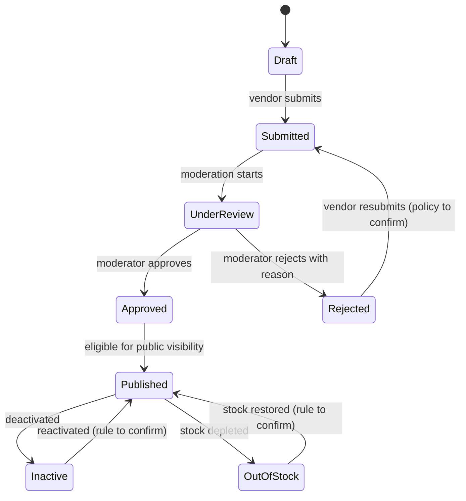
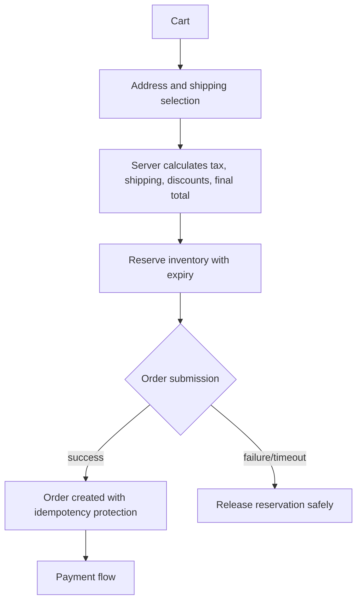
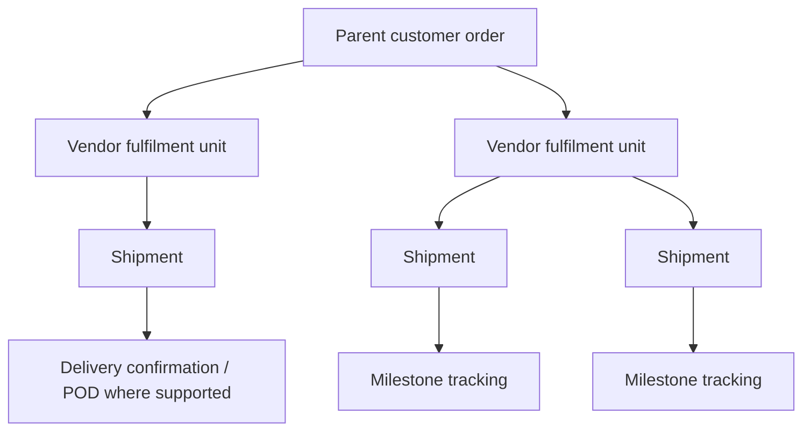
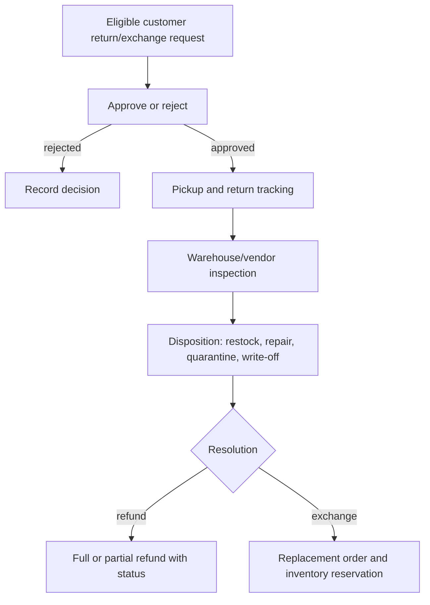

# BUSINESS-RULES.md — Beginner-Friendly Copy

> Learning copy only. No requirement, ID, business rule, API contract, architecture decision, or status was changed. The original content is reproduced below.

## Start here

This file explains `BUSINESS-RULES.md` in simple English.

A business rule is a statement about how TradeOrbit must behave. This guide explains rules as development work. It does not add new rules or choose unresolved values.

## Plain-English terms

| Term you will see | Simple meaning |
|---|---|
| Business rule | A behavior the marketplace must follow. |
| Mandatory | The rule is directly stated or required by scope. |
| Conditional | The rule applies only when its qualifier applies. |
| Decision required | A value, policy, model, or state change is unresolved. |
| SKU | Stock keeping unit. A code for a specific sellable product variant. |
| Variant | A version of a product, such as a size or colour. |
| Moderation | Reviewing submitted content before it becomes public. |
| KYC | Know Your Customer. Checks used to verify a seller’s business identity. |
| Tokenized | Replaced with a safe reference instead of storing the raw sensitive value. |
| CSV or Excel import | Uploading many product rows from a spreadsheet file. |
| State | A named step in a workflow, such as Draft or Published. |
| State transition | A move from one state to another. |
| Atomic | A group of steps either all happen or none happen. |
| Concurrency | Multiple users acting at the same time. |
| Ledger | An append-only record of money movements. |
| Immutable | Cannot be changed after it is written. |
| Compensating entry | A new ledger entry that corrects an earlier entry without overwriting it. |
| Fixed-precision decimal | A number format that avoids money rounding problems. |
| Floating-point arithmetic | Number math that can cause tiny rounding errors. Not allowed for money here. |
| Webhook | A callback message from another system, such as a payment provider. |
| Disposition | The chosen outcome for returned stock, such as restock or write-off. |
| RBAC | Role-based access control. Permissions depend on the user role. |
| Audit | A record of who did what and when. |
| Feature flag | A switch that turns a feature on or off for a scope. |
| SEO | Search engine optimisation. Fields that help search engines understand pages. |
| BI | Business intelligence. Reports and dashboards for decisions. |

## Status words

| Status | Beginner meaning |
|---|---|
| Mandatory | Build and test this rule. |
| Conditional | Build and test it only when the stated condition is in scope. |
| Decision required | Ask for the missing value or policy before implementing it. |

## Rule ID families

| Rule IDs | Area | Development work | Test work |
|---|---|---|---|
| BR-CAT-001–BR-CAT-010 | Catalogue | Product data, variants, media, identifiers, status workflow, moderation, bulk import, groupings, and product types. | Validation, workflow, import report, and visibility tests. |
| BR-VEN-001–BR-VEN-012 | Vendor | Registration, verification, profile, dashboard, settings, moderation, commission, statements, scorecards, and staff limits. | Vendor portal E2E, role tests, and sensitive-data checks. |
| BR-CUS-001–BR-CUS-008 | Customer | Accounts, preferences, addresses, segmentation, self-service, wallet, loyalty, and privacy requests. | Identity, account API, ledger, consent, and privacy tests. |
| BR-PRICE-001–BR-PRICE-008 | Pricing/tax/promotions | Price concepts, coupons, campaigns, eligibility, tax configuration, audit trail, and server totals. | Unit tests for calculations and tampering tests for totals. |
| BR-CHK-001–BR-CHK-008 | Cart/checkout | Cart lines, checkout policy, server calculations, reservations, idempotency, and consent for recovery messages. | Cart API, server-calculation, idempotency, expiry, and consent tests. |
| BR-INV-001–BR-INV-010 | Inventory | Stock quantities, locations, operations, alerts, reservations, traceability, and valuation. | Workflow, concurrency, expiry, and audit-history tests. |
| BR-ORD-001–BR-ORD-009, BR-SHIP-001–BR-SHIP-007 | Orders/shipping | Parent orders, fulfilment units, controlled status changes, labels, tracking, exceptions, and proof where supported. | Order E2E, shipment status, label, tracking, and exception tests. |
| BR-FIN-001–BR-FIN-009 | Finance | Money precision, immutable ledger, payments, refunds, settlement, payout, invoices, and verified webhooks. | Ledger, reconciliation, refund, webhook replay, and document tests. |
| BR-RET-001–BR-RET-008 | Returns | Eligibility configuration, request details, decisions, pickup, inspection, dispositions, refunds, exchanges, and analytics. | Return workflow, warehouse, refund, exchange, and reporting tests. |
| BR-REV-001–BR-REV-005, BR-SUP-001–BR-SUP-006 | Reviews/support | Ratings, moderation, spam checks, tickets, internal notes, disputes, SLA tracking, and analytics. | Review, moderation, support workflow, dispute, and analytics tests. |
| BR-MKT-001–BR-MKT-007, BR-CMS-001–BR-CMS-005, BR-BI-001 | Marketing/content/reporting | Notifications, campaigns, consent controls, banners, pages, SEO fields, sitemap, and protected reports. | Consent, CMS, export, role-protection, and reporting tests. |
| BR-ADM-001–BR-ADM-007, BR-SEC-001–BR-SEC-004 | Admin/security | Dashboards, RBAC, management screens, configuration, audit, privacy controls, and sensitive-data protection. | RBAC matrix, negative authorization, audit, privacy, and sensitive-data tests. |

Each individual ID stays exact in the original content below.

## Topic 1 — Catalogue and product listing rules

- **What is it?** Rules for creating and managing products, variants, media, identifiers, statuses, moderation, imports, and groupings.
- **Why do we need it?** Customers need accurate catalogue data, and only eligible products should be public.
- **How does it work?** Vendors submit data. The backend validates it. Moderation records a decision. Product status controls visibility.
- **Example:** A vendor submits a T-shirt with size variants, SKUs, images, and attributes. The listing waits for review before shoppers see it.
- **What do I need to build?** Product CRUD with permissions, variants, media, identifiers, validation, status workflow, moderation, bulk import/export reports, and groupings.
- **How do I test it?** Use API/UI validation tests, workflow tests, moderation E2E, bulk import tests, and public visibility checks.

## Topic 2 — Vendor onboarding and management rules

- **What is it?** Rules for seller registration, verification, profile, dashboard, settings, moderation, commission, settlement, scorecards, and staff.
- **Why do we need it?** The platform must know who sells, what they may do, and what they are paid.
- **How does it work?** Sellers submit details. Administrators record decisions. Permissions limit vendor staff. Protected references are used for sensitive bank data.
- **Example:** A seller completes onboarding and adds a logo and return policy. An administrator approves the vendor before vendor-only actions are allowed.
- **What do I need to build?** Onboarding, verification, admin decision workflow, storefront profile, dashboard, commission setup, settlement views, scorecards, and staff permissions.
- **How do I test it?** Use vendor portal E2E, integration/API tests, storage inspection, role-based tests, and commission rule tests.

## Topic 3 — Customer account rules

- **What is it?** Rules for login, verification, profile, addresses, segmentation, self-service, wallet, loyalty, and privacy requests.
- **Why do we need it?** Customers need reliable accounts and control over their data.
- **How does it work?** Identity functions manage access. Backend validation protects account data. Optional features apply only if enabled.
- **Example:** A customer saves a home address as default and later requests a data export.
- **What do I need to build?** Registration, login/logout, verification, password reset, profile settings, address validation, order history, consent-aware optional features, and privacy workflows.
- **How do I test it?** Use identity E2E, account API tests, address validation tests, ledger tests where enabled, and privacy workflow tests.

## Topic 4 — Pricing, tax and promotion rules

- **What is it?** Rules for price types, coupons, promotions, eligibility, tax configuration, audit trail, and server-side totals.
- **Why do we need it?** Prices and discounts must be reliable, explainable, and protected from client tampering.
- **How does it work?** Price concepts are stored. Promotion eligibility is evaluated. The server calculates the final payable amount.
- **Example:** A customer applies a coupon to a cart. The server checks eligibility and calculates the final amount.
- **What do I need to build?** Price fields, coupon logic, campaign logic, eligibility rules, tax configuration fields, audit trail, and server calculation.
- **How do I test it?** Use deterministic unit tests for calculations, invalid and boundary cases, conflicting discount checks, and client-tampering tests.

## Topic 5 — Cart, checkout and order placement rules

- **What is it?** Rules for cart lines, checkout inputs, server totals, reservations, idempotency, and consent-aware recovery messaging.
- **Why do we need it?** Checkout must create the right order once and handle stock safely.
- **How does it work?** Cart lines are persisted. The server calculates totals. Stock is reserved with expiry. Duplicate clicks must not create duplicates.
- **Example:** A customer double-clicks Place Order. The idempotency key prevents a second order.
- **What do I need to build?** Cart operations, checkout address and shipping selection, server calculation, reservation expiry, idempotent order submission, and duplicate-click protection.
- **How do I test it?** Use cart API tests, server-calculation tests, tampering tests, inventory expiry tests, and duplicate submission tests.

## Topic 6 — Inventory, procurement and warehouse rules

- **What is it?** Rules for stock quantities, locations, operations, alerts, reservations, traceability, valuation, and audits.
- **Why do we need it?** Stock must stay accurate across vendors, warehouses, checkouts, and returns.
- **How does it work?** Inventory movements update quantities and history. Reservations are released on cancellation or expiry.
- **Example:** A warehouse records stock-in for a SKU. Later, two checkouts reserve units atomically.
- **What do I need to build?** SKU/variant quantities, stock operations, alerts, reservations, audit history, optional locations, optional procurement, and optional traceability.
- **How do I test it?** Use inventory workflow tests, concurrency tests, expiry tests, alert/report tests, and audit-history checks.

## Topic 7 — Order, fulfilment and shipping rules

- **What is it?** Rules for orders, parent/child split, vendor assignment, pick/pack/dispatch, statuses, cancellation, shipping labels, tracking, and exceptions.
- **Why do we need it?** A single customer order can become several vendor or shipment workflows.
- **How does it work?** The parent order stays customer-facing. Fulfilment units and shipments track their own progress.
- **Example:** A customer buys items from two vendors. Each vendor gets a fulfilment unit and the customer sees one parent order.
- **What do I need to build?** Order creation, split logic, vendor workflows, controlled statuses, partial fulfilment, shipment creation, labels, tracking, and exception workflows.
- **How do I test it?** Use order E2E, order data/API tests, fulfilment E2E, shipment status tests, label tests, and exception workflow tests.

## Topic 8 — Finance, settlement and ledger rules

- **What is it?** Rules for money precision, immutable ledger entries, payments, refunds, settlement, payout, invoices, and verified webhooks.
- **Why do we need it?** Marketplace money records must be accurate and auditable.
- **How does it work?** Money uses fixed-precision decimals. Ledger history is not overwritten. Webhooks are verified and idempotent.
- **Example:** A refund creates the right ledger effects instead of changing an old entry.
- **What do I need to build?** Decimal money fields, append-only ledger, payment adapter, refund workflow, settlement calculation, payout reconciliation, finance documents, and webhook verification.
- **How do I test it?** Use ledger tests, payment/refund E2E, webhook signature and replay tests, reconciliation tests, and finance document tests.

## Topic 9 — Returns, exchanges and refund rules

- **What is it?** Rules for configurable eligibility, request details, decisions, pickup, inspection, dispositions, replacement orders, refunds, reversals, and analytics.
- **Why do we need it?** Returns affect products, inventory, customer money, and vendor accounting.
- **How does it work?** Eligibility is checked against configured policy. Approved returns are tracked. Inspection chooses a disposition. Refund or exchange follows.
- **Example:** A customer returns a tool. Inspection records restock or quarantine. A refund or replacement is linked to the return.
- **What do I need to build?** Return request, decision workflow, pickup tracking, disposition recording, refund initiation, replacement order, reversal handling, reason codes, and reports.
- **How do I test it?** Use return request E2E, approval/rejection workflow tests, warehouse tests, refund/finance tests, exchange E2E, and reporting tests.

## Topic 10 — Review, support and moderation rules

- **What is it?** Rules for ratings, reviews, verified-purchase indicators, moderation, spam checks, support tickets, communication history, disputes, and SLA values.
- **Why do we need it?** Feedback and support must be useful, fair, and traceable.
- **How does it work?** Eligibility rules apply. Reviews can be reported and moderated. Tickets have categories, priorities, assignment, and escalation.
- **Example:** A customer reports a suspicious review. A moderator reviews it while support keeps the dispute history.
- **What do I need to build?** Review submission, media where conditional, moderation, appeal, spam detection, ticket workflow, internal notes, dispute workflow, help content, and SLA tracking.
- **How do I test it?** Use review API/UI tests, moderation E2E, support workflow tests, dispute E2E, and analytics tests.

## Topic 11 — Marketing, content and reporting rules

- **What is it?** Rules for notifications, campaigns, loyalty, consent, merchandising, banners, pages, SEO, sitemap, and protected reports.
- **Why do we need it?** Marketing and content must respect consent and reports must be role-protected.
- **How does it work?** Optional features apply only when enabled. Consent controls apply where messages or alerts are used. Content fields are managed and published.
- **Example:** A customer receives a back-in-stock alert only where consent controls allow it.
- **What do I need to build?** Approved notification providers, campaign tools, consent controls, banners, static pages, SEO fields, sitemap, redirects, and exportable reports.
- **How do I test it?** Use consent tests, CMS E2E, SEO field checks, export tests, and role-protection tests.

## Topic 12 — Administration, audit and security rules

- **What is it?** Rules for admin dashboards, RBAC, management, configuration, audit, authentication, privacy, and sensitive-data protection.
- **Why do we need it?** Admin tools are powerful and need strict controls.
- **How does it work?** Every protected operation checks authentication and authorization. Privileged actions are audited. Sensitive data is minimized.
- **Example:** An admin changes a payout setting. The system records the actor, action, object, time, and outcome.
- **What do I need to build?** Role-protected dashboards, fine-grained permissions, management screens, configuration controls, audit records, privacy notices, consent records, and data-subject workflows.
- **How do I test it?** Use RBAC matrix tests, negative authorization tests, audit tests, privacy workflow tests, and sensitive-data access tests.

## Topic 13 — Rule traceability

- **What is it?** A table that maps SRS domains to business-rule ID ranges.
- **Why do we need it?** It helps reviewers confirm each domain has rules and every rule has a home.
- **How does it work?** Each row lists the ID range for a domain.
- **Example:** `BR-FIN-001–BR-FIN-009` points to finance rules.
- **What do I need to build?** Code and tests that can be traced back to the right ID range.
- **How do I test it?** Review changed work against the domain’s rule IDs and keep statuses unchanged.

## Original document content (unchanged)

# Business Rules

**Project:** Task 2 — E-Commerce Marketplace  
**Source of truth:** `docs/requirements/Task_2_Complete_Ecommerce_Marketplace_Specification.pdf`  
**Canonical requirements:** [SRS.md](SRS.md)  
**Related:** [USER-STORIES.md](USER-STORIES.md), [ACCEPTANCE-CRITERIA.md](ACCEPTANCE-CRITERIA.md), [DATABASE-ERD.md](../architecture/DATABASE-ERD.md)

## Status vocabulary

| Status | Meaning |
|---|---|
| **Mandatory** | Directly stated in the PDF or required by a scope requirement/checklist. |
| **Conditional** | Applies only when the PDF’s qualifier applies, e.g. “if enabled”, “where supported”, “subject to policy”. |
| **Decision required** | The PDF leaves a value, policy, model, or state transition unresolved. See [SRS §12](SRS.md#12-unresolved-decisions-and-items-to-confirm). |

> This document does not define numeric thresholds, commission percentages, settlement schedules, return windows, SLA values, or other unresolved business values. Those remain [DEC-001](SRS.md#12-unresolved-decisions-and-items-to-confirm)–[DEC-024](SRS.md#12-unresolved-decisions-and-items-to-confirm).

---

## 1. Catalogue and product listing rules

| ID | Business rule | Status | Source / cross-reference |
|---|---|---|---|
| BR-CAT-001 | Product create, view, edit, archive, and delete operations are subject to permissions and order-history retention rules. | Mandatory | [FR-CAT-001](SRS.md#31-product-catalogue--product-listing) |
| BR-CAT-002 | Categories, subcategories, brands, collections, tags, and attributes are marketplace catalogue structures. | Mandatory | [FR-CAT-002](SRS.md#31-product-catalogue--product-listing) |
| BR-CAT-003 | A product may have variants such as size, colour, material, model, and pack size; variant-level SKU, price, and stock are maintained. | Mandatory | [FR-CAT-003](SRS.md#31-product-catalogue--product-listing) |
| BR-CAT-004 | Product content may include titles, descriptions, specifications, dimensions, weight, images, video, and downloadable documents. | Mandatory | [FR-CAT-004](SRS.md#31-product-catalogue--product-listing) |
| BR-CAT-005 | SKU, barcode, product identifiers, configurable attributes, and validation are part of catalogue management. | Mandatory | [FR-CAT-005](SRS.md#31-product-catalogue--product-listing) |
| BR-CAT-006 | Product status values are draft, submitted, under review, approved, rejected, published, inactive, and out of stock. Exact transition permissions and conditions remain to be detailed. | Mandatory values; transition rules decision required | [FR-CAT-006](SRS.md#31-product-catalogue--product-listing), [DEC-021](SRS.md#12-unresolved-decisions-and-items-to-confirm) |
| BR-CAT-007 | Vendor product submission requires admin moderation; duplicate-listing detection and content guidelines apply. | Mandatory | [FR-CAT-007](SRS.md#31-product-catalogue--product-listing), [AC-003](ACCEPTANCE-CRITERIA.md) |
| BR-CAT-008 | Bulk import/export using CSV or Excel must produce validation reports and error handling. | Mandatory | [FR-CAT-008](SRS.md#31-product-catalogue--product-listing) |
| BR-CAT-009 | Product groupings include featured, new, trending, best-selling, related, and frequently-bought-together. | Mandatory | [FR-CAT-009](SRS.md#31-product-catalogue--product-listing) |
| BR-CAT-010 | Physical, digital, configurable, bundle, and service products are supported only where applicable. | Conditional | [FR-CAT-010](SRS.md#31-product-catalogue--product-listing), [DEC-003](SRS.md#12-unresolved-decisions-and-items-to-confirm) |

*Diagram note:* States are from the PDF. Transitions marked “policy/rule to confirm” are illustrative workflow connections and remain [DEC-021](SRS.md#12-unresolved-decisions-and-items-to-confirm).

---

## 2. Vendor onboarding and management rules

| ID | Business rule | Status | Source / cross-reference |
|---|---|---|---|
| BR-VEN-001 | Seller registration includes email/phone verification, application workflow, and onboarding checklist. | Mandatory | [FR-VEN-001](SRS.md#32-vendor--seller-management) |
| BR-VEN-002 | KYC/business verification, tax details, bank account verification, and document expiry tracking are required. Protected/tokenized bank references are used. | Mandatory | [FR-VEN-002](SRS.md#32-vendor--seller-management), [SEC-PII-004](../architecture/SECURITY-ARCHITECTURE.md) |
| BR-VEN-003 | Vendor approval, rejection, suspension, reactivation, and termination require recorded reasons. | Mandatory | [FR-VEN-003](SRS.md#32-vendor--seller-management) |
| BR-VEN-004 | Vendor storefront profile includes logo, banner, description, policies, operating hours, and contact details. | Mandatory | [FR-VEN-004](SRS.md#32-vendor--seller-management) |
| BR-VEN-005 | Vendor dashboard reports sales, orders, returns, inventory, ratings, commissions, and payouts. | Mandatory | [FR-VEN-005](SRS.md#32-vendor--seller-management) |
| BR-VEN-006 | Vendor-specific listing, pricing, stock, shipping settings, and fulfilment preferences are maintained by the vendor. | Mandatory | [FR-VEN-006](SRS.md#32-vendor--seller-management) |
| BR-VEN-007 | Admin product moderation and vendor policy compliance apply. | Mandatory | [FR-VEN-007](SRS.md#32-vendor--seller-management) |
| BR-VEN-008 | Commission plans can be defined by vendor, category, product, or campaign using fixed and percentage models. | Mandatory | [FR-VEN-008](SRS.md#32-vendor--seller-management), [BR-FIN-008](#8-finance-settlement-and-ledger-rules) |
| BR-VEN-009 | Vendor subscription plans and feature entitlements apply only if subscriptions are enabled. | Conditional | [FR-VEN-009](SRS.md#32-vendor--seller-management), [DEC-016](SRS.md#12-unresolved-decisions-and-items-to-confirm) |
| BR-VEN-010 | Settlement statements, payout requests/approvals, payment status, and reconciliation are vendor-visible functions. | Mandatory | [FR-VEN-010](SRS.md#32-vendor--seller-management) |
| BR-VEN-011 | Vendor performance scorecards include service-level metrics, cancellation rate, and return rate. | Mandatory | [FR-VEN-011](SRS.md#32-vendor--seller-management) |
| BR-VEN-012 | Vendor staff perform tasks only under permissions assigned by the vendor owner; activity history is maintained. | Mandatory | [SRS-ROLE-004](SRS.md#2-user-roles-and-portals), [FR-VEN-012](SRS.md#32-vendor--seller-management) |

---

## 3. Customer account rules

| ID | Business rule | Status | Source / cross-reference |
|---|---|---|---|
| BR-CUS-001 | Registration/login/logout, email/phone verification, and password reset are customer account functions; social sign-in is optional. | Mandatory; social sign-in conditional | [FR-CUS-001](SRS.md#33-customer-accounts--crm) |
| BR-CUS-002 | Customer profile, preferences, communication consent, and account security settings are maintained. | Mandatory | [FR-CUS-002](SRS.md#33-customer-accounts--crm) |
| BR-CUS-003 | A customer may have multiple saved addresses and a default address; addresses are validated. | Mandatory | [FR-CUS-003](SRS.md#33-customer-accounts--crm) |
| BR-CUS-004 | Customer segmentation, tags, account status, and support history are maintained. | Mandatory | [FR-CUS-004](SRS.md#33-customer-accounts--crm) |
| BR-CUS-005 | Customer self-service includes order history, invoices, returns, refunds, wishlist, saved items, and recently viewed products. | Mandatory | [FR-CUS-005](SRS.md#33-customer-accounts--crm) |
| BR-CUS-006 | Wallet/store credit requires ledger-based accounting and clear terms. | Conditional | [FR-CUS-006](SRS.md#33-customer-accounts--crm), [BR-FIN-002](#8-finance-settlement-and-ledger-rules) |
| BR-CUS-007 | Loyalty points, tiers, and redemption apply only if enabled. | Conditional | [FR-CUS-007](SRS.md#33-customer-accounts--crm), [DEC-016](SRS.md#12-unresolved-decisions-and-items-to-confirm) |
| BR-CUS-008 | Account deletion/export requests are handled in accordance with applicable privacy obligations. | Mandatory | [FR-CUS-008](SRS.md#33-customer-accounts--crm), [SEC-PRIV-005](../architecture/SECURITY-ARCHITECTURE.md) |

---

## 4. Pricing, tax and promotion rules

| ID | Business rule | Status | Source / cross-reference |
|---|---|---|---|
| BR-PRICE-001 | Supported price concepts are base price, sale price, vendor price, variant price, and scheduled price changes. | Mandatory | [FR-PRICE-001](SRS.md#35-pricing-tax--promotions) |
| BR-PRICE-002 | Coupons may be percentage or fixed discounts and may have minimum basket rules and usage limits. | Mandatory | [FR-PRICE-002](SRS.md#35-pricing-tax--promotions) |
| BR-PRICE-003 | Promotions may include campaigns, flash sales, seasonal promotions, bundles, volume discounts, and buy-X-get-Y offers. | Mandatory | [FR-PRICE-003](SRS.md#35-pricing-tax--promotions) |
| BR-PRICE-004 | Promotion eligibility may be defined by customer segment, vendor, category, product, channel, or date. | Mandatory | [FR-PRICE-004](SRS.md#35-pricing-tax--promotions) |
| BR-PRICE-005 | Shipping discounts, gift cards, and store credit apply only if supported. | Conditional | [FR-PRICE-005](SRS.md#35-pricing-tax--promotions), [DEC-016](SRS.md#12-unresolved-decisions-and-items-to-confirm) |
| BR-PRICE-006 | Tax rules are configurable by jurisdiction and product category; display may be tax-inclusive or tax-exclusive. | Mandatory; actual tax rules decision required | [FR-PRICE-006](SRS.md#35-pricing-tax--promotions), [DEC-001](SRS.md#12-unresolved-decisions-and-items-to-confirm) |
| BR-PRICE-007 | Price calculation must retain an audit trail and prevent conflicting or invalid discounts. | Mandatory | [FR-PRICE-007](SRS.md#35-pricing-tax--promotions) |
| BR-PRICE-008 | Final payable amounts are calculated on the server, not trusted from the client. | Mandatory | [FR-CHK-005](SRS.md#36-cart-checkout--order-placement) |

---

## 5. Cart, checkout and order placement rules

| ID | Business rule | Status | Source / cross-reference |
|---|---|---|---|
| BR-CHK-001 | Cart lines can be added, updated, removed, quantity-checked, saved for later, and persisted. | Mandatory | [FR-CHK-001](SRS.md#36-cart-checkout--order-placement) |
| BR-CHK-002 | Guest and authenticated checkout are supported subject to business policy. | Conditional | [FR-CHK-002](SRS.md#36-cart-checkout--order-placement), [DEC-012](SRS.md#12-unresolved-decisions-and-items-to-confirm) |
| BR-CHK-003 | Checkout includes address selection, shipping method selection, delivery estimate, and order summary. | Mandatory | [FR-CHK-003](SRS.md#36-cart-checkout--order-placement) |
| BR-CHK-004 | Coupon, gift card, or wallet application must provide transparent calculation. | Conditional for gift card/wallet | [FR-CHK-004](SRS.md#36-cart-checkout--order-placement) |
| BR-CHK-005 | Tax, shipping, discount, and final payable amount are calculated on the server. | Mandatory | [FR-CHK-005](SRS.md#36-cart-checkout--order-placement), [AC-001](ACCEPTANCE-CRITERIA.md) |
| BR-CHK-006 | Inventory reservation must expire and be released safely when checkout fails or times out. | Mandatory | [FR-CHK-006](SRS.md#36-cart-checkout--order-placement), [BR-INV-005](#6-inventory-procurement-and-warehouse-rules) |
| BR-CHK-007 | Checkout validation, idempotent order submission, and duplicate-click protection are required. | Mandatory | [FR-CHK-007](SRS.md#36-cart-checkout--order-placement), [API-IDEMP](../architecture/API-DESIGN.md) |
| BR-CHK-008 | Abandoned-cart events and recovery messaging are allowed only subject to consent. | Conditional | [FR-CHK-008](SRS.md#36-cart-checkout--order-placement), [SEC-PRIV-003](../architecture/SECURITY-ARCHITECTURE.md) |

---

## 6. Inventory, procurement and warehouse rules

| ID | Business rule | Status | Source / cross-reference |
|---|---|---|---|
| BR-INV-001 | Inventory is vendor-level and, where required, central, with SKU/variant-level quantities. | Conditional for central inventory | [FR-INV-001](SRS.md#38-inventory-procurement--warehouse) |
| BR-INV-002 | Multiple warehouses/locations, stock transfers, and location-based availability depend on the multi-warehouse launch decision. | Conditional | [FR-INV-002](SRS.md#38-inventory-procurement--warehouse), [DEC-016](SRS.md#12-unresolved-decisions-and-items-to-confirm) |
| BR-INV-003 | Stock-in, stock-out, adjustments, cycle counts, and reconciliation are inventory operations. | Mandatory | [FR-INV-003](SRS.md#38-inventory-procurement--warehouse) |
| BR-INV-004 | Low-stock thresholds, out-of-stock alerts, and replenishment reports are required. | Mandatory | [FR-INV-004](SRS.md#38-inventory-procurement--warehouse) |
| BR-INV-005 | Inventory is reserved during checkout and released on cancellation or expiry. | Mandatory | [FR-INV-005](SRS.md#38-inventory-procurement--warehouse), [AC-005](ACCEPTANCE-CRITERIA.md) |
| BR-INV-006 | Purchase orders and supplier records apply if procurement is in scope. | Conditional | [FR-INV-006](SRS.md#38-inventory-procurement--warehouse), [DEC-016](SRS.md#12-unresolved-decisions-and-items-to-confirm) |
| BR-INV-007 | Batch/lot/serial/expiry tracking applies to applicable product types. | Conditional | [FR-INV-007](SRS.md#38-inventory-procurement--warehouse), [DEC-003](SRS.md#12-unresolved-decisions-and-items-to-confirm) |
| BR-INV-008 | Damaged, lost, returned, and quarantined stock must be handled. | Mandatory | [FR-INV-008](SRS.md#38-inventory-procurement--warehouse) |
| BR-INV-009 | Inventory valuation and stock movement audit trail are required. | Mandatory | [FR-INV-009](SRS.md#38-inventory-procurement--warehouse) |
| BR-INV-010 | Concurrent checkouts must not oversell stock beyond configured rules. | Mandatory; configured rules to define | [AC-005](ACCEPTANCE-CRITERIA.md), [DEC-021](SRS.md#12-unresolved-decisions-and-items-to-confirm) |

---

## 7. Order, fulfilment and shipping rules

| ID | Business rule | Status | Source / cross-reference |
|---|---|---|---|
| BR-ORD-001 | Order creation, confirmation, payment state, and customer notifications are required. | Mandatory | [FR-ORD-001](SRS.md#39-order-management--fulfilment) |
| BR-ORD-002 | Orders are split by vendor, warehouse, or shipment while retaining a customer-facing parent order. | Mandatory | [FR-ORD-002](SRS.md#39-order-management--fulfilment), [AC-004](ACCEPTANCE-CRITERIA.md) |
| BR-ORD-003 | Vendor assignment, acceptance/rejection rules, and processing deadlines apply. | Mandatory; exact rules/deadlines to define | [FR-ORD-003](SRS.md#39-order-management--fulfilment), [DEC-021](SRS.md#12-unresolved-decisions-and-items-to-confirm) |
| BR-ORD-004 | Pick, pack, dispatch, and partial fulfilment workflows are supported. | Mandatory | [FR-ORD-004](SRS.md#39-order-management--fulfilment) |
| BR-ORD-005 | Order statuses use controlled transitions and event history. | Mandatory; exact state machine to define | [FR-ORD-005](SRS.md#39-order-management--fulfilment), [DEC-021](SRS.md#12-unresolved-decisions-and-items-to-confirm) |
| BR-ORD-006 | Cancellation before/after fulfilment follows policy; partial cancellation only where supported. | Conditional | [FR-ORD-006](SRS.md#39-order-management--fulfilment), [DEC-006](SRS.md#12-unresolved-decisions-and-items-to-confirm) |
| BR-ORD-007 | Order editing rules, invoice generation, and internal notes are supported. | Mandatory | [FR-ORD-007](SRS.md#39-order-management--fulfilment) |
| BR-ORD-008 | Bulk order processing, exception queues, and operational dashboards are supported. | Mandatory | [FR-ORD-008](SRS.md#39-order-management--fulfilment) |
| BR-ORD-009 | Delivery confirmation and proof-of-delivery reference apply where supported. | Conditional | [FR-ORD-009](SRS.md#39-order-management--fulfilment), [DEC-004](SRS.md#12-unresolved-decisions-and-items-to-confirm) |
| BR-SHIP-001 | Shipping zones, serviceability, package dimensions/weight, and rate calculation apply. | Mandatory | [FR-SHIP-001](SRS.md#310-shipping--logistics) |
| BR-SHIP-002 | Courier aggregator or carrier integrations handle shipment creation/cancellation; model is unresolved. | Mandatory capability; model decision required | [FR-SHIP-002](SRS.md#310-shipping--logistics), [DEC-005](SRS.md#12-unresolved-decisions-and-items-to-confirm) |
| BR-SHIP-003 | AWB/tracking number, shipping label, and manifest generation are required. | Mandatory | [FR-SHIP-003](SRS.md#310-shipping--logistics) |
| BR-SHIP-004 | Pickup scheduling, shipment tracking, and milestone webhooks are required. | Mandatory | [FR-SHIP-004](SRS.md#310-shipping--logistics) |
| BR-SHIP-005 | Estimated delivery date, delivery notifications, and exception management are required. | Mandatory | [FR-SHIP-005](SRS.md#310-shipping--logistics) |
| BR-SHIP-006 | Failed delivery, reattempt, return-to-origin, and reverse pickup workflows are supported. | Mandatory | [FR-SHIP-006](SRS.md#310-shipping--logistics) |
| BR-SHIP-007 | Split orders may create multiple shipments; each shipment has its own status tracking. | Mandatory | [FR-SHIP-007](SRS.md#310-shipping--logistics) |

---

## 8. Finance, settlement and ledger rules

| ID | Business rule | Status | Source / cross-reference |
|---|---|---|---|
| BR-FIN-001 | Monetary values use fixed-precision decimals and explicit currency code; floating-point arithmetic is prohibited for money. | Mandatory | [DB-006](SRS.md#8-data-api-and-integration-summary) |
| BR-FIN-002 | Financial ledger entries are immutable; errors are corrected with compensating entries rather than overwriting history. | Mandatory | [DB-007](SRS.md#8-data-api-and-integration-summary) |
| BR-FIN-003 | Payment transactions include authorization/capture, status, retries, failure handling, and verified webhooks. | Mandatory | [FR-PAY-003](SRS.md#37-payments-refunds--finance) |
| BR-FIN-004 | Full and partial refunds include reasons, status tracking, and reconciliation. | Mandatory | [FR-PAY-004](SRS.md#37-payments-refunds--finance) |
| BR-FIN-005 | Transaction ledger records customer payments, marketplace fees, vendor payable amounts, refunds, and adjustments. | Mandatory | [FR-PAY-005](SRS.md#37-payments-refunds--finance) |
| BR-FIN-006 | Commission deductions, settlement cycles, payout approval, and payout reconciliation are required; commission/payout values remain unresolved. | Mandatory; values decision required | [FR-PAY-006](SRS.md#37-payments-refunds--finance), [DEC-006](SRS.md#12-unresolved-decisions-and-items-to-confirm) |
| BR-FIN-007 | Tax invoices, credit notes, receipts, downloadable statements, and vendor liability/commission reversal rules are required; calculation details remain unresolved. | Mandatory; values decision required | [FR-PAY-007](SRS.md#37-payments-refunds--finance), [FR-RET-007](SRS.md#311-returns-exchanges--refunds) |
| BR-FIN-008 | COD remittance and reconciliation apply only if COD is enabled. | Conditional | [FR-PAY-008](SRS.md#37-payments-refunds--finance), [DEC-004](SRS.md#12-unresolved-decisions-and-items-to-confirm) |
| BR-FIN-009 | Payment callbacks/webhooks must be verified and idempotent; retries or duplicates must not create duplicate charges, orders, or refunds. | Mandatory | [AC-006](ACCEPTANCE-CRITERIA.md), [API-WH-001](../architecture/API-DESIGN.md) |

---

## 9. Returns, exchanges and refund rules

| ID | Business rule | Status | Source / cross-reference |
|---|---|---|---|
| BR-RET-001 | Return window, product eligibility, and return policy are configurable by category/vendor; actual values are unresolved. | Mandatory configuration; values decision required | [FR-RET-001](SRS.md#311-returns-exchanges--refunds), [DEC-006](SRS.md#12-unresolved-decisions-and-items-to-confirm) |
| BR-RET-002 | Return/exchange request includes reason, comments, and evidence uploads. | Mandatory | [FR-RET-002](SRS.md#311-returns-exchanges--refunds) |
| BR-RET-003 | Return request is approved/rejected; approved returns are picked up and tracked. | Mandatory | [FR-RET-003](SRS.md#311-returns-exchanges--refunds) |
| BR-RET-004 | Warehouse/vendor inspection dispositions are restock, repair, quarantine, or write-off. | Mandatory | [FR-RET-004](SRS.md#311-returns-exchanges--refunds) |
| BR-RET-005 | Exchange/replacement order creation reserves inventory. | Mandatory | [FR-RET-005](SRS.md#311-returns-exchanges--refunds), [BR-INV-005](#6-inventory-procurement-and-warehouse-rules) |
| BR-RET-006 | Full/partial refund initiation includes refund method and status updates. | Mandatory | [FR-RET-006](SRS.md#311-returns-exchanges--refunds) |
| BR-RET-007 | Vendor liability and commission reversal rules apply; exact reversal policy is unresolved. | Mandatory; policy decision required | [FR-RET-007](SRS.md#311-returns-exchanges--refunds), [DEC-006](SRS.md#12-unresolved-decisions-and-items-to-confirm) |
| BR-RET-008 | Return analytics, reason codes, and abuse/fraud review are required. | Mandatory | [FR-RET-008](SRS.md#311-returns-exchanges--refunds) |

---

## 10. Review, support and moderation rules

| ID | Business rule | Status | Source / cross-reference |
|---|---|---|---|
| BR-REV-001 | Product/vendor ratings and written reviews are supported; image/video attachments are optional. | Conditional for media | [FR-REV-001](SRS.md#314-reviews-ratings--moderation) |
| BR-REV-002 | Review eligibility and verified-purchase indicator rules apply. | Mandatory; exact eligibility to define | [FR-REV-002](SRS.md#314-reviews-ratings--moderation), [DEC-021](SRS.md#12-unresolved-decisions-and-items-to-confirm) |
| BR-REV-003 | Reviews can be reported, moderated, removed, and appealed. | Mandatory | [FR-REV-003](SRS.md#314-reviews-ratings--moderation) |
| BR-REV-004 | Admin/vendor responses are allowed where permitted. | Conditional | [FR-REV-004](SRS.md#314-reviews-ratings--moderation) |
| BR-REV-005 | Spam, abusive content, and suspicious review detection apply. | Mandatory | [FR-REV-005](SRS.md#314-reviews-ratings--moderation) |
| BR-SUP-001 | Support tickets have categories, priorities, assignment, and escalation. | Mandatory | [FR-SUP-001](SRS.md#315-customer-support--disputes) |
| BR-SUP-002 | Customer/vendor communication history and internal notes are maintained. | Mandatory | [FR-SUP-002](SRS.md#315-customer-support--disputes) |
| BR-SUP-003 | Live chat or chatbot integration applies if selected. | Conditional | [FR-SUP-003](SRS.md#315-customer-support--disputes), [DEC-017](SRS.md#12-unresolved-decisions-and-items-to-confirm) |
| BR-SUP-004 | FAQs, help centre, and policy knowledge base are provided. | Mandatory | [FR-SUP-004](SRS.md#315-customer-support--disputes) |
| BR-SUP-005 | Disputes are managed for orders, returns, payments, and vendor issues. | Mandatory | [FR-SUP-005](SRS.md#315-customer-support--disputes) |
| BR-SUP-006 | SLA tracking, resolution codes, CSAT, and support analytics are required; SLA values are unresolved. | Mandatory; values decision required | [FR-SUP-006](SRS.md#315-customer-support--disputes), [DEC-009](SRS.md#12-unresolved-decisions-and-items-to-confirm) |

---

## 11. Marketing, content and reporting rules

| ID | Business rule | Status | Source / cross-reference |
|---|---|---|---|
| BR-MKT-001 | Email, SMS, push, and messaging notifications use approved providers. | Mandatory | [FR-MKT-001](SRS.md#313-marketing-loyalty--engagement) |
| BR-MKT-002 | Campaigns, segments, referrals, and affiliate tracking apply if enabled. | Conditional | [FR-MKT-002](SRS.md#313-marketing-loyalty--engagement) |
| BR-MKT-003 | Loyalty points, reward rules, redemption, and expiry ledger apply if enabled. | Conditional | [FR-MKT-003](SRS.md#313-marketing-loyalty--engagement) |
| BR-MKT-004 | Abandoned-cart, back-in-stock, and price-drop alerts require consent controls. | Conditional; consent mandatory where used | [FR-MKT-004](SRS.md#313-marketing-loyalty--engagement) |
| BR-MKT-005 | Personalized recommendations and merchandising rules are supported; advanced recommendations are listed as expansion. | Conditional | [FR-MKT-005](SRS.md#313-marketing-loyalty--engagement), [PHASE-008](SRS.md#11-development-phases-and-mvp-baseline) |
| BR-MKT-006 | Promotional banners, pop-ups, and campaign landing pages are supported. | Mandatory | [FR-MKT-006](SRS.md#313-marketing-loyalty--engagement) |
| BR-MKT-007 | Campaign attribution, conversion, and revenue reporting are required. | Mandatory | [FR-MKT-007](SRS.md#313-marketing-loyalty--engagement) |
| BR-CMS-001 | Homepage sections, banners, navigation, footer, and landing pages are managed content. | Mandatory | [FR-CMS-001](SRS.md#316-content-management--seo) |
| BR-CMS-002 | Static pages include About, Contact, Terms, Privacy, Shipping, and Returns. | Mandatory | [FR-CMS-002](SRS.md#316-content-management--seo) |
| BR-CMS-003 | Blog/editorial content is included if required. | Conditional | [FR-CMS-003](SRS.md#316-content-management--seo), [DEC-017](SRS.md#12-unresolved-decisions-and-items-to-confirm) |
| BR-CMS-004 | SEO fields include title, description, canonical URL, Open Graph, and structured product data. | Mandatory | [FR-CMS-004](SRS.md#316-content-management--seo) |
| BR-CMS-005 | XML sitemap, robots directives, redirects, and broken-link monitoring are required. | Mandatory | [FR-CMS-005](SRS.md#316-content-management--seo) |
| BR-BI-001 | Reports are exportable, role-protected, and support date/filter controls. | Mandatory | [FR-BI-007](SRS.md#317-reports--business-intelligence), [SEC-AUTHZ-002](../architecture/SECURITY-ARCHITECTURE.md) |

---

## 12. Administration, audit and security rules

| ID | Business rule | Status | Source / cross-reference |
|---|---|---|---|
| BR-ADM-001 | Super-admin dashboard includes sales, orders, customers, sellers, inventory, and exception KPIs. | Mandatory | [FR-ADM-001](SRS.md#312-admin-console--platform-configuration) |
| BR-ADM-002 | Admin/sub-admin creation, RBAC, and fine-grained permissions are required. | Mandatory | [FR-ADM-002](SRS.md#312-admin-console--platform-configuration) |
| BR-ADM-003 | Admin can manage vendors, customers, products, categories, brands, orders, payments, and returns. | Mandatory | [FR-ADM-003](SRS.md#312-admin-console--platform-configuration) |
| BR-ADM-004 | Admin configures commissions, fees, taxes, shipping rules, policies, and serviceability. | Mandatory | [FR-ADM-004](SRS.md#312-admin-console--platform-configuration) |
| BR-ADM-005 | Admin manages coupons, banners, campaigns, homepage sections, and content pages. | Mandatory | [FR-ADM-005](SRS.md#312-admin-console--platform-configuration) |
| BR-ADM-006 | Admin handles moderation queues, disputes, flagged reviews, and compliance workflows. | Mandatory | [FR-ADM-006](SRS.md#312-admin-console--platform-configuration) |
| BR-ADM-007 | System configuration, feature flags, audit logs, and operational controls are required. | Mandatory | [FR-ADM-007](SRS.md#312-admin-console--platform-configuration) |
| BR-SEC-001 | Authentication, authorization, and permission checks are required on every protected operation. | Mandatory | [SEC-AUTHZ-001](../architecture/SECURITY-ARCHITECTURE.md) |
| BR-SEC-002 | Privileged actions, seller bank-detail changes, refunds, commissions, and payouts are audited. | Mandatory | [SEC-AUDIT-001](../architecture/SECURITY-ARCHITECTURE.md) |
| BR-SEC-003 | Sensitive data is minimised and protected; card numbers and CVV are never stored. | Mandatory | [SEC-DATA-001](../architecture/SECURITY-ARCHITECTURE.md), [SEC-PAY-001](../architecture/SECURITY-ARCHITECTURE.md) |
| BR-SEC-004 | Privacy notices, consent records, retention policies, and data-subject request workflows are required. | Mandatory | [SEC-PRIV-*](../architecture/SECURITY-ARCHITECTURE.md) |

## 13. Rule traceability

| SRS domain | Business-rule IDs |
|---|---|
| Catalogue | BR-CAT-001–BR-CAT-010 |
| Vendor | BR-VEN-001–BR-VEN-012 |
| Customer | BR-CUS-001–BR-CUS-008 |
| Pricing/tax/promotions | BR-PRICE-001–BR-PRICE-008 |
| Cart/checkout | BR-CHK-001–BR-CHK-008 |
| Inventory | BR-INV-001–BR-INV-010 |
| Orders/shipping | BR-ORD-001–BR-ORD-009, BR-SHIP-001–BR-SHIP-007 |
| Finance | BR-FIN-001–BR-FIN-009 |
| Returns | BR-RET-001–BR-RET-008 |
| Reviews/support | BR-REV-001–BR-REV-005, BR-SUP-001–BR-SUP-006 |
| Marketing/content/reporting | BR-MKT-001–BR-MKT-007, BR-CMS-001–BR-CMS-005, BR-BI-001 |
| Admin/security | BR-ADM-001–BR-ADM-007, BR-SEC-001–BR-SEC-004 |
