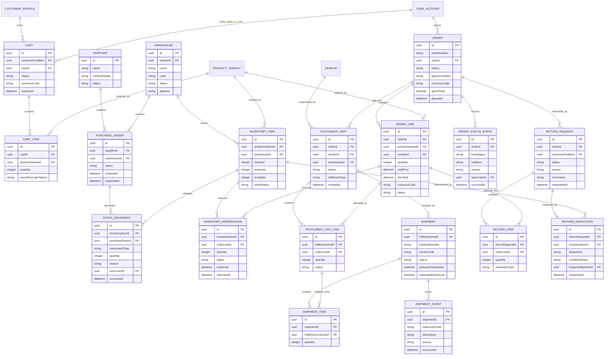

# DATABASE-ERD.md — Beginner-Friendly Copy

> **Learning copy notice.** This is a learning copy. No architecture decision, ID, API contract, database entity, security control, status, or requirement was changed. The original content is reproduced below.

## How to use this guide

- Read the beginner sections first, then the unchanged original below the separator.
- This document is a **conceptual/logical ERD**. It is not final SQL DDL or column sizing.
- Entity names such as `ORDER` and field names such as `currencyCode` must be copied exactly when building.

## How to read the IDs in this document

| ID pattern | Plain-English meaning | What it means as development work |
|---|---|---|
| `DB-001`–`DB-010` | Data design requirements | Build the database capability named in the row. |
| `DB-ID`, `DB-VEN`, `DB-CAT`, … | Entity group index | A group of related tables/entities to implement together. |
| `DB-CON-*` | Logical integrity rules | Add constraints, unique rules, and enforce them in code/database. |
| `DB-TX-*` | Transaction boundaries | Wrap the listed steps in one atomic transaction. |
| `DB-IDX-*` | Index and query intent | Add indexes for the listed query pattern. |
| `DB-RET-*` | Retention/lifecycle | Implement soft delete, retention, archival, or cleanup jobs. |
| `DEC-*` | Unresolved decisions | Ask before finalizing fields or rules that depend on them. |

## Beginner explanations by topic

### Scope and status

**What is it?**  
A map of data entities and relationships for TradeOrbit.

**Why do we need it?**  
It prevents contradictory tables and unsafe money/stock handling.

**How does it work?**  
Entities are drawn with primary keys, foreign keys, and fields. Rules and transactions are listed separately.

**Example.**  
`ORDER` has many `ORDER_LINE` rows; each line points back to one order.

**What do I need to build?**  
PostgreSQL tables, keys, constraints, indexes, transactions, and migrations.

**How do I test it?**  
Insert invalid references and confirm the database rejects them.

### 1. Data design requirements

**What is it?**  
Ten baseline rules for the database.

**Why do we need it?**  
They protect correctness, security, and performance.

**How does it work?**  
Each rule has an ID, status, and link to requirements or other docs.

**Example.**  
Money uses fixed-precision decimals, not floating point.

**What do I need to build?**  
System-of-record DB, keys/indexes, sensitive-data protection, transactions, idempotency, immutable ledger, histories, retention.

**How do I test it?**  
Check no float money column exists and no raw card number/CVV column exists.

| ID | Development work |
|---|---|
| DB-001 | Use PostgreSQL as the system of record. |
| DB-002 | Add primary keys, foreign keys, indexes, timestamps, status history, uniqueness. |
| DB-003 | Minimise/protect sensitive data; no raw card numbers or CVV. |
| DB-004 | Use transactions for checkout, reservation, payment-state, ledger operations. |
| DB-005 | Use idempotency keys for order/payment/refund/webhook/payout operations. |
| DB-006 | Fixed-precision decimal money plus explicit currency code; no floating point. |
| DB-007 | Immutable ledger; correct with compensating entries. |
| DB-008 | Status/event histories for orders, payments, shipments, returns, vendor approvals, products. |
| DB-009 | Index common filters/joins; review plans; avoid unbounded lists. |
| DB-010 | Soft deletion only where appropriate; retain financial/audit records. |

### 2. Entity group index

**What is it?**  
A table of contents for entity groups.

**Why do we need it?**  
It helps developers find which area owns a table.

**How does it work?**  
Each prefix groups related entities.

**Example.**  
`DB-FIN` covers payments, refunds, ledger, commissions, settlements, payouts.

**What do I need to build?**  
Tables grouped by these areas, matching module ownership.

**How do I test it?**  
Review module-to-table ownership in code review.

| ID | Development work |
|---|---|
| DB-ID | Build users, roles, permissions, addresses, consents, requests, audit, idempotency. |
| DB-VEN | Build vendor applications, verification, staff, documents, bank references, store profile, status events. |
| DB-CAT | Build categories, brands, collections, tags, attributes, products, variants, media, groupings. |
| DB-CUST | Build customer profiles, wishlist, recently viewed, reviews, segments, campaigns, notifications. |
| DB-PRICE | Build prices, promotions, coupons, eligibility, calculation audit. |
| DB-CART | Build carts and cart items including saved-for-later. |
| DB-INV | Build warehouses, inventory items, reservations, movements, suppliers, purchase orders. |
| DB-ORD | Build orders, lines, fulfilment units, order events, invoices. |
| DB-SHIP | Build shipments, shipment items, carrier refs, milestones, exceptions. |
| DB-RET | Build return requests, items, inspection, disposition. |
| DB-FIN | Build payments, attempts, webhooks, refunds, ledger, commissions, settlements, payouts, credit notes. |
| DB-SUP | Build tickets, messages, disputes, SLA events. |
| DB-CONTENT | Build pages, banners, navigation, redirects, SEO metadata. |
| DB-OPS | Build feature flags, report exports, object references, notification events. |

### 3. Identity, vendor, catalogue and customer ERD

**What is it?**  
Entities for who users are, who sells, what is sold, and customer engagement.

**Why do we need it?**  
It links logins, roles, vendors, products, and reviews.

**How does it work?**  
Foreign keys connect users to roles, vendors, profiles, addresses, consents, and content.

**Example.**  
A customer writes a review; the review links to customer profile, product, and vendor.

**What do I need to build?**  
The exact entities and fields in the first Mermaid ERD block.

**How do I test it?**  
Check `BANK_ACCOUNT_REFERENCE` holds only protected references/masked values, never raw secrets.

### 4. Cart, inventory, order, shipping and returns ERD

**What is it?**  
Entities for the path from cart to delivery and returns.

**Why do we need it?**  
Orders can split into fulfilment units and shipments; returns need inspection and disposition.

**How does it work?**  
`ORDER` is the parent. `FULFILMENT_UNIT` represents vendor/warehouse/shipment splits.

**Example.**  
One order with two vendors becomes two fulfilment units and two shipments.

**What do I need to build?**  
The exact entities and fields in the second Mermaid ERD block.

**How do I test it?**  
Confirm reservation quantity never exceeds available stock when committed.

### 5. Pricing, finance, support, content and operations ERD

**What is it?**  
Entities for money calculation, finance records, support, CMS, and operational state.

**Why do we need it?**  
These records must be auditable and protected.

**How does it work?**  
`LEDGER_ENTRY` is append-only; webhook and idempotency records support deduplication.

**Example.**  
A refund appends ledger entries; it does not edit past entries.

**What do I need to build?**  
The exact entities and fields in the third Mermaid ERD block.

**How do I test it?**  
Try updating/deleting a ledger row and confirm it is blocked.

### 6. Logical integrity rules

**What is it?**  
Rules about valid data relationships.

**Why do we need it?**  
They stop orphan rows, duplicate events, and unsafe deletes.

**How does it work?**  
Constraints enforce what the database can; application code enforces the rest.

**Example.**  
Webhook events are unique by provider and provider event ID.

**What do I need to build?**  
Primary/foreign keys, uniqueness, status checks, append-only protections, soft-delete rules.

**How do I test it?**  
Insert the same provider event ID twice and expect rejection.

| ID | Development work |
|---|---|
| DB-CON-001 | Primary key on every entity; foreign keys for cross-entity references. |
| DB-CON-002 | SKU uniqueness scoped by vendor/product rules (scope pending decision). |
| DB-CON-003 | At most one default address per address type. |
| DB-CON-004 | Append vendor status events; mirror current status on `VENDOR`. |
| DB-CON-005 | Product is public only when status/moderation approved/published. |
| DB-CON-006 | Cart line quantity obeys catalogue/inventory rules. |
| DB-CON-007 | Reservation quantity must not exceed available stock when committed. |
| DB-CON-008 | Parent order has one or more fulfilment units; each belongs to one order. |
| DB-CON-009 | Shipment items come from the same fulfilment unit. |
| DB-CON-010 | Return items reference eligible lines from the related order. |
| DB-CON-011 | Money fields use explicit currency codes. |
| DB-CON-012 | Ledger rows cannot be updated/deleted; compensating rows inserted. |
| DB-CON-013 | Webhook events unique by provider and provider event ID. |
| DB-CON-014 | Idempotency scope + key unique; fingerprint mismatches rejected. |
| DB-CON-015 | Sensitive fields minimised, protected, excluded from general list endpoints. |
| DB-CON-016 | Audit records append-only with actor/action/target/time/outcome. |
| DB-CON-017 | Soft delete for user-facing records where appropriate; not financial/audit. |
| DB-CON-018 | Optional entities only when confirmed in scope. |

### 7. Transaction boundaries

**What is it?**  
Groups of steps that must all succeed or all fail.

**Why do we need it?**  
Partial order creation or partial refund causes real errors.

**How does it work?**  
Wrap the listed steps in a database transaction; commit once.

**Example.**  
Order creation validates cart, recalculates totals, creates order/lines, reserves stock, stores idempotency, queues side effects after commit.

**What do I need to build?**  
Eight transactional operations listed below.

**How do I test it?**  
Force a failure mid-transaction and confirm no partial rows remain.

| ID | Development work |
|---|---|
| DB-TX-001 | Order creation transaction. |
| DB-TX-002 | Reservation release/expiry exactly once. |
| DB-TX-003 | Webhook persist/dedupe + payment/order state update. |
| DB-TX-004 | Refund status + ledger append once per event/key. |
| DB-TX-005 | Commission calculation + ledger + settlement snapshot. |
| DB-TX-006 | Return status, inspection, disposition, refund/replacement intent. |
| DB-TX-007 | Vendor status update + status event. |
| DB-TX-008 | Product moderation status + event. |

### 8. Index and query intent

**What is it?**  
Which lookups need fast access paths.

**Why do we need it?**  
Without indexes, searches scan whole tables.

**How does it work?**  
Add composite/single-column indexes matching each query pattern.

**Example.**  
Order lookup by user, order number, status, vendor, placed date.

**What do I need to build?**  
Indexes DB-IDX-001 to DB-IDX-010, then review query plans.

**How do I test it?**  
Run query plans and confirm indexes are used.

| ID | Development work |
|---|---|
| DB-IDX-001 | Composite indexes for product discovery filters. |
| DB-IDX-002 | Unique/near-unique SKU/barcode lookup scoped by vendor/product rules. |
| DB-IDX-003 | Inventory by variant, warehouse, status, available quantity. |
| DB-IDX-004 | Orders by user, number, status, vendor, placed date. |
| DB-IDX-005 | Fulfilment/shipment queues by status, vendor, warehouse, dates. |
| DB-IDX-006 | Payment/webhook reconciliation by provider reference/event ID/status. |
| DB-IDX-007 | Ledger/settlement by vendor, period, entry type, currency. |
| DB-IDX-008 | Support ticket queues by status, priority, assignee, SLA due time. |
| DB-IDX-009 | Audit by actor, action, target, time range. |
| DB-IDX-010 | Idempotency/webhook dedupe unique indexes. |

### 9. Retention, privacy and lifecycle

**What is it?**  
How long data lives and how it is removed or archived.

**Why do we need it?**  
SEO, finance, privacy, and audit have different needs.

**How does it work?**  
Soft delete/deactivate where appropriate; retain financial/audit records; clean short-lived data.

**Example.**  
A discontinued product can be deactivated with a redirect; a ledger row is never hard-deleted.

**What do I need to build?**  
Lifecycle jobs and policy-driven retention.

**How do I test it?**  
Run cleanup job and confirm carts expire but ledger rows remain.

| ID | Development work |
|---|---|
| DB-RET-001 | Soft delete/deactivate catalogue/content; preserve SEO redirects. |
| DB-RET-002 | Retain finance/tax records; never hard-delete for convenience. |
| DB-RET-003 | Retain/protect audit and security records. |
| DB-RET-004 | Keep consent and withdrawal evidence. |
| DB-RET-005 | Track data-subject request, decision, execution evidence, actor. |
| DB-RET-006 | Restrict/tokenize sensitive vendor docs/bank refs; track expiry. |
| DB-RET-007 | Clean carts, recently viewed, temporary reservations, webhook payloads after purpose. |

### 10. Unresolved data-model decisions

**What is it?**  
Questions that change fields or rules.

**Why do we need them?**  
Coding an assumption could create the wrong schema.

**How does it work?**  
Each `DEC-*` row lists the impact on the ERD.

**Example.**  
Guest checkout policy affects `CART.userId` and `ORDER.userId` linkage.

**What do I need to build?**  
Decision log and schema tickets blocked on these decisions.

**How do I test it?**  
Check no migration hardcodes an unresolved rule.

## Simple glossary

| Term | Simple meaning |
|---|---|
| modular monolith | One deployed backend, split internally into strict business modules. |
| REST API | HTTP endpoints using methods like GET, POST, PATCH, DELETE. |
| OpenAPI | A machine-readable description of API paths, schemas, and errors. |
| DTO | Data Transfer Object: a validated object used at the API boundary. |
| RBAC | Role-Based Access Control: permissions are attached to roles. |
| idempotency | Doing the same request twice has the same effect as doing it once. |
| webhook | A callback where a provider sends an event to your API. |
| queue | A list of background jobs waiting to be processed. |
| worker | A process that takes jobs from a queue and executes them. |
| cache | A fast temporary store for data that is safe to reuse. |
| Redis | In-memory data store used here for cache, rate limits, queues. |
| BullMQ | A Node.js queue library commonly used with Redis. |
| Prisma / ORM | Prisma maps application objects to database rows; an ORM is that mapping layer. |
| migration | A versioned script that changes database structure. |
| ERD | Entity Relationship Diagram: boxes for data entities and lines for relationships. |
| entity | A thing the database stores, such as `ORDER` or `VENDOR`. |
| primary key | The unique identifier for a row, shown as `PK`. |
| foreign key | A field that points to a row in another table, shown as `FK`. |
| composite index | An index built on several columns together. |
| index | A database helper that makes common lookups faster. |
| transaction | A group of database changes that all succeed or all fail together. |
| atomic | All steps happen or none happen. |
| immutable ledger | Financial rows that can be added but never edited or deleted. |
| compensating entry | A new ledger row that corrects an earlier one. |
| soft deletion | Marking a row inactive instead of physically deleting it. |
| uniqueness constraint | A rule that stops duplicate values. |
| CI/CD | Automated build/test (CI) and automated delivery (CD). |
| SLO | Service Level Objective: an agreed reliability target. |
| RPO/RTO | Recovery Point Objective (max data loss) / Recovery Time Objective (max downtime). |
| TLS | Encryption for data in transit; HTTPS uses TLS. |
| CSRF | Cross-Site Request Forgery: a trick that makes a user's browser send unwanted requests. |
| XSS | Cross-Site Scripting: injecting harmful script into a page. |
| SQL injection | Injecting SQL through input to read or change data illegally. |
| secrets manager | A secure store for API keys, passwords, and tokens. |
| tokenization | Replacing sensitive data with a safe reference/token. |
| KYC | Know Your Customer: checks used to verify a seller's identity/business. |
| PII | Personally Identifiable Information: data that identifies a person. |
| append-only | Records can be added but not edited or deleted. |
| denormalized | Data copied into a query-friendly shape for reads. |

## Original document content (unchanged)

# Database ERD

**Project:** Task 2 — E-Commerce Marketplace  
**Source of truth:** `docs/requirements/Task_2_Complete_Ecommerce_Marketplace_Specification.pdf`  
**Canonical requirements:** [SRS.md](../requirements/SRS.md)  
**Related:** [SYSTEM-ARCHITECTURE.md](SYSTEM-ARCHITECTURE.md), [BUSINESS-RULES.md](../requirements/BUSINESS-RULES.md), [SECURITY-ARCHITECTURE.md](SECURITY-ARCHITECTURE.md)

## Scope and status

This is a **conceptual/logical ERD**. It defines entities, relationships, ownership, and integrity intent. It is not physical DDL, column sizing, partitioning, or a final normalized implementation schema.

| Status | Meaning |
|---|---|
| **Mandatory** | Required by the PDF or necessary for a required marketplace capability. |
| **Conditional** | Applies only if the relevant optional feature is selected. |
| **Decision required** | Exact values, rules, or scope remain unresolved in [SRS §12](../requirements/SRS.md#12-unresolved-decisions-and-items-to-confirm). |

---

## 1. Data design requirements

| ID | Requirement | Status | Cross-reference |
|---|---|---|---|
| DB-001 | PostgreSQL is the system of record. | Mandatory | [SRS DB-001](../requirements/SRS.md#8-data-api-and-integration-summary) |
| DB-002 | Model entities with primary keys, foreign keys, indexes, timestamps, status history, and appropriate uniqueness constraints. | Mandatory | [SRS DB-002](../requirements/SRS.md#8-data-api-and-integration-summary) |
| DB-003 | Minimise and protect sensitive data; never store raw card numbers or CVV. | Mandatory | [SEC-DATA-001](SECURITY-ARCHITECTURE.md), [SEC-PAY-001](SECURITY-ARCHITECTURE.md) |
| DB-004 | Use database transactions for checkout, stock reservation, payment-state transitions, and financial ledger operations. | Mandatory | [BR-INV-005](../requirements/BUSINESS-RULES.md), [AC-005](../requirements/ACCEPTANCE-CRITERIA.md) |
| DB-005 | Use idempotency keys for order creation, payment requests, refunds, webhook processing, and payout operations. | Mandatory | [API-IDEMP](API-DESIGN.md) |
| DB-006 | Store monetary values using fixed-precision decimals and explicit currency code; never use floating-point arithmetic for money. | Mandatory | [BR-FIN-001](../requirements/BUSINESS-RULES.md) |
| DB-007 | Preserve immutable financial ledger entries; correct errors with compensating entries. | Mandatory | [BR-FIN-002](../requirements/BUSINESS-RULES.md) |
| DB-008 | Maintain status/event histories for orders, payments, shipments, returns, vendor approvals, and products. | Mandatory | [BR-ORD-005](../requirements/BUSINESS-RULES.md) |
| DB-009 | Index common filters/joins, review query plans, and avoid unbounded list endpoints. | Mandatory | [API-003](API-DESIGN.md), [PERF-006](PERFORMANCE-STRATEGY.md) |
| DB-010 | Use soft deletion only where appropriate; retain financial and audit records according to policy and law. | Mandatory | [SEC-PRIV-004](SECURITY-ARCHITECTURE.md) |

---

## 2. Entity group index

| ID | Entity group | Covers |
|---|---|---|
| DB-ID | Identity, access and privacy | Users, roles, permissions, addresses, consents, data-subject requests, audit records, idempotency records. |
| DB-VEN | Vendor and seller | Vendor applications, verification state, staff, documents, bank references, store profile, status history. |
| DB-CAT | Catalogue | Categories, brands, collections, tags, attributes, products, variants, media, product groupings. |
| DB-CUST | Customer and engagement | Customer profiles, wishlist, recently viewed, reviews, segments, campaigns, notifications. |
| DB-PRICE | Pricing and promotions | Prices, promotions, coupons, promotion eligibility, price calculation audit records. |
| DB-CART | Cart | Carts and cart lines, including saved-for-later state. |
| DB-INV | Inventory and procurement | Warehouses, inventory items, reservations, stock movements, suppliers, purchase orders. |
| DB-ORD | Orders and fulfilment | Parent orders, order lines, fulfilment units, order events, invoices. |
| DB-SHIP | Shipping and logistics | Shipments, shipment items, carrier references, milestones and exceptions. |
| DB-RET | Returns and exchanges | Return requests, return items, inspection and disposition records. |
| DB-FIN | Finance and settlement | Payments, attempts, webhooks, refunds, ledger, commissions, settlements, payouts, credit notes. |
| DB-SUP | Support and disputes | Tickets, messages, disputes, SLA events. |
| DB-CONTENT | Content and SEO | Pages, banners, navigation, redirects, SEO metadata. |
| DB-OPS | Operational records | Feature flags, report exports, object references, notification events. |

---

## 3. Identity, vendor, catalogue and customer ERD

```mermaid
erDiagram
    USER_ACCOUNT ||--o{ USER_ROLE : has
    ROLE ||--o{ USER_ROLE : assigned_to
    ROLE ||--o{ ROLE_PERMISSION : includes
    PERMISSION ||--o{ ROLE_PERMISSION : granted_by
    USER_ACCOUNT ||--o{ ADDRESS : saves
    USER_ACCOUNT ||--o{ CONSENT_RECORD : records
    USER_ACCOUNT ||--o{ DATA_SUBJECT_REQUEST : submits
    USER_ACCOUNT ||--o| CUSTOMER_PROFILE : has
    USER_ACCOUNT ||--o| VENDOR : operates
    VENDOR ||--o{ VENDOR_STAFF : employs
    VENDOR ||--o{ VENDOR_DOCUMENT : submits
    VENDOR ||--o| BANK_ACCOUNT_REFERENCE : references
    VENDOR ||--o{ VENDOR_STATUS_EVENT : records
    VENDOR ||--o| STORE_PROFILE : configures
    CATEGORY ||--o{ CATEGORY : parent_of
    VENDOR ||--o{ PRODUCT : lists
    CATEGORY ||--o{ PRODUCT : categorizes
    BRAND ||--o{ PRODUCT : brands
    COLLECTION ||--o{ PRODUCT : groups
    TAG ||--o{ PRODUCT : tags
    PRODUCT ||--o{ PRODUCT_VARIANT : has
    PRODUCT ||--o{ PRODUCT_MEDIA : displays
    PRODUCT_VARIANT ||--o{ PRICE : priced_by
    CUSTOMER_PROFILE ||--o{ WISHLIST_ITEM : saves
    PRODUCT_VARIANT ||--o{ WISHLIST_ITEM : wishlisted_as
    CUSTOMER_PROFILE ||--o{ RECENTLY_VIEWED : tracks
    PRODUCT ||--o{ RECENTLY_VIEWED : viewed_as
    CUSTOMER_PROFILE ||--o{ REVIEW : writes
    PRODUCT ||--o{ REVIEW : reviewed_as
    VENDOR ||--o{ REVIEW : vendor_reviewed
    REVIEW ||--o{ REVIEW_MODERATION_EVENT : moderated_by
    SEGMENT ||--o{ CUSTOMER_SEGMENT_MEMBER : contains
    CUSTOMER_PROFILE ||--o{ CUSTOMER_SEGMENT_MEMBER : member_of

    USER_ACCOUNT {
        uuid id PK
        string email
        string phone
        string passwordHash
        string status
        datetime createdAt
        datetime updatedAt
    }
    ROLE {
        uuid id PK
        string code
        string scope
        string status
    }
    PERMISSION {
        uuid id PK
        string code
        string resource
        string action
    }
    USER_ROLE {
        uuid id PK
        uuid userId FK
        uuid roleId FK
        uuid vendorId FK
        datetime grantedAt
    }
    ROLE_PERMISSION {
        uuid id PK
        uuid roleId FK
        uuid permissionId FK
    }
    ADDRESS {
        uuid id PK
        uuid userId FK
        string addressType
        string line1
        string line2
        string city
        string region
        string postalCode
        string countryCode
        boolean isDefault
    }
    CONSENT_RECORD {
        uuid id PK
        uuid userId FK
        string purpose
        string channel
        string status
        datetime recordedAt
    }
    DATA_SUBJECT_REQUEST {
        uuid id PK
        uuid userId FK
        string requestType
        string status
        datetime requestedAt
    }
    CUSTOMER_PROFILE {
        uuid id PK
        uuid userId FK
        string displayName
        string status
        string loyaltyTier
        datetime createdAt
    }
    VENDOR {
        uuid id PK
        uuid ownerUserId FK
        string legalName
        string tradeName
        string applicationStatus
        string verificationStatus
        string accountStatus
        datetime createdAt
    }
    VENDOR_STAFF {
        uuid id PK
        uuid vendorId FK
        uuid userId FK
        string status
        datetime invitedAt
    }
    VENDOR_DOCUMENT {
        uuid id PK
        uuid vendorId FK
        string documentType
        string objectReference
        datetime expiresAt
        string verificationStatus
    }
    BANK_ACCOUNT_REFERENCE {
        uuid id PK
        uuid vendorId FK
        string providerToken
        string maskedAccount
        string verificationStatus
    }
    VENDOR_STATUS_EVENT {
        uuid id PK
        uuid vendorId FK
        string fromStatus
        string toStatus
        string reason
        uuid actorUserId FK
        datetime occurredAt
    }
    STORE_PROFILE {
        uuid id PK
        uuid vendorId FK
        string slug
        string description
        string policies
        string operatingHours
        string contactDetails
    }
    CATEGORY {
        uuid id PK
        uuid parentId FK
        string name
        string slug
        string status
    }
    BRAND {
        uuid id PK
        string name
        string slug
        string status
    }
    COLLECTION {
        uuid id PK
        string name
        string slug
        string status
    }
    TAG {
        uuid id PK
        string name
        string slug
    }
    PRODUCT {
        uuid id PK
        uuid vendorId FK
        uuid categoryId FK
        uuid brandId FK
        string title
        string slug
        string description
        string productType
        string status
        datetime createdAt
    }
    PRODUCT_VARIANT {
        uuid id PK
        uuid productId FK
        string sku
        string barcode
        string variantAttributes
        string status
    }
    PRODUCT_MEDIA {
        uuid id PK
        uuid productId FK
        string mediaType
        string objectReference
        string altText
        integer sortOrder
    }
    PRICE {
        uuid id PK
        uuid productVariantId FK
        decimal amount
        string currencyCode
        string priceType
        datetime effectiveFrom
        datetime effectiveTo
    }
    WISHLIST_ITEM {
        uuid id PK
        uuid customerProfileId FK
        uuid productVariantId FK
        datetime addedAt
    }
    RECENTLY_VIEWED {
        uuid id PK
        uuid customerProfileId FK
        uuid productId FK
        datetime viewedAt
    }
    REVIEW {
        uuid id PK
        uuid customerProfileId FK
        uuid productId FK
        uuid vendorId FK
        integer rating
        string title
        string body
        boolean verifiedPurchase
        string status
    }
    REVIEW_MODERATION_EVENT {
        uuid id PK
        uuid reviewId FK
        string action
        string reason
        uuid actorUserId FK
        datetime occurredAt
    }
    SEGMENT {
        uuid id PK
        string name
        string ruleDefinition
        string status
    }
    CUSTOMER_SEGMENT_MEMBER {
        uuid id PK
        uuid segmentId FK
        uuid customerProfileId FK
    }
```

**Entity notes**

- `BANK_ACCOUNT_REFERENCE` stores only protected/tokenized references and masked display data; raw account secrets are not stored in the marketplace database.
- `PRODUCT.productType` is constrained by [DEC-003](../requirements/SRS.md#12-unresolved-decisions-and-items-to-confirm).
- Product and vendor status histories are mandatory; exact transition values are pending [DEC-021](../requirements/SRS.md#12-unresolved-decisions-and-items-to-confirm).
- `CUSTOMER_PROFILE`, `SEGMENT`, and loyalty attributes depend on customer/marketing scope decisions in [DEC-016](../requirements/SRS.md#12-unresolved-decisions-and-items-to-confirm).

---

## 4. Cart, inventory, order, shipping and returns ERD

**Entity notes**

- `ORDER` is the customer-facing parent order. `FULFILMENT_UNIT` represents vendor/warehouse/shipment split units in [BR-ORD-002](../requirements/BUSINESS-RULES.md).
- Multiple warehouses, suppliers, purchase orders, and batch/lot/serial/expiry fields are conditional on [DEC-016](../requirements/SRS.md#12-unresolved-decisions-and-items-to-confirm) and [DEC-003](../requirements/SRS.md#12-unresolved-decisions-and-items-to-confirm).
- Exact status names and transitions for orders, fulfilment units, reservations, shipments, and returns require [DEC-021](../requirements/SRS.md#12-unresolved-decisions-and-items-to-confirm).
- Reservation uniqueness and expiry behaviour support [AC-005](../requirements/ACCEPTANCE-CRITERIA.md).

---

## 5. Pricing, finance, support, content and operations ERD

```mermaid
erDiagram
    PRODUCT_VARIANT ||--o{ PRICE_RULE : priced_by
    PROMOTION ||--o{ COUPON : issues
    PROMOTION ||--o{ PRICE_RULE : applies
    ORDER ||--o{ PRICE_CALCULATION_AUDIT : calculated_for
    ORDER ||--o{ PAYMENT : paid_by
    PAYMENT ||--o{ PAYMENT_ATTEMPT : attempted_with
    PAYMENT ||--o{ WEBHOOK_EVENT : updated_by
    PAYMENT ||--o{ REFUND : refunded_by
    PAYMENT ||--o{ LEDGER_ENTRY : records
    REFUND ||--o{ LEDGER_ENTRY : records
    ORDER ||--o{ INVOICE : invoiced_as
    INVOICE ||--o{ CREDIT_NOTE : adjusted_by
    VENDOR ||--o{ COMMISSION_CALCULATION : charged_for
    COMMISSION_CALCULATION ||--o{ LEDGER_ENTRY : records
    VENDOR ||--o{ SETTLEMENT : settled_for
    SETTLEMENT ||--o{ PAYOUT : paid_by
    LEDGER_ENTRY ||--o{ SETTLEMENT : included_in
    ORDER ||--o{ SUPPORT_TICKET : discussed_in
    VENDOR ||--o{ SUPPORT_TICKET : discussed_for
    SUPPORT_TICKET ||--o{ SUPPORT_MESSAGE : contains
    SUPPORT_TICKET ||--o{ DISPUTE : escalated_to
    SUPPORT_TICKET ||--o{ SLA_EVENT : tracks
    CONTENT_PAGE ||--o{ SEO_METADATA : described_by
    BANNER ||--o{ SEO_METADATA : described_by
    CONTENT_PAGE ||--o{ NAVIGATION_ITEM : linked_from
    REDIRECT ||--o{ CONTENT_PAGE : points_to
    NOTIFICATION_EVENT ||--o{ OBJECT_REFERENCE : renders
    REPORT_EXPORT ||--o| OBJECT_REFERENCE : downloadable_as

    PRICE_RULE {
        uuid id PK
        uuid productVariantId FK
        uuid promotionId FK
        string ruleType
        decimal amount
        string currencyCode
        datetime effectiveFrom
        datetime effectiveTo
    }
    PROMOTION {
        uuid id PK
        string name
        string status
        string eligibilityDefinition
        datetime startsAt
        datetime endsAt
    }
    COUPON {
        uuid id PK
        uuid promotionId FK
        string code
        string status
        integer usageLimit
        integer usageCount
    }
    PRICE_CALCULATION_AUDIT {
        uuid id PK
        uuid orderId FK
        string calculationContext
        decimal subtotal
        decimal discountTotal
        decimal taxTotal
        decimal shippingTotal
        decimal grandTotal
        string currencyCode
        datetime calculatedAt
    }
    PAYMENT {
        uuid id PK
        uuid orderId FK
        string provider
        string providerReference
        string status
        decimal amount
        string currencyCode
        datetime createdAt
    }
    PAYMENT_ATTEMPT {
        uuid id PK
        uuid paymentId FK
        string providerReference
        string status
        string failureCode
        datetime attemptedAt
    }
    WEBHOOK_EVENT {
        uuid id PK
        uuid paymentId FK
        string provider
        string providerEventId
        string eventType
        string signatureStatus
        string processingStatus
        datetime receivedAt
    }
    REFUND {
        uuid id PK
        uuid paymentId FK
        decimal amount
        string currencyCode
        string reason
        string status
        string providerReference
        datetime initiatedAt
    }
    LEDGER_ENTRY {
        uuid id PK
        uuid orderId FK
        uuid paymentId FK
        uuid refundId FK
        uuid vendorId FK
        string entryType
        decimal amount
        string currencyCode
        string direction
        datetime postedAt
    }
    INVOICE {
        uuid id PK
        uuid orderId FK
        string invoiceNumber
        string status
        decimal total
        string currencyCode
        datetime issuedAt
    }
    CREDIT_NOTE {
        uuid id PK
        uuid invoiceId FK
        string creditNoteNumber
        decimal amount
        string currencyCode
        string reason
        datetime issuedAt
    }
    COMMISSION_CALCULATION {
        uuid id PK
        uuid vendorId FK
        uuid orderLineId FK
        string planReference
        decimal amount
        string currencyCode
        string calculationBasis
        datetime calculatedAt
    }
    SETTLEMENT {
        uuid id PK
        uuid vendorId FK
        string periodReference
        string status
        decimal grossAmount
        decimal deductionAmount
        decimal netPayable
        string currencyCode
        datetime preparedAt
    }
    PAYOUT {
        uuid id PK
        uuid settlementId FK
        string status
        decimal amount
        string currencyCode
        string providerReference
        datetime approvedAt
    }
    SUPPORT_TICKET {
        uuid id PK
        uuid orderId FK
        uuid vendorId FK
        uuid requesterUserId FK
        string category
        string priority
        string status
        string escalationStatus
    }
    SUPPORT_MESSAGE {
        uuid id PK
        uuid ticketId FK
        uuid authorUserId FK
        string visibility
        string body
        datetime sentAt
    }
    DISPUTE {
        uuid id PK
        uuid ticketId FK
        string disputeType
        string status
        string resolutionCode
        datetime openedAt
    }
    SLA_EVENT {
        uuid id PK
        uuid ticketId FK
        string milestone
        string status
        datetime dueAt
        datetime occurredAt
    }
    CONTENT_PAGE {
        uuid id PK
        string slug
        string title
        string body
        string status
    }
    BANNER {
        uuid id PK
        string name
        string placement
        string status
        string objectReference
    }
    NAVIGATION_ITEM {
        uuid id PK
        uuid contentPageId FK
        string label
        string target
        integer sortOrder
    }
    REDIRECT {
        uuid id PK
        string fromPath
        string toPath
        string status
    }
    SEO_METADATA {
        uuid id PK
        string entityType
        uuid entityId
        string title
        string description
        string canonicalUrl
        string structuredData
    }
    IDEMPOTENCY_RECORD {
        string scope PK
        string idempotencyKey PK
        string requestFingerprint
        string status
        string responseReference
        datetime createdAt
    }
    FEATURE_FLAG {
        uuid id PK
        string code
        string scope
        boolean enabled
        string configuration
    }
    NOTIFICATION_EVENT {
        uuid id PK
        string channel
        string templateCode
        string recipientReference
        string status
        datetime queuedAt
    }
    REPORT_EXPORT {
        uuid id PK
        uuid requestedByUserId FK
        string reportType
        string filterDefinition
        string status
        datetime requestedAt
    }
    OBJECT_REFERENCE {
        uuid id PK
        string provider
        string objectKey
        string mimeType
        string accessLevel
        datetime createdAt
    }
```

**Entity notes**

- `LEDGER_ENTRY` is append-only. Corrections are compensating entries per [BR-FIN-002](../requirements/BUSINESS-RULES.md).
- Money fields require `currencyCode` and fixed-precision decimal storage per DB-006.
- `WEBHOOK_EVENT.providerEventId` and `IDEMPOTENCY_RECORD` support duplicate/replay protection per DB-005 and [API-WH-001](API-DESIGN.md).
- Commission, payout, credit-note, and reconciliation values are not assumed; see [DEC-006](../requirements/SRS.md#12-unresolved-decisions-and-items-to-confirm) and [DEC-022](../requirements/SRS.md#12-unresolved-decisions-and-items-to-confirm).
- `FEATURE_FLAG` and conditional entity usage must follow [DEC-016](../requirements/SRS.md#12-unresolved-decisions-and-items-to-confirm).

---

## 6. Logical integrity rules

| ID | Rule | Status |
|---|---|---|
| DB-CON-001 | Every entity has a primary key; every cross-entity reference uses a foreign key unless the referenced system is external and represented by a provider reference. | Mandatory |
| DB-CON-002 | SKU uniqueness is scoped by vendor and product variant rules to be confirmed. | Mandatory intent; exact uniqueness scope decision required |
| DB-CON-003 | A user may have multiple addresses, with at most one default address per address type. | Mandatory |
| DB-CON-004 | Vendor status changes are appended to `VENDOR_STATUS_EVENT`; current status is mirrored on `VENDOR` for reads. | Mandatory |
| DB-CON-005 | A product becomes publicly visible only when its status and moderation state are approved/published according to the defined state machine. | Mandatory; exact transitions decision required |
| DB-CON-006 | A cart line quantity must satisfy catalogue and inventory quantity rules. | Mandatory |
| DB-CON-007 | Inventory reservation quantity must not exceed available stock when committed. | Mandatory |
| DB-CON-008 | A parent order may have one or more fulfilment units; every fulfilment unit belongs to one parent order. | Mandatory |
| DB-CON-009 | Shipment items must reference lines from the same fulfilment unit. | Mandatory |
| DB-CON-010 | Return items must reference eligible lines from the related order. | Mandatory |
| DB-CON-011 | Payment, refund, commission, settlement, payout, invoice, and credit-note amounts use explicit currency codes. | Mandatory |
| DB-CON-012 | Financial ledger rows cannot be updated or deleted; compensating rows are inserted. | Mandatory |
| DB-CON-013 | Webhook events are unique by provider and provider event ID. | Mandatory |
| DB-CON-014 | Idempotency scope plus key is unique; request fingerprint mismatches are rejected. | Mandatory |
| DB-CON-015 | Sensitive fields are minimised, encrypted/tokenized as appropriate, and excluded from general list endpoints. | Mandatory |
| DB-CON-016 | Audit records are append-only and linked to actor, action, target, time, and outcome. | Mandatory |
| DB-CON-017 | Soft deletion is used for user-facing catalogue/content records where appropriate, but not for financial or audit records. | Mandatory |
| DB-CON-018 | Optional entities such as warehouses, purchase orders, loyalty data, and batch/serial attributes are activated only when confirmed in scope. | Conditional |

---

## 7. Transaction boundaries

| ID | Transaction | Atomic work | Cross-reference |
|---|---|---|---|
| DB-TX-001 | Order creation | Validate cart, recalculate server totals, create parent order/lines, reserve inventory, persist idempotency record, queue post-commit side effects. | [AC-001](../requirements/ACCEPTANCE-CRITERIA.md), [AC-005](../requirements/ACCEPTANCE-CRITERIA.md) |
| DB-TX-002 | Reservation release/expiry | Mark reservation released and restore availability exactly once. | [BR-CHK-006](../requirements/BUSINESS-RULES.md) |
| DB-TX-003 | Payment status update | Persist webhook event, deduplicate, update payment status and order payment state consistently. | [AC-006](../requirements/ACCEPTANCE-CRITERIA.md) |
| DB-TX-004 | Refund | Update refund status and append ledger entries only once per provider event/idempotency key. | [AC-007](../requirements/ACCEPTANCE-CRITERIA.md) |
| DB-TX-005 | Commission and settlement preparation | Calculate commission results, append ledger entries, create settlement snapshot. | [AC-008](../requirements/ACCEPTANCE-CRITERIA.md) |
| DB-TX-006 | Return disposition | Update return status, inspection, inventory disposition, and linked refund/replacement intent. | [AC-007](../requirements/ACCEPTANCE-CRITERIA.md) |
| DB-TX-007 | Vendor status change | Update vendor status and append status event with reason and actor. | [AC-002](../requirements/ACCEPTANCE-CRITERIA.md) |
| DB-TX-008 | Product moderation | Update product status and append moderation/status event. | [AC-003](../requirements/ACCEPTANCE-CRITERIA.md) |

---

## 8. Index and query intent

| ID | Query pattern | Index intent | Cross-reference |
|---|---|---|---|
| DB-IDX-001 | Product discovery by category, brand, vendor, status, price, rating, and availability. | Composite indexes on catalogue filters; search index when needed. | [FR-DISC-003](../requirements/SRS.md#34-storefront-search--product-discovery), [PERF-004](PERFORMANCE-STRATEGY.md) |
| DB-IDX-002 | SKU/barcode lookup. | Unique or near-unique indexes scoped by vendor/product rules. | [FR-CAT-005](../requirements/SRS.md#31-product-catalogue--product-listing) |
| DB-IDX-003 | Inventory availability by variant and location. | Indexes on variant, warehouse, status, and available quantity. | [FR-INV-001](../requirements/SRS.md#38-inventory-procurement--warehouse) |
| DB-IDX-004 | Order lookup by user, order number, status, vendor, and placed date. | Composite indexes for customer and operational views. | [FR-ORD-001](../requirements/SRS.md#39-order-management--fulfilment) |
| DB-IDX-005 | Fulfilment and shipment queues by status and vendor/warehouse. | Indexes on status, vendor, warehouse, and due/estimated dates. | [FR-ORD-008](../requirements/SRS.md#39-order-management--fulfilment) |
| DB-IDX-006 | Payment and webhook reconciliation by provider reference/event ID/status. | Unique and lookup indexes. | [FR-PAY-003](../requirements/SRS.md#37-payments-refunds--finance) |
| DB-IDX-007 | Ledger and settlement queries by vendor, period, entry type, and currency. | Indexes on vendor, posted date, entry type, and settlement reference. | [FR-PAY-005](../requirements/SRS.md#37-payments-refunds--finance) |
| DB-IDX-008 | Support ticket queues by status, priority, assignee, and SLA due time. | Indexes on queue fields. | [FR-SUP-006](../requirements/SRS.md#315-customer-support--disputes) |
| DB-IDX-009 | Audit queries by actor, action, target, and time range. | Indexes on actor, target, and timestamp. | [SEC-AUDIT-001](SECURITY-ARCHITECTURE.md) |
| DB-IDX-010 | Idempotency and webhook deduplication. | Unique indexes on scope/key and provider/event ID. | [API-IDEMP](API-DESIGN.md) |

---

## 9. Retention, privacy and lifecycle

| ID | Data category | Lifecycle intent | Status |
|---|---|---|---|
| DB-RET-001 | User-facing catalogue/content records | Soft delete/deactivate where appropriate; preserve public URL/redirect behaviour where SEO is relevant. | Mandatory |
| DB-RET-002 | Orders, invoices, payments, refunds, ledger, settlements, payouts, tax records | Retain according to policy and law; never hard-delete for convenience. | Mandatory; retention periods decision required |
| DB-RET-003 | Audit and security records | Retain according to security/compliance policy; protect from modification. | Mandatory; retention periods decision required |
| DB-RET-004 | Consent records | Retain evidence of consent and withdrawal timestamps according to privacy obligations. | Mandatory |
| DB-RET-005 | Data-subject export/deletion requests | Track request, decision, execution evidence, and actor. | Mandatory |
| DB-RET-006 | Sensitive vendor documents and bank references | Restrict access, track expiry, tokenize/protect, and remove or archive according to policy. | Mandatory |
| DB-RET-007 | Carts, recently viewed, temporary reservations, webhook payloads | Short-lived lifecycle with cleanup after purpose is satisfied, except where reconciliation evidence is required. | Mandatory intent; exact periods decision required |

---

## 10. Unresolved data-model decisions

| ID | Decision needed | Impact on ERD |
|---|---|---|
| DEC-003 | Product types and subscription/service/digital scope. | Product attributes, fulfilment, inventory, tax, and recurring fields. |
| DEC-004 | Payment provider and settlement capability. | Payment/refund/payout fields and provider references. |
| DEC-005 | Shipping model. | Shipment/carrier references, webhook milestones, and rate objects. |
| DEC-006 | Commission, settlement, reserve/holdback, dispute policy. | Commission calculation, ledger, settlement, payout, and credit-note rules. |
| DEC-011 | Dedicated operational portals or admin subareas. | Role/permission scoping and staff-user relationships. |
| DEC-012 | Guest checkout policy. | `CART.userId`, `ORDER.userId`, and customer profile linkage rules. |
| DEC-016 | Conditional feature launch scope. | Warehouse, procurement, loyalty, gifting, wallet, subscription, B2B, and multi-warehouse entities. |
| DEC-018 | PCI DSS responsibility boundary. | Which payment data/reference fields are permissible. |
| DEC-020 | Retention and recovery numeric targets. | Retention policy fields and archival strategy. |
| DEC-021 | Exact state machines. | Status value domains and event transition rules. |
| DEC-022 | Duplicate-listing and reconciliation rules. | Duplicate detection fields and ledger matching evidence. |
