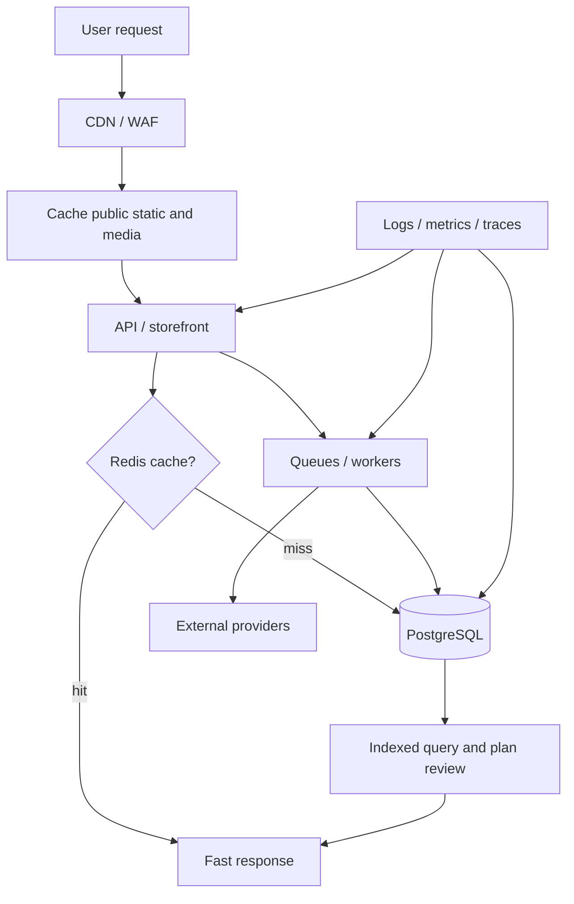

# PERFORMANCE-STRATEGY.md — Beginner-Friendly Copy

> **Learning copy notice.** This is a learning copy. No architecture decision, ID, API contract, database entity, security control, status, or requirement was changed. The original content is reproduced below.

## How to use this guide

- Read the beginner explanations first, then the unchanged original below the separator.
- A status of **Decision required** means the numeric target is not agreed yet. Do not invent one.
- Performance work is measured. If there is no agreed target, you can build the mechanism but cannot claim a final pass.

## How to read the IDs in this document

| ID pattern | Plain-English meaning | What it means as development work |
|---|---|---|
| `PERF-*` | Performance/reliability requirements | Build the capability named in the row. |
| `PERF-TGT-*` | Targets framework | Ask for and record the agreed metric/target. |
| `PERF-CAP-*` | Capacity inputs | Collect vendor/SKU/order/peak numbers before load testing. |
| `PERF-FE-*` | Frontend | Optimize pages, images, bundles, feedback, accessibility. |
| `PERF-CACHE-*` | Cache/API | Cache safe reads, add rate limits, keep idempotency durable. |
| `PERF-DB-*` | Database | Add indexes, review plans, bound queries, shorten transactions. |
| `PERF-SEARCH-*` | Search | Start with full-text; add a search index after threshold. |
| `PERF-CHK-*` | Checkout | Prevent duplicate submits, handle stock contention and spikes. |
| `PERF-ASYNC-*` | Background throughput | Monitor queues, retries, dead letters, webhook volume. |
| `PERF-AVAIL-*` | Availability/recovery | Define uptime, failover, backups, PITR, restore drills. |
| `PERF-OBS-*` | Observability | Add logs, metrics, traces, dashboards, alerts. |
| `PERF-TEST-*` | Testing | Run baseline, load, stress, spike, concurrency, failover tests. |
| `PERF-SCALE-*` | Scaling triggers | Document when to scale or extract; do not build early. |
| `DEC-*` | Unresolved decisions | Blocking questions such as DEC-020 numeric targets. |

## Beginner explanations by topic

### 1. Performance and reliability requirements

**What is it?**  
Ten requirements covering speed, capacity, efficiency, observability, and recovery.

**Why do we need it?**  
A slow or unreliable marketplace loses orders and trust.

**How does it work?**  
Each row has an ID, requirement, status, and cross-reference.

**Example.**  
Checkout must stay correct when many shoppers reserve the same SKU.

**What do I need to build?**  
Targets, fast queries, caches, queues, monitoring, transactions, load tests.

**How do I test it?**  
Run the relevant test type once targets exist.

| ID | Development work |
|---|---|
| PERF-001 | Define measurable page/API latency targets. |
| PERF-002 | Optimize Core Web Vitals, caching, images, queries. |
| PERF-003 | Define capacity inputs before load testing. |
| PERF-004 | Keep search responsive and define quality/latency targets. |
| PERF-005 | Support growth with scalable architecture and capacity plans. |
| PERF-006 | Index filters/joins, review plans, bound endpoints, short transactions. |
| PERF-007 | Define uptime, failover, backups, RPO/RTO. |
| PERF-008 | Centralize logs, metrics, traces, dashboards, alerts. |
| PERF-009 | Use transactions, retries, idempotency, queue monitoring, degradation, DLQ. |
| PERF-010 | Load test browse/search/checkout/flash-sale/concurrency paths. |

### 2. Strategy overview

**What is it?**  
A picture of how a request flows through CDN, cache, database, queues, and monitoring.

**Why do we need it?**  
It shows where speed comes from and where problems can hide.

**How does it work?**  
Public files come from CDN; safe reads from Redis; authoritative data from PostgreSQL; side effects via workers.

**Example.**  
A product page image comes from CDN; price comes from a server calculation, not cache guesswork.

**What do I need to build?**  
Each layer in the diagram with its stated treatment.

**How do I test it?**  
Trace one request and confirm cache hits/misses, query plan, and metrics are visible.

### 3. Performance targets framework

**What is it?**  
A list of metrics that need agreed numbers.

**Why do we need it?**  
Without numbers, “fast enough” cannot be tested.

**How does it work?**  
Each metric area has a target-setting requirement and a decision dependency.

**Example.**  
API latency percentiles for product listing, quote, and order creation.

**What do I need to build?**  
A targets register filled after DEC-008/009/020/023.

**How do I test it?**  
Check each target has an owner, value, measurement method, and alert.

| ID | Development work |
|---|---|
| PERF-TGT-001 | Define storefront page responsiveness targets. |
| PERF-TGT-002 | Define API latency percentiles. |
| PERF-TGT-003 | Define search quality/speed thresholds. |
| PERF-TGT-004 | Define checkout throughput and degradation behaviour. |
| PERF-TGT-005 | Define inventory contention behaviour; no oversell beyond rules. |
| PERF-TGT-006 | Define queue backlog/staleness limits. |
| PERF-TGT-007 | Define availability objectives. |
| PERF-TGT-008 | Define RPO/RTO, backup frequency, restore cadence. |
| PERF-TGT-009 | Define browsers, breakpoints, device expectations. |

### 4. Capacity planning

**What is it?**  
Collecting the numbers needed to size the system.

**Why do we need it?**  
Load tests and scaling plans need realistic inputs.

**How does it work?**  
Gather vendors, SKUs, orders, peak users, growth, hosting preference, topology.

**Example.**  
Peak concurrent shoppers during a flash sale drives web/API scaling.

**What do I need to build?**  
A capacity document and derived scenarios/sizing assumptions.

**How do I test it?**  
Compare test load to the agreed capacity inputs.

| ID | Development work |
|---|---|
| PERF-CAP-001 | Collect expected vendors, SKUs, catalogue growth. |
| PERF-CAP-002 | Collect monthly orders and peak order rate. |
| PERF-CAP-003 | Collect peak concurrent users. |
| PERF-CAP-004 | Collect growth forecast. |
| PERF-CAP-005 | Collect hosting preference, budget, team, timeline, support model. |
| PERF-CAP-006 | Collect load balancer/autoscaling/failover topology. |

### 5. Frontend and storefront performance

**What is it?**  
Making pages feel quick and accessible.

**Why do we need it?**  
Shoppers leave slow pages; accessibility must survive slow conditions.

**How does it work?**  
Track Core Web Vitals, optimize images, split bundles, set cache headers, show immediate feedback.

**Example.**  
Add to cart responds instantly in UI while totals still come from the server.

**What do I need to build?**  
LCP/INP/CLS instrumentation, responsive images, lazy loading, route splitting, clear loading/error states.

**How do I test it?**  
Run frontend Core Web Vitals and accessibility tests at agreed breakpoints.

| ID | Development work |
|---|---|
| PERF-FE-001 | Instrument Core Web Vitals for key pages. |
| PERF-FE-002 | Use optimized formats, responsive sizes, lazy loading, CDN, alt text. |
| PERF-FE-003 | Use server rendering/static generation where useful. |
| PERF-FE-004 | Split code by route/feature; keep admin code off public storefront. |
| PERF-FE-005 | Define public/private cache headers. |
| PERF-FE-006 | Show immediate feedback but rely on server totals/idempotent submit. |
| PERF-FE-007 | Keep accessible loading/error/focus/validation states under slow conditions. |

### 6. API and caching strategy

**What is it?**  
Reusing safe results and protecting APIs from overload.

**Why do we need it?**  
Fewer repeated queries means faster responses and less database load.

**How does it work?**  
Cache safe public reads; invalidate on status changes; keep idempotency records durable.

**Example.**  
A product publish change clears product detail, listing, search, and homepage groupings caches.

**What do I need to build?**  
Cache keys, invalidation triggers, Redis rate limits, durable idempotency store, signed URLs.

**How do I test it?**  
Publish a product and confirm stale cache is gone; replay cart request and confirm no cached authoritative total.

| ID | Development work |
|---|---|
| PERF-CACHE-001 | Cache safe public catalogue/category/content reads. |
| PERF-CACHE-002 | Cache common search shapes only where correctness permits. |
| PERF-CACHE-003 | Use secure short-lived session/token state. |
| PERF-CACHE-004 | Redis-backed rate limiting once limits agreed. |
| PERF-CACHE-005 | Store idempotency records durably, not only in cache. |
| PERF-CACHE-006 | Do not cache authoritative availability without freshness strategy. |
| PERF-CACHE-007 | Cache only non-authoritative cart/checkout UI state. |
| PERF-CACHE-008 | Public media through CDN; private documents by signed URLs. |

### 7. Database performance

**What is it?**  
Keeping queries and transactions efficient.

**Why do we need it?**  
A slow query or long transaction can block checkout.

**How does it work?**  
Use the ERD index intents, review plans, bound lists, keep transactions short, monitor health.

**Example.**  
Order lookup by user, order number, status, vendor, placed date uses a composite index.

**What do I need to build?**  
Indexes, pagination/filters, short transactions, decimal money columns, monitoring, restore timing.

**How do I test it?**  
Run `EXPLAIN`/query plan reviews and slow-query checks.

| ID | Development work |
|---|---|
| PERF-DB-001 | Index common filters/joins using DB-IDX-* intents. |
| PERF-DB-002 | Review plans for search, order queues, inventory, ledger, audit. |
| PERF-DB-003 | Avoid unbounded endpoints; require pagination and allow-listed filters. |
| PERF-DB-004 | Keep checkout/reservation/payment/refund/ledger transactions short. |
| PERF-DB-005 | Use fixed-precision decimal money columns and explicit currency codes. |
| PERF-DB-006 | Keep immutable ledger appends efficient and protected. |
| PERF-DB-007 | Separate/index reporting reads if dashboards impact transactions. |
| PERF-DB-008 | Monitor connections, slow queries, locks, replication lag, health. |
| PERF-DB-009 | Test backup/restore performance once RPO/RTO agreed. |

### 8. Search performance and scaling

**What is it?**  
Finding products quickly and correctly.

**Why do we need it?**  
Catalogue growth makes naive search slow.

**How does it work?**  
Start with PostgreSQL full-text; move to OpenSearch/Elasticsearch after agreed threshold.

**Example.**  
After moderation hides a product, search must not keep showing it.

**What do I need to build?**  
Full-text search, visibility-triggered indexing, aligned facets, quality targets.

**How do I test it?**  
Moderate a product and confirm it disappears from search.

| ID | Development work |
|---|---|
| PERF-SEARCH-001 | Start with PostgreSQL full-text where sufficient. |
| PERF-SEARCH-002 | Move to dedicated index only after threshold. |
| PERF-SEARCH-003 | Update search documents on approved visibility changes. |
| PERF-SEARCH-004 | Keep facets/filters aligned with API contracts/indexed fields. |
| PERF-SEARCH-005 | Define typo/synonym/relevance targets. |
| PERF-SEARCH-006 | Avoid stale product visibility after moderation/suspension. |

### 9. Checkout, inventory and flash-sale resilience

**What is it?**  
Keeping checkout correct under pressure.

**Why do we need it?**  
Duplicate clicks and stock races cause real business errors.

**How does it work?**  
Idempotency keys, atomic reservation, timeouts, queue side effects after commit, accurate states.

**Example.**  
Two requests with the same key create one order and one reservation.

**What do I need to build?**  
Duplicate-click protection, atomic stock reservation, expiry release, verified webhooks, load scenarios.

**How do I test it?**  
Concurrent reserve/submit tests and flash-sale spike tests.

| ID | Development work |
|---|---|
| PERF-CHK-001 | Require idempotency keys and duplicate-click protection. |
| PERF-CHK-002 | Atomic reservation, expiry/release, controlled oversell rules. |
| PERF-CHK-003 | Timeouts, bounded retries, status polling, verified webhooks. |
| PERF-CHK-004 | Queue non-critical side effects after commit; monitor backlog. |
| PERF-CHK-005 | Show accurate pending/failed states; no early success claim. |
| PERF-CHK-006 | Define flash-sale load scenarios/degradation after capacity inputs. |
| PERF-CHK-007 | Clean stale carts/reservations on schedule. |

### 10. Asynchronous throughput and reliability

**What is it?**  
Keeping background work healthy.

**Why do we need it?**  
A growing queue can delay notifications and exports.

**How does it work?**  
Monitor depth/age/rate, bounded retries with backoff, dead-letter queue, dedupe webhooks.

**Example.**  
A bad export job goes to DLQ and can be replayed safely after a fix.

**What do I need to build?**  
Queue metrics, retry policy, DLQ, webhook persistence, consent-aware channel queues, scheduling locks.

**How do I test it?**  
Force repeated failures and confirm DLQ routing and replay.

| ID | Development work |
|---|---|
| PERF-ASYNC-001 | Monitor depth, age, processing rate, oldest job age. |
| PERF-ASYNC-002 | Bounded retries with exponential backoff and jitter. |
| PERF-ASYNC-003 | Route unprocessable jobs to inspectable DLQ with safe replay. |
| PERF-ASYNC-004 | Persist webhook event first; dedupe by provider event ID. |
| PERF-ASYNC-005 | Queue notifications by channel/provider; respect consent/limits. |
| PERF-ASYNC-006 | Run exports/invoices/status jobs asynchronously with references. |
| PERF-ASYNC-007 | Coordinate scheduled tasks to avoid duplicates. |

### 11. Availability, failover and recovery

**What is it?**  
Staying usable and recovering after failure.

**Why do we need it?**  
Providers and infrastructure can fail.

**How does it work?**  
Define SLO, maintenance, failover; degrade safely; back up; test restore.

**Example.**  
If email provider is down, orders still place and notifications queue.

**What do I need to build?**  
Backups, encrypted storage, failover design, PITR if agreed, restore drills, RPO/RTO verification.

**How do I test it?**  
Run restore drill and simulate dependency failure.

| ID | Development work |
|---|---|
| PERF-AVAIL-001 | Define uptime SLO after review. |
| PERF-AVAIL-002 | Agree maintenance windows and communication. |
| PERF-AVAIL-003 | Decide load balancer/autoscaling/failover topology. |
| PERF-AVAIL-004 | Continue safe browsing; queue notifications; expose outages accurately. |
| PERF-AVAIL-005 | Automated encrypted backups with controlled retention. |
| PERF-AVAIL-006 | PITR where supported and decided. |
| PERF-AVAIL-007 | Restore drills before launch and on agreed cadence. |
| PERF-AVAIL-008 | Define and verify RPO/RTO. |

### 12. Observability and alerting

**What is it?**  
Signals that tell you how the system behaves.

**Why do we need it?**  
You cannot fix what you cannot see.

**How does it work?**  
Track latency, errors, saturation, traffic, provider health, business events; propagate correlation IDs.

**Example.**  
Alert on payment failures, webhook failures, stuck orders, oversell conflicts, queue backlog.

**What do I need to build?**  
Structured logs, metrics, traces, dashboards, alerts, correlation propagation.

**How do I test it?**  
Trigger a test failure and confirm the right alert fires with a correlation ID.

| ID | Development work |
|---|---|
| PERF-OBS-001 | Track latency by endpoint/journey. |
| PERF-OBS-002 | Track HTTP errors, validation/business failures, exceptions. |
| PERF-OBS-003 | Track CPU/memory, DB connections, queue depth, cache health, provider limits. |
| PERF-OBS-004 | Track requests/search/checkout rates by surface. |
| PERF-OBS-005 | Track provider success/failure and latency. |
| PERF-OBS-006 | Alert on payment/webhook failures, stuck orders, oversell, backlog, reconciliation exceptions. |
| PERF-OBS-007 | Propagate correlation IDs through APIs/logs/traces/queues/adapters. |
| PERF-OBS-008 | Provide operational dashboards. |
| PERF-OBS-009 | Alert against agreed SLOs after decisions. |

### 13. Testing strategy

**What is it?**  
Different tests for different performance risks.

**Why do we need it?**  
Average load, sudden spikes, and long runs reveal different problems.

**How does it work?**  
Run baseline, load, stress, spike, concurrency, endurance, failover, frontend tests.

**Example.**  
Concurrency test: two users reserve the last unit; only one succeeds.

**What do I need to build?**  
Test scripts, environments, target thresholds, evidence reports.

**How do I test it?**  
Execute the tests; final pass/fail waits for DEC-008/009/020/023 targets.

| ID | Development work |
|---|---|
| PERF-TEST-001 | Baseline key page/API timings. |
| PERF-TEST-002 | Load test expected concurrent users/journeys. |
| PERF-TEST-003 | Stress test beyond expected load. |
| PERF-TEST-004 | Spike/flash-sale test where in scope. |
| PERF-TEST-005 | Concurrency: reservation, idempotent submit, webhook duplicates. |
| PERF-TEST-006 | Endurance test for leaks/queue growth. |
| PERF-TEST-007 | Failover/restore test. |
| PERF-TEST-008 | Frontend Core Web Vitals/responsive/browser test. |

### 14. Scaling and extraction triggers

**What is it?**  
Conditions that may justify changing the deployment shape later.

**Why do we need it?**  
It avoids premature complexity while planning for growth.

**How does it work?**  
Each trigger names a candidate response and a status.

**Example.**  
If reporting queries hurt transactions, introduce read models/reporting store.

**What do I need to build?**  
Nothing yet. Record triggers in ADRs.

**How do I test it?**  
During reviews, check whether a trigger was reached before extracting.

| ID | Development work |
|---|---|
| PERF-SCALE-001 | Future dedicated search index and async indexing. |
| PERF-SCALE-002 | Future read models/reporting store. |
| PERF-SCALE-003 | Future independent notification scaling/extraction. |
| PERF-SCALE-004 | Future separate webhook processing unit. |
| PERF-SCALE-005 | Future checkout/order extraction behind stable APIs. |
| PERF-SCALE-006 | Future multi-region evaluation. |

### 15. Performance decision gates

**What is it?**  
Decisions that block final targets and plans.

**Why do we need it?**  
They stop teams from guessing numbers or topology.

**How does it work?**  
Each `DEC-*` row names what is needed and what it blocks.

**Example.**  
DEC-020 blocks final acceptance thresholds.

**What do I need to build?**  
Decision log and blocked tickets.

**How do I test it?**  
Confirm no test asserts an invented numeric target.

### 16. Traceability

**What is it?**  
A map from source sections to performance IDs.

**Why do we need it?**  
It shows coverage of NFRs, QA, and DevOps areas.

**How does it work?**  
Read the table and open the linked IDs/documents.

**Example.**  
§10 testing and QA → PERF-010 and AC-QA-005.

**What do I need to build?**  
Cross-links in docs and tickets.

**How do I test it?**  
Pick a source area and confirm linked performance IDs exist.

## Simple glossary

| Term | Simple meaning |
|---|---|
| modular monolith | One deployed backend, split internally into strict business modules. |
| REST API | HTTP endpoints using methods like GET, POST, PATCH, DELETE. |
| OpenAPI | A machine-readable description of API paths, schemas, and errors. |
| DTO | Data Transfer Object: a validated object used at the API boundary. |
| RBAC | Role-Based Access Control: permissions are attached to roles. |
| idempotency | Doing the same request twice has the same effect as doing it once. |
| webhook | A callback where a provider sends an event to your API. |
| queue | A list of background jobs waiting to be processed. |
| worker | A process that takes jobs from a queue and executes them. |
| cache | A fast temporary store for data that is safe to reuse. |
| Redis | In-memory data store used here for cache, rate limits, queues. |
| BullMQ | A Node.js queue library commonly used with Redis. |
| Prisma / ORM | Prisma maps application objects to database rows; an ORM is that mapping layer. |
| migration | A versioned script that changes database structure. |
| ERD | Entity Relationship Diagram: boxes for data entities and lines for relationships. |
| foreign key | A field that points to a row in another table. |
| index | A database helper that makes common lookups faster. |
| transaction | A group of database changes that all succeed or all fail together. |
| CI/CD | Automated build/test (CI) and automated delivery (CD). |
| SLO | Service Level Objective: an agreed reliability target. |
| RPO/RTO | Recovery Point Objective (max data loss) / Recovery Time Objective (max downtime). |
| TLS | Encryption for data in transit; HTTPS uses TLS. |
| CSRF | Cross-Site Request Forgery: a trick that makes a user's browser send unwanted requests. |
| XSS | Cross-Site Scripting: injecting harmful script into a page. |
| SQL injection | Injecting SQL through input to read or change data illegally. |
| secrets manager | A secure store for API keys, passwords, and tokens. |
| tokenization | Replacing sensitive data with a safe reference/token. |
| Core Web Vitals | User-experience metrics such as LCP, INP, CLS. |
| LCP / INP / CLS | Loading speed / interaction responsiveness / visual stability. |
| CDN | Content Delivery Network: cached public files served close to users. |
| WAF | Web Application Firewall that filters harmful web traffic. |
| SSR / SSG | Server-side rendering / static site generation. |
| connection pooling | Reusing database connections instead of opening new ones each time. |
| percentile | A value below which a share of requests fall, e.g. p95. |
| backoff | Waiting longer between retries to avoid overload. |
| jitter | Random variation added to retry delays. |
| dead-letter queue | A queue for jobs that cannot be processed after retries. |
| PITR | Point-in-time recovery: restoring to a chosen moment. |
| observability | Logs, metrics, traces, and alerts that explain system behaviour. |
| dependency degradation | Continuing safe parts of service when a provider fails. |
| extraction trigger | A measured condition that justifies splitting a module into a service. |

## Original document content (unchanged)

# Performance Strategy

**Project:** Task 2 — E-Commerce Marketplace  
**Source of truth:** `docs/requirements/Task_2_Complete_Ecommerce_Marketplace_Specification.pdf`  
**Canonical requirements:** [SRS.md](../requirements/SRS.md)  
**Related:** [SYSTEM-ARCHITECTURE.md](SYSTEM-ARCHITECTURE.md), [DATABASE-ERD.md](DATABASE-ERD.md), [API-DESIGN.md](API-DESIGN.md), [ACCEPTANCE-CRITERIA.md](../requirements/ACCEPTANCE-CRITERIA.md)

## Status vocabulary

| Status | Meaning |
|---|---|
| **Mandatory** | Required by the PDF or necessary for a reliable marketplace launch. |
| **Recommendation** | Recommended engineering approach, not a confirmed numeric target. |
| **Decision required** | Numeric target, topology, capacity input, or SLO is unresolved. See [SRS §12](../requirements/SRS.md#12-unresolved-decisions-and-items-to-confirm). |

> The PDF labels performance, availability, RPO/RTO, and related numbers as targets to agree. This document defines the strategy and decision gates but does not invent numeric pass/fail values.

---

## 1. Performance and reliability requirements

| ID | Area | Requirement | Status | Cross-reference |
|---|---|---|---|---|
| PERF-001 | Performance targets | Define measurable page and API latency targets for key journeys. | Decision required | [NFR-PERF-001](../requirements/SRS.md#5-non-functional-requirements), [DEC-020](../requirements/SRS.md#12-unresolved-decisions-and-items-to-confirm) |
| PERF-002 | Frontend and query optimization | Optimize Core Web Vitals, caching, image delivery, and database queries. | Mandatory | [NFR-PERF-002](../requirements/SRS.md#5-non-functional-requirements) |
| PERF-003 | Capacity model | Define expected vendors, SKUs, monthly orders, peak concurrent users, and growth forecast before load testing. | Decision required | [DEC-008](../requirements/SRS.md#12-unresolved-decisions-and-items-to-confirm) |
| PERF-004 | Search performance | Keep catalogue discovery and search responsive as catalogue size grows; define search quality/latency targets. | Mandatory intent; targets decision required | [FR-DISC-002](../requirements/SRS.md#34-storefront-search--product-discovery), [DEC-023](../requirements/SRS.md#12-unresolved-decisions-and-items-to-confirm) |
| PERF-005 | Scalability | Support growth in users, products, vendors, and concurrent orders through scalable architecture and tested capacity plans. | Mandatory | [NFR-SCAL-001](../requirements/SRS.md#5-non-functional-requirements) |
| PERF-006 | Database efficiency | Index common filters/joins, review query plans, avoid unbounded endpoints, and keep checkout/stock transactions short. | Mandatory | [DB-009](../requirements/SRS.md#8-data-api-and-integration-summary), [DB-IDX-*](DATABASE-ERD.md) |
| PERF-007 | Availability and recovery | Define uptime objective, maintenance windows, failover design, backups, RPO/RTO, and service dependency strategy. | Decision required | [NFR-AVAIL-001](../requirements/SRS.md#5-non-functional-requirements), [DEC-009](../requirements/SRS.md#12-unresolved-decisions-and-items-to-confirm), [DEC-019](../requirements/SRS.md#12-unresolved-decisions-and-items-to-confirm), [DEC-020](../requirements/SRS.md#12-unresolved-decisions-and-items-to-confirm) |
| PERF-008 | Observability | Centralize structured logs, metrics, traces, dashboards, and actionable alerts for performance and reliability. | Mandatory | [NFR-OBS-001](../requirements/SRS.md#5-non-functional-requirements), [DEP-007](../requirements/SRS.md#11-devops-environments-and-deployment) |
| PERF-009 | Reliability mechanisms | Use transactions, retries with backoff, idempotency, queue monitoring, graceful degradation, and dead-letter handling. | Mandatory | [NFR-REL-001](../requirements/SRS.md#5-non-functional-requirements), [ARC-ASYNC](SYSTEM-ARCHITECTURE.md) |
| PERF-010 | Performance testing | Load test expected peak traffic for search, browse, checkout, flash sales, and concurrent inventory updates. | Mandatory | [QA-007](../requirements/SRS.md#10-testing-and-quality-assurance), [AC-QA-005](../requirements/ACCEPTANCE-CRITERIA.md) |

**QA ID note:** [SRS §10](../requirements/SRS.md#10-testing-and-quality-assurance) defines `QA-007` as performance testing. Performance test acceptance is covered by [AC-QA-005](../requirements/ACCEPTANCE-CRITERIA.md).

---

## 2. Strategy overview

| Layer | Performance treatment | Status |
|---|---|---|
| Client/storefront | SSR/SSG where appropriate, code splitting, image optimization, Core Web Vitals review, accessible responsive components. | Recommendation |
| CDN/edge | Public media/static assets and cacheable public pages where safe. | Recommendation |
| API | Connection pooling, bounded request sizes, pagination, validation, correlation IDs, and cache controls. | Mandatory |
| Cache | Redis for safe read-through caching, rate limiting, and short-lived operational state. | Recommendation |
| Database | Indexes, query-plan review, transaction discipline, fixed-precision money columns, no unbounded queries. | Mandatory |
| Search | PostgreSQL full-text initially; dedicated search index when threshold is reached. | Conditional; threshold pending DEC-015 |
| Async | Queues for notifications, indexing, invoices, exports, webhooks, and scheduled cleanup. | Mandatory |
| Integrations | Timeouts, bounded retries, circuit/fallback behaviour, reconciliation, and provider-status monitoring. | Mandatory |
| Observability | SLO dashboards, error rates, latency histograms, queue depth, DB health, provider failures. | Mandatory; SLOs pending DEC-009/DEC-020 |

---

## 3. Performance targets framework

| ID | Metric area | Target-setting requirement | Status |
|---|---|---|---|
| PERF-TGT-001 | Storefront page responsiveness | Define targets for homepage, category, search, product detail, cart, and checkout pages. | Decision required |
| PERF-TGT-002 | API latency | Define percentiles for product listing, search, cart, quote, order creation, payment status, and order history endpoints. | Decision required |
| PERF-TGT-003 | Search quality and speed | Define typo tolerance, synonym, relevance, and latency acceptance thresholds. | Decision required |
| PERF-TGT-004 | Checkout throughput | Define expected order creation/payment peak and acceptable degradation behaviour. | Decision required |
| PERF-TGT-005 | Inventory contention | Define acceptable behaviour when many users reserve the same SKU; no oversell beyond configured rules. | Mandatory behaviour; thresholds decision required |
| PERF-TGT-006 | Background processing | Define acceptable queue backlog and staleness limits for notifications, indexing, exports, and invoice generation. | Decision required |
| PERF-TGT-007 | Availability | Define uptime, maintenance windows, failover, and dependency-degradation objectives. | Decision required |
| PERF-TGT-008 | Recovery | Define RPO/RTO, backup frequency, retention, and restore drill cadence. | Decision required |
| PERF-TGT-009 | Browser/mobile | Define supported browsers, breakpoints, and device performance expectations. | Decision required |

All targets above require [DEC-008](../requirements/SRS.md#12-unresolved-decisions-and-items-to-confirm), [DEC-009](../requirements/SRS.md#12-unresolved-decisions-and-items-to-confirm), [DEC-020](../requirements/SRS.md#12-unresolved-decisions-and-items-to-confirm), or [DEC-023](../requirements/SRS.md#12-unresolved-decisions-and-items-to-confirm).

---

## 4. Capacity planning

| ID | Input | Needed from | Used for |
|---|---|---|---|
| PERF-CAP-001 | Expected vendors, SKUs, and catalogue growth. | [DEC-008](../requirements/SRS.md#12-unresolved-decisions-and-items-to-confirm) | Database sizing, search strategy, cache sizing. |
| PERF-CAP-002 | Monthly orders and peak order rate. | [DEC-008](../requirements/SRS.md#12-unresolved-decisions-and-items-to-confirm) | Checkout throughput, queue sizing, database write capacity. |
| PERF-CAP-003 | Peak concurrent users. | [DEC-008](../requirements/SRS.md#12-unresolved-decisions-and-items-to-confirm) | Load-test scenarios, web/API scaling. |
| PERF-CAP-004 | Growth forecast. | [DEC-008](../requirements/SRS.md#12-unresolved-decisions-and-items-to-confirm) | Scaling plan and service-extraction triggers. |
| PERF-CAP-005 | Hosting preference, budget, team, timeline, support model. | [DEC-009](../requirements/SRS.md#12-unresolved-decisions-and-items-to-confirm) | Topology and operational model. |
| PERF-CAP-006 | Load balancer, autoscaling, failover topology. | [DEC-019](../requirements/SRS.md#12-unresolved-decisions-and-items-to-confirm) | Availability and scalability design. |

**Capacity outputs to produce after decisions**

- Load-test scenarios and target concurrency.
- Cache and queue sizing assumptions.
- Database connection and storage plan.
- Search index migration trigger.
- Auto-scaling and failover plan.
- Alert thresholds and escalation paths.
- Service extraction triggers documented in ADRs.

---

## 5. Frontend and storefront performance

| ID | Technique | Requirement | Status |
|---|---|---|---|
| PERF-FE-001 | Core Web Vitals tracking | Instrument LCP, INP/responsiveness, CLS, and related agreed metrics for key pages. | Mandatory |
| PERF-FE-002 | Image delivery | Use optimized formats, responsive sizes, lazy loading, CDN delivery, and alt text. | Mandatory |
| PERF-FE-003 | Rendering strategy | Use server rendering/static generation where it improves SEO and perceived performance. | Recommendation |
| PERF-FE-004 | Bundle control | Split code by route/feature and avoid shipping admin/vendor code to public storefront users. | Recommendation |
| PERF-FE-005 | Public cache headers | Define cacheability for public content, product media, and private/account responses. | Mandatory |
| PERF-FE-006 | Checkout responsiveness | Show immediate client feedback while relying on server-calculated totals and idempotent submission. | Mandatory |
| PERF-FE-007 | Accessibility interaction | Maintain accessible loading, error, focus, and validation states under slow conditions. | Mandatory |

---

## 6. API and caching strategy

| ID | Cache/API concern | Approach | Status |
|---|---|---|---|
| PERF-CACHE-001 | Catalogue reads | Cache safe public catalogue/category/content reads with explicit invalidation on publish/status changes. | Recommendation |
| PERF-CACHE-002 | Search results | Cache common query/facet result shapes only where correctness and personalization rules permit. | Recommendation; personalization pending DEC-016 |
| PERF-CACHE-003 | Session/auth | Use secure, short-lived session/token state according to final auth design. | Mandatory |
| PERF-CACHE-004 | Rate limiting | Use Redis-backed rate limiting once numeric limits are agreed. | Mandatory intent; limits pending DEC-020 |
| PERF-CACHE-005 | Idempotency records | Store idempotency records durably, not only in transient cache. | Mandatory |
| PERF-CACHE-006 | Inventory | Do not cache authoritative availability without a controlled freshness/invalidation strategy. | Mandatory |
| PERF-CACHE-007 | Cart/checkout | Cache only non-authoritative UI state; totals and stock commitments remain server-side. | Mandatory |
| PERF-CACHE-008 | Object storage/CDN | Serve public media through CDN; use signed URLs for private documents. | Mandatory |

**Invalidation triggers**

| Trigger | Affected cache |
|---|---|
| Product moderation/publish status change | Product detail, category listing, search documents, homepage groupings. |
| Price/promotion change | Product listing, quote context, cart display. |
| Inventory reservation/release/sale | Availability display, stock status, search facets where present. |
| Content/campaign change | Homepage, banners, navigation, static pages, sitemap inputs. |
| Vendor suspension/termination | Vendor storefront, product visibility, search results. |
| Feature flag/configuration change | Client capability flags and affected module configuration caches. |

---

## 7. Database performance

| ID | Practice | Requirement | Status |
|---|---|---|---|
| PERF-DB-001 | Index common filters/joins using [DB-IDX-*](DATABASE-ERD.md). | Mandatory |
| PERF-DB-002 | Review query plans for product search, order queues, inventory lookup, ledger reports, and audit search. | Mandatory |
| PERF-DB-003 | Avoid unbounded list endpoints; require pagination and allow-listed filters. | Mandatory |
| PERF-DB-004 | Keep checkout, reservation, payment-state, refund, and ledger transactions short and deterministic. | Mandatory |
| PERF-DB-005 | Use fixed-precision decimal money columns and explicit currency codes. | Mandatory |
| PERF-DB-006 | Keep immutable ledger appends efficient and protect them from updates. | Mandatory |
| PERF-DB-007 | Separate or index reporting reads if dashboards impact transactional work. | Recommendation |
| PERF-DB-008 | Monitor connections, slow queries, locks, replication lag where applicable, and database health. | Mandatory |
| PERF-DB-009 | Test backup/restore performance once RPO/RTO are agreed. | Mandatory; targets pending DEC-020 |

---

## 8. Search performance and scaling

| ID | Approach | Requirement | Status |
|---|---|---|---|
| PERF-SEARCH-001 | Start with PostgreSQL full-text where sufficient. | Recommendation | [TEC-010](../requirements/SRS.md#6-recommended-technology-stack) |
| PERF-SEARCH-002 | Move to OpenSearch/Elasticsearch when the agreed threshold is reached. | Conditional; threshold pending DEC-015 |
| PERF-SEARCH-003 | Update search documents on approved product visibility changes. | Mandatory |
| PERF-SEARCH-004 | Keep facets/filters aligned with API contracts and indexed fields. | Mandatory |
| PERF-SEARCH-005 | Define typo tolerance, synonym, and relevance targets. | Decision required | [DEC-023](../requirements/SRS.md#12-unresolved-decisions-and-items-to-confirm) |
| PERF-SEARCH-006 | Avoid exposing stale product visibility after moderation or vendor suspension. | Mandatory |

---

## 9. Checkout, inventory and flash-sale resilience

| ID | Concern | Strategy | Status |
|---|---|---|---|
| PERF-CHK-001 | Duplicate submits | Require idempotency keys and duplicate-click protection. | Mandatory |
| PERF-CHK-002 | Stock contention | Atomic reservation, expiry/release, and controlled oversell rules. | Mandatory; rules pending DEC-021 |
| PERF-CHK-003 | Provider latency | Timeouts, bounded retries, status polling, and verified webhooks. | Mandatory |
| PERF-CHK-004 | Queue spikes | Queue non-critical checkout side effects after commit; monitor backlog. | Mandatory |
| PERF-CHK-005 | Graceful failure | Show accurate pending/failed states; do not claim success before verified payment. | Mandatory |
| PERF-CHK-006 | Flash sales | Define load scenarios and degradation strategy once capacity inputs are known. | Decision required |
| PERF-CHK-007 | Cart expiry | Clean stale carts/reservations on a schedule. | Mandatory intent; durations pending DEC-020 |

---

## 10. Asynchronous throughput and reliability

| ID | Concern | Strategy | Status |
|---|---|---|---|
| PERF-ASYNC-001 | Queue backlog | Monitor depth, age, processing rate, and oldest job age. | Mandatory |
| PERF-ASYNC-002 | Retry policy | Bounded retries with exponential backoff and jitter. | Mandatory |
| PERF-ASYNC-003 | Dead-letter queue | Route unprocessable jobs to an inspectable DLQ with replay where safe. | Mandatory |
| PERF-ASYNC-004 | Webhook volume | Persist event first, process idempotently, deduplicate by provider event ID. | Mandatory |
| PERF-ASYNC-005 | Notifications | Queue by channel/provider; respect consent and provider limits. | Mandatory |
| PERF-ASYNC-006 | Exports/invoices/status jobs | Run asynchronously and expose progress/download references. | Mandatory |
| PERF-ASYNC-007 | Scheduling | Coordinate scheduled tasks to avoid duplicate execution. | Mandatory |

---

## 11. Availability, failover and recovery

| ID | Area | Strategy | Status |
|---|---|---|---|
| PERF-AVAIL-001 | Uptime objective | Define SLO after hosting, budget, support model, and dependency review. | Decision required |
| PERF-AVAIL-002 | Maintenance windows | Agree windows and communication approach. | Decision required |
| PERF-AVAIL-003 | Failover topology | Decide load balancer, autoscaling, and failover design. | Decision required | [DEC-019](../requirements/SRS.md#12-unresolved-decisions-and-items-to-confirm) |
| PERF-AVAIL-004 | Dependency degradation | Continue safe browsing where possible; queue notifications; expose provider outages accurately. | Mandatory |
| PERF-AVAIL-005 | Backups | Automated database backups, encrypted storage, controlled retention. | Mandatory |
| PERF-AVAIL-006 | PITR | Point-in-time recovery where supported by provider and decision. | Conditional |
| PERF-AVAIL-007 | Restore drills | Test restoration in a non-production environment before launch and on agreed cadence. | Mandatory |
| PERF-AVAIL-008 | RPO/RTO | Define and verify recovery objectives. | Decision required |

---

## 12. Observability and alerting

| ID | Signal | Requirement | Status |
|---|---|---|---|
| PERF-OBS-001 | Latency | Track page/API latency by key endpoint and journey. | Mandatory |
| PERF-OBS-002 | Errors | Track HTTP error rates, validation failures, business-rule failures, and unhandled exceptions. | Mandatory |
| PERF-OBS-003 | Saturation | Track CPU/memory, DB connections, queue depth, cache health, and provider rate limits. | Mandatory |
| PERF-OBS-004 | Traffic | Track requests/search/checkout rates by surface and endpoint family. | Mandatory |
| PERF-OBS-005 | Provider health | Track payment, shipping, tax, email, and SMS success/failure and latency. | Mandatory |
| PERF-OBS-006 | Business critical events | Alert on payment failures, webhook failures, stuck orders, oversell conflicts, queue backlog, and reconciliation exceptions. | Mandatory |
| PERF-OBS-007 | Correlation | Propagate request/correlation IDs through APIs, logs, traces, queues, and provider adapters. | Mandatory |
| PERF-OBS-008 | Dashboards | Provide operational dashboards for storefront, vendor/admin portal, API, database, queues, and integrations. | Mandatory |
| PERF-OBS-009 | SLO alerts | Alert against agreed SLOs once DEC-009/DEC-020 are resolved. | Decision required |

---

## 13. Testing strategy

| ID | Test type | Scope | Acceptance | Status |
|---|---|---|---|---|
| PERF-TEST-001 | Baseline | Key page and API timings under nominal conditions. | AC-QA-005 | Mandatory once targets exist |
| PERF-TEST-002 | Load | Expected concurrent users, browsing, search, cart, and checkout. | AC-QA-005 | Mandatory |
| PERF-TEST-003 | Stress | Push beyond expected load to identify breaking points and degradation. | AC-QA-005 | Recommendation |
| PERF-TEST-004 | Spike/flash sale | Sudden traffic to product detail, checkout, and reservation paths. | AC-QA-005 | Mandatory where flash sales are in scope |
| PERF-TEST-005 | Concurrency | Concurrent inventory reservation, idempotent order submit, webhook duplicates. | AC-005, AC-006 | Mandatory |
| PERF-TEST-006 | Endurance | Sustained load for memory leaks, queue growth, and connection leaks. | AC-QA-005 | Recommendation |
| PERF-TEST-007 | Failover/restore | Restore drill and dependency failure behaviour. | LAUNCH-010, PERF-AVAIL-008 | Mandatory |
| PERF-TEST-008 | Frontend | Core Web Vitals, responsive breakpoints, browser compatibility. | AC-QA-005, AC-ACC-001 | Mandatory |

**Test exit rule:** performance tests cannot receive a final pass/fail result until numeric targets from [DEC-008](../requirements/SRS.md#12-unresolved-decisions-and-items-to-confirm), [DEC-009](../requirements/SRS.md#12-unresolved-decisions-and-items-to-confirm), [DEC-020](../requirements/SRS.md#12-unresolved-decisions-and-items-to-confirm), and [DEC-023](../requirements/SRS.md#12-unresolved-decisions-and-items-to-confirm) are agreed and recorded.

---

## 14. Scaling and extraction triggers

| ID | Trigger candidate | Possible response | Status |
|---|---|---|---|
| PERF-SCALE-001 | Search traffic/catalogue size exceeds agreed threshold. | Introduce dedicated search index and async indexing. | Conditional; threshold pending DEC-015 |
| PERF-SCALE-002 | Reporting queries affect transactions. | Introduce read models/reporting store. | Conditional |
| PERF-SCALE-003 | Notification volume affects core API. | Scale workers independently or extract notification service. | Conditional |
| PERF-SCALE-004 | Webhook/payment load requires isolation. | Separate webhook processing deployment unit. | Conditional; compliance boundary pending DEC-018 |
| PERF-SCALE-005 | Checkout peak requires independent scaling. | Extract checkout/order processing behind stable APIs while preserving transactional rules. | Conditional |
| PERF-SCALE-006 | Multi-region demand confirmed. | Evaluate regional deployment, data residency, and localization. | Conditional; scope pending DEC-016/DEC-024 |

Extraction triggers are recorded in ADRs per [ARC-ADR](SYSTEM-ARCHITECTURE.md). No extraction is assumed for the initial modular monolith baseline.

---

## 15. Performance decision gates

| ID | Decision needed | Blocks |
|---|---|---|
| DEC-008 | Capacity inputs. | Load scenarios, sizing, thresholds. |
| DEC-009 | Hosting, budget, team, timeline, support model, SLOs. | Infrastructure plan, support and availability model. |
| DEC-015 | Search migration threshold. | Search architecture and index plan. |
| DEC-016 | Conditional launch scope. | Mobile, loyalty, multi-warehouse, B2B, and advanced feature load. |
| DEC-019 | Load balancer, autoscaling, failover topology. | Availability design. |
| DEC-020 | Numeric performance, availability, RPO/RTO, retention, breakpoints. | Final acceptance thresholds. |
| DEC-021 | Exact state machines and oversell policy details. | Concurrency and reservation rules. |
| DEC-023 | Search quality targets. | Search acceptance criteria. |
| DEC-024 | Whether advanced/mobile/multi-region features are mandatory day one. | Capacity model and MVP performance scope. |

---

## 16. Traceability

| Source area | Performance IDs |
|---|---|
| §5 architecture/application design | PERF-002, PERF-006, PERF-009 |
| §6 database/data model | PERF-006, [DATABASE-ERD.md](DATABASE-ERD.md) |
| §8 non-functional requirements | PERF-001–PERF-010 |
| §10 testing and QA | PERF-010, [AC-QA-005](../requirements/ACCEPTANCE-CRITERIA.md) |
| §11 DevOps/environments | PERF-008, PERF-AVAIL-*, [DEP-007](../requirements/SRS.md#11-devops-environments-and-deployment) |
| §16 assumptions/decisions | PERF decision gates above |
