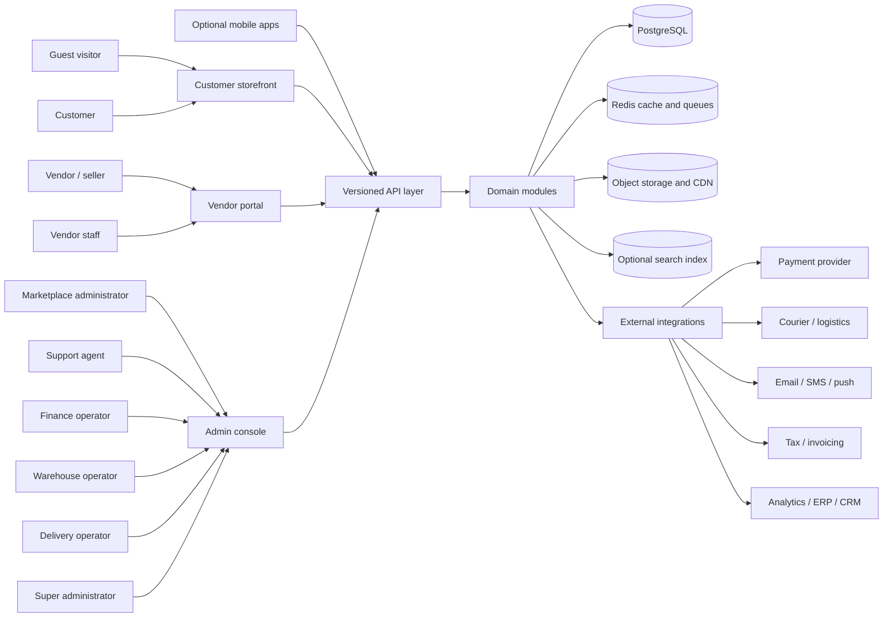
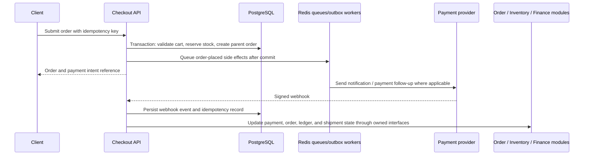
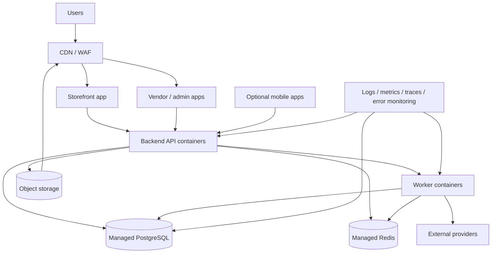

# SYSTEM-ARCHITECTURE.md — Beginner-Friendly Copy

> **Learning copy notice.** This is a learning copy. No architecture decision, ID, API contract, database entity, security control, status, or requirement was changed. The original content is reproduced below.

## How to use this guide

- Read the beginner sections first.
- Then read the original document below the separator.
- Treat the original as the source of truth.
- The beginner sections only explain it in simpler words.

## How to read the IDs in this document

| ID pattern | Plain-English meaning | What it means as development work |
|---|---|---|
| `ARC-001`–`ARC-008` | Whole-system architecture statements | Set up the overall shape of the backend, APIs, data stores, and rules. |
| `ARC-PRES-*` | Presentation (screens clients use) | Build the storefront, vendor portal, admin console, or optional mobile apps. |
| `ARC-DOMAIN-*` | Backend domain modules | Create a folder/module that owns one business area and its data. |
| `ARC-ASYNC-*` | Background work | Build queues, workers, scheduled jobs, and webhook handling. |
| `ARC-DATA-*` | Data storage choices | Choose and configure PostgreSQL, Redis, object storage, CDN, search, backups. |
| `INT-*` | External integrations | Write adapters for payment, courier, email, SMS, tax, analytics, ERP. |
| `ARC-DEP-*` | Deployment | Create environments, Docker images, CI pipeline, monitoring, rollback. |
| `ARC-ADR-*` | Architecture Decision Records | Write short decision notes with context, choice, consequences, and alternatives. |
| `ARC-EXT-*` | Future extraction options | Do not build now; document when a module could be split into its own service. |
| `DEC-*` | Unresolved decisions | Ask for a decision before building the dependent feature. |

## Beginner explanations by topic

### 1. Architecture intent

**What is it?**  
A short list of rules for how TradeOrbit is shaped.

**Why do we need it?**  
So every developer builds the same kind of system.

**How does it work?**  
Each idea gets an ID, a status, and a cross-reference to requirements.

**Example (TradeOrbit marketplace).**  
One backend app, many modules: catalogue, cart, checkout, orders, payments.

**What do I need to build?**  
A modular monolith: one deployable backend with strict module borders.

**How do I test it?**  
Check the module folders exist, tests run per module, and protected APIs check permissions.

| ID | Development work |
|---|---|
| ARC-001 | Create one backend app organised into strict domain modules. |
| ARC-002 | Keep modules isolated so a busy module can be extracted later. |
| ARC-003 | Expose one versioned API used by web and optional mobile clients. |
| ARC-004 | Use PostgreSQL, Redis, object storage, and optional search. |
| ARC-005 | Enforce login and permissions on every protected operation. |
| ARC-006 | Do immediate work synchronously; do side effects in queues. |
| ARC-007 | Keep audit records and financial history immutable. |
| ARC-008 | Do not invent answers for unresolved `DEC-*` items. |

### 2. System context

**What is it?**  
A map of who uses TradeOrbit and what they talk to.

**Why do we need it?**  
It shows that all user groups reach the same backend API.

**How does it work?**  
Clients call the versioned API; the API calls domain modules; modules call data stores and providers.

**Example.**  
A vendor updates stock in the vendor portal → API → catalogue/inventory modules → PostgreSQL.

**What do I need to build?**  
Storefront, vendor portal, admin console, API layer, module layer, and provider adapters.

**How do I test it?**  
Draw the request path for one journey and confirm each hop exists in code.

### 3. Presentation architecture

**What is it?**  
The screens and UI components users see.

**Why do we need it?**  
Different users need different tools, but consistent look and behaviour.

**How does it work?**  
Each client uses the same versioned API contract. The design system shares components.

**Example.**  
The storefront shows a price, but the server calculates the final payable amount.

**What do I need to build?**  
Customer storefront, vendor portal, admin console, design system, and accessible responsive forms.

**How do I test it?**  
Check permissions in UI, confirm no client-side final totals, test mobile widths and accessibility.

| ID | Development work |
|---|---|
| ARC-PRES-001 | Build the public customer storefront. |
| ARC-PRES-002 | Build the vendor portal. |
| ARC-PRES-003 | Build the admin console. |
| ARC-PRES-004 | Only build mobile apps if the decision is confirmed. |
| ARC-PRES-005 | Build a shared design system. |
| ARC-PRES-RULE-001 | Never trust client-calculated totals, tax, commission, or stock. |
| ARC-PRES-RULE-002 | Add permission checks and possible step-up authentication for sensitive admin actions. |
| ARC-PRES-RULE-003 | Reuse the same API contracts for web and optional mobile. |
| ARC-PRES-RULE-004 | Wait for the portal decomposition decision. |

### 4. Application and domain architecture

**What is it?**  
The backend split into business areas called domain modules.

**Why do we need it?**  
Small borders make code easier to test, own, and later split into services.

**How does it work?**  
A module owns its data. Other modules call it through interfaces or events, not direct writes.

**Example.**  
The checkout module asks inventory to reserve stock; it does not edit inventory tables itself.

**What do I need to build?**  
One module per business area listed below, with explicit interfaces and tests.

**How do I test it?**  
Try a cross-module write in a test and confirm it is blocked by the boundary rule.

| ID | Development work |
|---|---|
| ARC-DOMAIN-IDENTITY | Users, login, roles, permissions, consents. |
| ARC-DOMAIN-VENDOR | Vendor onboarding, KYC state, store profile, staff. |
| ARC-DOMAIN-CATALOGUE | Products, variants, media, categories, moderation. |
| ARC-DOMAIN-PRICING | Prices, coupons, campaigns, calculation audit. |
| ARC-DOMAIN-CART | Cart lines and saved-for-later state. |
| ARC-DOMAIN-CHECKOUT | Checkout sessions, idempotency, order orchestration. |
| ARC-DOMAIN-INVENTORY | Stock, reservations, movements, locations. |
| ARC-DOMAIN-ORDER | Parent orders, fulfilment units, status history. |
| ARC-DOMAIN-SHIPPING | Shipments, labels, tracking, exceptions. |
| ARC-DOMAIN-PAYMENT | Payment attempts, provider refs, refunds, webhooks. |
| ARC-DOMAIN-FINANCE | Ledger, commissions, settlements, payouts. |
| ARC-DOMAIN-RETURNS | Return workflow and eligibility. |
| ARC-DOMAIN-SUPPORT | Tickets, messages, disputes, SLA. |
| ARC-DOMAIN-MARKETING | Campaigns, segments, notification events. |
| ARC-DOMAIN-CONTENT | Pages, banners, navigation, SEO. |
| ARC-DOMAIN-REPORTING | Reports and exports with role protection. |
| ARC-DOMAIN-ADMIN | Feature flags and platform configuration. |
| ARC-DOMAIN-AUDIT | Append-only audit trail. |
| ARC-DOMAIN-INTEGRATION | Provider adapters with normalized internal models. |
| ARC-DOMAIN-RULE-001 | Keep cross-module writes behind interfaces/events. |
| ARC-DOMAIN-RULE-002 | Make checkout, stock, payment, refund, ledger operations transactional and idempotent. |
| ARC-DOMAIN-RULE-003 | Keep provider formats inside adapters. |
| ARC-DOMAIN-RULE-004 | Reports must not bypass authorization. |
| ARC-DOMAIN-RULE-005 | Document status machines before coding them. |

### 5. Asynchronous architecture

**What is it?**  
Work that happens after the main request, using a queue and workers.

**Why do we need it?**  
Emails, indexing, invoices, and webhooks should not slow down checkout.

**How does it work?**  
A transaction writes an outbox-style record; after commit, workers process the job.

**Example.**  
Order placed → queue notification → email worker sends confirmation.

**What do I need to build?**  
Outbox records, queue, workers, scheduled jobs, retries, dead-letter handling, replay tools.

**How do I test it?**  
Kill a worker mid-job and confirm retry is bounded and no duplicate email is sent.

| ID | Development work |
|---|---|
| ARC-ASYNC-001 | Write outbox records inside the owning transaction. |
| ARC-ASYNC-002 | Queue email/SMS/push work after key events. |
| ARC-ASYNC-003 | Verify webhook signatures, deduplicate, process idempotently. |
| ARC-ASYNC-004 | Update search documents after visibility changes. |
| ARC-ASYNC-005 | Generate invoices/statements/exports in the background. |
| ARC-ASYNC-006 | Schedule expiry, reminders, retries, settlement prep, alerts. |
| ARC-ASYNC-007 | Add bounded retries, backoff, dead-letter queue, monitoring, safe replay. |

### 6. Data architecture

**What is it?**  
Where each kind of data lives.

**Why do we need it?**  
Money, sessions, files, and search have different needs.

**How does it work?**  
PostgreSQL is the record of truth; Redis holds cache/queues; object storage holds files.

**Example.**  
Product photo → object storage; product row → PostgreSQL; popular category list → Redis cache.

**What do I need to build?**  
Database, cache, file storage, CDN, optional search index, backups, restore drills.

**How do I test it?**  
Confirm a restore works in a non-production environment.

| ID | Development work |
|---|---|
| ARC-DATA-001 | Use PostgreSQL as the transactional system of record. |
| ARC-DATA-002 | Use Redis for cache, rate limits, short-lived helpers, queues. |
| ARC-DATA-003 | Store media/documents/exports in object storage with signed URLs. |
| ARC-DATA-004 | Serve public media/static files through CDN. |
| ARC-DATA-005 | Add a search index only after the agreed threshold. |
| ARC-DATA-006 | Add read models/reporting store if dashboard load requires it. |
| ARC-DATA-007 | Configure backups, encryption, restore drills, recovery procedures. |

### 7. External integrations

**What is it?**  
Third-party services TradeOrbit calls or receives calls from.

**Why do we need it?**  
Payments, couriers, messages, tax, and analytics are external systems.

**How does it work?**  
An adapter translates provider formats into internal normalized models.

**Example.**  
Two couriers return different tracking JSON; the adapter outputs one internal shipment model.

**What do I need to build?**  
Adapters with timeouts, bounded retries, correlation IDs, audit records, signed webhook handling.

**How do I test it?**  
Simulate provider timeout and confirm queueing, accurate status, and exception visibility.

| ID | Development work |
|---|---|
| INT-PAY | Payment adapter with hosted/tokenized flow and reconciliation export. |
| INT-SHIP | Courier adapter with normalized shipment model. |
| INT-EMAIL | Queue-backed email adapter with templates and consent checks. |
| INT-SMS | Queue-backed SMS/WhatsApp adapter with consent rules. |
| INT-TAX | Tax/invoicing rules adapter; source of truth to be decided. |
| INT-MAPS | Optional address autocomplete/geocoding adapter. |
| INT-ANALYTICS | Consent-aware analytics event pipeline. |
| INT-ERP | Accounting/ERP/CRM integration after core rules are settled. |
| INT-RULE-001 | Do not leak provider SDK types into domain entities. |
| INT-RULE-002 | Add timeouts, retries, correlation IDs, audit records. |
| INT-RULE-003 | Verify webhook signatures and replay protection. |
| INT-RULE-004 | Degrade gracefully during provider outages. |

### 8. Deployment architecture

**What is it?**  
How the app is packaged, hosted, observed, and released.

**Why do we need it?**  
Repeatable releases reduce mistakes and allow rollback.

**How does it work?**  
Docker images for API/workers/web; CI then staging then production; logs/metrics/traces feed alerts.

**Example.**  
A payment failurerate alert fires after a staging smoke test passes.

**What do I need to build?**  
Environments, Docker images, worker deployment, managed DB, media storage, CI/CD, observability.

**How do I test it?**  
Run the CI pipeline, deploy to staging, run smoke tests, and practise rollback.

| ID | Development work |
|---|---|
| ARC-DEP-001 | Create local, test, staging/UAT, production with isolated credentials/data. |
| ARC-DEP-002 | Build Docker images for API, workers, web clients. |
| ARC-DEP-003 | Choose runtime platform after topology decision. |
| ARC-DEP-004 | Deploy workers separately. |
| ARC-DEP-005 | Use managed PostgreSQL with controlled migrations and backups. |
| ARC-DEP-006 | Use object storage plus CDN; signed URLs for private files. |
| ARC-DEP-007 | CI → staging → smoke tests → approval → production → rollback. |
| ARC-DEP-008 | Add structured logs, metrics, traces, error monitoring, alerts. |

### 9. Cross-cutting architecture views

**What is it?**  
Concerns that touch many modules at once.

**Why do we need it?**  
Security, money, performance, and testing cannot be added to only one module.

**How does it work?**  
Each concern has a chosen architecture treatment and a cross-reference to another document.

**Example.**  
Money correctness uses fixed-precision decimals, explicit currency, server-side calculations, and an immutable ledger.

**What do I need to build?**  
Central identity/authorization, consent/retention, decimal money fields, idempotency keys, caches, tests.

**How do I test it?**  
Run authorization matrix tests, injection tests, load tests, and regression tests.

### 10. Architecture decision records

**What is it?**  
Short notes that capture important choices.

**Why do we need it?**  
So a PDF recommendation is not mistaken for a final decision.

**How does it work?**  
Each ADR records context, decision, consequences, alternatives, and date.

**Example.**  
ADR: “modular monolith now; extraction later if search traffic grows.”

**What do I need to build?**  
An ADR template and a review step before changing boundaries or providers.

**How do I test it?**  
Check every major choice links to SRS IDs and unresolved decisions.

| ID | Development work |
|---|---|
| ARC-ADR-001 | Write ADRs with context, decision, consequences, alternatives, date. |
| ARC-ADR-002 | Mark PDF recommendations separately from final decisions. |
| ARC-ADR-003 | Link ADRs to affected SRS IDs and unresolved decisions. |
| ARC-ADR-004 | Require review before changing major boundaries or topology. |

### 11. Future extraction boundaries

**What is it?**  
A list of modules that might become separate services later.

**Why do we need it?**  
It documents growth options without building them now.

**How does it work?**  
Each candidate has a trigger, such as search traffic exceeding an agreed threshold.

**Example.**  
If reporting queries slow down checkout, reporting may be extracted.

**What do I need to build?**  
Nothing yet. Record triggers in ADRs.

**How do I test it?**  
Review triggers during capacity planning; confirm no early service split was assumed.

| ID | Development work |
|---|---|
| ARC-EXT-001 | Future search/catalogue read side extraction. |
| ARC-EXT-002 | Future notifications extraction. |
| ARC-EXT-003 | Future reporting/BI extraction. |
| ARC-EXT-004 | Future payment/webhook extraction. |
| ARC-EXT-005 | Future fulfilment/shipping extraction. |
| ARC-EXT-006 | Future mobile BFF extraction. |

### 12. Traceability

**What is it?**  
A map from source sections to architecture IDs.

**Why do we need it?**  
It proves each requirement area has an architecture response.

**How does it work?**  
Read the table, then open the linked IDs in the original content.

**Example.**  
Source §7 API and integrations → API-DESIGN.md and `INT-*`.

**What do I need to build?**  
Cross-links in docs and tickets.

**How do I test it?**  
Pick a requirement ID and confirm it leads to at least one architecture ID.

## Simple glossary

| Term | Simple meaning |
|---|---|
| modular monolith | One deployed backend, split internally into strict business modules. |
| REST API | HTTP endpoints using methods like GET, POST, PATCH, DELETE. |
| OpenAPI | A machine-readable description of API paths, schemas, and errors. |
| DTO | Data Transfer Object: a validated object used at the API boundary. |
| RBAC | Role-Based Access Control: permissions are attached to roles. |
| idempotency | Doing the same request twice has the same effect as doing it once. |
| webhook | A callback where a provider sends an event to your API. |
| queue | A list of background jobs waiting to be processed. |
| worker | A process that takes jobs from a queue and executes them. |
| cache | A fast temporary store for data that is safe to reuse. |
| Redis | In-memory data store used here for cache, rate limits, queues. |
| BullMQ | A Node.js queue library commonly used with Redis. |
| Prisma / ORM | Prisma maps application objects to database rows; an ORM is that mapping layer. |
| migration | A versioned script that changes database structure. |
| ERD | Entity Relationship Diagram: boxes for data entities and lines for relationships. |
| foreign key | A field that points to a row in another table. |
| index | A database helper that makes common lookups faster. |
| transaction | A group of database changes that all succeed or all fail together. |
| CI/CD | Automated build/test (CI) and automated delivery (CD). |
| SLO | Service Level Objective: an agreed reliability target. |
| RPO/RTO | Recovery Point Objective (max data loss) / Recovery Time Objective (max downtime). |
| TLS | Encryption for data in transit; HTTPS uses TLS. |
| CSRF | Cross-Site Request Forgery: a trick that makes a user's browser send unwanted requests. |
| XSS | Cross-Site Scripting: injecting harmful script into a page. |
| SQL injection | Injecting SQL through input to read or change data illegally. |
| secrets manager | A secure store for API keys, passwords, and tokens. |
| tokenization | Replacing sensitive data with a safe reference/token. |
| outbox | A record written in the same transaction, later published to workers. |
| CDN | Content Delivery Network: cached public files served close to users. |
| object storage | File storage accessed by object references/keys, not filesystem paths. |
| ADR | Architecture Decision Record: a short note explaining a significant choice. |
| read model | A query-friendly copy of data used by reports or dashboards. |
| BFF | Backend for Frontend: a small aggregation layer for a specific client. |
| dead-letter queue | A queue for jobs that cannot be processed after retries. |
| observability | Logs, metrics, traces, and alerts that explain system behaviour. |
| status machine | The allowed states and transitions for an order, vendor, product, etc. |

## Original document content (unchanged)

# System Architecture

**Project:** Task 2 — E-Commerce Marketplace  
**Source of truth:** `docs/requirements/Task_2_Complete_Ecommerce_Marketplace_Specification.pdf`  
**Canonical requirements:** [SRS.md](../requirements/SRS.md)  
**Related:** [DATABASE-ERD.md](DATABASE-ERD.md), [API-DESIGN.md](API-DESIGN.md), [SECURITY-ARCHITECTURE.md](SECURITY-ARCHITECTURE.md), [PERFORMANCE-STRATEGY.md](PERFORMANCE-STRATEGY.md)

## Status vocabulary

| Status | Meaning |
|---|---|
| **Mandatory** | Directly stated or implied by an in-scope requirement in the PDF. |
| **Recommendation** | Recommended baseline from the PDF, not a confirmed final technical choice. |
| **Conditional** | Applies only if the corresponding optional feature is in scope. |
| **Decision required** | The PDF leaves provider, topology, transport, threshold, or scope unresolved. See [SRS §12](../requirements/SRS.md#12-unresolved-decisions-and-items-to-confirm). |

---

## 1. Architecture intent

| ID | Architecture statement | Status | Cross-reference |
|---|---|---|---|
| ARC-001 | Begin with a modular monolith: one deployable backend organised into strict domain modules with explicit interfaces, independent tests, and clear data ownership. | Recommendation | [SRS ARC-001](../requirements/SRS.md#7-architecture-summary) |
| ARC-002 | Avoid premature microservice complexity while preserving extraction of high-load or independently operated modules later. | Recommendation | [PHASE-008](../requirements/SRS.md#11-development-phases-and-mvp-baseline) |
| ARC-003 | Separate presentation clients from the backend through versioned APIs so web, optional mobile, and internal workspaces share one contract surface. | Mandatory | [API-001](API-DESIGN.md) |
| ARC-004 | Use PostgreSQL as the transactional system of record; Redis for cache, rate limiting, and queues; object storage for files; and an optional search index when full-text search is insufficient. | Recommendation | [DB-001](DATABASE-ERD.md), [TEC-009](../requirements/SRS.md#6-recommended-technology-stack), [TEC-010](../requirements/SRS.md#6-recommended-technology-stack) |
| ARC-005 | All protected operations enforce authentication and server-side authorization at the API/application boundary. | Mandatory | [SEC-AUTHZ-001](SECURITY-ARCHITECTURE.md) |
| ARC-006 | Use synchronous calls for immediate transactional reads/writes and asynchronous processing for side effects, notifications, indexing, exports, and webhooks. | Recommendation | [ARC-ASYNC](#5-asynchronous-architecture) |
| ARC-007 | Maintain audit, status, and immutable financial histories as first-class architecture concerns. | Mandatory | [DB-008](DATABASE-ERD.md), [SEC-AUDIT-001](SECURITY-ARCHITECTURE.md) |
| ARC-008 | Treat all unresolved values, providers, topologies, and optional scope as decision gates; do not encode assumptions as delivered behaviour. | Mandatory | [SRS §12](../requirements/SRS.md#12-unresolved-decisions-and-items-to-confirm) |

---

## 2. System context

**Context notes**

- Dedicated workspaces for support, warehouse, delivery, and finance are not named in the PDF; they are modelled as admin-console subareas until [DEC-011](../requirements/SRS.md#12-unresolved-decisions-and-items-to-confirm) is resolved.
- Native mobile apps and additional channels are conditional and must not be treated as launch scope without [DEC-016](../requirements/SRS.md#12-unresolved-decisions-and-items-to-confirm) and [DEC-024](../requirements/SRS.md#12-unresolved-decisions-and-items-to-confirm).

---

## 3. Presentation architecture

### ARC-PRES — Presentation layer

| ID | Client surface | Responsibilities | Status | Cross-reference |
|---|---|---|---|---|
| ARC-PRES-001 | Customer storefront | Public catalogue, search, product detail, cart, checkout, account, orders, returns, reviews, support entry points, SEO pages. | Mandatory | [FR-DISC-*](../requirements/SRS.md#34-storefront-search--product-discovery), [FR-CUS-*](../requirements/SRS.md#33-customer-accounts--crm), [UX-PRES-001](../requirements/ACCEPTANCE-CRITERIA.md) |
| ARC-PRES-002 | Vendor portal | Onboarding, KYC submission, store profile, products, inventory, prices, orders, shipments, returns, commissions, payouts, staff management. | Mandatory | [FR-VEN-*](../requirements/SRS.md#32-vendor--seller-management) |
| ARC-PRES-003 | Admin console | Platform dashboards, user/vendor/catalogue/order/payment/return administration, moderation, configuration, audit, and role-aware operational subareas. | Mandatory | [FR-ADM-*](../requirements/SRS.md#312-admin-console--platform-configuration), [SRS-ROLE-011–SRS-ROLE-015](../requirements/SRS.md#2-user-roles-and-portals) |
| ARC-PRES-004 | Optional mobile apps | Customer, vendor, and delivery app surfaces using shared API contracts. | Conditional | [FR-MOB-002](../requirements/SRS.md#319-mobile--multi-channel), [DEC-016](../requirements/SRS.md#12-unresolved-decisions-and-items-to-confirm) |
| ARC-PRES-005 | Design system | Shared components, responsive patterns, accessible forms, error states, and status indicators across clients. | Mandatory | [UX-PRES-001](../requirements/ACCEPTANCE-CRITERIA.md), [NFR-ACC-001](../requirements/SRS.md#5-non-functional-requirements) |

**Presentation rules**

| ID | Rule | Status |
|---|---|---|
| ARC-PRES-RULE-001 | Clients must not calculate final payable amounts, tax, commission, or stock commitments as authoritative values. | Mandatory |
| ARC-PRES-RULE-002 | Sensitive admin actions require explicit permission checks and, where decided, step-up authentication. | Mandatory; step-up details depend on DEC-010 |
| ARC-PRES-RULE-003 | Web and optional mobile clients consume the same versioned API contracts; mobile-specific endpoints must be justified. | Mandatory |
| ARC-PRES-RULE-004 | Portal decomposition must follow [DEC-011](../requirements/SRS.md#12-unresolved-decisions-and-items-to-confirm). | Decision required |

---

## 4. Application and domain architecture

### ARC-DOMAIN — Modular monolith boundaries

| ID | Domain module | Owns | Provides | Consumes / publishes | Status |
|---|---|---|---|---|---|
| ARC-DOMAIN-IDENTITY | Identity and access | Users, credentials, sessions, roles, permissions, consents linkage | Authentication, session management, authorization policy evaluation | Publishes user/role events | Mandatory |
| ARC-DOMAIN-VENDOR | Vendor and seller management | Vendor applications, KYC state, store profiles, staff invitations, status history | Vendor onboarding, approval state, storefront configuration | Publishes vendor status events | Mandatory |
| ARC-DOMAIN-CATALOGUE | Catalogue | Products, variants, media, categories, brands, attributes, groups, moderation state | Listing, moderation, catalogue-group queries | Publishes product visibility/index events | Mandatory |
| ARC-DOMAIN-PRICING | Pricing, tax and promotions | Prices, coupons, campaigns, rules, calculation audit records | Server-side quote calculation and promotion evaluation | Uses catalogue/customer context | Mandatory |
| ARC-DOMAIN-CART | Cart | Cart lines, saved-for-later state, cart persistence | Cart operations and pre-checkout quote context | Uses catalogue/pricing/inventory | Mandatory |
| ARC-DOMAIN-CHECKOUT | Checkout and order placement | Checkout sessions, idempotency, reservation intent | Server-calculated totals, validation, order creation orchestration | Uses inventory/payment/order; publishes order-placed events | Mandatory |
| ARC-DOMAIN-INVENTORY | Inventory and warehouse | Stock balances, reservations, movements, locations, low-stock state | Availability, reservation, release, movement recording | Publishes stock-changed/reservation-expired events | Mandatory; locations conditional |
| ARC-DOMAIN-ORDER | Orders and fulfilment | Parent orders, fulfilment units, status history, invoices, internal notes | Customer order views, vendor order assignment, fulfilment transitions | Publishes order-status events | Mandatory |
| ARC-DOMAIN-SHIPPING | Shipping and logistics | Shipments, labels, tracking, milestones, exceptions | Rate/serviceability lookup, shipment booking, tracking | Uses provider adapter; publishes shipment-status events | Mandatory |
| ARC-DOMAIN-PAYMENT | Payments and refunds | Payment attempts, provider references, refund state, webhook records | Payment authorization/capture/refund orchestration | Publishes payment-status/refund-status events | Mandatory |
| ARC-DOMAIN-FINANCE | Finance and settlements | Immutable ledger, commission results, settlements, payouts, statements | Reconciliation, settlement statements, finance reports | Uses payment/order/refund data | Mandatory |
| ARC-DOMAIN-RETURNS | Returns and exchanges | Return requests, approvals, pickup, inspection, disposition, replacements | Return workflow and eligibility checks | Uses order/inventory/payment/finance | Mandatory |
| ARC-DOMAIN-SUPPORT | Support and disputes | Tickets, messages, internal notes, disputes, SLA state | Support workflow and dispute linkage | Uses order/payment/return/vendor context | Mandatory; chat conditional |
| ARC-DOMAIN-MARKETING | Marketing and notifications | Campaigns, segments, notification events, consent-aware templates | Email/SMS/push orchestration and campaign attribution | Uses customer/order/product events | Mandatory; loyalty/affiliate conditional |
| ARC-DOMAIN-CONTENT | Content and SEO | Pages, banners, navigation, redirects, SEO metadata, sitemap inputs | Public content and merchandising configuration | Publishes content-change events | Mandatory |
| ARC-DOMAIN-REPORTING | Reporting and BI | Reporting models, export jobs, dashboard queries | Role-protected reports and exports | Consumes read models/events from other modules | Mandatory |
| ARC-DOMAIN-ADMIN | Platform configuration | Feature flags, configuration, admin permissions linkage, operational controls | Configuration lookups and admin operations | Publishes configuration-change events | Mandatory |
| ARC-DOMAIN-AUDIT | Audit and compliance | Audit records, sensitive-action history, event history views | Append-only audit trail and evidence queries | Consumes protected action events | Mandatory |
| ARC-DOMAIN-INTEGRATION | Integration adapters | Provider-specific mapping, signing, retries, normalization | Stable internal interfaces for external providers | Used by payment/shipping/tax/messaging modules | Mandatory |

**Boundary rules**

| ID | Rule | Status |
|---|---|---|
| ARC-DOMAIN-RULE-001 | A module owns its data; other modules access it through application interfaces or published events, not direct cross-module writes. | Recommendation |
| ARC-DOMAIN-RULE-002 | Checkout, stock reservation, payment-state transition, refund, and ledger operations are transactional and idempotent. | Mandatory |
| ARC-DOMAIN-RULE-003 | Provider-specific formats remain inside integration adapters; domain modules consume normalized models. | Recommendation |
| ARC-DOMAIN-RULE-004 | Reporting reads from controlled read models or audited queries and never bypasses authorization rules. | Mandatory |
| ARC-DOMAIN-RULE-005 | Status machines are centralized in the owning domain and documented before implementation. | Mandatory; exact states depend on DEC-021 |

---

## 5. Asynchronous architecture

### ARC-ASYNC — Background processing and events

| ID | Concern | Architecture approach | Status | Cross-reference |
|---|---|---|---|---|
| ARC-ASYNC-001 | Transactional side effects | Use an outbox-style record in the owning transaction, then publish to workers after commit. | Recommendation | [DB-004](DATABASE-ERD.md) |
| ARC-ASYNC-002 | Notifications | Queue email/SMS/push work after order, shipment, return, vendor, and payment events. | Mandatory capability | [FR-MKT-001](../requirements/SRS.md#313-marketing-loyalty--engagement) |
| ARC-ASYNC-003 | Webhooks | Verify signatures, persist raw event references, deduplicate by provider event ID/signature metadata, and process idempotently. | Mandatory | [API-WH-001](API-DESIGN.md) |
| ARC-ASYNC-004 | Search indexing | Update search documents after catalogue visibility changes; initial search may use PostgreSQL full-text. | Recommendation | [DEC-015](../requirements/SRS.md#12-unresolved-decisions-and-items-to-confirm) |
| ARC-ASYNC-005 | Invoices, statements, exports | Generate documents asynchronously and expose status/download links. | Mandatory | [FR-PAY-007](../requirements/SRS.md#37-payments-refunds--finance), [FR-BI-007](../requirements/SRS.md#317-reports--business-intelligence) |
| ARC-ASYNC-006 | Scheduled tasks | Process reservation expiry, document expiry reminders, retries, settlement preparation, and alert scans. | Mandatory | [BR-CHK-006](../requirements/BUSINESS-RULES.md), [FR-VEN-002](../requirements/SRS.md#32-vendor--seller-management) |
| ARC-ASYNC-007 | Retry and failure handling | Use bounded retries with backoff, dead-letter handling, monitoring, and manual replay where safe. | Mandatory | [NFR-REL-001](../requirements/SRS.md#5-non-functional-requirements) |

---

## 6. Data architecture

| ID | Data store / concern | Use | Status | Cross-reference |
|---|---|---|---|---|
| ARC-DATA-001 | PostgreSQL | System of record for transactional marketplace data, status histories, and financial ledger entries. | Mandatory | [DB-001](DATABASE-ERD.md) |
| ARC-DATA-002 | Redis | Cache, rate limiting, short-lived checkout/session helpers, queues, and scheduled job coordination where appropriate. | Recommendation | [TEC-009](../requirements/SRS.md#6-recommended-technology-stack) |
| ARC-DATA-003 | Object storage | Product media, seller documents, invoices, statements, exports, and private files via signed URLs. | Mandatory | [DEP-006](../requirements/SRS.md#11-devops-environments-and-deployment) |
| ARC-DATA-004 | CDN | Public media/static delivery and edge protection. | Recommendation | [TEC-012](../requirements/SRS.md#6-recommended-technology-stack) |
| ARC-DATA-005 | Search index | Product search and facets when PostgreSQL full-text is insufficient. | Conditional; threshold to agree | [DEC-015](../requirements/SRS.md#12-unresolved-decisions-and-items-to-confirm) |
| ARC-DATA-006 | Read models / reporting store | Denormalized views for dashboards and reports if query load requires isolation. | Recommendation | [FR-BI-*](../requirements/SRS.md#317-reports--business-intelligence) |
| ARC-DATA-007 | Backup and recovery | Managed backups, encrypted storage, restore drills, and documented recovery procedures. | Mandatory; RPO/RTO pending | [NFR-REC-001](../requirements/SRS.md#5-non-functional-requirements), [DEC-020](../requirements/SRS.md#12-unresolved-decisions-and-items-to-confirm) |

Data ownership and integrity rules are defined in [DATABASE-ERD.md](DATABASE-ERD.md). Sensitive-data handling is defined in [SECURITY-ARCHITECTURE.md](SECURITY-ARCHITECTURE.md).

---

## 7. External integrations

| ID | Integration | Purpose | Architecture treatment | Status |
|---|---|---|---|---|
| INT-PAY | Payment gateway | Authorization/capture, refunds, settlement capability where available, status webhooks | Adapter with hosted/tokenized flow, signed webhooks, idempotent processing, reconciliation export. | Mandatory capability; provider pending DEC-004 |
| INT-SHIP | Courier/logistics | Rates, serviceability, shipment creation, labels, manifests, tracking, reverse pickup | Adapter with normalized shipment model, milestone webhooks, and exception handling. | Mandatory capability; model pending DEC-005 |
| INT-EMAIL | Email provider | Verification, order/shipment/return notifications, invoices, alerts | Queue-backed notification adapter with templates and consent checks. | Mandatory |
| INT-SMS | SMS/WhatsApp | OTP and permitted transactional/promotional messages | Queue-backed adapter with consent and provider-specific fallback. | Mandatory capability; provider/consent rules apply |
| INT-TAX | Tax/invoicing | Tax calculation, invoice numbering, tax reports | Rules adapter; calculation source of truth must be decided. | Mandatory capability; tax rules pending DEC-001/DEC-022 |
| INT-MAPS | Maps/address | Address autocomplete, geocoding, delivery coverage | Optional client/provider adapter feeding address and serviceability checks. | Conditional |
| INT-ANALYTICS | Analytics | Traffic, funnel, product, and campaign analysis | Consent-aware event pipeline with agreed taxonomy and retention. | Mandatory capability; taxonomy/retention to define |
| INT-ERP | Accounting/ERP/CRM | Financial reconciliation, stock sync, customer/business workflows | Integrate after core data ownership and reconciliation rules are established. | Mandatory capability; sequencing in PHASE-005 |

**Integration rules**

| ID | Rule | Status |
|---|---|---|
| INT-RULE-001 | No provider SDK type becomes a domain entity; adapters translate to internal normalized models. | Recommendation |
| INT-RULE-002 | Outbound calls require timeouts, bounded retries, correlation IDs, and audit records for financial/operational actions. | Mandatory |
| INT-RULE-003 | Inbound webhooks require signature verification, replay protection, and idempotent processing. | Mandatory |
| INT-RULE-004 | Provider outages degrade gracefully: queue non-critical work, show accurate status, and expose exception queues. | Mandatory |

---

## 8. Deployment architecture

| ID | Deployment concern | Architecture treatment | Status |
|---|---|---|---|
| ARC-DEP-001 | Environments | local, automated test, staging/UAT, and production with isolated credentials and data. | Mandatory |
| ARC-DEP-002 | Packaging | Docker images for API, workers, and web clients; repeatable local/CI environments. | Mandatory |
| ARC-DEP-003 | Runtime | Containerized application platform or managed Kubernetes once topology is decided. | Decision required; provider/topology pending DEC-009/DEC-019 |
| ARC-DEP-004 | Workers | Separate worker deployment for queues, scheduled jobs, webhook processing, exports, and notification delivery. | Recommendation |
| ARC-DEP-005 | Database | Managed PostgreSQL with controlled migrations, monitoring, automated backups, and restore procedures. | Mandatory |
| ARC-DEP-006 | Media | Object storage plus CDN; signed URLs for private documents. | Mandatory |
| ARC-DEP-007 | Delivery | CI pipeline then staging deployment, smoke tests, approval, production deployment, rollback capability. | Mandatory |
| ARC-DEP-008 | Observability | Structured logs, metrics, traces, error monitoring, and alerts for payment failures, queue backlog, API errors, and database health. | Mandatory |

---

## 9. Cross-cutting architecture views

| Concern | Architecture decision | Cross-reference |
|---|---|---|
| Authentication and authorization | Central identity module; RBAC and fine-grained permissions enforced at API and module boundaries. | [SECURITY-ARCHITECTURE.md](SECURITY-ARCHITECTURE.md) |
| Privacy and compliance | Data classification, consent linkage, retention, export/deletion workflows, and auditability. | [SECURITY-ARCHITECTURE.md](SECURITY-ARCHITECTURE.md) |
| Money correctness | Fixed-precision decimal amounts, explicit currency, immutable ledger, server-side calculations. | [DATABASE-ERD.md](DATABASE-ERD.md), [BUSINESS-RULES.md](../requirements/BUSINESS-RULES.md) |
| Idempotency | Keys for order creation, payment requests, refunds, webhook processing, and payout operations. | [API-IDEMP](API-DESIGN.md) |
| Performance | Caching, query/index discipline, async side effects, CDN delivery, load testing, and monitoring. | [PERFORMANCE-STRATEGY.md](PERFORMANCE-STRATEGY.md) |
| Reliability | Transactions, retries with backoff, dead-letter queues, graceful degradation, backups, restore drills. | [PERFORMANCE-STRATEGY.md](PERFORMANCE-STRATEGY.md) |
| Testing | Unit, integration, API, E2E, workflow, security, performance, accessibility, and regression coverage. | [AC-QA-*](../requirements/ACCEPTANCE-CRITERIA.md) |

---

## 10. Architecture decision records

### ARC-ADR — ADR process

| ID | Requirement | Status |
|---|---|---|
| ARC-ADR-001 | Record significant architecture and technology choices as ADRs with context, decision, consequences, alternatives, and decision date. | Mandatory |
| ARC-ADR-002 | Record PDF recommendations separately from final decisions so recommendations are not misrepresented as settled choices. | Mandatory |
| ARC-ADR-003 | Link each ADR to affected SRS IDs and unresolved decisions. | Mandatory |
| ARC-ADR-004 | Require review before changing module boundaries, data ownership, provider topology, auth model, or deployment topology. | Mandatory |

**Initial ADR candidates**

| ADR candidate | Related decision |
|---|---|
| Modular monolith vs microservices | [DEC-002](../requirements/SRS.md#12-unresolved-decisions-and-items-to-confirm), [SRS-OV-005](../requirements/SRS.md#1-project-overview) |
| Technology stack baseline acceptance | [TEC-001–TEC-022](../requirements/SRS.md#6-recommended-technology-stack) |
| ORM selection | [DEC-013](../requirements/SRS.md#12-unresolved-decisions-and-items-to-confirm) |
| Real-time transport | [DEC-014](../requirements/SRS.md#12-unresolved-decisions-and-items-to-confirm) |
| Search engine and migration trigger | [DEC-015](../requirements/SRS.md#12-unresolved-decisions-and-items-to-confirm) |
| Portal decomposition | [DEC-011](../requirements/SRS.md#12-unresolved-decisions-and-items-to-confirm) |
| Payment and settlement provider model | [DEC-004](../requirements/SRS.md#12-unresolved-decisions-and-items-to-confirm) |
| Shipping provider model | [DEC-005](../requirements/SRS.md#12-unresolved-decisions-and-items-to-confirm) |
| Hosting, load balancing, autoscaling, failover | [DEC-009](../requirements/SRS.md#12-unresolved-decisions-and-items-to-confirm), [DEC-019](../requirements/SRS.md#12-unresolved-decisions-and-items-to-confirm) |

---

## 11. Future extraction boundaries

| ID | Candidate | Extraction trigger | Status |
|---|---|---|---|
| ARC-EXT-001 | Search and catalogue read side | Search traffic or catalogue size exceeds agreed threshold. | Conditional; threshold pending DEC-008/DEC-015 |
| ARC-EXT-002 | Notifications | Message volume or provider isolation requires independent scaling. | Conditional |
| ARC-EXT-003 | Reporting/BI | Analytical queries impact transactional database performance. | Conditional |
| ARC-EXT-004 | Payment/webhook processing | Compliance, isolation, or availability requirements justify a separate deployment unit. | Conditional; compliance boundary pending DEC-018 |
| ARC-EXT-005 | Fulfilment/shipping | Logistics integrations require independent deployment cadence. | Conditional; shipping model pending DEC-005 |
| ARC-EXT-006 | Mobile BFF | Native apps require client-specific aggregation. | Conditional; mobile scope pending DEC-016 |

Extraction is an evolution option, not current scope. Any extraction must preserve the same data ownership, idempotency, authorization, and audit rules documented in this document set.

---

## 12. Traceability

| Source area | Architecture IDs |
|---|---|
| §1 product definition | ARC-001–ARC-008 |
| §2 roles and portals | ARC-PRES-001–ARC-PRES-005 |
| §3 functional scope | ARC-DOMAIN-* |
| §4 recommended stack | ARC-DATA-*, ARC-DEP-* |
| §5 architecture and application design | ARC-001–ARC-008, ARC-DOMAIN-*, ARC-ASYNC-* |
| §6 data model | ARC-DATA-*, [DATABASE-ERD.md](DATABASE-ERD.md) |
| §7 API and integrations | [API-DESIGN.md](API-DESIGN.md), INT-* |
| §8 NFRs | [PERFORMANCE-STRATEGY.md](PERFORMANCE-STRATEGY.md), [SECURITY-ARCHITECTURE.md](SECURITY-ARCHITECTURE.md) |
| §9 security checklist | [SECURITY-ARCHITECTURE.md](SECURITY-ARCHITECTURE.md) |
| §10 QA | [ACCEPTANCE-CRITERIA.md](../requirements/ACCEPTANCE-CRITERIA.md) |
| §11 DevOps | ARC-DEP-* |
| §16 decisions to confirm | ARC-ADR candidates, decision gates in this document |
